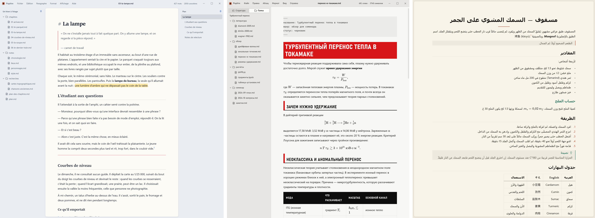
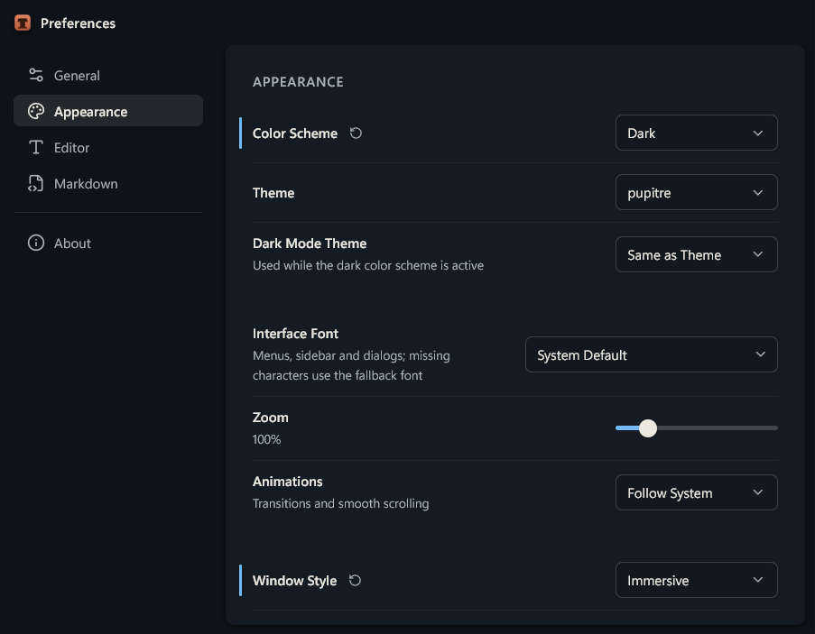

<p align="center">English | <a href="README.zh-CN.md">简体中文</a></p>

<p align="center">
  
</p>

<h1 align="center">Pupitre</h1>

<p align="center"><em>pupitre, French: the sloped desk where a professor lays out their notes before speaking.</em></p>

[](https://github.com/shalemore/pupitre/actions/workflows/ci.yml) [](LICENSE)



A cross-platform Markdown editor. Formatting is rendered while typing, and the syntax under the cursor stays visible and editable. [Try it in your browser](https://shalemore.github.io/pupitre/).

- **Everything renders.** GFM, front matter, GitHub alerts, math and chemistry formulas, Mermaid diagrams, footnotes, emoji, highlights, sub- and superscripts, and inline HTML.
- **Themes are CSS.** Each has a light and a dark side, and any two can be paired.

<p align="center">
  
</p>

## Install

Download it from [Releases](https://github.com/shalemore/pupitre/releases), or on Windows install it with [Scoop](https://scoop.sh):

```sh
scoop bucket add shalemore https://github.com/shalemore/scoop-bucket
scoop install pupitre
```

_The browser demo cannot open a folder, and a document is lost when the tab closes._

## Features

- Focus and typewriter modes
- Syntax highlighting in code blocks
- Right-to-left and mixed-direction text
- Classic and immersive window styles
- More than 30 interface languages

Help › Example Markdown Document shows what is supported and how to write a theme.

## License

[MIT](LICENSE)
