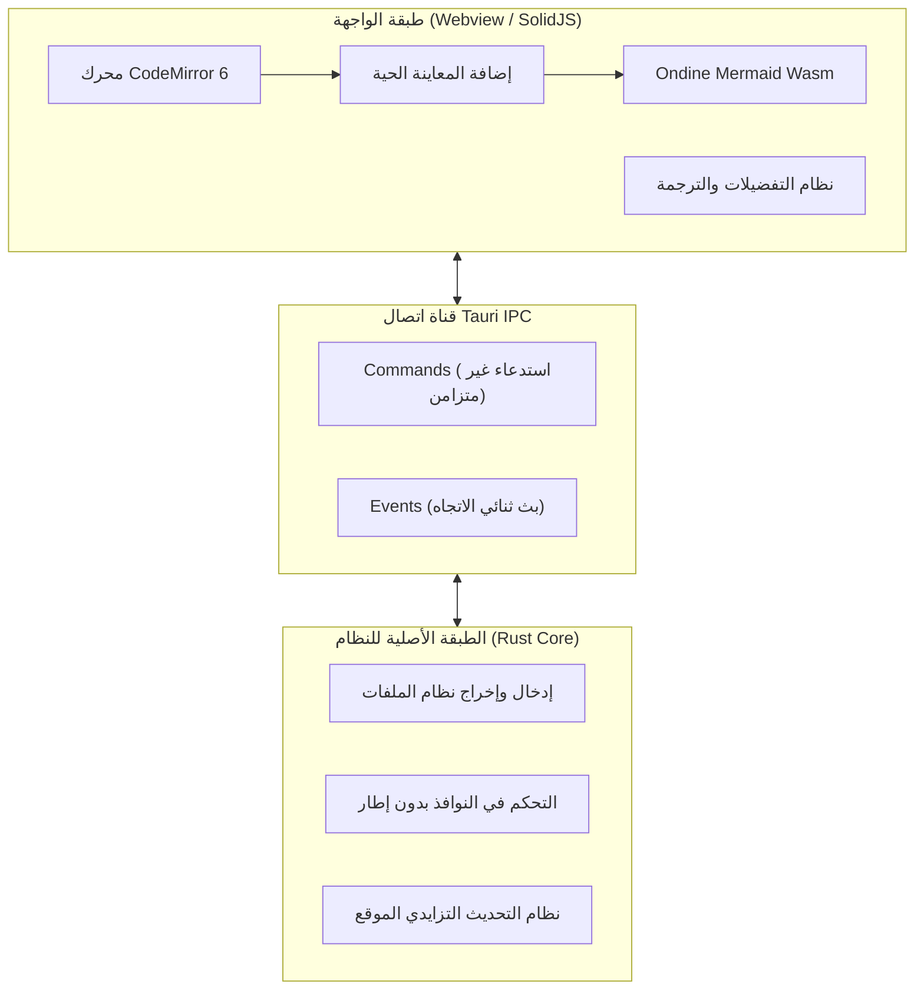
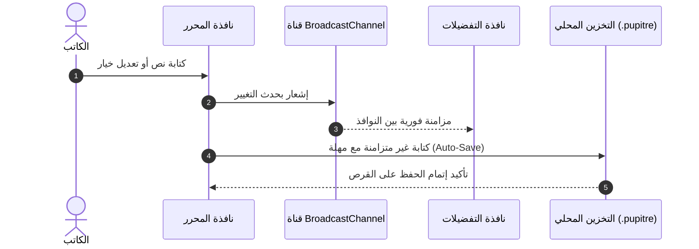

# 🪶 بوبيتر (Pupitre) - دليل محرر Markdown الممتع والبسيط

> **Pupitre** (كلمة فرنسية تعني _حامل النوتة الموسيقية_ أو _منصة الخطابة_) هو محرر Markdown لسطح المكتب، فائق السرعة والخفة، مبني على **Tauri v2 + SolidJS + CodeMirror 6**.
> مصمم خصيصاً لتوفير تجربة كتابة نقية وتنسيق طباعي مريح دون أي تشتيت.


---

> [!NOTE]
> **المعاينة المباشرة في نفس الموضع (In-place Live Preview)**: في Pupitre، تنطوي علامات تنسيق Markdown تلقائياً لتظهر النص المنسق بمجرد ابتعاد المؤشر. وعند تحرير السطر، تظهر العلامات فوراً في موضعها لتحرير سلس وطبيعي.

> [!TIP]
> الاختصارات الأساسية:
>
> - <kbd>Ctrl</kbd> + <kbd>S</kbd>: حفظ المستند الحالي
> - <kbd>Ctrl</kbd> + <kbd>O</kbd>: فتح ملف Markdown محلي
> - <kbd>Ctrl</kbd> + <kbd>B</kbd>: إظهار / إخفاء الشريط الجانبي للمخطط
> - <kbd>Ctrl</kbd> + <kbd>,</kbd>: فتح التفضيلات في أجزاء من الثانية

---

## ١. الطباعة والتنسيق المضمن (Typography & Styles)

يوفر Pupitre أثناء التدوين اليومي أنماطاً بصرية راقية وحركات انتقال سلسة:

- **نص عريض (Bold)**: يُكتب `**قوي وسريع**` ويظهر كـ **قوي وسريع**
- _نص مائل (Italic)_: يُكتب `*تدفق مريح*` ويظهر كـ _تدفق مريح_
- _**عريض ومائل (Bold & Italic)**_: يُكتب `***أفضل ما في الاثنين***` ويظهر كـ _**أفضل ما في الاثنين**_
- ~~نص مشطوب (Strikethrough)~~: يُكتب `~~ثقيل وقديم~~` ويظهر كـ ~~ثقيل وقديم~~
- كود مضمن: `const app = new Pupitre();`
- تنسيق مركب: **~~نص عريض مشطوب~~** أو _`شارة كود مائلة`_
- أزرار لوحة المفاتيح: <kbd>Ctrl</kbd> + <kbd>Shift</kbd> + <kbd>S</kbd> حفظ باسم
- روابط خارجية: [مستودع Pupitre على GitHub](https://github.com/shalemore/pupitre)

### اقتباسات متداخلة

> الأدوات الإبداعية العظيمة تشبه الهواء النقي: لا تشعر بها أثناء العمل، لكنها تمنحك التركيز والصفاء باستمرار.
>
> > —— "لا يتحقق الكمال عندما لا يتبقى شيء لتضيفه، بل عندما لا يتبقى شيء يمكنك حذفه."

---

## ٢. التسلسل الهرمي للعناوين (Headings)

يقوم بوبيتر بتحليل عناوين المستند تلقائياً لإنشاء مخطط تفاعلي متناسق في الشريط الجانبي:

### ٢.١ عنوان المستوى الثالث (H3) - فكرة فرعية أو تفصيل

#### ٢.١.١ عنوان المستوى الرابع (H4) - بند محدد

##### ٢.١.١.١ عنوان المستوى الخامس (H5) - ملاحظة توضيحية

###### ٢.١.١.١.١ عنوان المستوى السادس (H6) - تفصيل دقيق

---

## ٣. القوائم وقوائم المهام (Lists & Tasks)

### ٣.١ خطة تطوير الميزات

- [x] نواة أصلية فائقة السرعة مع **Rust + Tauri 2.0**
- [x] واجهة تفاعلية دقيقة مبنية بـ **SolidJS** (بدون عبء Virtual-DOM)
- [x] معمارية تحرير عصرية باستخدام **CodeMirror 6**
- [x] رسوم Mermaid البيانية المباشرة عبر **Ondine WebAssembly**
- [x] تحرير مرئي وتفاعلي لـ **جداول GFM**
- [x] تصميم **بدون إطار (Frameless)** وظلال نوافذ ناعمة
- [x] دعم أصلي لـ **١٢ لغة** ومزامنة المظهر الداكن/الفاتح
- [x] نظام تحديث رسمي مشفر وآمن **Auto-Updater**
- [ ] تصدير ملفات PDF عالية الدقة ومستندات HTML مستقلة
- [ ] روابط ثنائية الاتجاه ورسم بياني معرفي محلي

### ٣.٢ القوائم المتداخلة

1. مرحلة المسودة والأفكار
   - تدوين الأفكار العفوية كنص خام
   - إدراج مقاطع الشيفرة البرمجية
   - رسم المخططات الأولية
2. مرحلة المراجعة والتنقيح
   1. فحص تسلسل العناوين
   2. التحقق من المعادلات والمخططات
   3. حفظ التغييرات في نظام إدارة الإصدارات
3. مرحلة النشر والأرشفة

### ٣.٣ قوالب الشيفرة البرمجية المتداخلة ضمن القوائم

تدعم القوائم المرتبة إدراج كتل الشيفرة البرمجية مع المحاذاة الدقيقة:

1. سجّل الدخول وافتح قفل العميل، ثم انتظر اكتمال المزامنة.
2. قم بتفعيل **SSH Agent** وبيانات الاعتماد المحلية من التفضيلات.
3. اكتب إعدادات المفتاح العام للمطابقة التلقائية:

   ```powershell
   New-Item -ItemType Directory -Path $HOME\.ssh -Force | Out-Null
   Set-Content `
     -Path $HOME\.ssh\github-pupitre.pub `
     -Value 'ssh-ed25519 AAAAC3NzaC1lZDI1NTE5AAAAID3FhmdqRz1VHUTNHuAKBA1nchfD63/9NTQmwQkx7tC'
   ```

4. اختبر اتصال الطرفية بالخادم البعيد:

   ```powershell
   & "$env:WINDIR\System32\OpenSSH\ssh.exe" -T git@github.com
   ```

---

## ٤. جداول البيانات (GFM Tables)

يدعم Pupitre جداول GitHub Flavored Markdown بالكامل مع محاذاة الأعمدة:

| الميزة            |         محرر Pupitre         | محررات Electron التقليدية |     المفكرة الافتراضية |
| :---------------- | :--------------------------: | :-----------------------: | --------------------: |
| سرعة التشغيل      |  **أقل من ٣٠٠ مللي ثانية**   | ١٥٠٠ إلى ٣٠٠٠ مللي ثانية  | أقل من ١٠٠ مللي ثانية |
| استهلاك الذاكرة    | **حوالي ٣٥ إلى ٦٠ ميغابايت** |   ٢٠٠ إلى ٥٠٠ ميغابايت    |    أقل من ١٥ ميغابايت |
| المعاينة المباشرة | **في نفس الموضع (In-place)** |        شاشة منقسمة        |            نص خام فقط |
| محرك الرسوم       |    **Wasm Mermaid مدمج**     |    إضافات ثقيلة منفصلة    |             غير مدعوم |
| بيئة التشغيل      |     **Tauri 2.0 (Rust)**     |    متصفح Chromium كامل    |       نظام تشغيل محدد |
| مظهر النافذة      |   **نافذة طافية بلا إطار**    |        غير متناسق         |      إطار نظام تقليدي |

---

## ٥. مخططات Mermaid المعمارية والزمنية (Mermaid)

بفضل WebAssembly المدمج، تعمل رسوم Mermaid البيانية محلياً دون الحاجة لاتصال بالإنترنت:

### ٥.١ الهيكل التقني للنظام



### ٥.٢ تسلسل الحفظ التلقائي ومزامنة الإعدادات



---

## ٦. قوالب الشيفرة البرمجية مع التمييز اللوني

يحتوي كل قالب على شريط رأسي طافٍ يوضح اسم اللغة مع زر نسخ بنقرة واحدة:

### ٦.١ شيفرة Rust (تعريف أمر Tauri)

```rust
use tauri::{AppHandle, Manager};

#[tauri::command]
pub async fn open_settings_window(app: AppHandle) -> Result<(), String> {
    if let Some(win) = app.get_webview_window("settings") {
        let _ = win.unminimize();
        let _ = win.show();
        let _ = win.set_focus();
        return Ok(());
    }
    Ok(())
}
```

### ٦.٢ شيفرة TypeScript (حالة تفاعلية في SolidJS)

```typescript
import { createSignal, createMemo } from "solid-js";

export function useWordCount(content: () => string) {
  const stats = createMemo(() => {
    const text = content();
    const words = (text.match(/\S+/g) || []).length;
    const chars = text.length;
    return { words, chars };
  });

  return stats;
}
```

---

## ٧. المعادلات الرياضية والعلمية (KaTeX)

عرض رياضي عالي الدقة للمعادلات المضمنة والمستقلة:

- معادلة مضمنة: تكافؤ الكتلة والطاقة لأينشتاين $E = mc^2$، ومتطابقة أويلر $e^{i\pi} + 1 = 0$.
- معادلة مستقلة (التوزيع الطبيعي لغاوس وقانون ماكسويل-أمبير):

$$
f(x) = \frac{1}{\sigma \sqrt{2\pi}} \exp\left( -\frac{(x - \mu)^2}{2\sigma^2} \right)
$$

$$
\oint_C \mathbf{B} \cdot d\boldsymbol{\ell} = \mu_0 I_{\text{enc}} + \mu_0 \varepsilon_0 \frac{d\Phi_E}{dt}
$$

---

## ٨. الأقسام القابلة للطي (Collapsible Details)

<details>
<summary><b>🔍 انقر للتوسيع: جدول اختصارات Pupitre السريعة</b></summary>

| الإجراء        | اختصار Windows / Linux                            | اختصار macOS                                   |
| :------------ | :------------------------------------------------ | :--------------------------------------------- |
| مستند جديد    | <kbd>Ctrl</kbd> + <kbd>N</kbd>                    | <kbd>⌘</kbd> + <kbd>N</kbd>                    |
| فتح ملف       | <kbd>Ctrl</kbd> + <kbd>O</kbd>                    | <kbd>⌘</kbd> + <kbd>O</kbd>                    |
| حفظ المستند   | <kbd>Ctrl</kbd> + <kbd>S</kbd>                    | <kbd>⌘</kbd> + <kbd>S</kbd>                    |
| حفظ باسم      | <kbd>Ctrl</kbd> + <kbd>Shift</kbd> + <kbd>S</kbd> | <kbd>⌘</kbd> + <kbd>Shift</kbd> + <kbd>S</kbd> |
| بحث عن نص     | <kbd>Ctrl</kbd> + <kbd>F</kbd>                    | <kbd>⌘</kbd> + <kbd>F</kbd>                    |
| استبدال نص    | <kbd>Ctrl</kbd> + <kbd>H</kbd>                    | <kbd>⌥</kbd> + <kbd>⌘</kbd> + <kbd>F</kbd>     |
| تكبير / تصغير | <kbd>Ctrl</kbd> + <kbd>+</kbd> / <kbd>-</kbd>     | <kbd>⌘</kbd> + <kbd>+</kbd> / <kbd>-</kbd>     |
| التفضيلات      | <kbd>Ctrl</kbd> + <kbd>,</kbd>                    | <kbd>⌘</kbd> + <kbd>,</kbd>                    |

</details>

---

## ٩. الهوامش والخاتمة (Footnotes)

صُمم Pupitre ليكون رفيقك المخلص في المقالات والمدونات التقنية والمذكرات وتصميم الأنظمة البرمجية[^1].

نتمنى أن تتدفق أفكارك بحرية مطلقة تحت أطراف أصابعك.

[^1]: مشروع Pupitre مفتوح المصدر ومخصص لعشاق الكتابة النقية الخالية من التشتيت. نرحب باقتراحاتكم ومساهماتكم على GitHub!
