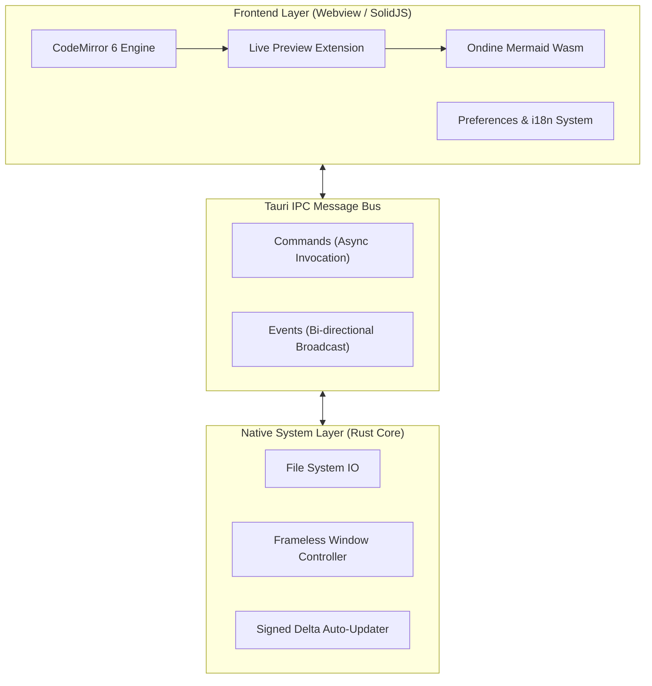
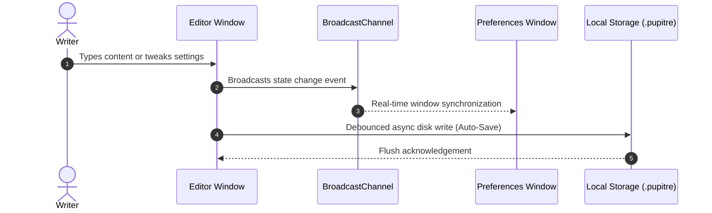

# 🪶 Pupitre - Immersive Minimalist Markdown Editor Guide

> **Pupitre** (French for _music stand_ or _lectern_) is a distraction-free, high-performance desktop Markdown editor built on **Tauri v2 + SolidJS + CodeMirror 6**.
> Designed for pure writing and effortless typographic flow.


---

> [!NOTE]
> **In-place Live Preview**: In Pupitre, Markdown syntax marks collapse smoothly into rendered typography when the cursor moves away. When editing a line, the raw syntax reveals itself in place for seamless, intuitive writing.

> [!TIP]
> Essential Shortcuts:
>
> - <kbd>Ctrl</kbd> + <kbd>S</kbd>: Save document
> - <kbd>Ctrl</kbd> + <kbd>O</kbd>: Open local Markdown file
> - <kbd>Ctrl</kbd> + <kbd>B</kbd>: Toggle Outline sidebar
> - <kbd>Ctrl</kbd> + <kbd>,</kbd>: Open Preferences in milliseconds

---

## 1. Typography & Inline Styles

Pupitre delivers refined typographic styling with smooth micro-interactions:

- **Bold emphasis**: `**reliable & fast**` renders as **reliable & fast**
- _Italic emphasis_: `*graceful workflow*` renders as _graceful workflow_
- _**Bold & Italic**_: `***the best of both***` renders as _**the best of both**_
- ~~Strikethrough~~: `~~bloated legacy~~` renders as ~~bloated legacy~~
- Inline code: `const editor = new Pupitre();`
- Combined formatting: **~~bold and struck through~~** or _`italicized code badge`_
- Keyboard key styling: <kbd>Ctrl</kbd> + <kbd>Shift</kbd> + <kbd>S</kbd> Save As
- Hyperlinks: [Pupitre GitHub Repository](https://github.com/shalemore/pupitre)

### Nested Blockquote Demo

> Great creative tools feel like clean air: imperceptible in moment-to-moment thought, yet sustaining your focus and creativity.
>
> > — "Perfection is achieved not when there is nothing more to add, but when there is nothing left to take away."

---

## 2. Heading Hierarchy (H1 to H6)

Pupitre dynamically parses document headings and renders a nested outline in the left sidebar:

### 2.1 Level 3 Heading (H3) - Functional Modules

#### 2.1.1 Level 4 Heading (H4) - Topic Specifications

##### 2.1.1.1 Level 5 Heading (H5) - Supplemental Guidance

###### 2.1.1.1.1 Level 6 Heading (H6) - Leaf-level Annotations

---

## 3. Lists & Task Checklists

### 3.1 Feature Development Roadmap

- [x] Lightweight **Rust + Tauri 2.0** desktop backend core
- [x] Fine-grained **SolidJS** reactive UI (0 virtual-DOM overhead)
- [x] Modern **CodeMirror 6** live-preview document model
- [x] Built-in **Ondine WebAssembly** instant Mermaid diagrams
- [x] **GFM Interactive Tables** with visual live editing
- [x] **Frameless design** with native window shadows & custom controls
- [x] Native **12-locale internationalization** with auto dark/light theme
- [x] Cryptographically signed **Auto-Updater** pipeline
- [ ] Export to clean standalone HTML & high-fidelity PDF
- [ ] Local bidirectional document linking and graph view

### 3.2 Nested Ordered & Unordered Lists

1. Drafting Phase
   - Capture fleeting concepts in plain text
   - Insert key source code snippets
   - Sketch architecture flows
2. Revision & Polishing Phase
   1. Check hierarchy and outline clarity
   2. Verify equations and diagram accuracy
   3. Commit changes to version control
3. Archival & Distribution Phase

### 3.3 Indented Code Blocks in Lists

Technical documentation and step-by-step guides support nested code blocks inside list items:

1. Log in and unlock the client, waiting for synchronization to finish.
2. Enable **SSH Agent** and local credentials in system preferences.
3. Write public key configuration for seamless authentication:

   ```powershell
   New-Item -ItemType Directory -Path $HOME\.ssh -Force | Out-Null
   Set-Content `
     -Path $HOME\.ssh\github-pupitre.pub `
     -Value 'ssh-ed25519 AAAAC3NzaC1lZDI1NTE5AAAAID3FhmdqRz1VHUTNHuAKBA1nchfD63/9NTQmwQkx7tC'
   ```

4. Test terminal SSH connectivity:

   ```powershell
   & "$env:WINDIR\System32\OpenSSH\ssh.exe" -T git@github.com
   ```

---

## 4. GFM Data Tables

Pupitre provides full GitHub Flavored Markdown (GFM) table support with column alignment:

| Capability       |        Pupitre Editor         | Traditional Electron Editor |   Native Notepad |
| :--------------- | :---------------------------: | :-------------------------: | ---------------: |
| Cold Launch Time |         **< 300 ms**          |       1500 ~ 3000 ms        |         < 100 ms |
| Working Memory   |        **~35 - 60 MB**        |        200 - 500 MB         |          < 15 MB |
| Live Preview     |       **In-place Flow**       |      Dual split panes       |  Plain text only |
| Diagram Engine   |   **Built-in Wasm Mermaid**   |   Heavy external plugins    |      Unsupported |
| Runtime Stack    |     **Tauri 2.0 (Rust)**      |   Chromium Browser Engine   |     OS-exclusive |
| Window Esthetics | **Frameless Floating Shadow** |        Inconsistent         | Native OS border |

---

## 5. Mermaid Architecture & Sequence Diagrams

Powered by embedded WebAssembly, Mermaid diagrams compile and render instantaneously right in your document:

### 5.1 Architecture Overview



### 5.2 Auto-Save & Config Sync Sequence



---

## 6. Syntax-Highlighted Code Blocks

Each fenced block features a floating header with language badge and a one-click copy button:

### 6.1 Rust (Tauri Command Example)

```rust
use tauri::{AppHandle, Manager};

#[tauri::command]
pub async fn open_settings_window(app: AppHandle) -> Result<(), String> {
    if let Some(win) = app.get_webview_window("settings") {
        let _ = win.unminimize();
        let _ = win.show();
        let _ = win.set_focus();
        return Ok(());
    }
    Ok(())
}
```

### 6.2 TypeScript (SolidJS Reactive State)

```typescript
import { createSignal, createMemo } from "solid-js";

export function useWordCount(content: () => string) {
  const stats = createMemo(() => {
    const text = content();
    const words = (text.match(/\S+/g) || []).length;
    const chars = text.length;
    return { words, chars };
  });

  return stats;
}
```

---

## 7. Mathematical Expressions (KaTeX)

Both inline and display equations are rendered with crisp mathematical typography:

- Inline formulas: Einstein's mass-energy equivalence $E = mc^2$, and Euler's formula $e^{i\pi} + 1 = 0$.
- Display formula (Gaussian Normal Distribution & Maxwell-Ampère Law):

$$
f(x) = \frac{1}{\sigma \sqrt{2\pi}} \exp\left( -\frac{(x - \mu)^2}{2\sigma^2} \right)
$$

$$
\oint_C \mathbf{B} \cdot d\boldsymbol{\ell} = \mu_0 I_{\text{enc}} + \mu_0 \varepsilon_0 \frac{d\Phi_E}{dt}
$$

---

## 8. Interactive Collapsible Sections

<details>
<summary><b>🔍 Click to expand: Pupitre Shortcuts Quick Reference</b></summary>

| Action        | Windows / Linux Shortcut                          | macOS Shortcut                                 |
| :------------ | :------------------------------------------------ | :--------------------------------------------- |
| New Document  | <kbd>Ctrl</kbd> + <kbd>N</kbd>                    | <kbd>⌘</kbd> + <kbd>N</kbd>                    |
| Open File     | <kbd>Ctrl</kbd> + <kbd>O</kbd>                    | <kbd>⌘</kbd> + <kbd>O</kbd>                    |
| Save File     | <kbd>Ctrl</kbd> + <kbd>S</kbd>                    | <kbd>⌘</kbd> + <kbd>S</kbd>                    |
| Save As       | <kbd>Ctrl</kbd> + <kbd>Shift</kbd> + <kbd>S</kbd> | <kbd>⌘</kbd> + <kbd>Shift</kbd> + <kbd>S</kbd> |
| Find Text     | <kbd>Ctrl</kbd> + <kbd>F</kbd>                    | <kbd>⌘</kbd> + <kbd>F</kbd>                    |
| Replace Text  | <kbd>Ctrl</kbd> + <kbd>H</kbd>                    | <kbd>⌥</kbd> + <kbd>⌘</kbd> + <kbd>F</kbd>     |
| Zoom In / Out | <kbd>Ctrl</kbd> + <kbd>+</kbd> / <kbd>-</kbd>     | <kbd>⌘</kbd> + <kbd>+</kbd> / <kbd>-</kbd>     |
| Preferences   | <kbd>Ctrl</kbd> + <kbd>,</kbd>                    | <kbd>⌘</kbd> + <kbd>,</kbd>                    |

</details>

---

## 9. Footnotes & Acknowledgements

Pupitre is crafted to accompany your essays, system designs, daily journals, and research notes[^1].

May your thoughts flow unhindered at the speed of thought.

[^1]: Pupitre is an open-source project dedicated to pure, distraction-free writing. Feel free to contribute or file suggestions on GitHub!
