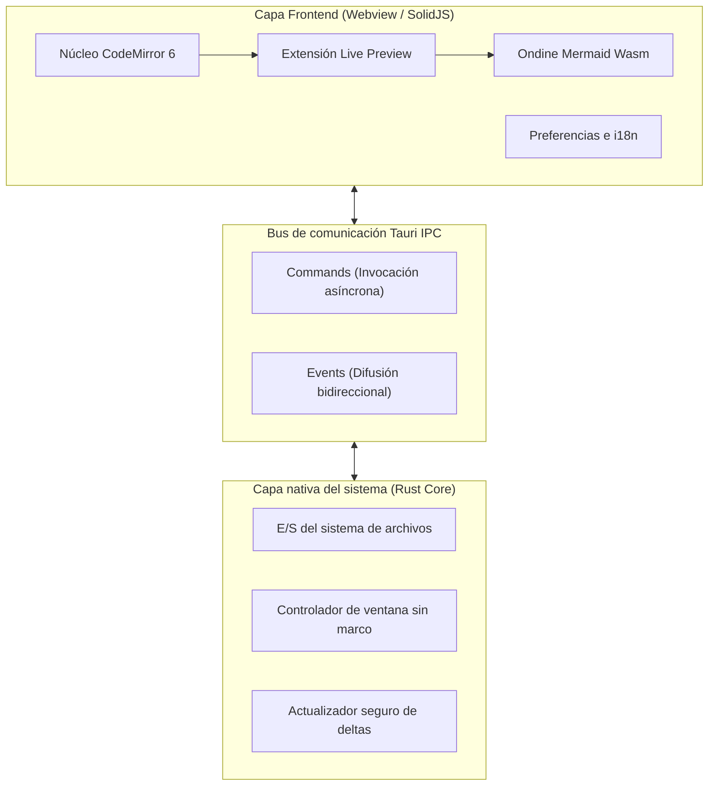
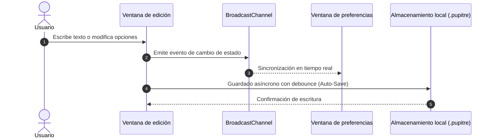

# 🪶 Pupitre - Guía del editor Markdown minimalista e inmersivo

> **Pupitre** (del francés _atril_ o _pupitre_) es un editor Markdown de escritorio ágil, ligero y libre de distracciones, desarrollado con **Tauri v2 + SolidJS + CodeMirror 6**.
> Diseñado exclusivamente para la escritura pura y una tipografía impecable.


---

> [!NOTE]
> **Vista previa interactiva en el lugar (In-place Live Preview)**: En Pupitre, las marcas de sintaxis de Markdown se contraen suavemente al alejar el cursor para mostrar un diseño impecable. Al colocar el cursor en la línea, la sintaxis reaparece al instante para editar de manera natural y sin fricciones.

> [!TIP]
> Atajos de teclado esenciales:
>
> - <kbd>Ctrl</kbd> + <kbd>S</kbd>: Guardar documento actual
> - <kbd>Ctrl</kbd> + <kbd>O</kbd>: Abrir archivo Markdown local
> - <kbd>Ctrl</kbd> + <kbd>B</kbd>: Alternar barra lateral de esquema
> - <kbd>Ctrl</kbd> + <kbd>,</kbd>: Abrir Preferencias al instante

---

## 1. Tipografía y formatos de texto (Typography & Styles)

Durante la redacción diaria, Pupitre ofrece estilos elegantes y microinteracciones fluidas:

- **Énfasis en negrita (Bold)**: `**sólido y veloz**` se muestra como **sólido y veloz**
- _Énfasis en cursiva (Italic)_: `*flujo agradable*` se muestra como _flujo agradable_
- _**Negrita y cursiva (Bold & Italic)**_: `***lo mejor de ambos***` se muestra como _**lo mejor de ambos**_
- ~~Tachado (Strikethrough)~~: `~~pesado y obsoleto~~` se muestra como ~~pesado y obsoleto~~
- Código en línea: `const app = new Pupitre();`
- Formato combinado: **~~texto en negrita tachado~~** o _`etiqueta de código en cursiva`_
- Teclas de teclado: <kbd>Ctrl</kbd> + <kbd>Shift</kbd> + <kbd>S</kbd> Guardar como
- Enlaces web: [Repositorio GitHub de Pupitre](https://github.com/shalemore/pupitre)

### Ejemplo de citas anidadas

> Las grandes herramientas se sienten como el aire limpio: imperceptibles durante la tarea cotidiana, pero impulsando tu creatividad y concentración constante.
>
> > —— "La perfección no se alcanza cuando no hay nada más que añadir, sino cuando no queda nada más que quitar."

---

## 2. Jerarquía de encabezados (Heading Hierarchy)

Pupitre analiza todos los encabezados del documento y genera un esquema jerárquico dinámico en la barra lateral:

### 2.1 Encabezado nivel 3 (H3) - Módulos funcionales

#### 2.1.1 Encabezado nivel 4 (H4) - Detalles específicos

##### 2.1.1.1 Encabezado nivel 5 (H5) - Guía complementaria

###### 2.1.1.1.1 Encabezado nivel 6 (H6) - Anotación mínima

---

## 3. Listas y listas de tareas (Lists & Tasks)

### 3.1 Hoja de ruta de desarrollo de funciones

- [x] Núcleo nativo ultrarrápido con **Rust + Tauri 2.0**
- [x] Interfaz reactiva con **SolidJS** (cero sobrecarga de Virtual-DOM)
- [x] Arquitectura de edición moderna con **CodeMirror 6**
- [x] Diagramas Mermaid compilados al instante mediante **Ondine WebAssembly**
- [x] Edición visual en tiempo real de **Tablas interactivas GFM**
- [x] Diseño **sin marco (Frameless)** con sombras de ventana elegantes
- [x] Soporte nativo para **12 idiomas** y modo oscuro/claro automático
- [x] Actualizador seguro oficial **Auto-Updater** con firmas criptográficas
- [ ] Exportación a PDF de alta resolución y HTML limpio
- [ ] Enlaces bidireccionales y gráfico de conocimiento local

### 3.2 Listas ordenadas y desordenadas anidadas

1. Fase de borrador e inspiración
   - Capturar ideas espontáneas en texto plano
   - Adjuntar fragmentos de código relevantes
   - Esbozar diagramas de arquitectura
2. Fase de revisión y corrección
   1. Comprobar la coherencia del esquema
   2. Validar fórmulas matemáticas y diagramas
   3. Confirmar cambios en el control de versiones
3. Fase de publicación y archivo

### 3.3 Bloques de código indentados en listas

Las guías paso a paso admiten bloques de código anidados dentro de los elementos de lista:

1. Inicie sesión y desbloquee el cliente, esperando a que finalice la sincronización.
2. Habilite **SSH Agent** y las credenciales locales en las preferencias del sistema.
3. Escriba la configuración de clave pública para una autenticación fluida:

   ```powershell
   New-Item -ItemType Directory -Path $HOME\.ssh -Force | Out-Null
   Set-Content `
     -Path $HOME\.ssh\github-pupitre.pub `
     -Value 'ssh-ed25519 AAAAC3NzaC1lZDI1NTE5AAAAID3FhmdqRz1VHUTNHuAKBA1nchfD63/9NTQmwQkx7tC'
   ```

4. Pruebe la conectividad del terminal:

   ```powershell
   & "$env:WINDIR\System32\OpenSSH\ssh.exe" -T git@github.com
   ```

---

## 4. Tablas de datos GFM (GFM Tables)

Pupitre incluye compatibilidad total con tablas GitHub Flavored Markdown y alineación de columnas:

| Característica           |       Editor Pupitre       | Editores Electron clásicos | Bloc de notas del SO |
| :----------------------- | :------------------------: | :------------------------: | -------------------: |
| Tiempo de inicio en frío |        **< 300 ms**        |       1500 ~ 3000 ms       |             < 100 ms |
| Consumo de memoria       |      **~35 a 60 MB**       |        200 a 500 MB        |              < 15 MB |
| Vista previa             | **En el lugar (In-place)** |     Pantalla dividida      |     Solo texto plano |
| Motor de diagramas       |  **Wasm Mermaid nativo**   |   Dependiente de plugins   |          Sin soporte |
| Entorno de ejecución     |    **Tauri 2.0 (Rust)**    |   Motor Chromium pesado    |   Exclusivo de un SO |
| Estética de ventana      |  **Flotante sin marcos**   |          Desigual          |    Marco tradicional |

---

## 5. Diagramas de arquitectura y secuencia Mermaid (Mermaid)

Gracias a WebAssembly integrado, los diagramas Mermaid se procesan localmente sin depender de internet:

### 5.1 Arquitectura del sistema



### 5.2 Secuencia de autoguardado y sincronización



---

## 6. Bloques de código con resaltado de sintaxis

Cada bloque incluye una cabecera flotante con la etiqueta del lenguaje y un botón de copia rápida:

### 6.1 Rust (Ejemplo de comando Tauri)

```rust
use tauri::{AppHandle, Manager};

#[tauri::command]
pub async fn open_settings_window(app: AppHandle) -> Result<(), String> {
    if let Some(win) = app.get_webview_window("settings") {
        let _ = win.unminimize();
        let _ = win.show();
        let _ = win.set_focus();
        return Ok(());
    }
    Ok(())
}
```

### 6.2 TypeScript (Estado reactivo en SolidJS)

```typescript
import { createSignal, createMemo } from "solid-js";

export function useWordCount(content: () => string) {
  const stats = createMemo(() => {
    const text = content();
    const words = (text.match(/\S+/g) || []).length;
    const chars = text.length;
    return { words, chars };
  });

  return stats;
}
```

---

## 7. Fórmulas matemáticas y notación científica (KaTeX)

Renderizado matemático nítido tanto en línea como en bloques independientes:

- Fórmula en línea: La conocida relación masa-energía $E = mc^2$, y la identidad de Euler $e^{i\pi} + 1 = 0$.
- Fórmula en bloque (Distribución normal de Gauss y Ley de Maxwell-Ampère):

$$
f(x) = \frac{1}{\sigma \sqrt{2\pi}} \exp\left( -\frac{(x - \mu)^2}{2\sigma^2} \right)
$$

$$
\oint_C \mathbf{B} \cdot d\boldsymbol{\ell} = \mu_0 I_{\text{enc}} + \mu_0 \varepsilon_0 \frac{d\Phi_E}{dt}
$$

---

## 8. Secciones desplegables interactivas (Collapsible Details)

<details>
<summary><b>🔍 Haz clic para desplegar: Atajos de teclado de Pupitre</b></summary>

| Acción                | Atajo en Windows / Linux                          | Atajo en macOS                                 |
| :-------------------- | :------------------------------------------------ | :--------------------------------------------- |
| Nuevo documento       | <kbd>Ctrl</kbd> + <kbd>N</kbd>                    | <kbd>⌘</kbd> + <kbd>N</kbd>                    |
| Abrir archivo         | <kbd>Ctrl</kbd> + <kbd>O</kbd>                    | <kbd>⌘</kbd> + <kbd>O</kbd>                    |
| Guardar documento     | <kbd>Ctrl</kbd> + <kbd>S</kbd>                    | <kbd>⌘</kbd> + <kbd>S</kbd>                    |
| Guardar como          | <kbd>Ctrl</kbd> + <kbd>Shift</kbd> + <kbd>S</kbd> | <kbd>⌘</kbd> + <kbd>Shift</kbd> + <kbd>S</kbd> |
| Buscar texto          | <kbd>Ctrl</kbd> + <kbd>F</kbd>                    | <kbd>⌘</kbd> + <kbd>F</kbd>                    |
| Reemplazar texto      | <kbd>Ctrl</kbd> + <kbd>H</kbd>                    | <kbd>⌥</kbd> + <kbd>⌘</kbd> + <kbd>F</kbd>     |
| Zoom acercar / alejar | <kbd>Ctrl</kbd> + <kbd>+</kbd> / <kbd>-</kbd>     | <kbd>⌘</kbd> + <kbd>+</kbd> / <kbd>-</kbd>     |
| Preferencias          | <kbd>Ctrl</kbd> + <kbd>,</kbd>                    | <kbd>⌘</kbd> + <kbd>,</kbd>                    |

</details>

---

## 9. Notas al pie y despedida (Footnotes)

Pupitre te acompañará en artículos, blogs de ingeniería, anotaciones diarias y diseños de arquitectura de software[^1].

Que tus ideas fluyan libremente al ritmo de tus pensamientos.

[^1]: Pupitre es un proyecto de código abierto dedicado a los amantes de la escritura fluida. ¡Te invitamos a contribuir o proponer mejoras en GitHub!
