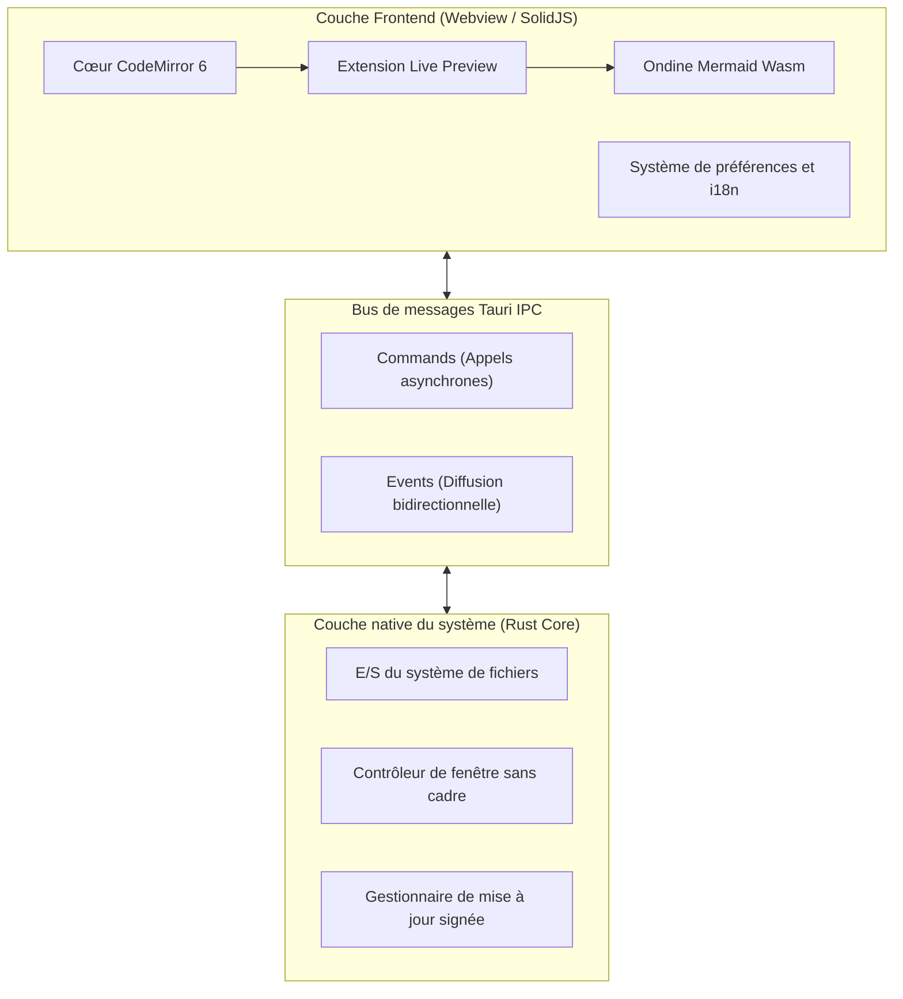
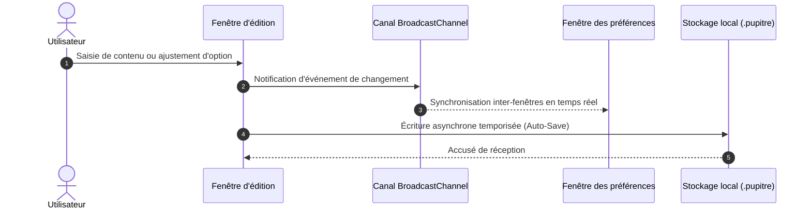

# 🪶 Pupitre - Guide de l'éditeur Markdown minimaliste et immersif

> **Pupitre** (du français _pupitre d'orchestre_ ou _lutrin_) est un éditeur Markdown de bureau, léger, rapide et épuré, propulsé par **Tauri v2 + SolidJS + CodeMirror 6**.
> Conçu exclusivement pour la rédaction pure et l'élégance typographique.


---

> [!NOTE]
> **Aperçu direct sur place (In-place Live Preview)** : Dans Pupitre, les balises Markdown s'effacent avec fluidité pour révéler un rendu soigné lorsque le curseur s'éloigne. Dès que le curseur revient sur une ligne, la syntaxe réapparaît sur place pour une édition intuitive et sans friction.

> [!TIP]
> Raccourcis indispensables :
>
> - <kbd>Ctrl</kbd> + <kbd>S</kbd> : Enregistrer le document
> - <kbd>Ctrl</kbd> + <kbd>O</kbd> : Ouvrir un fichier Markdown local
> - <kbd>Ctrl</kbd> + <kbd>B</kbd> : Afficher / masquer le volet latéral du plan
> - <kbd>Ctrl</kbd> + <kbd>,</kbd> : Ouvrir les Préférences instantanément

---

## 1. Typographie et formats de texte (Typography & Styles)

Au fil de votre écriture, Pupitre offre des styles impeccables et des micro-animations discrètes :

- **Mise en gras (Bold)** : `**robuste et réactif**` s'affiche comme **robuste et réactif**
- _Mise en italique (Italic)_ : `*flux agréable*` s'affiche comme _flux agréable_
- _**Gras et italique (Bold & Italic)**_ : `***le meilleur des deux***` s'affiche comme _**le meilleur des deux**_
- ~~Texte barré (Strikethrough)~~ : `~~lourd et désuet~~` s'affiche comme ~~lourd et désuet~~
- Code en ligne (Inline Code) : `const app = new Pupitre();`
- Formats combinés : **~~texte en gras barré~~** ou _`badge de code en italique`_
- Touches de clavier : <kbd>Ctrl</kbd> + <kbd>Shift</kbd> + <kbd>S</kbd> Enregistrer sous
- Liens hypertextes : [Dépôt GitHub officiel de Pupitre](https://github.com/shalemore/pupitre)

### Exemple de citations imbriquées

> Les grands outils de création sont comparables à l'air pur : invisibles à l'esprit pendant le travail, mais décuplant votre concentration.
>
> > —— « La perfection est atteinte non pas lorsqu'il n'y a plus rien à ajouter, mais lorsqu'il n'y a plus rien à retirer. »

---

## 2. Hiérarchie des titres (Heading Hierarchy)

Pupitre analyse dynamiquement les titres du document et génère un plan arborescent en temps réel dans la barre latérale :

### 2.1 Titre niveau 3 (H3) - Modules fonctionnels

#### 2.1.1 Titre niveau 4 (H4) - Spécifications détaillées

##### 2.1.1.1 Titre niveau 5 (H5) - Conseils complémentaires

###### 2.1.1.1.1 Titre niveau 6 (H6) - Annotations terminales

---

## 3. Listes et listes de tâches (Lists & Tasks)

### 3.1 Feuille de route des fonctionnalités

- [x] Cœur natif ultraléger propulsé par **Rust + Tauri 2.0**
- [x] Interface réactive avec **SolidJS** (0 recalcul de DOM virtuel)
- [x] Architecture d'édition moderne avec **CodeMirror 6**
- [x] Diagrammes Mermaid compilés instantanément grâce à **Ondine WebAssembly**
- [x] Édition visuelle et interactive de **Tableaux GFM**
- [x] Design **sans cadre (Frameless)** avec ombre portée soignée
- [x] Prise en charge native de **12 langues** et thèmes sombre / clair automatiques
- [x] Système d'installation et de mise à jour officiel **Auto-Updater** signé
- [ ] Exportation vers des fichiers PDF haute définition et HTML autonome
- [ ] Liens bidirectionnels locaux et graphe de connaissances

### 3.2 Listes ordonnées et non ordonnées imbriquées

1. Phase de rédaction initiale
   - Noter les inspirations fugaces en texte brut
   - Intégrer les fragments de code essentiels
   - Ébaucher les schémas d'architecture
2. Phase de relecture et mise au point
   1. Vérifier la cohérence du plan
   2. Valider les formules scientifiques et diagrammes
   3. Sauvegarder dans le gestionnaire de versions
3. Phase de publication et d'archivage

### 3.3 Blocs de code indentés dans les listes

Les guides par étapes prennent en charge les blocs de code imbriqués dans les éléments de liste :

1. Connectez-vous et déverrouillez le client, en attendant la fin de la synchronisation.
2. Activez **SSH Agent** et les identifiants locaux dans les préférences.
3. Enregistrez la configuration de clé publique pour une authentification transparente :

   ```powershell
   New-Item -ItemType Directory -Path $HOME\.ssh -Force | Out-Null
   Set-Content `
     -Path $HOME\.ssh\github-pupitre.pub `
     -Value 'ssh-ed25519 AAAAC3NzaC1lZDI1NTE5AAAAID3FhmdqRz1VHUTNHuAKBA1nchfD63/9NTQmwQkx7tC'
   ```

4. Testez la connectivité du terminal :

   ```powershell
   & "$env:WINDIR\System32\OpenSSH\ssh.exe" -T git@github.com
   ```

---

## 4. Tableaux de données GFM (GFM Tables)

Pupitre prend en charge la syntaxe GitHub Flavored Markdown et l'alignement des colonnes :

| Critères                 |        Éditeur Pupitre        | Éditeurs Electron classiques |       Bloc-notes système |
| :----------------------- | :---------------------------: | :--------------------------: | -----------------------: |
| Démarrage à froid        |         **< 300 ms**          |        1500 à 3000 ms        |                 < 100 ms |
| Mémoire vive             |        **~35 à 60 Mo**        |         200 à 500 Mo         |                  < 15 Mo |
| Rendu direct             |   **Sur place (In-place)**    |     Double écran scindé      |    Texte brut uniquement |
| Moteur de diagrammes     |   **Mermaid Wasm intégré**    |   Plugins externes lourds    |       Non pris en charge |
| Plateforme d'exécution   |     **Tauri 2.0 (Rust)**      |   Moteur Chromium complet    |       Dédié à un seul OS |
| Esthétique de la fenêtre | **Design sans bordure épuré** |           Variable           | Bordure native classique |

---

## 5. Diagrammes Mermaid d'architecture et de séquence (Mermaid)

Grâce à WebAssembly, les diagrammes Mermaid sont calculés et affichés sans connexion réseau :

### 5.1 Architecture globale du logiciel



### 5.2 Séquence d'enregistrement automatique et de synchronisation



---

## 6. Blocs de code avec coloration syntaxique

Chaque bloc est surmonté d'un en-tête flottant avec le badge du langage et un bouton de copie rapide :

### 6.1 Rust (Exemple de commande Tauri)

```rust
use tauri::{AppHandle, Manager};

#[tauri::command]
pub async fn open_settings_window(app: AppHandle) -> Result<(), String> {
    if let Some(win) = app.get_webview_window("settings") {
        let _ = win.unminimize();
        let _ = win.show();
        let _ = win.set_focus();
        return Ok(());
    }
    Ok(())
}
```

### 6.2 TypeScript (État réactif SolidJS)

```typescript
import { createSignal, createMemo } from "solid-js";

export function useWordCount(content: () => string) {
  const stats = createMemo(() => {
    const text = content();
    const words = (text.match(/\S+/g) || []).length;
    const chars = text.length;
    return { words, chars };
  });

  return stats;
}
```

---

## 7. Formules mathématiques et scientifiques (KaTeX)

Rendu typographique haute définition des équations en ligne et en bloc autonome :

- Formule en ligne : La célèbre équivalence masse-énergie $E = mc^2$, et la formule d'Euler $e^{i\pi} + 1 = 0$.
- Formule en bloc (Loi normale de Gauss et équation de Maxwell-Ampère) :

$$
f(x) = \frac{1}{\sigma \sqrt{2\pi}} \exp\left( -\frac{(x - \mu)^2}{2\sigma^2} \right)
$$

$$
\oint_C \mathbf{B} \cdot d\boldsymbol{\ell} = \mu_0 I_{\text{enc}} + \mu_0 \varepsilon_0 \frac{d\Phi_E}{dt}
$$

---

## 8. Sections dépliantes interactives (Collapsible Details)

<details>
<summary><b>🔍 Cliquez pour afficher : Raccourcis clavier de Pupitre</b></summary>

| Action               | Raccourci Windows / Linux                         | Raccourci macOS                                |
| :------------------- | :------------------------------------------------ | :--------------------------------------------- |
| Nouveau document     | <kbd>Ctrl</kbd> + <kbd>N</kbd>                    | <kbd>⌘</kbd> + <kbd>N</kbd>                    |
| Ouvrir un fichier    | <kbd>Ctrl</kbd> + <kbd>O</kbd>                    | <kbd>⌘</kbd> + <kbd>O</kbd>                    |
| Enregistrer          | <kbd>Ctrl</kbd> + <kbd>S</kbd>                    | <kbd>⌘</kbd> + <kbd>S</kbd>                    |
| Enregistrer sous     | <kbd>Ctrl</kbd> + <kbd>Shift</kbd> + <kbd>S</kbd> | <kbd>⌘</kbd> + <kbd>Shift</kbd> + <kbd>S</kbd> |
| Rechercher du texte  | <kbd>Ctrl</kbd> + <kbd>F</kbd>                    | <kbd>⌘</kbd> + <kbd>F</kbd>                    |
| Remplacer du texte   | <kbd>Ctrl</kbd> + <kbd>H</kbd>                    | <kbd>⌥</kbd> + <kbd>⌘</kbd> + <kbd>F</kbd>     |
| Zoom avant / arrière | <kbd>Ctrl</kbd> + <kbd>+</kbd> / <kbd>-</kbd>     | <kbd>⌘</kbd> + <kbd>+</kbd> / <kbd>-</kbd>     |
| Préférences          | <kbd>Ctrl</kbd> + <kbd>,</kbd>                    | <kbd>⌘</kbd> + <kbd>,</kbd>                    |

</details>

---

## 9. Notes de bas de page et conclusion (Footnotes)

Pupitre est façonné pour accompagner vos essais, vos articles d'ingénierie, vos notes quotidiennes et vos architectures logicielles[^1].

Que votre pensée s'exprime en toute liberté au bout de vos doigts.

[^1]: Pupitre est un projet open-source conçu pour les amoureux d'écriture pure et sans distraction. N'hésitez pas à proposer des améliorations sur GitHub !
