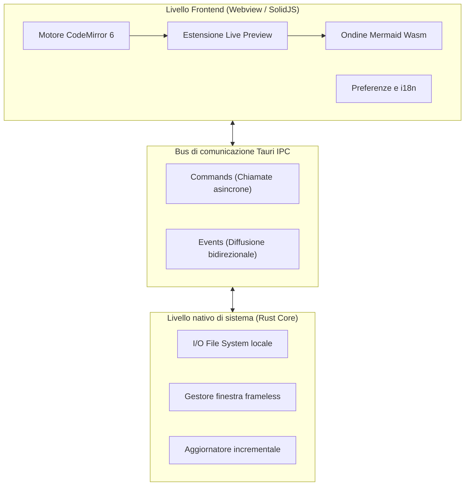
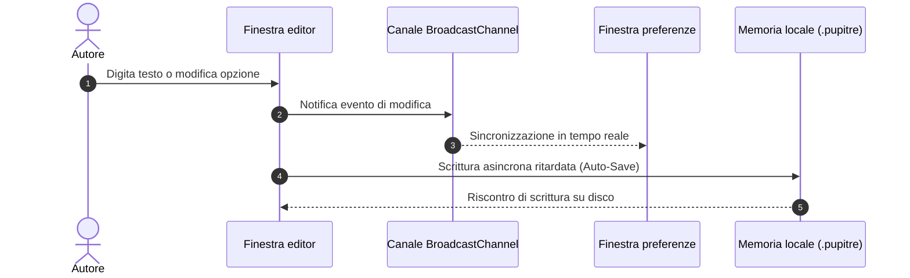

# 🪶 Pupitre - Guida all'editor Markdown minimalista e immersivo

> **Pupitre** (dal francese _leggio_ o _pulpito_) è un editor Markdown desktop leggero, scattante e privo di distrazioni, sviluppato su **Tauri v2 + SolidJS + CodeMirror 6**.
> Creato esclusivamente per la scrittura pura e un'esperienza tipografica senza compromessi.

---

> [!NOTE]
> **Anteprima sul posto in tempo reale (In-place Live Preview)**: In Pupitre, i simboli della sintassi Markdown si richiudono automaticamente mostrando la formattazione quando il cursore si allontana. Spostando il cursore sulla riga, la sintassi si riapre sul posto per una modifica naturale e immediata.

> [!TIP]
> Scorciatoie essenziali:
>
> - <kbd>Ctrl</kbd> + <kbd>S</kbd>: Salva il documento corrente
> - <kbd>Ctrl</kbd> + <kbd>O</kbd>: Apri file Markdown locale
> - <kbd>Ctrl</kbd> + <kbd>B</kbd>: Mostra/Nascondi la struttura laterale
> - <kbd>Ctrl</kbd> + <kbd>,</kbd>: Apri le Preferenze in un istante

---

## 1. Tipografia e formattazione del testo (Typography & Styles)

Durante la stesura, Pupitre garantisce stili armoniosi e transizioni morbide:

- **Grassetto (Bold)**: `**robusto e scattante**` appare come **robusto e scattante**
- _Corsivo (Italic)_: `*flusso piacevole*` appare come _flusso piacevole_
- _**Grassetto e corsivo (Bold & Italic)**_: `***il meglio di entrambi***` appare come _**il meglio di entrambi**_
- ~~Barrato (Strikethrough)~~: `~~pesante e obsoleto~~` appare come ~~pesante e obsoleto~~
- Codice in linea (Inline Code): `const app = new Pupitre();`
- Formattazioni combinate: **~~testo in grassetto barrato~~** oppure _`badge di codice in corsivo`_
- Tasti di scelta rapida: <kbd>Ctrl</kbd> + <kbd>Shift</kbd> + <kbd>S</kbd> Salva con nome
- Collegamento esterno: [Repository GitHub ufficiale di Pupitre](https://github.com/shalemore/pupitre)

### Dimostrazione citazioni nidificate

> I grandi strumenti sono come l'aria limpida: impercettibili mentre lavori, ma capaci di sostenere in silenzio la tua concentrazione.
>
> > —— "La perfezione si ottiene non quando non c'è più nulla da aggiungere, ma quando non c'è più nulla da togliere."

---

## 2. Gerarchia delle intestazioni su 6 livelli (Headings)

Pupitre elabora i titoli in tempo reale creando l'indice interattivo nella barra laterale:

# Titolo Livello 1 (H1) - Argomento principale

## Titolo Livello 2 (H2) - Capitolo o sezione primaria

### Titolo Livello 3 (H3) - Sottosezione o punto chiave

#### Titolo Livello 4 (H4) - Dettaglio specifico

##### Titolo Livello 5 (H5) - Nota integrativa

###### Titolo Livello 6 (H6) - Livello minimo di nota

---

## 3. Elenchi e liste di controllo (Lists & Tasks)

### 3.1 Tabella di marcia delle funzionalità

- [x] Motore nativo ultrarapido basato su **Rust + Tauri 2.0**
- [x] Interfaccia reattiva con **SolidJS** (zero sovraccarico Virtual-DOM)
- [x] Architettura di editing moderna con **CodeMirror 6**
- [x] Diagrammi Mermaid compilati all'istante tramite **Ondine WebAssembly**
- [x] Modifica visiva in tempo reale di **Tabelle GFM interattive**
- [x] Design **senza cornice (Frameless)** con ombreggiature armoniose
- [x] Supporto nativo a **12 lingue** e passaggio automatico tema scuro/chiaro
- [x] Sistema di aggiornamento automatico firmato **Auto-Updater**
- [ ] Esportazione in PDF ad alta risoluzione e HTML indipendente
- [ ] Collegamenti bidirezionali locali e grafo di conoscenza

### 3.2 Esempi di elenchi nidificati

1. Fase iniziale di bozza
   - Registrare idee spontanee in testo semplice
   - Inserire frammenti di codice pertinenti
   - Tracciare schemi di architettura
2. Fase di revisione
   1. Verificare l'equilibrio dei titoli
   2. Controllare formule matematiche e diagrammi
   3. Eseguire il commit nel controllo versione
3. Fase di pubblicazione e archiviazione

---

## 4. Tabelle di dati GFM (GFM Tables)

Pupitre include il pieno supporto alle tabelle GitHub Flavored Markdown e all'allineamento delle colonne:

| Proprietà           |       Editor Pupitre        | Editor Electron tradizionali | Blocco note di sistema |
| :------------------ | :-------------------------: | :--------------------------: | ---------------------: |
| Avvio a freddo      |        **< 300 ms**         |      Da 1500 a 3000 ms       |               < 100 ms |
| Memoria RAM         |     **Circa 35-60 MB**      |       Da 200 a 500 MB        |                < 15 MB |
| Tipo di anteprima   |  **Sul posto (In-place)**   |        Schermo diviso        |      Solo testo grezzo |
| Motore diagrammi    | **Mermaid Wasm integrato**  |    Plugin esterni pesanti    |         Non supportato |
| Piattaforma runtime |    **Tauri 2.0 (Rust)**     |   Browser Chromium intero    |  Specifica del sistema |
| Aspetto finestra    | **Senza cornice con ombre** |         Non uniforme         |  Bordo nativo classico |

---

## 5. Diagrammi di architettura e sequenza Mermaid (Mermaid)

Grazie alla tecnologia WebAssembly integrata, i diagrammi Mermaid vengono elaborati senza connessione internet:

### 5.1 Architettura complessiva



### 5.2 Sequenza di salvataggio automatico e sincronizzazione



---

## 6. Blocchi di codice con evidenziazione della sintassi

Ogni blocco include un'intestazione con etichetta del linguaggio e pulsante di copia:

### Rust (Comando nativo Tauri)

```rust
use tauri::{AppHandle, Manager};

#[tauri::command]
pub async fn open_settings_window(app: AppHandle) -> Result<(), String> {
    if let Some(win) = app.get_webview_window("settings") {
        let _ = win.unminimize();
        let _ = win.show();
        let _ = win.set_focus();
        return Ok(());
    }
    Ok(())
}
```

### TypeScript (Stato reattivo SolidJS)

```typescript
import { createSignal, createMemo } from "solid-js";

export function useWordCount(content: () => string) {
  const stats = createMemo(() => {
    const text = content();
    const words = (text.match(/\S+/g) || []).length;
    const chars = text.length;
    return { words, chars };
  });

  return stats;
}
```

---

## 7. Formule matematiche e scientifiche (KaTeX)

Resa nitida delle equazioni matematiche, sia all'interno del testo che in blocchi dedicati:

- Formula in linea: La celebre equazione massa-energia $E = mc^2$, e l'identità di Eulero $e^{i\pi} + 1 = 0$.
- Formula in blocco (Distribuzione normale di Gauss e Legge di Maxwell-Ampère):

$$
f(x) = \frac{1}{\sigma \sqrt{2\pi}} \exp\left( -\frac{(x - \mu)^2}{2\sigma^2} \right)
$$

$$
\oint_C \mathbf{B} \cdot d\boldsymbol{\ell} = \mu_0 I_{\text{enc}} + \mu_0 \varepsilon_0 \frac{d\Phi_E}{dt}
$$

---

## 8. Sezioni comprimibili interattive (Collapsible Details)

<details>
<summary><b>🔍 Fai clic per espandere: Guida rapida alle scorciatoie di Pupitre</b></summary>

| Azione               | Scorciatoia Windows / Linux                       | Scorciatoia macOS                              |
| :------------------- | :------------------------------------------------ | :--------------------------------------------- |
| Nuovo documento      | <kbd>Ctrl</kbd> + <kbd>N</kbd>                    | <kbd>⌘</kbd> + <kbd>N</kbd>                    |
| Apri file            | <kbd>Ctrl</kbd> + <kbd>O</kbd>                    | <kbd>⌘</kbd> + <kbd>O</kbd>                    |
| Salva documento      | <kbd>Ctrl</kbd> + <kbd>S</kbd>                    | <kbd>⌘</kbd> + <kbd>S</kbd>                    |
| Salva con nome       | <kbd>Ctrl</kbd> + <kbd>Shift</kbd> + <kbd>S</kbd> | <kbd>⌘</kbd> + <kbd>Shift</kbd> + <kbd>S</kbd> |
| Trova testo          | <kbd>Ctrl</kbd> + <kbd>F</kbd>                    | <kbd>⌘</kbd> + <kbd>F</kbd>                    |
| Sostituisci testo    | <kbd>Ctrl</kbd> + <kbd>H</kbd>                    | <kbd>⌥</kbd> + <kbd>⌘</kbd> + <kbd>F</kbd>     |
| Ingrandisci / Riduci | <kbd>Ctrl</kbd> + <kbd>+</kbd> / <kbd>-</kbd>     | <kbd>⌘</kbd> + <kbd>+</kbd> / <kbd>-</kbd>     |
| Preferenze           | <kbd>Ctrl</kbd> + <kbd>,</kbd>                    | <kbd>⌘</kbd> + <kbd>,</kbd>                    |

</details>

---

## 9. Note a piè di pagina e chiusura (Footnotes)

Pupitre nasce per accompagnare saggi, articoli tecnici, appunti quotidiani e architetture software[^1].

Possa il tuo pensiero fluire libero e limpido sulla punta delle dita.

[^1]: Pupitre è un'opera open source per chi ama scrivere con chiarezza e tranquillità. Sentiti libero di proporre idee e codice su GitHub!
