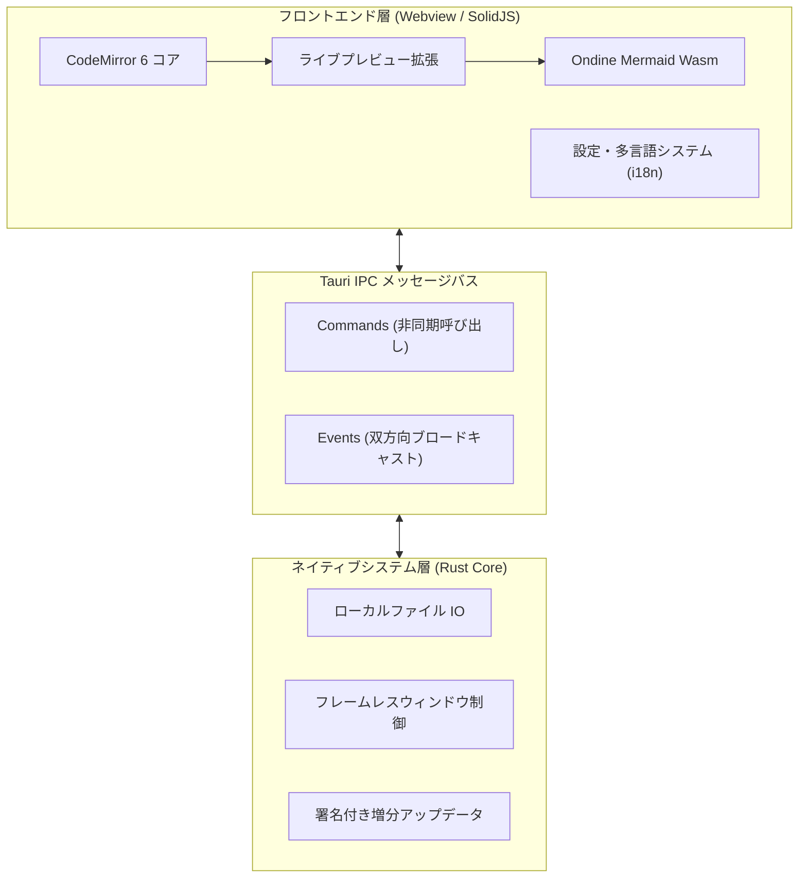
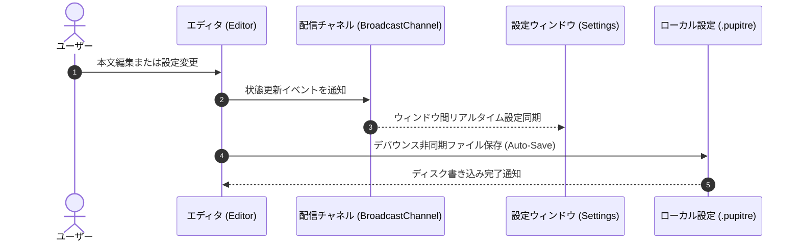

# 🪶 Pupitre - 没入型ミニマル Markdown エディタガイド

> **Pupitre**（フランス語で「譜面台」「演台」）は、**Tauri v2 + SolidJS + CodeMirror 6** を基盤に構築された、軽量・高速・美麗なデスクトップ Markdown インプレースエディタです。
> 純粋な執筆と快適なタイポグラフィ体験のために設計されました。

---

> [!NOTE]
> **インプレース・ライブプレビュー (In-place Live Preview)**: Pupitre では、カーソルが離れると Markdown 構文記号が自動で美麗な書式へと折りたたまれます。該当行を編集するときのみ記号がその場で展開され、思考を妨げない直感的な執筆が可能です。

> [!TIP]
> よく使うショートカットキー：
>
> - <kbd>Ctrl</kbd> + <kbd>S</kbd>：現在のドキュメントを保存
> - <kbd>Ctrl</kbd> + <kbd>O</kbd>：ローカルの Markdown ファイルを開く
> - <kbd>Ctrl</kbd> + <kbd>B</kbd>：アウトラインサイドバーの表示切替
> - <kbd>Ctrl</kbd> + <kbd>,</kbd>：環境設定をミリ秒で起動

---

## 1. タイポグラフィとインライン書式 (Typography & Styles)

日々の執筆において、Pupitre は滑らかなトランジションと洗練されたスタイルを提供します：

- **太字強調 (Bold)**：`**堅牢で高速**` は **堅牢で高速** と表示
- _斜体強調 (Italic)_：`*優雅な体験*` は _優雅な体験_ と表示
- _**太字斜体 (Bold & Italic)**_：`***両方の利点***` は _**両方の利点**_ と表示
- ~~取り消し線 (Strikethrough)~~：`~~肥大化した過去~~` は ~~肥大化した過去~~ と表示
- インラインコード：`const app = new Pupitre();`
- 複合修飾：**~~太字かつ取り消し線~~** や _`斜体のコードバッジ`_
- キーボードタグ：<kbd>Ctrl</kbd> + <kbd>Shift</kbd> + <kbd>S</kbd> 名前を付けて保存
- ハイパーリンク：[Pupitre GitHub 公式リポジトリ](https://github.com/shalemore/pupitre)

### ネスト引用ブロックのデモ

> 優れたツールは空気のように透明であり、作業中は意識されることなく、ただ静かに集中力を高めてくれます。
>
> > ——「完璧とは、付け加えるものがなくなったときではなく、取り去るものがなくなったときに達成される。」

---

## 2. 見出しの 6 段階階層 (Headings)

Pupitre はドキュメント内の見出しを即座に解析し、サイドバーに目次ツリーを自動生成します：

# 見出し 1 (H1) - ドキュメントの主題・タイトル

## 見出し 2 (H2) - 主要な章・セクション

### 見出し 3 (H3) - 具体的なトピックや論点

#### 見出し 4 (H4) - 詳細な補足説明

##### 見出し 5 (H5) - 小見出し

###### 見出し 6 (H6) - 最小単位の注記

---

## 3. タスクリストと箇条書き (Lists & Tasks)

### 3.1 機能開発ロードマップ

- [x] **Rust + Tauri 2.0** による軽量高速ネイティブコア
- [x] **SolidJS** の細粒度リアクティブ機構（仮想 DOM 再描画ゼロ）
- [x] **CodeMirror 6** 現代的インプレース編集アーキテクチャ
- [x] **Ondine WebAssembly** によるネイティブ Mermaid 図表即時描画
- [x] **GFM インタラクティブテーブル**のリアルタイム編集
- [x] **フレームレス（枠線なし）**の没入型ウィンドウと独自コントロール
- [x] **12 言語の国際化対応**とダーク・ライトモード自動追従
- [x] 署名付きバイナリによる公式 **Auto-Updater** 自動増分更新
- [ ] クリーンな HTML および高解像度 PDF へのエクスポート
- [ ] ローカル双方向リンクとナレッジグラフ表示

### 3.2 ネストリストの例

1. アイデア出し・執筆フェーズ
   - プレーンテキストで思考の素描を記録
   - 重要なコードスニペットを貼り付け
   - 構成の概略図をスケッチ
2. 推敲・校正フェーズ
   1. アウトラインの構造と見出し順を確認
   2. 数式と図表の正確性をチェック
   3. バージョン管理システムへコミット
3. 公開・アーカイブフェーズ

---

## 4. データテーブルと整列 (GFM Tables)

GitHub Flavored Markdown (GFM) のテーブル記法に対応し、各列の整列が可能です：

| 特性・指標         |       Pupitre エディタ       | 従来の Electron エディタ |        OS 標準メモ帳 |
| :----------------- | :--------------------------: | :----------------------: | -------------------: |
| 起動所要時間       |       **300 ms 未満**        |     1500 〜 3000 ms      |          100 ms 未満 |
| メモリ使用量       |      **約 35 〜 60 MB**      |      200 〜 500 MB       |           15 MB 未満 |
| プレビュー方式     | **インプレース（原位切替）** |   2 画面分割または切替   | プレーンテキストのみ |
| 図表レンダラ       |    **Wasm Mermaid 内蔵**     |   重量級プラグイン依存   |               非対応 |
| アプリ基盤         |     **Tauri 2.0 (Rust)**     |  Chromium ブラウザ基盤   |              OS 固有 |
| ウィンドウデザイン |  **フレームレス＋美しい影**  |     不揃い・OS 依存      |   従来型ネイティブ枠 |

---

## 5. Mermaid 構成図とシーケンス図 (Mermaid Diagrams)

内蔵された WebAssembly エンジンにより、ネットワーク接続なしで Mermaid 図表をリアルタイム描画します：

### 5.1 全体アーキテクチャ構成図



### 5.2 自動保存と設定同期シーケンス



---

## 6. シンタックスハイライト付きコードブロック

右上に言語バッジとワンクリックコピーボタンが自動配置されます：

### Rust (Tauri コマンド定義)

```rust
use tauri::{AppHandle, Manager};

#[tauri::command]
pub async fn open_settings_window(app: AppHandle) -> Result<(), String> {
    if let Some(win) = app.get_webview_window("settings") {
        let _ = win.unminimize();
        let _ = win.show();
        let _ = win.set_focus();
        return Ok(());
    }
    Ok(())
}
```

### TypeScript (SolidJS リアクティブ状態)

```typescript
import { createSignal, createMemo } from "solid-js";

export function useWordCount(content: () => string) {
  const stats = createMemo(() => {
    const text = content();
    const words = (text.match(/\S+/g) || []).length;
    const chars = text.length;
    return { words, chars };
  });

  return stats;
}
```

---

## 7. 数式・科学表記 (KaTeX Math)

インライン数式および独立したブロック数式を高品質に描画します：

- インライン数式：アインシュタインの質量とエネルギーの等価性 $E = mc^2$、オイラーの等式 $e^{i\pi} + 1 = 0$。
- ブロック数式（ガウス正規分布とマクスウェル方程式）：

$$
f(x) = \frac{1}{\sigma \sqrt{2\pi}} \exp\left( -\frac{(x - \mu)^2}{2\sigma^2} \right)
$$

$$
\oint_C \mathbf{B} \cdot d\boldsymbol{\ell} = \mu_0 I_{\text{enc}} + \mu_0 \varepsilon_0 \frac{d\Phi_E}{dt}
$$

---

## 8. 折りたたみ詳細ブロック (Collapsible Details)

<details>
<summary><b>🔍 クリックして展開：Pupitre ショートカット一覧</b></summary>

| 操作項目           | Windows / Linux ショートカット                    | macOS ショートカット                           |
| :----------------- | :------------------------------------------------ | :--------------------------------------------- |
| 新規ドキュメント   | <kbd>Ctrl</kbd> + <kbd>N</kbd>                    | <kbd>⌘</kbd> + <kbd>N</kbd>                    |
| ファイルを開く     | <kbd>Ctrl</kbd> + <kbd>O</kbd>                    | <kbd>⌘</kbd> + <kbd>O</kbd>                    |
| ドキュメントを保存 | <kbd>Ctrl</kbd> + <kbd>S</kbd>                    | <kbd>⌘</kbd> + <kbd>S</kbd>                    |
| 名前を付けて保存   | <kbd>Ctrl</kbd> + <kbd>Shift</kbd> + <kbd>S</kbd> | <kbd>⌘</kbd> + <kbd>Shift</kbd> + <kbd>S</kbd> |
| テキスト検索       | <kbd>Ctrl</kbd> + <kbd>F</kbd>                    | <kbd>⌘</kbd> + <kbd>F</kbd>                    |
| テキスト置換       | <kbd>Ctrl</kbd> + <kbd>H</kbd>                    | <kbd>⌥</kbd> + <kbd>⌘</kbd> + <kbd>F</kbd>     |
| 拡大 / 縮小        | <kbd>Ctrl</kbd> + <kbd>+</kbd> / <kbd>-</kbd>     | <kbd>⌘</kbd> + <kbd>+</kbd> / <kbd>-</kbd>     |
| 環境設定を開く     | <kbd>Ctrl</kbd> + <kbd>,</kbd>                    | <kbd>⌘</kbd> + <kbd>,</kbd>                    |

</details>

---

## 9. 脚注とおわりに (Footnotes)

Pupitre は、あなたの論文、技術ブログ、ひらめきのメモ、システム設計の良きパートナーとなるでしょう[^1]。

思考が指先から淀みなくあふれ出しますように。

[^1]: Pupitre は、純粋で集中できる執筆環境を愛するクリエイターのためのオープンソース製品です。GitHub へのフィードバックやコントリビュートをお待ちしています！
