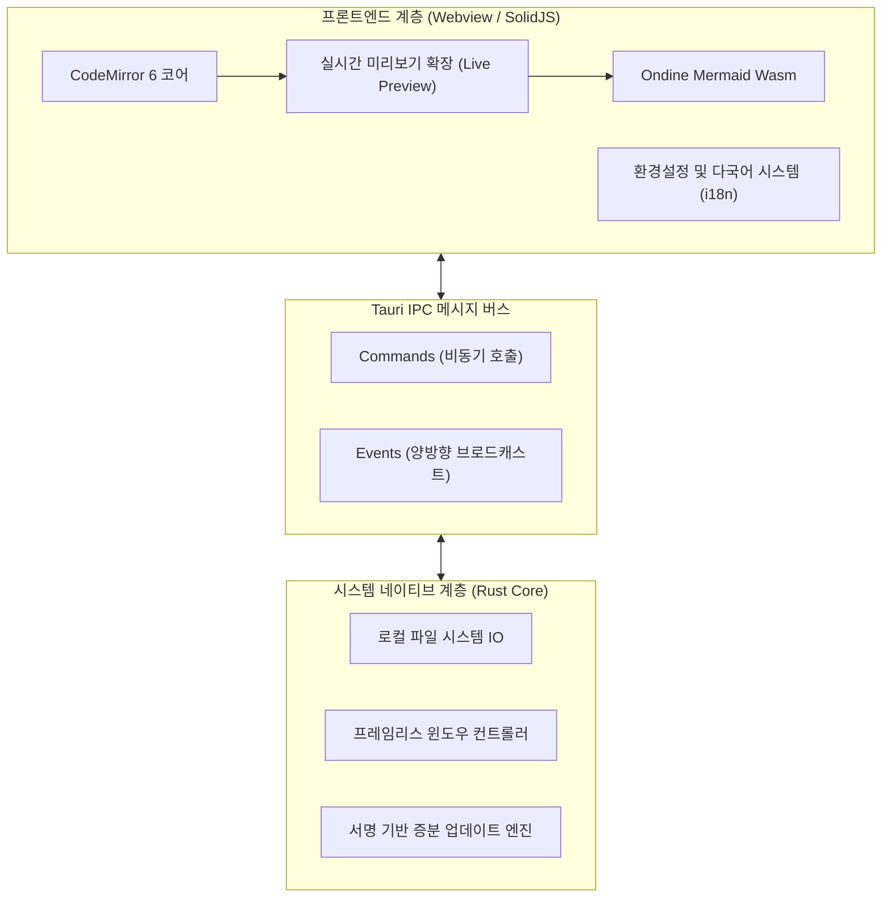
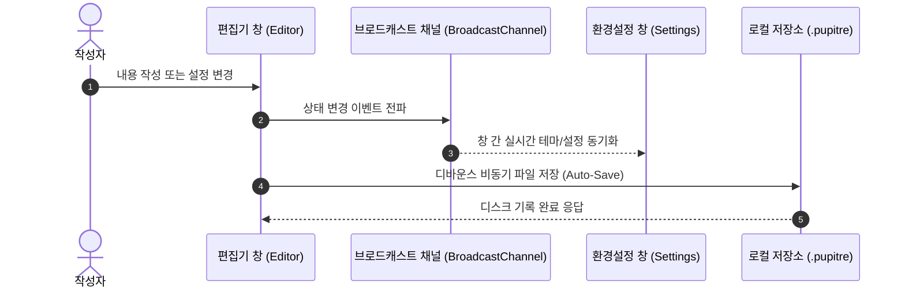

# 🪶 Pupitre - 몰입형 미니멀 Markdown 편집기 가이드

> **Pupitre**(프랑스어로 '악보대' 또는 '강연대')는 **Tauri v2 + SolidJS + CodeMirror 6**를 기반으로 제작된 가볍고 빠르며 세련된 데스크톱 Markdown 인플레이스 편집기입니다.
> 오직 순수한 글쓰기와 방해 없는 타이포그래피 경험을 위해 설계되었습니다.


---

> [!NOTE]
> **인플레이스 실시간 미리보기 (In-place Live Preview)**: Pupitre에서는 커서가 벗어나면 Markdown 서식 기호가 자연스럽게 접히며 렌더링된 서식으로 전환됩니다. 해당 줄을 편집할 때만 기호가 즉시 펼쳐져 직관적인 글쓰기를 지원합니다.

> [!TIP]
> 자주 사용하는 단축키:
>
> - <kbd>Ctrl</kbd> + <kbd>S</kbd>: 현재 문서 저장
> - <kbd>Ctrl</kbd> + <kbd>O</kbd>: 로컬 Markdown 파일 열기
> - <kbd>Ctrl</kbd> + <kbd>B</kbd>: 개요 사이드바 표시/숨기기
> - <kbd>Ctrl</kbd> + <kbd>,</kbd>: 밀리초 단위의 즉각적인 환경설정 열기

---

## 1. 타이포그래피 및 인라인 서식 (Typography & Styles)

일상적인 기록과 저작 과정에서 Pupitre는 부드러운 전환과 정교한 스타일을 선사합니다:

- **굵은 글씨 (Bold)**: `**단단하고 안정적**` 은 **단단하고 안정적** 으로 표시
- _기울임꼴 (Italic)_: `*우아하고 가벼움*` 은 _우아하고 가벼움_ 으로 표시
- _**굵은 기울임꼴 (Bold & Italic)**_: `***둘의 완벽한 조화***` 는 _**둘의 완벽한 조화**_ 로 표시
- ~~취소선 (Strikethrough)~~: `~~비대하고 둔중함~~` 은 ~~비대하고 둔중함~~ 으로 표시
- 인라인 코드: `const editor = new Pupitre();`
- 복합 서식: **~~굵은 취소선 텍스트~~** 또는 _`기울임 코드 배지`_
- 키보드 입력 태그: <kbd>Ctrl</kbd> + <kbd>Shift</kbd> + <kbd>S</kbd> 다른 이름으로 저장
- 외부 링크: [Pupitre GitHub 공식 저장소](https://github.com/shalemore/pupitre)

### 중첩 인용구 데모

> 훌륭한 도구는 맑은 공기와 같아서, 작업하는 동안에는 의식되지 않지만 조용히 집중력을 극대화해 줍니다.
>
> > —— "완벽함이란 더 이상 보탤 것이 없을 때가 아니라, 더 이상 뺄 것이 없을 때 완성된다."

---

## 2. 제목 계층 구조 (Heading Hierarchy)

Pupitre는 문서 내의 모든 제목을 동적으로 파싱하여 왼쪽 사이드바에 실시간 트리형 목차(아웃라인)를 생성합니다:

### 2.1 3단계 제목 (H3) - 기능 모듈 및 논점

#### 2.1.1 4단계 제목 (H4) - 세부 항목 설명

##### 2.1.1.1 5단계 제목 (H5) - 추가 안내 사항

###### 2.1.1.1.1 6단계 제목 (H6) - 최소 단위 주석

---

## 3. 할 일 목록 및 목록 서식 (Lists & Tasks)

### 3.1 주요 기능 개발 로드맵

- [x] **Rust + Tauri 2.0** 기반의 초고속 네이티브 코어
- [x] **SolidJS** 미세 반응형 프레임워크 (가상 DOM 리렌더링 부하 제로)
- [x] **CodeMirror 6** 현대적 인플레이스 실시간 미리보기 시스템
- [x] **Ondine WebAssembly** 탑재로 네이티브 Mermaid 다이어그램 즉시 렌더링
- [x] **GFM 대화형 테이블** 실시간 시각적 편집 지원
- [x] **프레임리스 (무테)** 몰입형 윈도우 및 사용자 정의 컨트롤
- [x] **12개국어 다국어 지원** 및 다크/라이트 테마 자동 동기화
- [x] 암호화 서명 기반 공식 **Auto-Updater** 자동 증분 업데이트
- [ ] 고해상도 PDF 및 단일 HTML 내보내기
- [ ] 로컬 양방향 문서 링크 및 지식 그래프 뷰

### 3.2 중첩 목록 예시

1. 초안 작성 단계
   - 텍스트로 순간의 영감과 아이디어 스케치
   - 핵심 소스 코드 스니펫 삽입
   - 시스템 구조 다이어그램 작성
2. 퇴고 및 검토 단계
   1. 개요 순서와 제목 위계 확인
   2. 수식과 도표 논리 검증
   3. 버전 관리 시스템에 커밋
3. 배포 및 보관 단계

### 3.3 목록 내 코드 블록 들여쓰기

단계별 가이드나 기술 문서에서는 목록 항목 내에 들여쓰기된 코드 블록을 포함할 수 있습니다:

1. 클라이언트에 로그인하고 잠금을 해제한 후 동기화가 완료될 때까지 기다립니다.
2. 환경설정에서 **SSH Agent** 및 로컬 인증 정보 지원을 활성화합니다.
3. 원활한 인증을 위해 공개 키 구성을 작성합니다:

   ```powershell
   New-Item -ItemType Directory -Path $HOME\.ssh -Force | Out-Null
   Set-Content `
     -Path $HOME\.ssh\github-pupitre.pub `
     -Value 'ssh-ed25519 AAAAC3NzaC1lZDI1NTE5AAAAID3FhmdqRz1VHUTNHuAKBA1nchfD63/9NTQmwQkx7tC'
   ```

4. 터미널에서 SSH 연결 상태를 테스트합니다:

   ```powershell
   & "$env:WINDIR\System32\OpenSSH\ssh.exe" -T git@github.com
   ```

---

## 4. 데이터 표 및 정렬 (GFM Tables)

GitHub Flavored Markdown (GFM) 표 구문을 완벽 지원하며 열 정렬을 지원합니다:

| 특성 지표       |          Pupitre 편집기          |   기존 Electron 편집기    |         OS 기본 메모장 |
| :-------------- | :------------------------------: | :-----------------------: | ---------------------: |
| 초기 실행 속도  |         **300 ms 미만**          |      1500 ~ 3000 ms       |            100 ms 미만 |
| 메모리 점유율   |        **약 35 ~ 60 MB**         |       200 ~ 500 MB        |             15 MB 미만 |
| 미리보기 방식   |   **인플레이스 (원위치 전환)**   |   2분할 화면 또는 전환    |     서식 없는 텍스트만 |
| 다이어그램 지원 |      **Wasm Mermaid 내장**       | 무거운 외부 플러그인 의존 |                 미지원 |
| 런타임 플랫폼   |       **Tauri 2.0 (Rust)**       |  Chromium 브라우저 엔진   |              OS 종속적 |
| 윈도우 디자인   | **프레임리스 + 부드러운 그림자** |         불균일함          | 투박한 네이티브 테두리 |

---

## 5. Mermaid 아키텍처 및 시퀀스 다이어그램 (Mermaid Diagrams)

내장된 WebAssembly 엔진을 통해 네트워크 연결 없이도 다이어그램을 실시간 렌더링합니다:

### 5.1 소프트웨어 기술 아키텍처



### 5.2 자동 저장 및 설정 동기화 시퀀스



---

## 6. 구문 강조 코드 블록 (Syntax-Highlighted Code Blocks)

우측 상단에 언어 배지와 원클릭 복사 버튼이 자동으로 배치됩니다:

### 6.1 Rust (Tauri Command 예제)

```rust
use tauri::{AppHandle, Manager};

#[tauri::command]
pub async fn open_settings_window(app: AppHandle) -> Result<(), String> {
    if let Some(win) = app.get_webview_window("settings") {
        let _ = win.unminimize();
        let _ = win.show();
        let _ = win.set_focus();
        return Ok(());
    }
    Ok(())
}
```

### 6.2 TypeScript (SolidJS 반응형 상태)

```typescript
import { createSignal, createMemo } from "solid-js";

export function useWordCount(content: () => string) {
  const stats = createMemo(() => {
    const text = content();
    const words = (text.match(/\S+/g) || []).length;
    const chars = text.length;
    return { words, chars };
  });

  return stats;
}
```

---

## 7. 수학 공식 및 과학 표기 (KaTeX Math)

인라인 수식 및 독립 블록 수식을 수려한 수학 타이포그래피로 렌더링합니다:

- 인라인 수식: 아인슈타인의 질량-에너지 등가 공식 $E = mc^2$, 오일러의 등식 $e^{i\pi} + 1 = 0$.
- 블록 수식 (가우스 정규분포 및 맥스웰 방정식):

$$
f(x) = \frac{1}{\sigma \sqrt{2\pi}} \exp\left( -\frac{(x - \mu)^2}{2\sigma^2} \right)
$$

$$
\oint_C \mathbf{B} \cdot d\boldsymbol{\ell} = \mu_0 I_{\text{enc}} + \mu_0 \varepsilon_0 \frac{d\Phi_E}{dt}
$$

---

## 8. 접기 가능한 상세 정보 (Collapsible Details)

<details>
<summary><b>🔍 클릭하여 펼치기: Pupitre 단축키 총람표</b></summary>

| 기능 명령          | Windows / Linux 단축키                            | macOS 단축키                                   |
| :----------------- | :------------------------------------------------ | :--------------------------------------------- |
| 새 문서            | <kbd>Ctrl</kbd> + <kbd>N</kbd>                    | <kbd>⌘</kbd> + <kbd>N</kbd>                    |
| 파일 열기          | <kbd>Ctrl</kbd> + <kbd>O</kbd>                    | <kbd>⌘</kbd> + <kbd>O</kbd>                    |
| 문서 저장          | <kbd>Ctrl</kbd> + <kbd>S</kbd>                    | <kbd>⌘</kbd> + <kbd>S</kbd>                    |
| 다른 이름으로 저장 | <kbd>Ctrl</kbd> + <kbd>Shift</kbd> + <kbd>S</kbd> | <kbd>⌘</kbd> + <kbd>Shift</kbd> + <kbd>S</kbd> |
| 텍스트 찾기        | <kbd>Ctrl</kbd> + <kbd>F</kbd>                    | <kbd>⌘</kbd> + <kbd>F</kbd>                    |
| 텍스트 바꾸기      | <kbd>Ctrl</kbd> + <kbd>H</kbd>                    | <kbd>⌥</kbd> + <kbd>⌘</kbd> + <kbd>F</kbd>     |
| 확대 / 축소        | <kbd>Ctrl</kbd> + <kbd>+</kbd> / <kbd>-</kbd>     | <kbd>⌘</kbd> + <kbd>+</kbd> / <kbd>-</kbd>     |
| 환경설정 열기      | <kbd>Ctrl</kbd> + <kbd>,</kbd>                    | <kbd>⌘</kbd> + <kbd>,</kbd>                    |

</details>

---

## 9. 각주 및 맺음말 (Footnotes)

Pupitre는 기술 문서, 장편 논문, 영감 메모, 시스템 아키텍처 설계를 아우르는 창작의 여정을 함께합니다[^1].

당신의 생각이 방해 없이 손끝에서 자연스럽게 흘러나오길 바랍니다.

[^1]: Pupitre는 미니멀하고 순수한 저작 환경을 지향하는 창작자들을 위해 정성스럽게 빚어낸 오픈소스 도구입니다. GitHub에서 언제든 의견이나 기여를 환영합니다!
