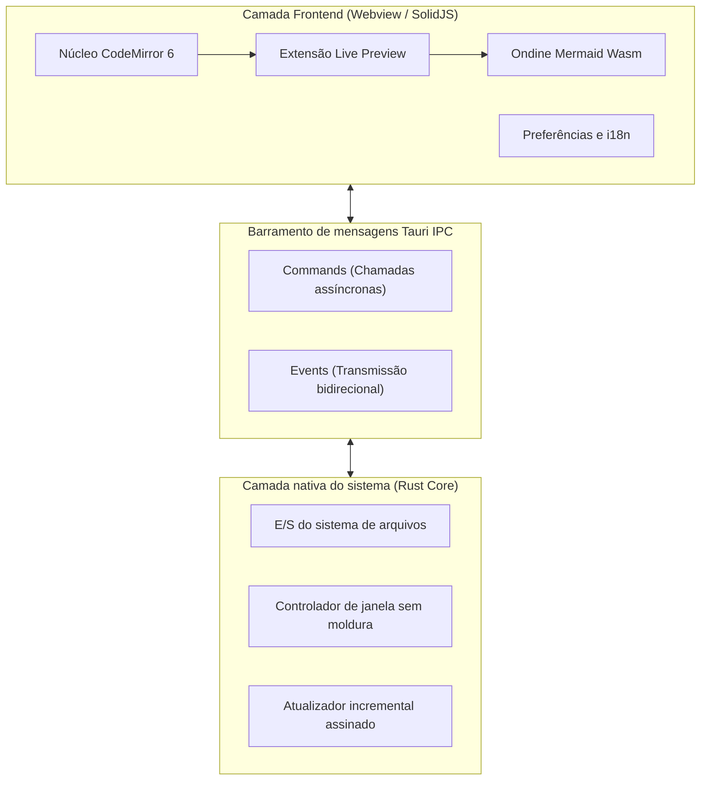
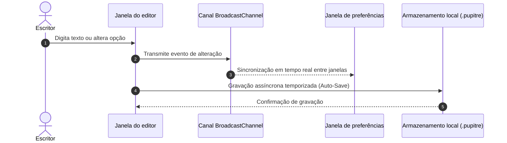

# 🪶 Pupitre - Guia do editor Markdown minimalista e imersivo

> **Pupitre** (do francês _estante de partitura_ ou _púlpito_) é um editor Markdown de desktop ágil, leve e livre de distrações, construído com **Tauri v2 + SolidJS + CodeMirror 6**.
> Criado especialmente para a escrita pura e uma experiência tipográfica impecável.

---

> [!NOTE]
> **Pré-visualização direta no local (In-place Live Preview)**: No Pupitre, a sintaxe Markdown se recolhe suavemente para exibir a formatação elegante quando o cursor se afasta. Ao posicionar o cursor na linha, os marcadores se revelam no mesmo ponto para uma edição natural.

> [!TIP]
> Atalhos indispensáveis:
>
> - <kbd>Ctrl</kbd> + <kbd>S</kbd>: Salvar o documento atual
> - <kbd>Ctrl</kbd> + <kbd>O</kbd>: Abrir arquivo Markdown local
> - <kbd>Ctrl</kbd> + <kbd>B</kbd>: Alternar a barra lateral do sumário
> - <kbd>Ctrl</kbd> + <kbd>,</kbd>: Abrir Preferências em milissegundos

---

## 1. Tipografia e formatação de texto (Typography & Styles)

Durante a escrita diária, o Pupitre oferece estilos refinados e transições suaves:

- **Destaque em negrito (Bold)**: `**sólido e veloz**` é renderizado como **sólido e veloz**
- _Destaque em itálico (Italic)_: `*fluxo agradável*` é renderizado como _fluxo agradável_
- _**Negrito e itálico (Bold & Italic)**_: `***o melhor dos dois***` é renderizado como _**o melhor dos dois**_
- ~~Tachado (Strikethrough)~~: `~~pesado e obsoleto~~` é renderizado como ~~pesado e obsoleto~~
- Código em linha (Inline Code): `const app = new Pupitre();`
- Formatações combinadas: **~~texto em negrito tachado~~** ou _`distintivo de código em itálico`_
- Teclas de atalho: <kbd>Ctrl</kbd> + <kbd>Shift</kbd> + <kbd>S</kbd> Salvar como
- Links externos: [Repositório GitHub oficial do Pupitre](https://github.com/shalemore/pupitre)

### Demonstração de citações aninhadas

> As grandes ferramentas são como o ar puro: imperceptíveis durante o trabalho, mas fortalecendo em silêncio o seu foco e criatividade.
>
> > —— "A perfeição não é alcançada quando não há mais nada a acrescentar, mas quando não há mais nada a retirar."

---

## 2. Hierarquia de títulos em 6 níveis (Headings)

O Pupitre processa os títulos em tempo real para alimentar o sumário dinâmico na barra lateral:

# Título Nível 1 (H1) - Tema do documento

## Título Nível 2 (H2) - Capítulo ou seção principal

### Título Nível 3 (H3) - Subseção ou ponto essencial

#### Título Nível 4 (H4) - Tópico detalhado

##### Título Nível 5 (H5) - Observação menor

###### Título Nível 6 (H6) - Detalhe pontual

---

## 3. Listas e listas de tarefas (Lists & Tasks)

### 3.1 Roteiro de desenvolvimento de recursos

- [x] Núcleo nativo ultrarrápido com **Rust + Tauri 2.0**
- [x] Interface reativa com **SolidJS** (zero sobrecarga de Virtual-DOM)
- [x] Arquitetura de edição moderna com **CodeMirror 6**
- [x] Diagramas Mermaid gerados instantaneamente com **Ondine WebAssembly**
- [x] Edição visual e interativa de **Tabelas GFM**
- [x] Design **sem moldura (Frameless)** com sombras elegantes
- [x] Suporte nativo a **12 idiomas** e temas claro/escuro automáticos
- [x] Atualizador oficial com assinatura segura **Auto-Updater**
- [ ] Exportação para PDF de alta fidelidade e HTML independente
- [ ] Conexões bidirecionais locais e grafo de conhecimento

### 3.2 Listas ordenadas e desordenadas aninhadas

1. Fase inicial de rascunho
   - Anotar lampejos de ideias em texto puro
   - Inserir trechos de código relevantes
   - Esboçar estruturas e fluxos
2. Fase de revisão e polimento
   1. Verificar o equilíbrio dos títulos
   2. Validar equações matemáticas e diagramas
   3. Registrar alterações no controle de versão
3. Fase de publicação e arquivamento

---

## 4. Tabelas de dados GFM (GFM Tables)

O Pupitre oferece suporte total a tabelas GitHub Flavored Markdown e alinhamento de colunas:

| Característica         |         Editor Pupitre          |  Editores Electron clássicos  |      Bloco de Notas do SO |
| :--------------------- | :-----------------------------: | :---------------------------: | ------------------------: |
| Inicialização a frio   |          **< 300 ms**           |        1500 a 3000 ms         |                  < 100 ms |
| Consumo de memória     |         **~35 a 60 MB**         |         200 a 500 MB          |                   < 15 MB |
| Modo de visualização   | **No próprio local (In-place)** |         Tela dividida         | Somente texto sem formato |
| Mecanismo de diagramas |   **Mermaid Wasm integrado**    | Dependente de plugins pesados |               Sem suporte |
| Plataforma de execução |      **Tauri 2.0 (Rust)**       |  Navegador Chromium completo  |   Exclusivo de um sistema |
| Estética da janela     |   **Sem moldura com sombras**   |           Irregular           |     Borda nativa clássica |

---

## 5. Diagramas Mermaid de arquitetura e sequência (Mermaid)

Com o poder do WebAssembly integrado, os diagramas Mermaid funcionam sem conexão com a internet:

### 5.1 Arquitetura técnica geral



### 5.2 Sequência de salvamento automático e sincronização



---

## 6. Blocos de código com destaque de sintaxe

Cada bloco conta com um cabeçalho flutuante exibindo a linguagem e um botão de cópia com um clique:

### Rust (Comando nativo Tauri)

```rust
use tauri::{AppHandle, Manager};

#[tauri::command]
pub async fn open_settings_window(app: AppHandle) -> Result<(), String> {
    if let Some(win) = app.get_webview_window("settings") {
        let _ = win.unminimize();
        let _ = win.show();
        let _ = win.set_focus();
        return Ok(());
    }
    Ok(())
}
```

### TypeScript (Estado reativo SolidJS)

```typescript
import { createSignal, createMemo } from "solid-js";

export function useWordCount(content: () => string) {
  const stats = createMemo(() => {
    const text = content();
    const words = (text.match(/\S+/g) || []).length;
    const chars = text.length;
    return { words, chars };
  });

  return stats;
}
```

---

## 7. Fórmulas matemáticas e notação científica (KaTeX)

Renderização nítida de equações matemáticas, tanto no texto quanto em blocos destacados:

- Fórmula no texto: A célebre equação massa-energia $E = mc^2$, e a identidade de Euler $e^{i\pi} + 1 = 0$.
- Fórmula destacada (Distribuição normal de Gauss e Lei de Maxwell-Ampère):

$$
f(x) = \frac{1}{\sigma \sqrt{2\pi}} \exp\left( -\frac{(x - \mu)^2}{2\sigma^2} \right)
$$

$$
\oint_C \mathbf{B} \cdot d\boldsymbol{\ell} = \mu_0 I_{\text{enc}} + \mu_0 \varepsilon_0 \frac{d\Phi_E}{dt}
$$

---

## 8. Seções dobráveis interativas (Collapsible Details)

<details>
<summary><b>🔍 Clique para abrir: Tabela rápida de atalhos do Pupitre</b></summary>

| Ação                     | Atalho Windows / Linux                            | Atalho macOS                                   |
| :----------------------- | :------------------------------------------------ | :--------------------------------------------- |
| Novo documento           | <kbd>Ctrl</kbd> + <kbd>N</kbd>                    | <kbd>⌘</kbd> + <kbd>N</kbd>                    |
| Abrir arquivo            | <kbd>Ctrl</kbd> + <kbd>O</kbd>                    | <kbd>⌘</kbd> + <kbd>O</kbd>                    |
| Salvar documento         | <kbd>Ctrl</kbd> + <kbd>S</kbd>                    | <kbd>⌘</kbd> + <kbd>S</kbd>                    |
| Salvar como              | <kbd>Ctrl</kbd> + <kbd>Shift</kbd> + <kbd>S</kbd> | <kbd>⌘</kbd> + <kbd>Shift</kbd> + <kbd>S</kbd> |
| Localizar texto          | <kbd>Ctrl</kbd> + <kbd>F</kbd>                    | <kbd>⌘</kbd> + <kbd>F</kbd>                    |
| Substituir texto         | <kbd>Ctrl</kbd> + <kbd>H</kbd>                    | <kbd>⌥</kbd> + <kbd>⌘</kbd> + <kbd>F</kbd>     |
| Aumentar / Diminuir zoom | <kbd>Ctrl</kbd> + <kbd>+</kbd> / <kbd>-</kbd>     | <kbd>⌘</kbd> + <kbd>+</kbd> / <kbd>-</kbd>     |
| Preferências             | <kbd>Ctrl</kbd> + <kbd>,</kbd>                    | <kbd>⌘</kbd> + <kbd>,</kbd>                    |

</details>

---

## 9. Notas de rodapé e conclusão (Footnotes)

O Pupitre foi concebido para acompanhar seus ensaios, blogs técnicos, anotações diárias e arquiteturas de software[^1].

Que suas ideias fluam livres e autênticas na ponta dos dedos.

[^1]: O Pupitre é um software de código aberto feito para apaixonados pela escrita sem distrações. Sinta-se à vontade para contribuir no GitHub!
