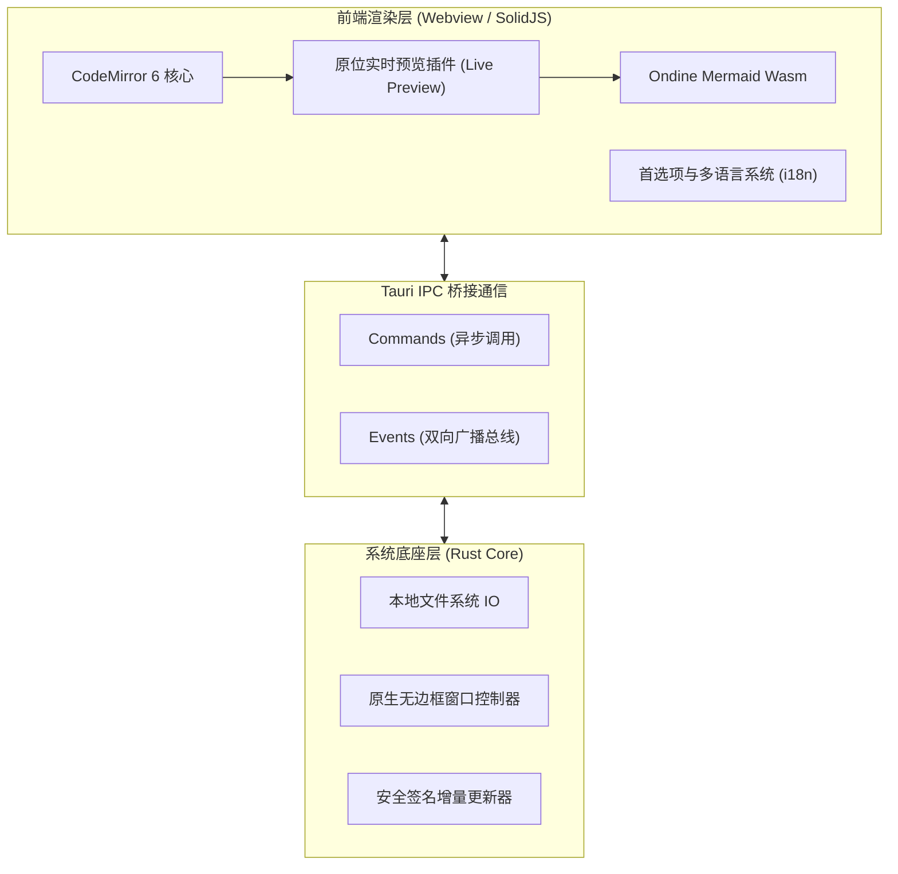
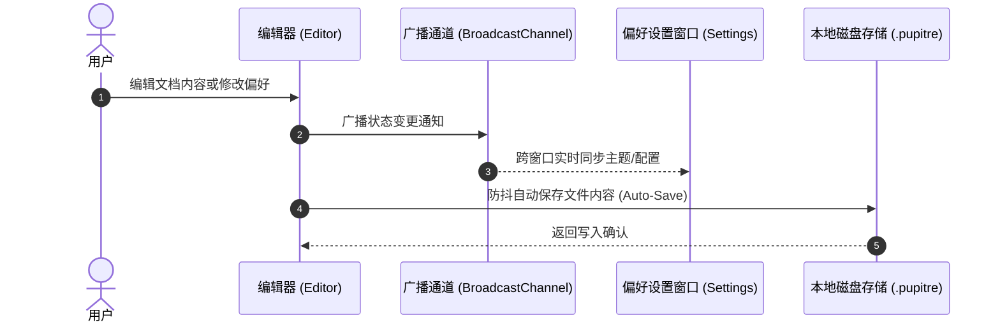

# 🪶 Pupitre - 沉浸式极简 Markdown 编辑器指南

> **Pupitre**（法文原意：琴谱架、讲台）是一款基于 **Tauri v2 + SolidJS + CodeMirror 6** 打造的极简、轻量、高颜值的桌面 Markdown 原位编辑器。
> 专为纯粹写作与沉浸式排版体验而生。


---

> [!NOTE]
> **原位实时预览 (In-place Live Preview)**：在 Pupitre 中，光标离开标记时自动呈现精美渲染排版；当光标移入相应行时，所有 Markdown 格式标记无缝展开，真正做到“所见即所思，所写即所得”。

> [!TIP]
> 常用快捷操作：
>
> - <kbd>Ctrl</kbd> + <kbd>S</kbd>：快速保存当前文档
> - <kbd>Ctrl</kbd> + <kbd>O</kbd>：打开本地 Markdown 文件
> - <kbd>Ctrl</kbd> + <kbd>B</kbd>：展开 / 收起左侧大纲侧边栏
> - <kbd>Ctrl</kbd> + <kbd>,</kbd>：秒级打开首选项设置

---

## 一、排版与文本格式 (Typography & Inline Styles)

在日常记录与写作中，Pupitre 提供了细腻的排版样式与过渡动画：

- **粗体强调 (Bold)**：`**坚固可靠**` 显示为 **坚固可靠**
- _斜体强调 (Italic)_：`*优雅从容*` 显示为 _优雅从容_
- _**粗斜体 (Bold & Italic)**_：`***兼收并蓄***` 显示为 _**兼收并蓄**_
- ~~删除线 (Strikethrough)~~：`~~臃肿沉重~~` 显示为 ~~臃肿沉重~~
- 行内代码 (Inline Code)：`const app = new Pupitre();`
- 组合修饰：**~~加粗且删除的内容~~** 或 _`带斜体的高亮标记`_
- 键盘操作标签：<kbd>Ctrl</kbd> + <kbd>Shift</kbd> + <kbd>S</kbd> 另存为文件
- 外部链接：[Pupitre GitHub 开源主页](https://github.com/shalemore/pupitre)

### 嵌套引用块演示

> 优秀的工具如同透明的空气，在工作时你感觉不到它的存在，但它却默默赋予你专注的力量。
>
> > —— “极简并非缺乏细节，而是克制地删繁就简，直到无法再减去任何多余之物。”

---

## 二、标题层级体系 (Heading Hierarchy)

Pupitre 会自动解析所有各级标题，并在左侧边栏生成实时树状动态目录大纲：

### 2.1 标题三级 (H3) - 功能子模块与论点

#### 2.1.1 标题四级 (H4) - 子项细节说明

##### 2.1.1.1 标题五级 (H5) - 补充提示

###### 2.1.1.1.1 标题六级 (H6) - 最小层级标注

---

## 三、任务清单与列表 (Lists & Task Checklists)

### 3.1 核心特性开发计划

- [x] 基于 **Rust + Tauri 2.0** 的极速原生内核
- [x] **SolidJS** 细粒度响应式前端框架，0 冗余组件 Virtual-DOM 重绘
- [x] **CodeMirror 6** 现代编辑器架构与即时预览插件系统
- [x] 支持 **Ondine WebAssembly** 驱动的原生 Mermaid 图表渲染
- [x] **GFM 交互式表格**实时渲染与可视化编辑
- [x] **无原生标题栏 (Frameless)** 沉浸式设计与自定义窗口控制
- [x] 内置 **12 种国际化多语言**与深浅模式自动跟随
- [x] 官方 **Auto-Updater** 安全签名自动增量更新
- [ ] 导出为高清 PDF 与单页 HTML
- [ ] 本地双向链接与知识图谱预览

### 3.2 嵌套列表演示

1. 基础写作阶段
   - 快速整理灵感草稿
   - 插入关键代码片段
   - 绘制结构草图
2. 润色校对阶段
   1. 检查语法与排版层级
   2. 校验公式与图表逻辑
   3. 导出或提交至版本控制
3. 发布归档阶段

### 3.3 列表嵌套代码块演示 (Indented Code in Lists)

在步骤指引与技术文档中，列表支持直接内嵌缩进代码块：

1. 登录并解锁客户端，等待数据同步完成。
2. 在系统首选项中启用 **SSH Agent** 与本地凭据支持。
3. 写入公钥配置，供系统组件无感调用：

   ```powershell
   New-Item -ItemType Directory -Path $HOME\.ssh -Force | Out-Null
   Set-Content `
     -Path $HOME\.ssh\github-pupitre.pub `
     -Value 'ssh-ed25519 AAAAC3NzaC1lZDI1NTE5AAAAID3FhmdqRz1VHUTNHuAKBA1nchfD63/9NTQmwQkx7tC'
   ```

4. 测试终端连接状态：

   ```powershell
   & "$env:WINDIR\System32\OpenSSH\ssh.exe" -T git@github.com
   ```

---

## 四、数据表格与对齐 (GFM Tables)

Pupitre 完全支持 GitHub Flavored Markdown (GFM) 表格语法，并具备自适应排版：

| 特性指标     |       Pupitre 编辑器        | 传统 Electron 编辑器 | 原生纯记事本 |
| :----------- | :-------------------------: | :------------------: | -----------: |
| 启动冷开销   |        **< 300 ms**         |    1500 ~ 3000 ms    |     < 100 ms |
| 内存占用     |      **约 35 ~ 60 MB**      |     200 ~ 500 MB     |      < 15 MB |
| 实时预览机制 | **原位就地切换 (In-place)** |  双栏分屏或源码切换  |     仅纯文本 |
| 图表渲染支持 |    **内置 Mermaid Wasm**    |     依赖重型插件     |       不支持 |
| 跨平台架构   |    **Tauri 2.0 (Rust)**     |   Chromium 运行时    |   单系统专属 |
| 窗口外观定制 |    **沉浸式无边框阴影**     |       参差不齐       | 系统原生边框 |

---

## 五、Mermaid 架构图与流程图 (Mermaid Diagrams)

Pupitre 内置了基于 WebAssembly 编译的 Mermaid 渲染引擎，无需网络请求即可在编辑器中实时预览图表：

### 5.1 软件整体技术架构



### 5.2 自动保存与配置同步时序



---

## 六、代码块与语法高亮 (Syntax-Highlighted Code Blocks)

右上角具备一键复制代码按钮以及语言徽标提示：

### 6.1 Rust (Tauri Command 示例)

```rust
use tauri::{AppHandle, Manager};

#[tauri::command]
pub async fn open_settings_window(app: AppHandle) -> Result<(), String> {
    if let Some(win) = app.get_webview_window("settings") {
        let _ = win.unminimize();
        let _ = win.show();
        let _ = win.set_focus();
        return Ok(());
    }
    Ok(())
}
```

### 6.2 TypeScript (SolidJS 响应式状态)

```typescript
import { createSignal, createMemo } from "solid-js";

export function useWordCount(content: () => string) {
  const stats = createMemo(() => {
    const text = content();
    const words = (text.match(/\S+/g) || []).length;
    const chars = text.length;
    return { words, chars };
  });

  return stats;
}
```

---

## 七、数学公式与科学记号 (Math Equations)

支持行内公式与独立展示公式：

- 行内公式：著名的质能转换方程为 $E = mc^2$，欧拉恒等式为 $e^{i\pi} + 1 = 0$。
- 块级公式（高斯积分与概率密度）：

$$
f(x) = \frac{1}{\sigma \sqrt{2\pi}} \exp\left( -\frac{(x - \mu)^2}{2\sigma^2} \right)
$$

$$
\oint_C \mathbf{B} \cdot d\boldsymbol{\ell} = \mu_0 I_{\text{enc}} + \mu_0 \varepsilon_0 \frac{d\Phi_E}{dt}
$$

---

## 八、折叠区块与交互提示 (Collapsible Details)

<details>
<summary><b>🔍 点击展开：Pupitre 快捷键全览表</b></summary>

| 功能指令      | Windows / Linux 快捷键                            | macOS 快捷键                                   |
| :------------ | :------------------------------------------------ | :--------------------------------------------- |
| 新建文档      | <kbd>Ctrl</kbd> + <kbd>N</kbd>                    | <kbd>⌘</kbd> + <kbd>N</kbd>                    |
| 打开文件      | <kbd>Ctrl</kbd> + <kbd>O</kbd>                    | <kbd>⌘</kbd> + <kbd>O</kbd>                    |
| 保存文档      | <kbd>Ctrl</kbd> + <kbd>S</kbd>                    | <kbd>⌘</kbd> + <kbd>S</kbd>                    |
| 另存为        | <kbd>Ctrl</kbd> + <kbd>Shift</kbd> + <kbd>S</kbd> | <kbd>⌘</kbd> + <kbd>Shift</kbd> + <kbd>S</kbd> |
| 查找内容      | <kbd>Ctrl</kbd> + <kbd>F</kbd>                    | <kbd>⌘</kbd> + <kbd>F</kbd>                    |
| 替换内容      | <kbd>Ctrl</kbd> + <kbd>H</kbd>                    | <kbd>⌥</kbd> + <kbd>⌘</kbd> + <kbd>F</kbd>     |
| 缩放放大/缩小 | <kbd>Ctrl</kbd> + <kbd>+</kbd> / <kbd>-</kbd>     | <kbd>⌘</kbd> + <kbd>+</kbd> / <kbd>-</kbd>     |
| 偏好设置      | <kbd>Ctrl</kbd> + <kbd>,</kbd>                    | <kbd>⌘</kbd> + <kbd>,</kbd>                    |

</details>

---

## 九、脚注与结尾 (Footnotes)

Pupitre 将陪伴你完成长篇论著、技术博客、灵感备忘与系统架构设计[^1]。

愿你的思想在指尖自由流淌，无拘无束。

[^1]: Pupitre 是为崇尚极简与纯粹的创作者匠心打造的开源作品。欢迎在 GitHub 上提交反馈或贡献代码！
