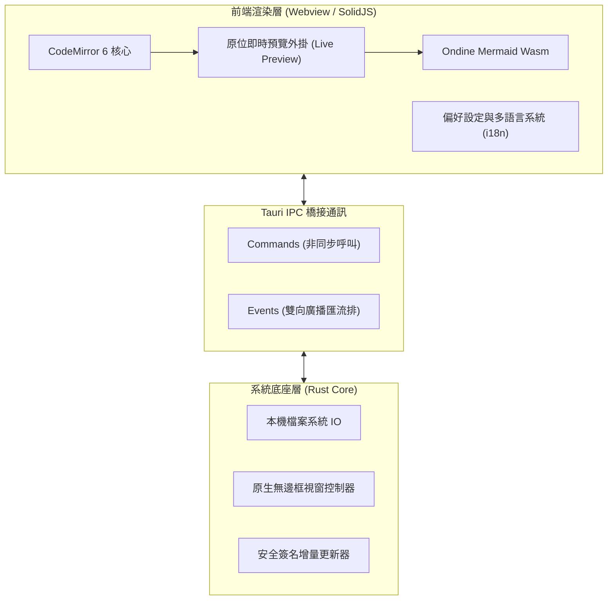
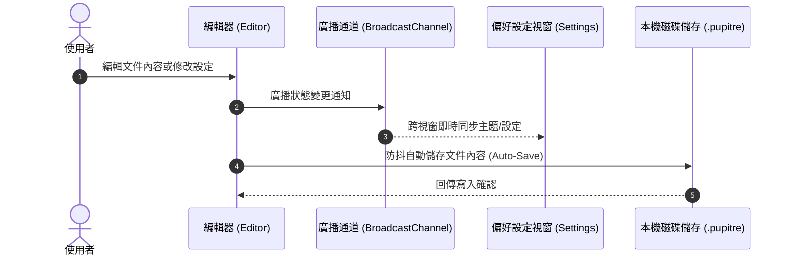

# 🪶 Pupitre - 沉浸式極簡 Markdown 編輯器指南

> **Pupitre**（法文原意：琴譜架、講台）是一款基於 **Tauri v2 + SolidJS + CodeMirror 6** 打造的極簡、輕量、高顏值的桌面 Markdown 原位編輯器。
> 專為純粹寫作與沉浸式排版體驗而生。


---

> [!NOTE]
> **原位即時預覽 (In-place Live Preview)**：在 Pupitre 中，游標離開標記時自動呈現精美渲染排版；當游標移入相應行時，所有 Markdown 格式標記無縫展開，真正做到「所見即所思，所寫即所得」。

> [!TIP]
> 常用快捷操作：
>
> - <kbd>Ctrl</kbd> + <kbd>S</kbd>：快速儲存當前文件
> - <kbd>Ctrl</kbd> + <kbd>O</kbd>：開啟本機 Markdown 檔案
> - <kbd>Ctrl</kbd> + <kbd>B</kbd>：展開 / 收起左側大綱側邊欄
> - <kbd>Ctrl</kbd> + <kbd>,</kbd>：秒級開啟偏好設定

---

## 一、排版與文字格式 (Typography & Inline Styles)

在日常記錄與寫作中，Pupitre 提供了細膩的排版樣式與過渡動畫：

- **粗體強調 (Bold)**：`**堅固可靠**` 顯示為 **堅固可靠**
- _斜體強調 (Italic)_：`*優雅從容*` 顯示為 _優雅從容_
- _**粗斜體 (Bold & Italic)**_：`***兼收並蓄***` 顯示為 _**兼收並蓄**_
- ~~刪除線 (Strikethrough)~~：`~~臃腫沉重~~` 顯示為 ~~臃腫沉重~~
- 行內程式碼 (Inline Code)：`const app = new Pupitre();`
- 組合修飾：**~~加粗且刪除的內容~~** 或 _`帶斜體的高亮標記`_
- 鍵盤操作標籤：<kbd>Ctrl</kbd> + <kbd>Shift</kbd> + <kbd>S</kbd> 另存新檔
- 外部連結：[Pupitre GitHub 開源專案](https://github.com/shalemore/pupitre)

### 嵌套引用塊展示

> 優秀的工具如同透明的空氣，在工作時你感覺不到它的存在，但它卻默默賦予你專注的力量。
>
> > ——「極簡並非缺乏細節，而是克制地刪繁就簡，直到無法再減去任何多餘之物。」

---

## 二、標題層級體系 (Heading Hierarchy)

Pupitre 會自動解析所有各級標題，並在左側邊欄生成實時樹狀動態目錄大綱：

### 2.1 標題三級 (H3) - 功能子模組與論點

#### 2.1.1 標題四級 (H4) - 子項細節說明

##### 2.1.1.1 標題五級 (H5) - 補充提示

###### 2.1.1.1.1 標題六級 (H6) - 最小層級標注

---

## 三、任務清單與列表 (Lists & Task Checklists)

### 3.1 核心特性開發計劃

- [x] 基於 **Rust + Tauri 2.0** 的極速原生核心
- [x] **SolidJS** 細粒度響應式前端框架，0 冗餘元件 Virtual-DOM 重繪
- [x] **CodeMirror 6** 現代編輯器架構與即時預覽外掛系統
- [x] 支援 **Ondine WebAssembly** 驅動的原生 Mermaid 圖表渲染
- [x] **GFM 互動式表格**即時渲染與視覺化編輯
- [x] **無原生標題列 (Frameless)** 沉浸式設計與自訂視窗控制
- [x] 內建 **12 種國際化多語言**與深淺模式自動跟隨
- [x] 官方 **Auto-Updater** 安全簽名自動增量更新
- [ ] 匯出為高解析度 PDF 與單頁 HTML
- [ ] 本機雙向連結與知識圖譜預覽

### 3.2 嵌套列表展示

1. 基礎寫作階段
   - 快速整理靈感草稿
   - 插入關鍵程式碼片段
   - 繪製結構草圖
2. 潤色校對階段
   1. 檢查語法與排版層級
   2. 校驗公式與圖表邏輯
   3. 匯出或提交至版本控制
3. 發布歸檔階段

### 3.3 列表嵌套代碼塊演示 (Indented Code in Lists)

在步驟指引與技術文檔中，列表支持直接內嵌縮進代碼塊：

1. 登錄並解鎖客戶端，等待數據同步完成。
2. 在系統偏好設定中啟用 **SSH Agent** 與本地憑證支援。
3. 寫入公鑰設定，供系統組件無感調用：

   ```powershell
   New-Item -ItemType Directory -Path $HOME\.ssh -Force | Out-Null
   Set-Content `
     -Path $HOME\.ssh\github-pupitre.pub `
     -Value 'ssh-ed25519 AAAAC3NzaC1lZDI1NTE5AAAAID3FhmdqRz1VHUTNHuAKBA1nchfD63/9NTQmwQkx7tC'
   ```

4. 測試終端連接狀態：

   ```powershell
   & "$env:WINDIR\System32\OpenSSH\ssh.exe" -T git@github.com
   ```

---

## 四、資料表格與對齊 (GFM Tables)

Pupitre 完全支援 GitHub Flavored Markdown (GFM) 表格語法，並具備自適應排版：

| 特性指標     |       Pupitre 編輯器        | 傳統 Electron 編輯器 | 原生純記事本 |
| :----------- | :-------------------------: | :------------------: | -----------: |
| 啟動冷開銷   |        **< 300 ms**         |    1500 ~ 3000 ms    |     < 100 ms |
| 記憶體占用   |      **約 35 ~ 60 MB**      |     200 ~ 500 MB     |      < 15 MB |
| 即時預覽機制 | **原位就地切換 (In-place)** | 雙欄分屏或原始碼切換 |     僅純文字 |
| 圖表渲染支援 |    **內建 Mermaid Wasm**    |     依賴重型外掛     |       不支援 |
| 跨平台架構   |    **Tauri 2.0 (Rust)**     |  Chromium 執行環境   |   單系統專屬 |
| 視窗外觀自訂 |    **沉浸式無邊框陰影**     |       參差不齊       | 系統原生邊框 |

---

## 五、Mermaid 架構圖與流程圖 (Mermaid Diagrams)

Pupitre 內建了基於 WebAssembly 編譯的 Mermaid 渲染引擎，無需網路請求即可在編輯器中即時預覽圖表：

### 5.1 軟體整體技術架構



### 5.2 自動儲存與設定同步時序



---

## 六、程式碼區塊與語法突顯 (Syntax-Highlighted Code Blocks)

右上角具備一鍵複製程式碼按鈕以及語言徽章提示：

### 6.1 Rust (Tauri Command 範例)

```rust
use tauri::{AppHandle, Manager};

#[tauri::command]
pub async fn open_settings_window(app: AppHandle) -> Result<(), String> {
    if let Some(win) = app.get_webview_window("settings") {
        let _ = win.unminimize();
        let _ = win.show();
        let _ = win.set_focus();
        return Ok(());
    }
    Ok(())
}
```

### 6.2 TypeScript (SolidJS 響應式狀態)

```typescript
import { createSignal, createMemo } from "solid-js";

export function useWordCount(content: () => string) {
  const stats = createMemo(() => {
    const text = content();
    const words = (text.match(/\S+/g) || []).length;
    const chars = text.length;
    return { words, chars };
  });

  return stats;
}
```

---

## 七、數學公式與科學記號 (Math Equations)

支援行內公式與獨立展示公式：

- 行內公式：著名的質能轉換方程式為 $E = mc^2$，歐拉恆等式為 $e^{i\pi} + 1 = 0$。
- 塊級公式（高斯積分與機率密度）：

$$
f(x) = \frac{1}{\sigma \sqrt{2\pi}} \exp\left( -\frac{(x - \mu)^2}{2\sigma^2} \right)
$$

$$
\oint_C \mathbf{B} \cdot d\boldsymbol{\ell} = \mu_0 I_{\text{enc}} + \mu_0 \varepsilon_0 \frac{d\Phi_E}{dt}
$$

---

## 八、折疊區塊與互動提示 (Collapsible Details)

<details>
<summary><b>🔍 點擊展開：Pupitre 快捷鍵全覽表</b></summary>

| 功能指令      | Windows / Linux 快捷鍵                            | macOS 快捷鍵                                   |
| :------------ | :------------------------------------------------ | :--------------------------------------------- |
| 新增文件      | <kbd>Ctrl</kbd> + <kbd>N</kbd>                    | <kbd>⌘</kbd> + <kbd>N</kbd>                    |
| 開啟檔案      | <kbd>Ctrl</kbd> + <kbd>O</kbd>                    | <kbd>⌘</kbd> + <kbd>O</kbd>                    |
| 儲存文件      | <kbd>Ctrl</kbd> + <kbd>S</kbd>                    | <kbd>⌘</kbd> + <kbd>S</kbd>                    |
| 另存新檔      | <kbd>Ctrl</kbd> + <kbd>Shift</kbd> + <kbd>S</kbd> | <kbd>⌘</kbd> + <kbd>Shift</kbd> + <kbd>S</kbd> |
| 尋找內容      | <kbd>Ctrl</kbd> + <kbd>F</kbd>                    | <kbd>⌘</kbd> + <kbd>F</kbd>                    |
| 取代內容      | <kbd>Ctrl</kbd> + <kbd>H</kbd>                    | <kbd>⌥</kbd> + <kbd>⌘</kbd> + <kbd>F</kbd>     |
| 縮放放大/縮小 | <kbd>Ctrl</kbd> + <kbd>+</kbd> / <kbd>-</kbd>     | <kbd>⌘</kbd> + <kbd>+</kbd> / <kbd>-</kbd>     |
| 偏好設定      | <kbd>Ctrl</kbd> + <kbd>,</kbd>                    | <kbd>⌘</kbd> + <kbd>,</kbd>                    |

</details>

---

## 九、註腳與結尾 (Footnotes)

Pupitre 將陪伴你完成長篇論著、技術部落格、靈感備忘與系統架構設計[^1]。

願你的思想在指尖自由流淌，無拘無束。

[^1]: Pupitre 是為崇尚極簡與純粹的創作者匠心打造的開源作品。歡迎在 GitHub 上提交反饋或貢獻程式碼！
