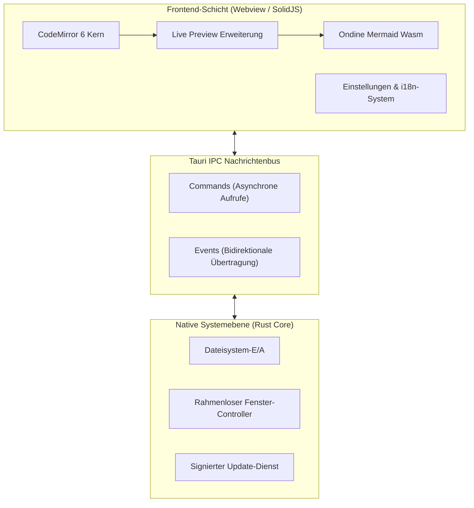
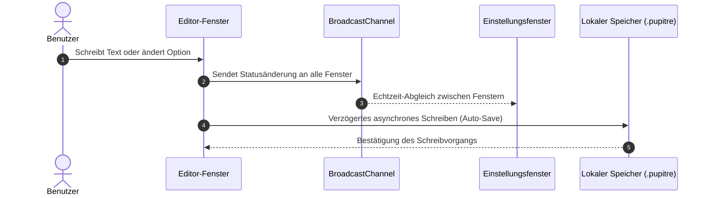

# 🪶 Pupitre - Handbuch für den minimalistischen Markdown-Editor

> **Pupitre** (französisch für _Notenständer_ oder _Pult_) ist ein eleganter, ablenkungsfreier Desktop-Markdown-Editor, der auf **Tauri v2 + SolidJS + CodeMirror 6** basiert.
> Entwickelt für reines Schreiben und makellose Typografie.


---

> [!NOTE]
> **Direkte Live-Vorschau (In-place Live Preview)**: In Pupitre werden Markdown-Formatierungszeichen automatisch ausgeblendet, sobald der Cursor die Zeile verlässt. Beim Bearbeiten erscheint die Syntax nahtlos wieder am selben Ort – für ein natürliches, ununterbrochenes Schreiberlebnis.

> [!TIP]
> Wichtige Tastenkombinationen:
>
> - <kbd>Ctrl</kbd> + <kbd>S</kbd>: Dokument speichern
> - <kbd>Ctrl</kbd> + <kbd>O</kbd>: Lokale Markdown-Datei öffnen
> - <kbd>Ctrl</kbd> + <kbd>B</kbd>: Gliederungsleiste ein-/ausblenden
> - <kbd>Ctrl</kbd> + <kbd>,</kbd>: Einstellungen blitzschnell öffnen

---

## 1. Typografie und Textformate (Typography & Styles)

Beim Verfassen Ihrer Texte bietet Pupitre ein harmonisches Schriftbild und flüssige Übergänge:

- **Fettgedruckt (Bold)**: `**stabil und schnell**` wird als **stabil und schnell** dargestellt
- _Kursiv (Italic)_: `*angenehmer Schreibfluss*` wird als _angenehmer Schreibfluss_ dargestellt
- _**Fett und kursiv (Bold & Italic)**_: `***das Beste aus beidem***` wird als _**das Beste aus beidem**_ dargestellt
- ~~Durchgestrichen (Strikethrough)~~: `~~schwerfällig und veraltet~~` wird als ~~schwerfällig und veraltet~~ dargestellt
- Inline-Code: `const app = new Pupitre();`
- Kombinierte Formatierung: **~~fetter, durchgestrichener Text~~** oder _`kursiver Code-Badge`_
- Tastaturbefehle: <kbd>Ctrl</kbd> + <kbd>Shift</kbd> + <kbd>S</kbd> Speichern unter
- Hyperlinks: [Offizielles Pupitre-GitHub-Repository](https://github.com/shalemore/pupitre)

### Verschachtelte Zitate

> Großartige Werkzeuge fühlen sich wie reine Luft an: Während der Arbeit unbemerkt, stärken sie doch im Stillen Ihre Konzentration.
>
> > —— „Vollkommenheit entsteht nicht dann, wenn man nichts mehr hinzufügen kann, sondern wenn man nichts mehr weglassen kann.“

---

## 2. Überschriftenhierarchie (Heading Hierarchy)

Pupitre analysiert alle Überschriften dynamisch und generiert eine Baumstruktur in der linken Seitenleiste:

### 2.1 Überschrift Ebene 3 (H3) - Funktionsmodul & Thesen

#### 2.1.1 Überschrift Ebene 4 (H4) - Spezifische Unterpunkte

##### 2.1.1.1 Überschrift Ebene 5 (H5) - Ergänzende Hinweise

###### 2.1.1.1.1 Überschrift Ebene 6 (H6) - Detaillierte Randnotiz

---

## 3. Listen und Aufgaben-Checklisten (Lists & Tasks)

### 3.1 Geplante Funktionen & Meilensteine

- [x] Schneller nativer Kern auf Basis von **Rust + Tauri 2.0**
- [x] Reaktives Frontend mit **SolidJS** (kein Virtual-DOM-Overhead)
- [x] Moderner Editor-Aufbau mit **CodeMirror 6**
- [x] Native Mermaid-Diagramme über **Ondine WebAssembly** in Echtzeit
- [x] Interaktive **GFM-Tabellen** direkt im Text bearbeiten
- [x] **Rahmenloses Design (Frameless)** mit eleganten Fensterschatten
- [x] Volle Unterstützung von **12 Sprachen** und automatischer Hell/Dunkel-Modus
- [x] Offizieller, kryptografisch signierter **Auto-Updater**
- [ ] Export als hochauflösendes PDF und eigenständiges HTML
- [ ] Lokale bidirektionale Verknüpfungen und Wissensgraph

### 3.2 Verschachtelte Listenbeispiele

1. Entwurfsphase
   - Spontane Gedanken in reinem Text festhalten
   - Wichtige Quellcode-Ausschnitte einfügen
   - Skizzen und Architekturen anlegen
2. Überarbeitungsphase
   1. Gliederungsstruktur prüfen
   2. Formeln und Diagramme auf Richtigkeit testen
   3. Änderungen in die Versionsverwaltung übertragen
3. Veröffentlichungsphase

### 3.3 Eingerückte Codeblöcke in Listen

Schritt-für-Schritt-Anleitungen unterstützen eingerückte Codeblöcke innerhalb von Listenelementen:

1. Melden Sie sich an und entsperren Sie den Client, bis die Synchronisierung abgeschlossen ist.
2. Aktivieren Sie **SSH Agent** und lokale Anmeldeinformationen in den Einstellungen.
3. Schreiben Sie die Konfiguration des öffentlichen Schlüssels:

   ```powershell
   New-Item -ItemType Directory -Path $HOME\.ssh -Force | Out-Null
   Set-Content `
     -Path $HOME\.ssh\github-pupitre.pub `
     -Value 'ssh-ed25519 AAAAC3NzaC1lZDI1NTE5AAAAID3FhmdqRz1VHUTNHuAKBA1nchfD63/9NTQmwQkx7tC'
   ```

4. Testen Sie die Terminal-Konnektivität:

   ```powershell
   & "$env:WINDIR\System32\OpenSSH\ssh.exe" -T git@github.com
   ```

---

## 4. GFM-Datentabellen (GFM Tables)

Pupitre unterstützt alle GitHub Flavored Markdown-Tabellen inklusive Spaltenausrichtung:

| Eigenschaft     |        Pupitre Editor        | Herkömmliche Electron-Editoren | Standard-Editor des Betriebssystems |
| :-------------- | :--------------------------: | :----------------------------: | ----------------------------------: |
| Kaltstartzeit   |         **< 300 ms**         |        1500 bis 3000 ms        |                            < 100 ms |
| RAM-Bedarf      |     **ca. 35 bis 60 MB**     |         200 bis 500 MB         |                             < 15 MB |
| Vorschauart     | **Direkt am Ort (In-place)** |      Geteilter Bildschirm      |                     Nur reiner Text |
| Diagramm-Engine | **Wasm Mermaid integriert**  |    Schwere externe Plugins     |                   Nicht unterstützt |
| Plattformbasis  |     **Tauri 2.0 (Rust)**     |  Vollständige Chromium-Engine  |            Betriebssystemspezifisch |
| Fensteroptik    |  **Rahmenlos mit Schatten**  |         Uneinheitlich          |          Klassischer nativer Rahmen |

---

## 5. Mermaid-Architektur- und Sequenzdiagramme (Mermaid)

Dank eingebetteter WebAssembly-Technologie werden Mermaid-Diagramme ohne Internetverbindung gerendert:

### 5.1 Systemarchitektur



### 5.2 Automatisches Speichern und Konfigurationsabgleich



---

## 6. Codeblöcke mit Syntax-Hervorhebung

Jeder Codeblock besitzt eine schwebende Leiste mit Sprachanzeige und Kopier-Schaltfläche:

### 6.1 Rust (Tauri Command Beispiel)

```rust
use tauri::{AppHandle, Manager};

#[tauri::command]
pub async fn open_settings_window(app: AppHandle) -> Result<(), String> {
    if let Some(win) = app.get_webview_window("settings") {
        let _ = win.unminimize();
        let _ = win.show();
        let _ = win.set_focus();
        return Ok(());
    }
    Ok(())
}
```

### 6.2 TypeScript (SolidJS Reaktiver Zustand)

```typescript
import { createSignal, createMemo } from "solid-js";

export function useWordCount(content: () => string) {
  const stats = createMemo(() => {
    const text = content();
    const words = (text.match(/\S+/g) || []).length;
    const chars = text.length;
    return { words, chars };
  });

  return stats;
}
```

---

## 7. Mathematische Formeln (KaTeX)

Gestochen scharfe mathematische Typografie für Formeln im Text und in abgesetzten Blöcken:

- Formel im Fließtext: Einsteins berühmte Gleichung $E = mc^2$ sowie die Eulersche Identität $e^{i\pi} + 1 = 0$.
- Abgesetzte Formeln (Gaußsche Normalverteilung und Maxwell-Ampère-Gesetz):

$$
f(x) = \frac{1}{\sigma \sqrt{2\pi}} \exp\left( -\frac{(x - \mu)^2}{2\sigma^2} \right)
$$

$$
\oint_C \mathbf{B} \cdot d\boldsymbol{\ell} = \mu_0 I_{\text{enc}} + \mu_0 \varepsilon_0 \frac{d\Phi_E}{dt}
$$

---

## 8. Interaktive Ausklappbereiche (Collapsible Details)

<details>
<summary><b>🔍 Klicken zum Ausklappen: Tastaturkürzel-Übersicht</b></summary>

| Aktion                   | Windows- / Linux-Tastenkombination                | macOS-Tastenkombination                        |
| :----------------------- | :------------------------------------------------ | :--------------------------------------------- |
| Neues Dokument           | <kbd>Ctrl</kbd> + <kbd>N</kbd>                    | <kbd>⌘</kbd> + <kbd>N</kbd>                    |
| Datei öffnen             | <kbd>Ctrl</kbd> + <kbd>O</kbd>                    | <kbd>⌘</kbd> + <kbd>O</kbd>                    |
| Dokument speichern       | <kbd>Ctrl</kbd> + <kbd>S</kbd>                    | <kbd>⌘</kbd> + <kbd>S</kbd>                    |
| Speichern unter          | <kbd>Ctrl</kbd> + <kbd>Shift</kbd> + <kbd>S</kbd> | <kbd>⌘</kbd> + <kbd>Shift</kbd> + <kbd>S</kbd> |
| Text suchen              | <kbd>Ctrl</kbd> + <kbd>F</kbd>                    | <kbd>⌘</kbd> + <kbd>F</kbd>                    |
| Text ersetzen            | <kbd>Ctrl</kbd> + <kbd>H</kbd>                    | <kbd>⌥</kbd> + <kbd>⌘</kbd> + <kbd>F</kbd>     |
| Vergrößern / Verkleinern | <kbd>Ctrl</kbd> + <kbd>+</kbd> / <kbd>-</kbd>     | <kbd>⌘</kbd> + <kbd>+</kbd> / <kbd>-</kbd>     |
| Einstellungen            | <kbd>Ctrl</kbd> + <kbd>,</kbd>                    | <kbd>⌘</kbd> + <kbd>,</kbd>                    |

</details>

---

## 9. Fußnoten und Ausblick (Footnotes)

Pupitre begleitet Sie bei Aufsätzen, technischen Artikeln, Architekturentwürfen und täglichen Notizen[^1].

Mögen Ihre Gedanken frei und ungehindert auf das Papier fließen.

[^1]: Pupitre ist ein Open-Source-Projekt für alle, die Freude an ungestörtem, fokussiertem Schreiben haben. Wir freuen uns über Beiträge auf GitHub!
