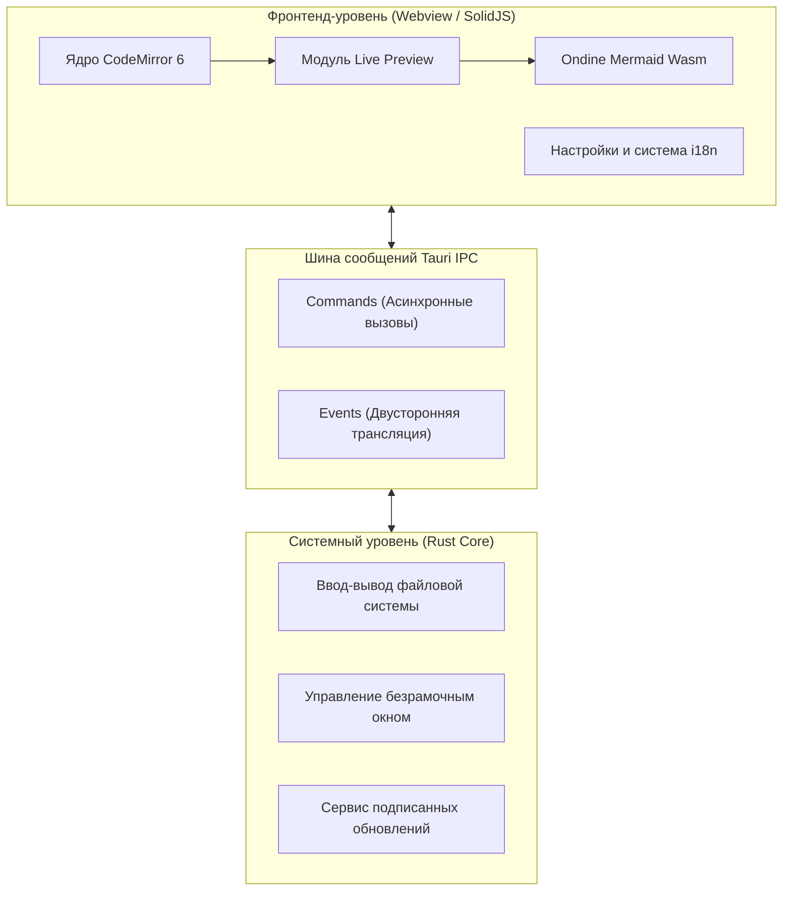
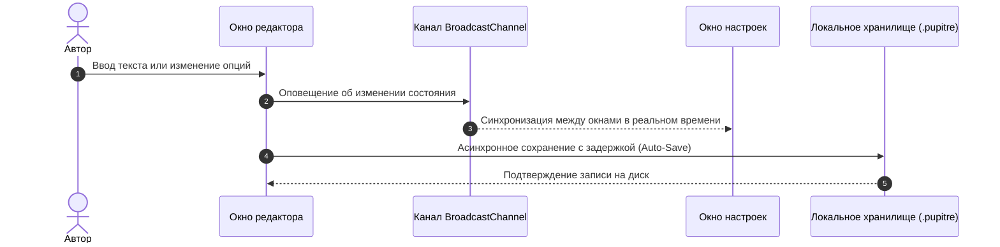

# 🪶 Pupitre — руководство по минималистичному редактору Markdown

> **Pupitre** (франц. _пюпитр_ или _кафедра_) — это быстрый, легкий и элегантный десктопный Markdown-редактор на базе **Tauri v2 + SolidJS + CodeMirror 6**.
> Создан исключительно для сосредоточенного письма и безупречной типографики.


---

> [!NOTE]
> **Прямой предпросмотр на месте (In-place Live Preview)**: В Pupitre разметка Markdown плавно сворачивается в красивое форматирование, когда курсор покидает строку. При редактировании строки разметка немедленно раскрывается на месте для непрерывного процесса письма.

> [!TIP]
> Основные горячие клавиши:
>
> - <kbd>Ctrl</kbd> + <kbd>S</kbd>: Сохранить текущий документ
> - <kbd>Ctrl</kbd> + <kbd>O</kbd>: Открыть локальный Markdown-файл
> - <kbd>Ctrl</kbd> + <kbd>B</kbd>: Показать / скрыть боковую панель структуры
> - <kbd>Ctrl</kbd> + <kbd>,</kbd>: Мгновенно открыть настройки

---

## 1. Типографика и стили текста (Typography & Styles)

При работе с текстом Pupitre обеспечивает гармоничные стили и плавную анимацию:

- **Полужирный шрифт (Bold)**: `**надежный и быстрый**` отображается как **надежный и быстрый**
- _Курсив (Italic)_: `*плавный рабочий процесс*` отображается как _плавный рабочий процесс_
- _**Полужирный курсив (Bold & Italic)**_: `***лучшее из двух миров***` отображается как _**лучшее из двух миров**_
- ~~Зачеркнутый текст (Strikethrough)~~: `~~тяжелый и громоздкий~~` отображается как ~~тяжелый и громоздкий~~
- Встроенный код: `const app = new Pupitre();`
- Комбинированные стили: **~~полужирный зачеркнутый текст~~** или _`код с курсивом`_
- Клавиатурные клавиши: <kbd>Ctrl</kbd> + <kbd>Shift</kbd> + <kbd>S</kbd> Сохранить как
- Внешняя ссылка: [Официальный репозиторий Pupitre на GitHub](https://github.com/shalemore/pupitre)

### Вложенные цитаты

> Превосходные инструменты подобны чистому воздуху: незаметны в процессе работы, но постоянно поддерживают ваше вдохновение.
>
> > —— «Совершенство достигается не тогда, когда больше нечего добавить, а тогда, когда нечего убрать.»

---

## 2. Иерархия заголовков (Heading Hierarchy)

Pupitre автоматически анализирует заголовки и формирует дерево оглавления на левой боковой панели:

### 2.1 Заголовок уровня 3 (H3) - Функциональные модули

#### 2.1.1 Заголовок уровня 4 (H4) - Детализация подпунктов

##### 2.1.1.1 Заголовок уровня 5 (H5) - Дополнительные пояснения

###### 2.1.1.1.1 Заголовок уровня 6 (H6) - Минимальные примечания

---

## 3. Списки и списки задач (Lists & Tasks)

### 3.1 План разработки функционала

- [x] Сверхбыстрое нативное ядро на базе **Rust + Tauri 2.0**
- [x] Реактивный интерфейс **SolidJS** (без лишних затрат на Virtual-DOM)
- [x] Архитектура на основе **CodeMirror 6** с режимом предпросмотра
- [x] Мгновенная визуализация диаграмм Mermaid через **Ondine WebAssembly**
- [x] Интерактивные **таблицы GFM** с визуальным редактированием
- [x] **Безрамочный дизайн (Frameless)** с аккуратными тенями окна
- [x] Встроенная поддержка **12 языков** и автоматическая темная/светлая тема
- [x] Безопасный инкрементальный автообновлятор **Auto-Updater** с цифровой подписью
- [ ] Экспорт в файлы PDF высокого разрешения и автономный HTML
- [ ] Двунаправленные локальные ссылки и граф знаний

### 3.2 Вложенные нумерованные и маркированные списки

1. Этап подготовки и черновика
   - Фиксация спонтанных мыслей в виде чистого текста
   - Вставка ключевых фрагментов кода
   - Наброски схем архитектуры
2. Этап редактирования и шлифовки
   1. Проверка структуры заголовков
   2. Контроль математических формул и диаграмм
   3. Фиксация изменений в системе контроля версий
3. Этап публикации и архивирования

### 3.3 Блоки кода с отступом в списках

Пошаговые руководства поддерживают вложенные блоки кода прямо внутри пунктов списков:

1. Войдите в клиент и разблокируйте хранилище, дождитесь завершения синхронизации.
2. Включите **SSH Agent** и поддержку локальных учетных данных в настройках.
3. Запишите конфигурацию открытого ключа для прозрачной аутентификации:

   ```powershell
   New-Item -ItemType Directory -Path $HOME\.ssh -Force | Out-Null
   Set-Content `
     -Path $HOME\.ssh\github-pupitre.pub `
     -Value 'ssh-ed25519 AAAAC3NzaC1lZDI1NTE5AAAAID3FhmdqRz1VHUTNHuAKBA1nchfD63/9NTQmwQkx7tC'
   ```

4. Проверьте подключение через терминал:

   ```powershell
   & "$env:WINDIR\System32\OpenSSH\ssh.exe" -T git@github.com
   ```

---

## 4. Таблицы данных GFM (GFM Tables)

Pupitre полностью поддерживает синтаксис таблиц GitHub Flavored Markdown и выравнивание столбцов:

| Критерий                 |         Редактор Pupitre         | Традиционные редакторы на Electron |    Системный Блокнот |
| :----------------------- | :------------------------------: | :--------------------------------: | -------------------: |
| Время холодного старта   |           **< 300 мс**           |           1500 — 3000 мс           |             < 100 мс |
| Объем оперативной памяти |         **~35 — 60 МБ**          |            200 — 500 МБ            |              < 15 МБ |
| Механизм предпросмотра   |     **На месте (In-place)**      |         Разделенный экран          | Только простой текст |
| Движок диаграмм          |   **Встроенный Wasm Mermaid**    |  Зависимость от тяжелых плагинов   |    Не поддерживается |
| Платформа выполнения     |       **Tauri 2.0 (Rust)**       |        Полноценный Chromium        |       Только одна ОС |
| Внешний вид окна         | **Безрамочный с мягкими тенями** |            Неоднородный            | Стандартная рамка ОС |

---

## 5. Архитектурные и последовательные диаграммы Mermaid (Mermaid)

Благодаря встроенному WebAssembly диаграммы Mermaid рендерятся мгновенно без доступа к сети:

### 5.1 Архитектура приложения



### 5.2 Схема автосохранения и синхронизации настроек



---

## 6. Блоки исходного кода с подсветкой синтаксиса

Каждый блок снабжен плавающей панелью с указанием языка и кнопкой копирования в один клик:

### 6.1 Rust (Пример команды Tauri)

```rust
use tauri::{AppHandle, Manager};

#[tauri::command]
pub async fn open_settings_window(app: AppHandle) -> Result<(), String> {
    if let Some(win) = app.get_webview_window("settings") {
        let _ = win.unminimize();
        let _ = win.show();
        let _ = win.set_focus();
        return Ok(());
    }
    Ok(())
}
```

### 6.2 TypeScript (Реактивное состояние SolidJS)

```typescript
import { createSignal, createMemo } from "solid-js";

export function useWordCount(content: () => string) {
  const stats = createMemo(() => {
    const text = content();
    const words = (text.match(/\S+/g) || []).length;
    const chars = text.length;
    return { words, chars };
  });

  return stats;
}
```

---

## 7. Математические формулы и научная нотация (KaTeX)

Качественный рендеринг формул в строке и в отдельных выделенных блоках:

- Строчная формула: Знаменитое уравнение эквивалентности массы и энергии $E = mc^2$, а также тождество Эйлера $e^{i\pi} + 1 = 0$.
- Выделенная формула (Нормальное распределение Гаусса и закон Максвелла — Ампера):

$$
f(x) = \frac{1}{\sigma \sqrt{2\pi}} \exp\left( -\frac{(x - \mu)^2}{2\sigma^2} \right)
$$

$$
\oint_C \mathbf{B} \cdot d\boldsymbol{\ell} = \mu_0 I_{\text{enc}} + \mu_0 \varepsilon_0 \frac{d\Phi_E}{dt}
$$

---

## 8. Интерактивные спойлеры (Collapsible Details)

<details>
<summary><b>🔍 Нажмите, чтобы открыть: Справочник горячих клавиш Pupitre</b></summary>

| Действие       | Сочетание для Windows / Linux                     | Сочетание для macOS                            |
| :------------- | :------------------------------------------------ | :--------------------------------------------- |
| Новый документ | <kbd>Ctrl</kbd> + <kbd>N</kbd>                    | <kbd>⌘</kbd> + <kbd>N</kbd>                    |
| Открыть файл   | <kbd>Ctrl</kbd> + <kbd>O</kbd>                    | <kbd>⌘</kbd> + <kbd>O</kbd>                    |
| Сохранить файл | <kbd>Ctrl</kbd> + <kbd>S</kbd>                    | <kbd>⌘</kbd> + <kbd>S</kbd>                    |
| Сохранить как  | <kbd>Ctrl</kbd> + <kbd>Shift</kbd> + <kbd>S</kbd> | <kbd>⌘</kbd> + <kbd>Shift</kbd> + <kbd>S</kbd> |
| Найти текст    | <kbd>Ctrl</kbd> + <kbd>F</kbd>                    | <kbd>⌘</kbd> + <kbd>F</kbd>                    |
| Заменить текст | <kbd>Ctrl</kbd> + <kbd>H</kbd>                    | <kbd>⌥</kbd> + <kbd>⌘</kbd> + <kbd>F</kbd>     |
| Масштаб +/-    | <kbd>Ctrl</kbd> + <kbd>+</kbd> / <kbd>-</kbd>     | <kbd>⌘</kbd> + <kbd>+</kbd> / <kbd>-</kbd>     |
| Настройки      | <kbd>Ctrl</kbd> + <kbd>,</kbd>                    | <kbd>⌘</kbd> + <kbd>,</kbd>                    |

</details>

---

## 9. Сноски и заключение (Footnotes)

Pupitre станет вашим надежным спутником при создании статей, технических заметок, книг и архитектурных схем[^1].

Пусть ваши мысли свободно превращаются в текст на кончиках пальцев.

[^1]: Pupitre — это проект с открытым исходным кодом для тех, кто ценит чистый фокус и письмо без помех. Будем рады вашим предложениям на GitHub!
