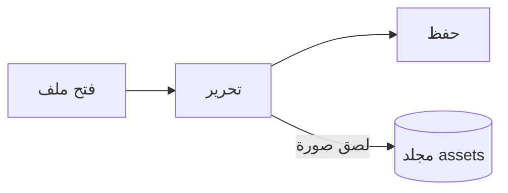

# دليل Pupitre


إنّ Pupitre محرر Markdown لسطح المكتب. المستندات هي ملفات `.md` عادية: ما تراه معروض منسقًا في مكانه، وتظهر صياغة Markdown أثناء وجود المؤشر عليها. هذا الدليل نموذج لما يعرضه المحرر أيضًا؛ عدّله بحرية، فلن يُحفظ ما لم تختر **حفظ باسم**.

## التحرير

حرّك المؤشر داخل **نص غامق** أو `تعليمات برمجية مضمنة` أو [رابط](https://github.com/shalemore/pupitre) فتظهر صياغته حوله. تتصرف العلامات كأنها نص:

- احذف علامة لإزالة تنسيقها، وأضف `#` أمام العنوان أو احذفها لتغيير مستواه.
- تحديد النص يُظهر الصيغة داخله، والنسخ ينسخ Markdown.
- يتبع النقر مع <kbd>Ctrl</kbd> الرابط: تُفتح عناوين الويب في المتصفح، وتنتقل روابط `#heading` إلى العنوان، ويفتح رابطُ ملف Markdown المجاور للمستند ذلك الملف.
- التنسيق متاح في قائمتَي **فقرة** و**تنسيق** وفي قائمة السياق والاختصارات أدناه.

<details>
<summary>اختصارات لوحة المفاتيح (Ctrl هو ⌘ على macOS)</summary>

| الإجراء                             | الاختصار                                                                                                     |
| :--------------------------------- | :---------------------------------------------------------------------------------------------------------- |
| غامق / مائل / تعليمات برمجية مضمنة | <kbd>Ctrl</kbd>+<kbd>B</kbd> / <kbd>I</kbd> / <kbd>Shift</kbd>+<kbd>`</kbd>                                 |
| تسطير                              | <kbd>Ctrl</kbd>+<kbd>U</kbd>                                                                                |
| يتوسطه خط                          | <kbd>Alt</kbd>+<kbd>Shift</kbd>+<kbd>5</kbd>                                                                |
| مسح التنسيق                        | <kbd>Ctrl</kbd>+<kbd>\\</kbd>                                                                               |
| رابط                               | <kbd>Ctrl</kbd>+<kbd>K</kbd>                                                                                |
| إدراج صورة                         | <kbd>Ctrl</kbd>+<kbd>Shift</kbd>+<kbd>I</kbd>                                                               |
| العنوان 1–6 / فقرة                 | <kbd>Ctrl</kbd>+<kbd>1</kbd>…<kbd>6</kbd> / <kbd>0</kbd>                                                    |
| اقتباس                             | <kbd>Ctrl</kbd>+<kbd>Shift</kbd>+<kbd>Q</kbd>                                                               |
| قائمة مرقمة / نقطية                | <kbd>Ctrl</kbd>+<kbd>Shift</kbd>+<kbd>[</kbd> / <kbd>]</kbd>                                                |
| كتلة تعليمات برمجية / كتلة رياضية  | <kbd>Ctrl</kbd>+<kbd>Shift</kbd>+<kbd>K</kbd> / <kbd>M</kbd>                                                |
| جدول                               | <kbd>Ctrl</kbd>+<kbd>T</kbd>                                                                                |
| بحث / استبدال                      | <kbd>Ctrl</kbd>+<kbd>F</kbd> / <kbd>Ctrl</kbd>+<kbd>H</kbd> (macOS: <kbd>⌘</kbd>+<kbd>⌥</kbd>+<kbd>F</kbd>) |
| إعادة فتح علامة التبويب المغلقة     | <kbd>Ctrl</kbd>+<kbd>Shift</kbd>+<kbd>T</kbd>                                                               |
| الأشرطة الجانبية                    | <kbd>Ctrl</kbd>+<kbd>Shift</kbd>+<kbd>L</kbd>                                                               |
| وضع المصدر                         | <kbd>Ctrl</kbd>+<kbd>/</kbd>                                                                                |
| وضع التركيز / وضع الآلة الكاتبة     | <kbd>F8</kbd> / <kbd>F9</kbd>                                                                               |
| إعادة ضبط التكبير                  | <kbd>Ctrl</kbd>+<kbd>Shift</kbd>+<kbd>0</kbd>                                                               |
| التفضيلات                           | <kbd>Ctrl</kbd>+<kbd>,</kbd>                                                                                |

</details>

## أوضاع الكتابة

- **وضع التركيز** يعتّم كل شيء عدا الفقرة التي تكتبها.
- **وضع الآلة الكاتبة** يُبقي السطر الذي تكتبه في منتصف النافذة، أو قرب أعلاها أو أسفلها، وفقًا لما تحدده التفضيلات › المحرر.

كلاهما في قائمة **عرض** وفي التفضيلات › المحرر، ويمكن الجمع بينهما.

## نمط النافذة

يبدّل التفضيلات › المظهر › نمط النافذة بين **كلاسيكي** و**غامر**. في النمط الغامر يوضع المستند في بطاقة داخل النافذة؛ يتنحى شريط العنوان والأشرطة الجانبية عند الكتابة أو التمرير ويعودان عندما يصل المؤشر إلى أعلى النافذة أو إلى إحدى حافتيها الجانبيتين. يُبقي التثبيت في الشريط الجانبي الأشرطةَ الجانبية مفتوحة، ويغيّر سحبُ حافة الشريط الجانبي عرضَه.

## الملفات والصور

- يحتفظ Pupitre بنهايات الأسطر في الملف الذي فتحه ما لم يحدد التفضيلات › Markdown غير ذلك. وهناك أيضًا تُحدَّد الصيغة التي تُدرجها أوامر التنسيق.
- تُحفظ الصور الملصقة في مجلد بجانب المستند (`assets` افتراضيًا، التفضيلات › Markdown). أما المستند الذي لم يُحفظ بعد فيُبقيها في الذاكرة ويكتبها عند أول حفظ.
- يجعل التفضيلات › عام › تطبيق Markdown الافتراضي برنامج Pupitre يفتح ملفات `.md` من مدير الملفات.
- تُخزَّن التفضيلات في `settings.json`؛ ويعرض التفضيلات › حول مجلده. تُكتب فقط القيم المختلفة عن الافتراضية، وأي حقل يتعذر قراءته يعود إلى قيمته الافتراضية دون التأثير في بقية الحقول.
- يمكن أن تكون للمجلد إعدادات خاصة به: عند فتح مجلد، تعرض التفضيلات مفتاحًا بين **عمومي** و**هذا المجلد**. تُكتب التغييرات التي تُجريها ضمن **هذا المجلد** في `.pupitre/settings.json` داخله، ويُنشئه أول تغيير، وتُطبَّق على الإعدادات العمومية كلما فُتح ذلك المجلد. وإعادة تعيين إعداد هناك تعيده إلى القيمة العمومية.

## السمات

تنسّق السمة النافذة كلها والمستند. يسردها التفضيلات › المظهر مع أنظمة الألوان التي تدعمها، ويمكن اختيار سمة مستقلة للوضع الداكن.

تأتي السمات مع التطبيق: كل سمة مجلد في `src/renderer/themes/<name>/` يحوي `index.css`، واسم المجلد هو اسم السمة. تُوضع الخطوط أو الصور التي تستخدمها السمة في المجلد نفسه وتُشار إليها بمسارات `url()` نسبية.

```css
:root {
  /* أنظمة الألوان التي تدعمها السمة: فاتح أو داكن أو كلاهما */
  color-scheme: light dark;

  /* الخط الافتراضي لنص المتن، ويمكن تغييره من التفضيلات */
  --font-document: Georgia, serif;

  /* رموز التصميم المستخدمة في النافذة بأكملها */
  --ui-surface-1: oklch(0.99 0.01 90);
  --ui-brand: oklch(0.55 0.12 250);
}

@media (prefers-color-scheme: dark) {
  :root {
    --ui-surface-1: oklch(0.2 0.01 90);
  }
}

.md-document .md-h1 {
  font-size: 2em;
}
```

- تُضبط الألوان عبر رموز `--ui-*` (الأسطح والنص والتمييز) و`--syntax-*` للتعليمات البرمجية. قيمها الافتراضية وقائمتها الكاملة في `src/renderer/app.css` وسمة `pupitre`.
- ينبغي أن ترسم أشرطة الاقتباس بـ `var(--alert-color, …)` لتحتفظ التنبيهات بألوانها.
- حجم خط النص وارتفاع السطر وعرض المحتوى تخص المستخدم وتتغلب دائمًا؛ استخدم `em` للأحجام داخل المستند وخصائص منطقية مثل `padding-inline-start` لينعكس النص من اليمين إلى اليسار.

## مرجع Markdown

### النص

**غامق**، _مائل_، ~~يتوسطه خط~~، `تعليمات برمجية مضمنة`، [روابط](https://commonmark.org)، H~2~O، x^2^، ==تمييز==، :tada: و<kbd>Esc</kbd>. يُعرض HTML المضمّن عندما يكون عنصرًا كاملًا، ويظهر كنص مصدري فيما عدا ذلك. الفقرة التي لا تحوي سوى `[TOC]` تتحوّل إلى قائمة بعناوين المستند.

> اقتباس.
>
> > اقتباس متداخل.

> [!NOTE]
> تنبيهات GitHub: `[!NOTE]` و`[!TIP]` و`[!IMPORTANT]` و`[!WARNING]` و`[!CAUTION]`.

> [!WARNING]
> يجب أن تكون العلامة في السطر الأول من الاقتباس.

### القوائم

1. مرقمة
   - متداخلة نقطية
   - [x] يمكن تحديد المهام
   - [ ] وإلغاء تحديدها
2. يمكن أن تحوي القوائم تعليمات برمجية:

   ```sh
   npm run dev
   ```

### جدول

| يمين | وسط  |  يسار |
| :--- | :--: | ----: |
| خلية | خلية |  1.00 |
| أطول |  نص  | 10.50 |

### التعليمات البرمجية

```typescript
function countWords(text: string): number {
  const segmenter = new Intl.Segmenter(undefined, { granularity: "word" });
  return [...segmenter.segment(text)].filter((part) => part.isWordLike).length;
}
```

### الرياضيات

معادلة مضمنة $e^{i\pi} + 1 = 0$ ومعادلة منفصلة:

$$
\int_{-\infty}^{\infty} e^{-x^2} \, dx = \sqrt{\pi}
$$

تُكتب المعادلات الكيميائية بـ `\ce`: $\ce{2H2 + O2 -> 2H2O}$.

### المخططات



### الحواشي

جملة تحتوي حاشية[^1].

[^1]: تُدرج الحواشي في نهاية المستند.

<!-- تُحفظ التعليقات في الملف وتظهر كنص مصدري. -->
