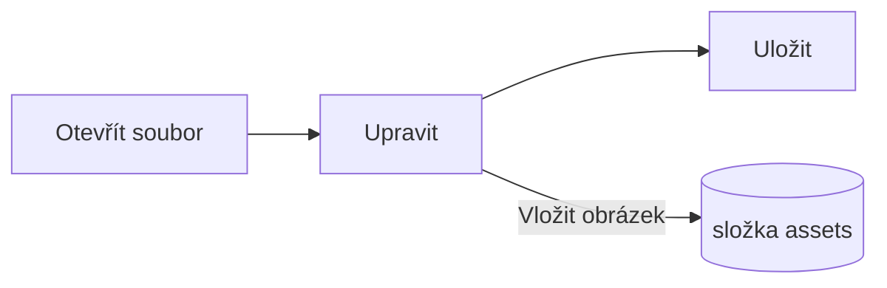

# Průvodce aplikací Pupitre


Pupitre je počítačový editor Markdownu. Dokumenty jsou běžné soubory `.md`: co vidíte, se vykresluje přímo na místě a syntaxe Markdownu se zobrazuje tam, kde je kurzor. Tento průvodce je zároveň ukázkou toho, co editor vykresluje; upravujte ho volně, uloží se jen při volbě **Uložit jako**.

## Úpravy

Umístěte kurzor do **tučného textu**, `vloženého kódu` nebo [odkazu](https://github.com/shalemore/pupitre) a kolem něj se objeví syntaxe. Značky se chovají jako text:

- Smazáním značky formátování odstraníte; přidáním nebo smazáním `#` před nadpisem změníte jeho úroveň.
- Výběr textu ukáže jeho syntaxi a kopírování kopíruje Markdown.
- Formátování je v nabídkách **Odstavec** a **Formát**, v místní nabídce a ve zkratkách níže.

<details>
<summary>Klávesové zkratky (na macOS je Ctrl nahrazeno ⌘)</summary>

| Akce                               | Zkratka                                                                                                     |
| :--------------------------------- | :---------------------------------------------------------------------------------------------------------- |
| Tučné / Kurzíva / Vložený kód      | <kbd>Ctrl</kbd>+<kbd>B</kbd> / <kbd>I</kbd> / <kbd>Shift</kbd>+<kbd>`</kbd>                                 |
| Přeškrtnutí                        | <kbd>Alt</kbd>+<kbd>Shift</kbd>+<kbd>5</kbd>                                                                |
| Odkaz                              | <kbd>Ctrl</kbd>+<kbd>K</kbd>                                                                                |
| Nadpis 1–6 / Odstavec              | <kbd>Ctrl</kbd>+<kbd>1</kbd>…<kbd>6</kbd> / <kbd>0</kbd>                                                    |
| Citace                             | <kbd>Ctrl</kbd>+<kbd>Shift</kbd>+<kbd>Q</kbd>                                                               |
| Číslovaný / odrážkový seznam       | <kbd>Ctrl</kbd>+<kbd>Shift</kbd>+<kbd>[</kbd> / <kbd>]</kbd>                                                |
| Blok kódu / Matematický blok       | <kbd>Ctrl</kbd>+<kbd>Shift</kbd>+<kbd>K</kbd> / <kbd>M</kbd>                                                |
| Tabulka                            | <kbd>Ctrl</kbd>+<kbd>T</kbd>                                                                                |
| Najít / Nahradit                   | <kbd>Ctrl</kbd>+<kbd>F</kbd> / <kbd>Ctrl</kbd>+<kbd>H</kbd> (macOS: <kbd>⌘</kbd>+<kbd>⌥</kbd>+<kbd>F</kbd>) |
| Osnova                             | <kbd>Ctrl</kbd>+<kbd>Shift</kbd>+<kbd>L</kbd>                                                               |
| Režim soustředění / psacího stroje | <kbd>F8</kbd> / <kbd>F9</kbd>                                                                               |
| Obnovit zvětšení                   | <kbd>Ctrl</kbd>+<kbd>Shift</kbd>+<kbd>0</kbd>                                                               |
| Předvolby                          | <kbd>Ctrl</kbd>+<kbd>,</kbd>                                                                                |

</details>

## Režimy psaní

- **Režim soustředění** ztlumí vše kromě odstavce, který píšete.
- **Režim psacího stroje** udržuje psaný řádek uprostřed okna.

Oba jsou v nabídce **Zobrazení** a v Předvolby › Editor a lze je kombinovat.

## Styl okna

Předvolby › Vzhled › Styl okna přepíná mezi **Klasickým** a **Imersivním**. V imersivním stylu leží dokument na kartě uvnitř okna; záhlaví a osnova ustoupí, jakmile začnete psát nebo rolovat, a vrátí se, když ukazatel dosáhne horního nebo počátečního okraje okna.

## Soubory a obrázky

- Pupitre zachová konce řádků otevřeného souboru, pokud Předvolby › Markdown neříkají jinak. Syntaxe, kterou vkládají příkazy formátování, se nastavuje tamtéž.
- Vložené obrázky se ukládají do složky vedle dokumentu (ve výchozím nastavení `assets`, Předvolby › Markdown). Neuložený dokument je drží v paměti a zapíše je při prvním uložení.
- Předvolby › Obecné › Výchozí aplikace pro Markdown zajistí, že Pupitre otevírá soubory `.md` ze správce souborů.
- Předvolby se ukládají do `settings.json`; Předvolby › O aplikaci zobrazí jeho složku. Ukládají se jen hodnoty odlišné od výchozích a pole, které nelze přečíst, se vrátí na výchozí, aniž by ovlivnilo ostatní.

## Motivy

Motiv určuje vzhled celého okna a dokumentu. Předvolby › Vzhled je vypisují s barevnými schématy, která podporují, a pro tmavý režim lze zvolit samostatný motiv.

Motivy jsou součástí aplikace: každý je složka v `src/renderer/themes/<název>/` s `index.css` a název složky je název motivu. Písma nebo obrázky, které motiv používá, leží ve stejné složce a odkazují se relativními `url()`.

```css
:root {
  /* Barevná schémata, která motiv podporuje: světlé, tmavé nebo obojí */
  color-scheme: light dark;

  /* Výchozí písmo základního textu; lze změnit v předvolbách */
  --font-document: Georgia, serif;

  /* Designové tokeny platné pro celé okno */
  --ui-surface-1: oklch(0.99 0.01 90);
  --ui-brand: oklch(0.55 0.12 250);
}

@media (prefers-color-scheme: dark) {
  :root {
    --ui-surface-1: oklch(0.2 0.01 90);
  }
}

.md-document .md-h1 {
  font-size: 2em;
}
```

- Barvy se nastavují pomocí tokenů `--ui-*` (plochy, text, akcent) a `--syntax-*` pro kód. Jejich výchozí hodnoty a celý seznam jsou v `src/renderer/app.css` a v motivu `pupitre`.
- Proužky citací mají používat `var(--alert-color, …)`, aby si upozornění ponechala své barvy.
- Velikost textu, řádkování a šířka obsahu patří uživateli a vždy vyhrávají; v dokumentu používejte `em` a logické vlastnosti jako `padding-inline-start`, aby se text zprava doleva zrcadlil.

## Referenční příručka Markdownu

### Text

**Tučné**, _kurzíva_, ~~přeškrtnutí~~, `vložený kód`, [odkazy](https://commonmark.org), H<sub>2</sub>O, x<sup>2</sup>, <kbd>Esc</kbd> a <mark>zvýraznění</mark>. Vložené HTML se vykreslí, když tvoří kompletní prvek, jinak se zobrazí jako zdrojový kód.

> Citace.
>
> > Vnořená citace.

> [!NOTE]
> Upozornění GitHubu: `[!NOTE]`, `[!TIP]`, `[!IMPORTANT]`, `[!WARNING]` a `[!CAUTION]`.

> [!WARNING]
> Značka musí být prvním řádkem citace.

### Seznamy

1. Číslovaný
   - Vnořený, odrážkový
   - [x] Úkoly lze odškrtnout
   - [ ] A opět zrušit
2. Seznamy mohou obsahovat kód:

   ```sh
   npm run dev
   ```

### Tabulka

| Vlevo | Střed | Vpravo |
| :---- | :---: | -----: |
| Buňka | Buňka |   1.00 |
| Delší | Text  |  10.50 |

### Kód

```typescript
function countWords(text: string): number {
  const segmenter = new Intl.Segmenter(undefined, { granularity: "word" });
  return [...segmenter.segment(text)].filter((part) => part.isWordLike).length;
}
```

### Matematika

V textu $e^{i\pi} + 1 = 0$ a jako blok:

$$
\int_{-\infty}^{\infty} e^{-x^2} \, dx = \sqrt{\pi}
$$

### Diagramy



### Poznámky pod čarou

Věta s poznámkou pod čarou[^1].

[^1]: Poznámky pod čarou jsou uvedeny na konci dokumentu.

<!-- Komentáře zůstávají v souboru a zobrazují se jako zdrojový kód. -->
