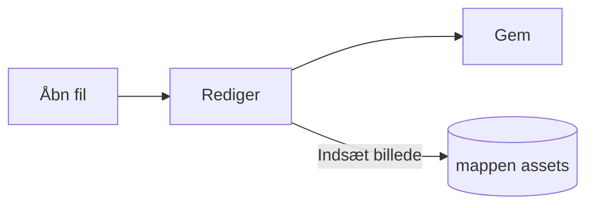

# Pupitres guide


Pupitre er en Markdown-editor til skrivebordet. Dokumenter er almindelige `.md`-filer: det, du ser, gengives på stedet, og Markdown-syntaksen vises der markøren står. Denne guide er også et eksempel på, hvad editoren gengiver; rediger den frit, den gemmes først, når du vælger **Gem som**.

## Redigering

Sæt markøren inde i **fed tekst**, et `kodeafsnit` eller et [link](https://github.com/shalemore/pupitre), og syntaksen vises omkring den. Markørerne opfører sig som tekst:

- Slet en markør for at fjerne formateringen; tilføj eller slet et `#` foran en overskrift for at ændre niveauet.
- Når du markerer tekst, vises syntaksen i den, og kopiering kopierer Markdown.
- <kbd>Ctrl</kbd>+klik følger et link: webadresser åbnes i browseren, `#overskrift`-links ruller til overskriften, og links til en Markdown-fil ved siden af dokumentet åbner den.
- Formatering findes i menuerne **Afsnit** og **Format**, i højrekliksmenuen og i genvejene nedenfor.

<details>
<summary>Tastaturgenveje (Ctrl er ⌘ på macOS)</summary>

| Handling                              | Genvej                                                                                                      |
| :------------------------------------ | :---------------------------------------------------------------------------------------------------------- |
| Fed / Kursiv / Inline-kode            | <kbd>Ctrl</kbd>+<kbd>B</kbd> / <kbd>I</kbd> / <kbd>Shift</kbd>+<kbd>`</kbd>                                 |
| Gennemstreget                         | <kbd>Alt</kbd>+<kbd>Shift</kbd>+<kbd>5</kbd>                                                                |
| Understregning                        | <kbd>Ctrl</kbd>+<kbd>U</kbd>                                                                                |
| Ryd formatering                       | <kbd>Ctrl</kbd>+<kbd>\\</kbd>                                                                               |
| Link                                  | <kbd>Ctrl</kbd>+<kbd>K</kbd>                                                                                |
| Indsæt billede…                       | <kbd>Ctrl</kbd>+<kbd>Shift</kbd>+<kbd>I</kbd>                                                               |
| Overskrift 1–6 / Afsnit               | <kbd>Ctrl</kbd>+<kbd>1</kbd>…<kbd>6</kbd> / <kbd>0</kbd>                                                    |
| Citat                                 | <kbd>Ctrl</kbd>+<kbd>Shift</kbd>+<kbd>Q</kbd>                                                               |
| Nummereret / punktliste               | <kbd>Ctrl</kbd>+<kbd>Shift</kbd>+<kbd>[</kbd> / <kbd>]</kbd>                                                |
| Kodeblok / Matematikblok              | <kbd>Ctrl</kbd>+<kbd>Shift</kbd>+<kbd>K</kbd> / <kbd>M</kbd>                                                |
| Tabel                                 | <kbd>Ctrl</kbd>+<kbd>T</kbd>                                                                                |
| Søg / Erstat                          | <kbd>Ctrl</kbd>+<kbd>F</kbd> / <kbd>Ctrl</kbd>+<kbd>H</kbd> (macOS: <kbd>⌘</kbd>+<kbd>⌥</kbd>+<kbd>F</kbd>) |
| Genåbn lukket faneblad                | <kbd>Ctrl</kbd>+<kbd>Shift</kbd>+<kbd>T</kbd>                                                               |
| Sidepaneler                           | <kbd>Ctrl</kbd>+<kbd>Shift</kbd>+<kbd>L</kbd>                                                               |
| Kildekodetilstand                     | <kbd>Ctrl</kbd>+<kbd>/</kbd>                                                                                |
| Fokustilstand / Skrivemaskinetilstand | <kbd>F8</kbd> / <kbd>F9</kbd>                                                                               |
| Nulstil zoom                          | <kbd>Ctrl</kbd>+<kbd>Shift</kbd>+<kbd>R</kbd>                                                               |
| Indstillinger                         | <kbd>Ctrl</kbd>+<kbd>,</kbd>                                                                                |

</details>

## Skrivetilstande

- **Fokustilstand** dæmper alt undtagen det afsnit, du skriver i.
- **Skrivemaskinetilstand** holder linjen, du skriver på, i midten af vinduet eller nær dets over- eller underkant, som angivet under Indstillinger › Editor.

Begge findes i menuen **Vis** og under Indstillinger › Editor og kan kombineres.

## Vinduesstil

Indstillinger › Udseende › Vinduesstil skifter mellem **Klassisk** og **Immersiv**. I immersiv stil vises dokumentet på et kort i vinduet; titellinjen og sidepanelerne skjules, så snart du skriver eller ruller, og kommer tilbage, når markøren når vinduets overkant eller sidekant. Fastgjorte sidepaneler forbliver åbne, og du ændrer bredden ved at trække i kanten af et sidepanel.

## Filer og billeder

- Pupitre beholder linjeskiftene fra den fil, der blev åbnet, medmindre Indstillinger › Markdown siger andet. Den syntaks, som formateringskommandoer indsætter, indstilles også der.
- Indsatte billeder gemmes i en mappe ved siden af dokumentet (`assets` som standard, Indstillinger › Markdown). Et dokument, der endnu ikke er gemt, holder dem i hukommelsen og skriver dem ved første gemning.
- Indstillinger › Generelt › Standard Markdown-app får Pupitre til at åbne `.md`-filer fra filhåndteringen.
- Indstillingerne gemmes i `settings.json`; Indstillinger › Om viser mappen. Kun værdier, der afviger fra standard, skrives, og et felt, der ikke kan læses, falder tilbage til standard uden at påvirke de andre.
- En mappe kan have sine egne indstillinger: når en mappe er åben, viser indstillingerne en skifteknap mellem **Globalt** og **Denne mappe**. Ændringer under **Denne mappe** gemmes i `.pupitre/settings.json` i den; filen oprettes ved den første ændring og lægges over de globale indstillinger, så længe mappen er åben. Nulstilling af en indstilling der genskaber den globale værdi.

## Temaer

Et tema bestemmer stilen for hele vinduet og dokumentet. Indstillinger › Udseende viser dem med de farveskemaer, de understøtter, og et særskilt tema kan vælges til mørk tilstand.

Temaer følger med appen: hvert tema er en mappe i `src/renderer/themes/<navn>/` med en `index.css`, og mappenavnet er temaets navn. Skrifttyper eller billeder, et tema bruger, ligger i samme mappe og henvises til med relative `url()`.

```css
:root {
  /* De farveskemaer, temaet understøtter: lyst, mørkt eller begge */
  color-scheme: light dark;

  /* Standardskrifttypen for brødteksten; den kan ændres i indstillingerne */
  --font-document: Georgia, serif;

  /* Designtokens for hele vinduet */
  --ui-surface-1: oklch(0.99 0.01 90);
  --ui-brand: oklch(0.55 0.12 250);
}

@media (prefers-color-scheme: dark) {
  :root {
    --ui-surface-1: oklch(0.2 0.01 90);
  }
}

.md-document .md-h1 {
  font-size: 2em;
}
```

- Farver indstilles med `--ui-*`-tokens (flader, tekst, accent) og `--syntax-*` til kode. Deres standardværdier og hele listen findes i `src/renderer/app.css` og temaet `pupitre`.
- Citatstreger bør bruge `var(--alert-color, …)`, så advarsler beholder deres farver.
- Brødtekstens størrelse, linjeafstand og indholdsbredde tilhører brugeren og vinder altid; brug `em` til mål i dokumentet og logiske egenskaber som `padding-inline-start`, så tekst fra højre mod venstre spejles.

## Markdown-reference

### Tekst

**Fed**, _kursiv_, ~~gennemstreget~~, `inline-kode`, [links](https://commonmark.org), H~2~O, x^2^, ==fremhævning==, :tada: og <kbd>Esc</kbd>. Inline-HTML gengives, når det er et komplet element, og vises ellers som kildekode. Et afsnit, der kun indeholder `[TOC]`, bliver til en liste over dokumentets overskrifter.

> Et citat.
>
> > Et indlejret citat.

> [!NOTE]
> GitHub-advarsler: `[!NOTE]`, `[!TIP]`, `[!IMPORTANT]`, `[!WARNING]` og `[!CAUTION]`.

> [!WARNING]
> Markøren skal være citatets første linje.

### Lister

1. Nummereret
   - Indlejret, punktliste
   - [x] Opgaver kan sættes flueben ved
   - [ ] Og fjernes igen
2. Lister kan indeholde kode:

   ```sh
   npm run dev
   ```

### Tabel

| Venstre | Midten | Højre |
| :------ | :----: | ----: |
| Celle   | Celle  |  1.00 |
| Længere | Tekst  | 10.50 |

### Kode

```typescript
function countWords(text: string): number {
  const segmenter = new Intl.Segmenter(undefined, { granularity: "word" });
  return [...segmenter.segment(text)].filter((part) => part.isWordLike).length;
}
```

### Matematik

Inline $e^{i\pi} + 1 = 0$ og som blok:

$$
\int_{-\infty}^{\infty} e^{-x^2} \, dx = \sqrt{\pi}
$$

Kemiske ligninger skrives med `\ce`: $\ce{2H2 + O2 -> 2H2O}$.

### Diagrammer



### Fodnoter

En sætning med en fodnote[^1].

[^1]: Fodnoter vises i slutningen af dokumentet.

<!-- Kommentarer bevares i filen og vises som kildekode. -->
