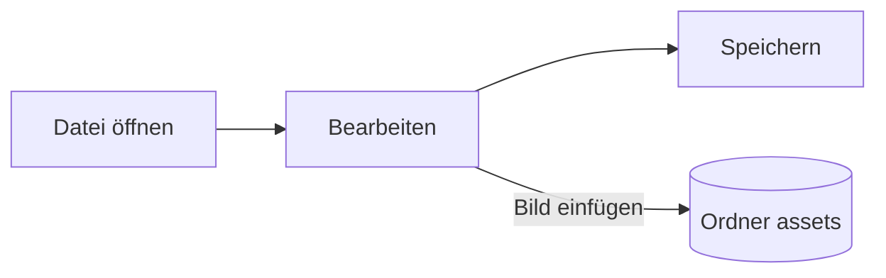

# Pupitre-Anleitung


Pupitre ist ein Markdown-Editor für den Desktop. Dokumente sind einfache `.md`-Dateien: Was Sie sehen, wird an Ort und Stelle dargestellt, und die Markdown-Syntax erscheint, solange sich der Cursor darauf befindet. Diese Anleitung zeigt zugleich, was der Editor darstellt; bearbeiten Sie sie ruhig, sie wird nur gespeichert, wenn Sie **Speichern unter** wählen.

## Bearbeiten

Setzen Sie den Cursor in **fetten Text**, einen `Codeausschnitt` oder einen [Link](https://github.com/shalemore/pupitre), und die Syntax erscheint darum herum. Die Markierungen verhalten sich wie Text:

- Löschen Sie eine Markierung, um die Formatierung zu entfernen; ein `#` mehr oder weniger vor einer Überschrift ändert ihre Ebene.
- Markierter Text zeigt seine Syntax, und Kopieren kopiert Markdown.
- Die Formatierung finden Sie in den Menüs **Absatz** und **Format**, im Kontextmenü und in den Tastenkürzeln unten.

<details>
<summary>Tastenkürzel (Strg entspricht ⌘ unter macOS)</summary>

| Aktion                             | Kürzel                                                                                                      |
| :--------------------------------- | :---------------------------------------------------------------------------------------------------------- |
| Fett / Kursiv / Inline-Code        | <kbd>Ctrl</kbd>+<kbd>B</kbd> / <kbd>I</kbd> / <kbd>Shift</kbd>+<kbd>`</kbd>                                 |
| Durchgestrichen                    | <kbd>Alt</kbd>+<kbd>Shift</kbd>+<kbd>5</kbd>                                                                |
| Unterstrichen                      | <kbd>Ctrl</kbd>+<kbd>U</kbd>                                                                                |
| Formatierung entfernen             | <kbd>Ctrl</kbd>+<kbd>\\</kbd>                                                                               |
| Link                               | <kbd>Ctrl</kbd>+<kbd>K</kbd>                                                                                |
| Bild einfügen...                   | <kbd>Ctrl</kbd>+<kbd>Shift</kbd>+<kbd>I</kbd>                                                               |
| Überschrift 1–6 / Absatz           | <kbd>Ctrl</kbd>+<kbd>1</kbd>…<kbd>6</kbd> / <kbd>0</kbd>                                                    |
| Zitat                              | <kbd>Ctrl</kbd>+<kbd>Shift</kbd>+<kbd>Q</kbd>                                                               |
| Nummerierte Liste / Aufzählung     | <kbd>Ctrl</kbd>+<kbd>Shift</kbd>+<kbd>[</kbd> / <kbd>]</kbd>                                                |
| Codeblock / Formelblock            | <kbd>Ctrl</kbd>+<kbd>Shift</kbd>+<kbd>K</kbd> / <kbd>M</kbd>                                                |
| Tabelle                            | <kbd>Ctrl</kbd>+<kbd>T</kbd>                                                                                |
| Suchen / Ersetzen                  | <kbd>Ctrl</kbd>+<kbd>F</kbd> / <kbd>Ctrl</kbd>+<kbd>H</kbd> (macOS: <kbd>⌘</kbd>+<kbd>⌥</kbd>+<kbd>F</kbd>) |
| Geschlossenen Tab wieder öffnen    | <kbd>Ctrl</kbd>+<kbd>Shift</kbd>+<kbd>T</kbd>                                                               |
| Gliederung                         | <kbd>Ctrl</kbd>+<kbd>Shift</kbd>+<kbd>L</kbd>                                                               |
| Quellcode-Modus                    | <kbd>Ctrl</kbd>+<kbd>/</kbd>                                                                                |
| Fokusmodus / Schreibmaschinenmodus | <kbd>F8</kbd> / <kbd>F9</kbd>                                                                               |
| Zoom zurücksetzen                  | <kbd>Ctrl</kbd>+<kbd>Shift</kbd>+<kbd>0</kbd>                                                               |
| Einstellungen                      | <kbd>Ctrl</kbd>+<kbd>,</kbd>                                                                                |

</details>

## Schreibmodi

- Der **Fokusmodus** blendet alles außer dem Absatz aus, an dem Sie schreiben.
- Der **Schreibmaschinenmodus** hält die Zeile, in der Sie schreiben, in der Mitte des Fensters.

Beide finden Sie im Menü **Ansicht** und unter Einstellungen › Editor; sie lassen sich kombinieren.

## Fensterstil

Unter Einstellungen › Darstellung › Fensterstil wechseln Sie zwischen **Klassisch** und **Immersiv**. Im immersiven Stil liegt das Dokument in einer Karte im Fenster; Titelleiste und Gliederung weichen, sobald Sie tippen oder scrollen, und kehren zurück, wenn der Zeiger den oberen oder den vorderen Fensterrand erreicht.

## Dateien und Bilder

- Pupitre behält die Zeilenenden der geöffneten Datei, sofern Einstellungen › Markdown nichts anderes festlegt. Dort stellen Sie auch ein, welche Syntax Formatierungsbefehle einfügen.
- Eingefügte Bilder werden in einem Ordner neben dem Dokument gespeichert (standardmäßig `assets`, Einstellungen › Markdown). Ein noch nicht gespeichertes Dokument hält sie im Speicher und schreibt sie beim ersten Speichern.
- Mit Einstellungen › Allgemein › Standard-App für Markdown öffnet Pupitre `.md`-Dateien aus dem Dateimanager.
- Die Einstellungen liegen in `settings.json`; Einstellungen › Über zeigt den Ordner. Es werden nur Werte geschrieben, die vom Standard abweichen, und ein nicht lesbares Feld fällt auf seinen Standard zurück, ohne die anderen zu beeinflussen.

## Designs

Ein Design gestaltet das ganze Fenster und das Dokument. Einstellungen › Darstellung listet sie mit den unterstützten Farbschemata auf; für den dunklen Modus lässt sich ein eigenes Design wählen.

Designs werden mit der App ausgeliefert: Jedes ist ein Ordner `src/renderer/themes/<name>/` mit einer `index.css`, und der Ordnername ist der Name des Designs. Schriften oder Bilder eines Designs liegen im selben Ordner und werden mit relativen `url()` eingebunden.

```css
:root {
  /* Die Farbschemata dieses Designs: hell, dunkel oder beides */
  color-scheme: light dark;

  /* Standard-Schrift für den Fließtext; lässt sich in den Einstellungen ändern */
  --font-document: Georgia, serif;

  /* Design-Token, die im ganzen Fenster gelten */
  --ui-surface-1: oklch(0.99 0.01 90);
  --ui-brand: oklch(0.55 0.12 250);
}

@media (prefers-color-scheme: dark) {
  :root {
    --ui-surface-1: oklch(0.2 0.01 90);
  }
}

.md-document .md-h1 {
  font-size: 2em;
}
```

- Farben werden über die Token `--ui-*` (Flächen, Text, Akzent) und `--syntax-*` für Code gesetzt. Ihre Standardwerte und die vollständige Liste stehen in `src/renderer/app.css` und im Design `pupitre`.
- Zitatbalken sollten `var(--alert-color, …)` verwenden, damit Hinweise ihre Farben behalten.
- Schriftgröße, Zeilenhöhe und Inhaltsbreite gehören dem Benutzer und haben immer Vorrang; verwenden Sie `em` für Größen im Dokument und logische Eigenschaften wie `padding-inline-start`, damit rechtsläufiger Text gespiegelt wird.

## Markdown-Referenz

### Text

**Fett**, _kursiv_, ~~durchgestrichen~~, `Inline-Code`, [Links](https://commonmark.org), H~2~O, x^2^, <kbd>Esc</kbd> und <mark>Hervorhebungen</mark>. Inline-HTML wird dargestellt, wenn es ein vollständiges Element ist, sonst als Quelltext angezeigt.

> Ein Zitat.
>
> > Ein verschachteltes Zitat.

> [!NOTE]
> GitHub-Hinweise: `[!NOTE]`, `[!TIP]`, `[!IMPORTANT]`, `[!WARNING]` und `[!CAUTION]`.

> [!WARNING]
> Die Markierung muss die erste Zeile des Zitats sein.

### Listen

1. Nummeriert
   - Verschachtelt, mit Aufzählungszeichen
   - [x] Aufgaben lassen sich abhaken
   - [ ] und wieder öffnen
2. Listen können Code enthalten:

   ```sh
   npm run dev
   ```

### Tabelle

| Links  | Mitte | Rechts |
| :----- | :---: | -----: |
| Zelle  | Zelle |   1.00 |
| Länger | Text  |  10.50 |

### Code

```typescript
function countWords(text: string): number {
  const segmenter = new Intl.Segmenter(undefined, { granularity: "word" });
  return [...segmenter.segment(text)].filter((part) => part.isWordLike).length;
}
```

### Formeln

Inline $e^{i\pi} + 1 = 0$ und abgesetzt:

$$
\int_{-\infty}^{\infty} e^{-x^2} \, dx = \sqrt{\pi}
$$

### Diagramme



### Fußnoten

Ein Satz mit Fußnote[^1].

[^1]: Fußnoten stehen am Ende des Dokuments.

<!-- Kommentare bleiben in der Datei und werden als Quelltext angezeigt. -->
