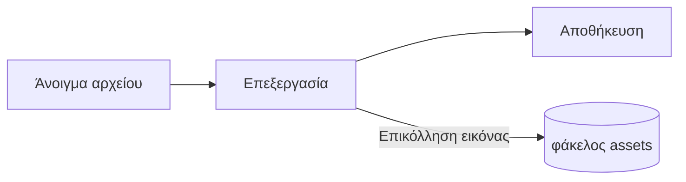

# Οδηγός του Pupitre


Το Pupitre είναι επεξεργαστής Markdown για υπολογιστή. Τα έγγραφα είναι απλά αρχεία `.md`: ό,τι βλέπετε αποδίδεται επιτόπου και η σύνταξη Markdown εμφανίζεται εκεί όπου βρίσκεται ο κέρσορας. Αυτός ο οδηγός είναι επίσης δείγμα του τι αποδίδει ο επεξεργαστής· επεξεργαστείτε τον ελεύθερα, αποθηκεύεται μόνο αν επιλέξετε **Αποθήκευση ως**.

## Επεξεργασία

Τοποθετήστε τον κέρσορα μέσα σε **έντονο κείμενο**, σε `κώδικα εντός γραμμής` ή σε έναν [σύνδεσμο](https://github.com/shalemore/pupitre) και η σύνταξη εμφανίζεται γύρω του. Τα σύμβολα συμπεριφέρονται σαν κείμενο:

- Διαγράψτε ένα σύμβολο για να αφαιρέσετε τη μορφοποίηση· προσθέστε ή διαγράψτε ένα `#` μπροστά από μια επικεφαλίδα για να αλλάξετε το επίπεδό της.
- Η επιλογή κειμένου δείχνει τη σύνταξή του και η αντιγραφή αντιγράφει Markdown.
- Το <kbd>Ctrl</kbd>+κλικ ακολουθεί έναν σύνδεσμο: οι διευθύνσεις ιστού ανοίγουν στο πρόγραμμα περιήγησης, οι σύνδεσμοι `#επικεφαλίδα` μεταβαίνουν στην επικεφαλίδα και οι σύνδεσμοι προς ένα αρχείο Markdown δίπλα στο έγγραφο το ανοίγουν.
- Η μορφοποίηση βρίσκεται στα μενού **Παράγραφος** και **Μορφή**, στο μενού περιβάλλοντος και στις συντομεύσεις παρακάτω.

<details>
<summary>Συντομεύσεις πληκτρολογίου (το Ctrl είναι ⌘ στο macOS)</summary>

| Ενέργεια                                | Συντόμευση                                                                                                  |
| :-------------------------------------- | :---------------------------------------------------------------------------------------------------------- |
| Έντονα / Πλάγια / Κώδικας εντός γραμμής | <kbd>Ctrl</kbd>+<kbd>B</kbd> / <kbd>I</kbd> / <kbd>Shift</kbd>+<kbd>`</kbd>                                 |
| Υπογράμμιση                             | <kbd>Ctrl</kbd>+<kbd>U</kbd>                                                                                |
| Διακριτή διαγραφή                       | <kbd>Alt</kbd>+<kbd>Shift</kbd>+<kbd>5</kbd>                                                                |
| Καθαρισμός μορφής                       | <kbd>Ctrl</kbd>+<kbd>\\</kbd>                                                                               |
| Σύνδεσμος                               | <kbd>Ctrl</kbd>+<kbd>K</kbd>                                                                                |
| Εισαγωγή εικόνας                        | <kbd>Ctrl</kbd>+<kbd>Shift</kbd>+<kbd>I</kbd>                                                               |
| Επικεφαλίδα 1–6 / Παράγραφος            | <kbd>Ctrl</kbd>+<kbd>1</kbd>…<kbd>6</kbd> / <kbd>0</kbd>                                                    |
| Παράθεση                                | <kbd>Ctrl</kbd>+<kbd>Shift</kbd>+<kbd>Q</kbd>                                                               |
| Αριθμημένη / λίστα με κουκκίδες         | <kbd>Ctrl</kbd>+<kbd>Shift</kbd>+<kbd>[</kbd> / <kbd>]</kbd>                                                |
| Μπλοκ κώδικα / Μαθηματικό μπλοκ         | <kbd>Ctrl</kbd>+<kbd>Shift</kbd>+<kbd>K</kbd> / <kbd>M</kbd>                                                |
| Πίνακας                                 | <kbd>Ctrl</kbd>+<kbd>T</kbd>                                                                                |
| Εύρεση / Αντικατάσταση                  | <kbd>Ctrl</kbd>+<kbd>F</kbd> / <kbd>Ctrl</kbd>+<kbd>H</kbd> (macOS: <kbd>⌘</kbd>+<kbd>⌥</kbd>+<kbd>F</kbd>) |
| Επανάνοιγμα κλειστής καρτέλας           | <kbd>Ctrl</kbd>+<kbd>Shift</kbd>+<kbd>T</kbd>                                                               |
| Πλαϊνές γραμμές                         | <kbd>Ctrl</kbd>+<kbd>Shift</kbd>+<kbd>L</kbd>                                                               |
| Λειτουργία πηγαίου κώδικα               | <kbd>Ctrl</kbd>+<kbd>/</kbd>                                                                                |
| Λειτουργία συγκέντρωσης / γραφομηχανής  | <kbd>F8</kbd> / <kbd>F9</kbd>                                                                               |
| Επαναφορά μεγέθυνσης                    | <kbd>Ctrl</kbd>+<kbd>Shift</kbd>+<kbd>0</kbd>                                                               |
| Προτιμήσεις                             | <kbd>Ctrl</kbd>+<kbd>,</kbd>                                                                                |

</details>

## Λειτουργίες γραφής

- Η **λειτουργία συγκέντρωσης** θαμπώνει τα πάντα εκτός από την παράγραφο που γράφετε.
- Η **λειτουργία γραφομηχανής** κρατά τη γραμμή που γράφετε στο κέντρο του παραθύρου ή κοντά στο πάνω ή στο κάτω μέρος του, όπως ορίζει η Προτιμήσεις › Επεξεργαστής.

Και οι δύο βρίσκονται στο μενού **Προβολή** και στις Προτιμήσεις › Επεξεργαστής και μπορούν να συνδυαστούν.

## Στυλ παραθύρου

Οι Προτιμήσεις › Εμφάνιση › Στυλ παραθύρου εναλλάσσουν μεταξύ **Κλασικού** και **Εμβυθιστικού**. Στο εμβυθιστικό στυλ το έγγραφο βρίσκεται σε κάρτα μέσα στο παράθυρο· η γραμμή τίτλου και οι πλαϊνές γραμμές κρύβονται μόλις γράψετε ή κάνετε κύλιση και επιστρέφουν όταν ο δείκτης φτάσει στην πάνω ή σε μία πλαϊνή άκρη του παραθύρου. Το καρφίτσωμα σε μια πλαϊνή γραμμή κρατά τις πλαϊνές γραμμές ανοιχτές και το σύρσιμο του άκρου μιας πλαϊνής γραμμής αλλάζει το μέγεθός της.

## Αρχεία και εικόνες

- Το Pupitre διατηρεί τα τέλη γραμμής του αρχείου που άνοιξε, εκτός αν οι Προτιμήσεις › Markdown λένε κάτι άλλο. Εκεί ρυθμίζεται και η σύνταξη που εισάγουν οι εντολές μορφοποίησης.
- Οι επικολλημένες εικόνες αποθηκεύονται σε φάκελο δίπλα στο έγγραφο (`assets` από προεπιλογή, Προτιμήσεις › Markdown). Ένα έγγραφο που δεν έχει αποθηκευτεί τις κρατά στη μνήμη και τις γράφει στην πρώτη αποθήκευση.
- Οι Προτιμήσεις › Γενικά › Προεπιλεγμένη εφαρμογή Markdown κάνουν το Pupitre να ανοίγει αρχεία `.md` από τον διαχειριστή αρχείων.
- Οι προτιμήσεις αποθηκεύονται στο `settings.json`· οι Προτιμήσεις › Σχετικά δείχνουν τον φάκελό του. Γράφονται μόνο οι τιμές που διαφέρουν από τις προεπιλεγμένες και ένα πεδίο που δεν διαβάζεται επιστρέφει στην προεπιλογή χωρίς να επηρεάζει τα υπόλοιπα.
- Ένας φάκελος μπορεί να έχει δικές του ρυθμίσεις: με ανοιχτό φάκελο, οι Προτιμήσεις εμφανίζουν έναν διακόπτη για **Καθολικά** ή **Αυτός ο φάκελος**. Ό,τι αλλάζετε στην επιλογή **Αυτός ο φάκελος** πηγαίνει στο `.pupitre/settings.json` μέσα του, το οποίο δημιουργείται με την πρώτη αλλαγή και εφαρμόζεται πάνω από τις καθολικές ρυθμίσεις όταν ο φάκελος είναι ανοιχτός. Η επαναφορά μιας ρύθμισης εκεί την επιστρέφει στην καθολική τιμή.

## Θέματα

Ένα θέμα καθορίζει την εμφάνιση ολόκληρου του παραθύρου και του εγγράφου. Οι Προτιμήσεις › Εμφάνιση τα απαριθμούν με τα χρωματικά σχήματα που υποστηρίζουν, και για τη σκοτεινή λειτουργία μπορεί να επιλεγεί ξεχωριστό θέμα.

Τα θέματα συνοδεύουν την εφαρμογή: καθένα είναι φάκελος στο `src/renderer/themes/<όνομα>/` με `index.css`, και το όνομα του φακέλου είναι το όνομα του θέματος. Οι γραμματοσειρές ή οι εικόνες που χρησιμοποιεί ένα θέμα βρίσκονται στον ίδιο φάκελο και αναφέρονται με σχετικά `url()`.

```css
:root {
  /* Τα χρωματικά σχήματα που υποστηρίζει το θέμα: ανοιχτό, σκούρο ή και τα δύο */
  color-scheme: light dark;

  /* Προεπιλεγμένη γραμματοσειρά σώματος κειμένου· αλλάζει από τις προτιμήσεις */
  --font-document: Georgia, serif;

  /* Σύμβολα σχεδίασης που ισχύουν σε όλο το παράθυρο */
  --ui-surface-1: oklch(0.99 0.01 90);
  --ui-brand: oklch(0.55 0.12 250);
}

@media (prefers-color-scheme: dark) {
  :root {
    --ui-surface-1: oklch(0.2 0.01 90);
  }
}

.md-document .md-h1 {
  font-size: 2em;
}
```

- Τα χρώματα ορίζονται με τα token `--ui-*` (επιφάνειες, κείμενο, έμφαση) και `--syntax-*` για τον κώδικα. Οι προεπιλογές τους και η πλήρης λίστα βρίσκονται στο `src/renderer/app.css` και στο θέμα `pupitre`.
- Οι μπάρες παράθεσης πρέπει να χρησιμοποιούν `var(--alert-color, …)` ώστε οι ειδοποιήσεις να διατηρούν τα χρώματά τους.
- Το μέγεθος του κειμένου, το διάστιχο και το πλάτος του περιεχομένου ανήκουν στον χρήστη και υπερισχύουν πάντα· χρησιμοποιήστε `em` για μεγέθη στο έγγραφο και λογικές ιδιότητες όπως `padding-inline-start`, ώστε το κείμενο από δεξιά προς αριστερά να κατοπτρίζεται.

## Αναφορά Markdown

### Κείμενο

**Έντονα**, _πλάγια_, ~~διακριτή διαγραφή~~, `κώδικας εντός γραμμής`, [σύνδεσμοι](https://commonmark.org), H~2~O, x^2^, ==επισημάνσεις==, :tada: και <kbd>Esc</kbd>. Το ενσωματωμένο HTML αποδίδεται όταν είναι πλήρες στοιχείο και εμφανίζεται ως πηγαίος κώδικας διαφορετικά. Μια παράγραφος που λέει μόνο `[TOC]` γίνεται λίστα με τις επικεφαλίδες του εγγράφου.

> Μια παράθεση.
>
> > Μια εμφωλευμένη παράθεση.

> [!NOTE]
> Ειδοποιήσεις GitHub: `[!NOTE]`, `[!TIP]`, `[!IMPORTANT]`, `[!WARNING]` και `[!CAUTION]`.

> [!WARNING]
> Το σύμβολο πρέπει να είναι η πρώτη γραμμή της παράθεσης.

### Λίστες

1. Αριθμημένη
   - Εμφωλευμένη, με κουκκίδες
   - [x] Οι εργασίες μπορούν να επισημανθούν
   - [ ] Και να μην επισημανθούν
2. Οι λίστες μπορούν να περιέχουν κώδικα:

   ```sh
   npm run dev
   ```

### Πίνακας

| Αριστερά | Κέντρο  | Δεξιά |
| :------- | :-----: | ----: |
| Κελί     |  Κελί   |  1.00 |
| Μακρύ    | Κείμενο | 10.50 |

### Κώδικας

```typescript
function countWords(text: string): number {
  const segmenter = new Intl.Segmenter(undefined, { granularity: "word" });
  return [...segmenter.segment(text)].filter((part) => part.isWordLike).length;
}
```

### Μαθηματικά

Εντός γραμμής $e^{i\pi} + 1 = 0$ και ως μπλοκ:

$$
\int_{-\infty}^{\infty} e^{-x^2} \, dx = \sqrt{\pi}
$$

Οι χημικές εξισώσεις χρησιμοποιούν το `\ce`: $\ce{2H2 + O2 -> 2H2O}$.

### Διαγράμματα



### Υποσημειώσεις

Μια πρόταση με υποσημείωση[^1].

[^1]: Οι υποσημειώσεις παρατίθενται στο τέλος του εγγράφου.

<!-- Τα σχόλια παραμένουν στο αρχείο και εμφανίζονται ως πηγαίος κώδικας. -->
