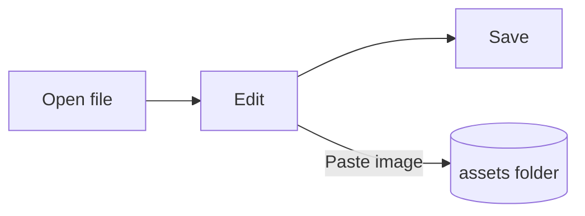

# Pupitre Guide


Pupitre is a desktop Markdown editor. Documents are plain `.md` files: what you see is rendered in place, and the Markdown syntax appears while the cursor is on it. This guide is also a sample of what the editor renders; edit it freely, it is not saved unless you choose **Save As**.

## Editing

Move the cursor into **bold text**, a `code span` or a [link](https://github.com/shalemore/pupitre) and its syntax appears around it. The markers behave like text:

- Delete a marker to remove its format; add or delete a `#` in front of a heading to change its level.
- Selecting text shows the syntax in it, and copying copies Markdown.
- <kbd>Ctrl</kbd>+click follows a link: web addresses open in the browser, `#heading` links scroll to the heading and links to a Markdown file next to the document open it.
- Formatting is in the **Paragraph** and **Format** menus, the context menu and the shortcuts below.

<details>
<summary>Keyboard shortcuts (Ctrl is ⌘ on macOS)</summary>

| Action                       | Shortcut                                                                                                    |
| :--------------------------- | :---------------------------------------------------------------------------------------------------------- |
| Bold / Italic / Inline code  | <kbd>Ctrl</kbd>+<kbd>B</kbd> / <kbd>I</kbd> / <kbd>Shift</kbd>+<kbd>`</kbd>                                 |
| Strikethrough                | <kbd>Alt</kbd>+<kbd>Shift</kbd>+<kbd>5</kbd>                                                                |
| Link                         | <kbd>Ctrl</kbd>+<kbd>K</kbd>                                                                                |
| Heading 1–6 / Paragraph      | <kbd>Ctrl</kbd>+<kbd>1</kbd>…<kbd>6</kbd> / <kbd>0</kbd>                                                    |
| Quote                        | <kbd>Ctrl</kbd>+<kbd>Shift</kbd>+<kbd>Q</kbd>                                                               |
| Numbered / Bulleted list     | <kbd>Ctrl</kbd>+<kbd>Shift</kbd>+<kbd>[</kbd> / <kbd>]</kbd>                                                |
| Code block / Math block      | <kbd>Ctrl</kbd>+<kbd>Shift</kbd>+<kbd>K</kbd> / <kbd>M</kbd>                                                |
| Table                        | <kbd>Ctrl</kbd>+<kbd>T</kbd>                                                                                |
| Find / Replace               | <kbd>Ctrl</kbd>+<kbd>F</kbd> / <kbd>Ctrl</kbd>+<kbd>H</kbd> (macOS: <kbd>⌘</kbd>+<kbd>⌥</kbd>+<kbd>F</kbd>) |
| Sidebars                     | <kbd>Ctrl</kbd>+<kbd>Shift</kbd>+<kbd>L</kbd>                                                               |
| Focus mode / Typewriter mode | <kbd>F8</kbd> / <kbd>F9</kbd>                                                                               |
| Reset zoom                   | <kbd>Ctrl</kbd>+<kbd>Shift</kbd>+<kbd>0</kbd>                                                               |
| Preferences                  | <kbd>Ctrl</kbd>+<kbd>,</kbd>                                                                                |

</details>

## Writing modes

- **Focus mode** dims everything except the paragraph you are writing.
- **Typewriter mode** keeps the line you are writing in the middle of the window, or near its top or bottom, as Preferences › Editor says.

Both are in the **View** menu and in Preferences › Editor, and they can be combined.

## Window style

Preferences › Appearance › Window Style switches between **Classic** and **Immersive**. In the immersive style the document sits in a card inside the window; the title bar and the sidebars step aside once you type or scroll and come back when the pointer reaches the top or a side edge of the window. The pin in a sidebar keeps the sidebars open, and dragging a sidebar's edge resizes it.

## Files and images

- Pupitre keeps the line endings of the file it opened unless Preferences › Markdown says otherwise. The syntax that formatting commands insert is set there too.
- Pasted images are saved in a folder next to the document (`assets` by default, Preferences › Markdown). A document that has not been saved yet keeps them in memory and writes them on the first save.
- Preferences › General › Default Markdown App makes Pupitre open `.md` files from the file manager.
- Preferences are stored in `settings.json`; Preferences › About shows its folder. Only values that differ from the defaults are written, and a field that cannot be read falls back to its default without affecting the others.
- A folder can have settings of its own: with a folder open, Preferences shows a switch between **Global** and **This Folder**. What you change under **This Folder** goes to `.pupitre/settings.json` in it, which is created by the first change, and is laid over the global settings whenever that folder is open. Resetting a setting there gives it back to the global value.

## Themes

A theme styles the whole window and the document. Preferences › Appearance lists them with the color schemes they support, and a separate theme can be chosen for dark mode.

Themes ship with the app: each one is a folder in `src/renderer/themes/<name>/` with an `index.css`, and the folder name is the theme's name. Fonts or images a theme uses go in the same folder and are referenced with relative `url()`s.

```css
:root {
  /* The schemes this theme supports: light, dark or both */
  color-scheme: light dark;

  /* Default body font; users can override it in the preferences */
  --font-document: Georgia, serif;

  /* Design tokens used by the whole window */
  --ui-surface-1: oklch(0.99 0.01 90);
  --ui-brand: oklch(0.55 0.12 250);
}

@media (prefers-color-scheme: dark) {
  :root {
    --ui-surface-1: oklch(0.2 0.01 90);
  }
}

.md-document .md-h1 {
  font-size: 2em;
}
```

- Colors are set through the `--ui-*` tokens (surfaces, text, accent) and `--syntax-*` for code. Their defaults and the full list are in `src/renderer/app.css` and the `pupitre` theme.
- Quote bars should use `var(--alert-color, …)` so alerts keep their colors.
- Body font size, line height and content width belong to the user and always win; use `em` for sizes in the document and logical properties such as `padding-inline-start` so right-to-left text mirrors.

## Markdown reference

### Text

**Bold**, _italic_, ~~strikethrough~~, `inline code`, [links](https://commonmark.org), H~2~O, x^2^, ==highlights==, :tada: and <kbd>Esc</kbd>. Inline HTML is rendered when it is a complete element and shown as source otherwise. A paragraph that only says `[TOC]` becomes a list of the document's headings.

> A quote.
>
> > A nested quote.

> [!NOTE]
> GitHub alerts: `[!NOTE]`, `[!TIP]`, `[!IMPORTANT]`, `[!WARNING]` and `[!CAUTION]`.

> [!WARNING]
> The marker must be the first line of the quote.

### Lists

1. Ordered
   - Nested, bulleted
   - [x] Tasks can be checked
   - [ ] And unchecked
2. Lists can hold code:

   ```sh
   npm run dev
   ```

### Table

| Left   | Center | Right |
| :----- | :----: | ----: |
| Cell   |  Cell  |  1.00 |
| Longer |  Text  | 10.50 |

### Code

```typescript
function countWords(text: string): number {
  const segmenter = new Intl.Segmenter(undefined, { granularity: "word" });
  return [...segmenter.segment(text)].filter((part) => part.isWordLike).length;
}
```

### Math

Inline $e^{i\pi} + 1 = 0$ and display:

$$
\int_{-\infty}^{\infty} e^{-x^2} \, dx = \sqrt{\pi}
$$

Chemical equations use `\ce`: $\ce{2H2 + O2 -> 2H2O}$.

### Diagrams



### Footnotes

A sentence with a footnote[^1].

[^1]: Footnotes are listed at the end of the document.

<!-- Comments are kept in the file and shown as source. -->
