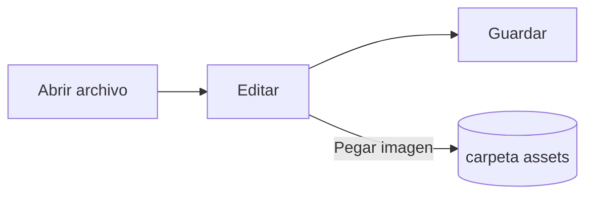

# Guía de Pupitre


Pupitre es un editor de Markdown de escritorio. Los documentos son archivos `.md` normales: lo que ves se muestra renderizado en el mismo lugar, y la sintaxis de Markdown aparece mientras el cursor está sobre ella. Esta guía también es un ejemplo de lo que muestra el editor; edítala con libertad, no se guarda salvo que elijas **Guardar como**.

## Edición

Mueve el cursor dentro de **texto en negrita**, un `fragmento de código` o un [enlace](https://github.com/shalemore/pupitre) y su sintaxis aparece alrededor. Los marcadores se comportan como texto:

- Borra un marcador para quitar su formato; añade o borra un `#` delante de un encabezado para cambiar su nivel.
- Al seleccionar texto se ve su sintaxis, y copiar copia Markdown.
- <kbd>Ctrl</kbd>+clic sigue un enlace: las direcciones web se abren en el navegador, los enlaces `#encabezado` llevan al encabezado y los enlaces a un archivo Markdown contiguo lo abren.
- El formato está en los menús **Párrafo** y **Formato**, en el menú contextual y en los atajos de abajo.

<details>
<summary>Atajos de teclado (Ctrl es ⌘ en macOS)</summary>

| Acción                                        | Atajo                                                                                                       |
| :-------------------------------------------- | :---------------------------------------------------------------------------------------------------------- |
| Negrita / Cursiva / Código en línea           | <kbd>Ctrl</kbd>+<kbd>B</kbd> / <kbd>I</kbd> / <kbd>Shift</kbd>+<kbd>`</kbd>                                 |
| Tachado                                       | <kbd>Alt</kbd>+<kbd>Shift</kbd>+<kbd>5</kbd>                                                                |
| Subrayado                                     | <kbd>Ctrl</kbd>+<kbd>U</kbd>                                                                                |
| Borrar formato                                | <kbd>Ctrl</kbd>+<kbd>\\</kbd>                                                                               |
| Enlace                                        | <kbd>Ctrl</kbd>+<kbd>K</kbd>                                                                                |
| Insertar imagen…                              | <kbd>Ctrl</kbd>+<kbd>Shift</kbd>+<kbd>I</kbd>                                                               |
| Título 1–6 / Párrafo                          | <kbd>Ctrl</kbd>+<kbd>1</kbd>…<kbd>6</kbd> / <kbd>0</kbd>                                                    |
| Cita                                          | <kbd>Ctrl</kbd>+<kbd>Shift</kbd>+<kbd>Q</kbd>                                                               |
| Lista numerada / con viñetas                  | <kbd>Ctrl</kbd>+<kbd>Shift</kbd>+<kbd>[</kbd> / <kbd>]</kbd>                                                |
| Bloque de código / Bloque matemático          | <kbd>Ctrl</kbd>+<kbd>Shift</kbd>+<kbd>K</kbd> / <kbd>M</kbd>                                                |
| Tabla                                         | <kbd>Ctrl</kbd>+<kbd>T</kbd>                                                                                |
| Buscar / Reemplazar                           | <kbd>Ctrl</kbd>+<kbd>F</kbd> / <kbd>Ctrl</kbd>+<kbd>H</kbd> (macOS: <kbd>⌘</kbd>+<kbd>⌥</kbd>+<kbd>F</kbd>) |
| Reabrir pestaña cerrada                       | <kbd>Ctrl</kbd>+<kbd>Shift</kbd>+<kbd>T</kbd>                                                               |
| Barras laterales                              | <kbd>Ctrl</kbd>+<kbd>Shift</kbd>+<kbd>L</kbd>                                                               |
| Modo código fuente                            | <kbd>Ctrl</kbd>+<kbd>/</kbd>                                                                                |
| Modo concentración / Modo máquina de escribir | <kbd>F8</kbd> / <kbd>F9</kbd>                                                                               |
| Restablecer zoom                              | <kbd>Ctrl</kbd>+<kbd>Shift</kbd>+<kbd>R</kbd>                                                               |
| Preferencias                                  | <kbd>Ctrl</kbd>+<kbd>,</kbd>                                                                                |

</details>

## Modos de escritura

- El **Modo concentración** atenúa todo salvo el párrafo que estás escribiendo.
- El **Modo máquina de escribir** mantiene la línea que escribes en el centro de la ventana, o cerca del borde superior o inferior según Preferencias › Editor.

Ambos están en el menú **Ver** y en Preferencias › Editor, y se pueden combinar.

## Estilo de ventana

Preferencias › Apariencia › Estilo de ventana alterna entre **Clásico** e **Inmersivo**. En el estilo inmersivo el documento está en una tarjeta dentro de la ventana; la barra de título y las barras laterales se ocultan al escribir o desplazarte y vuelven cuando el puntero llega al borde superior o a un borde lateral de la ventana. La fijación de una barra lateral mantiene abiertas las barras laterales, y arrastrar el borde de una barra lateral cambia su anchura.

## Archivos e imágenes

- Pupitre conserva los saltos de línea del archivo que abrió salvo que Preferencias › Markdown indique otra cosa. Ahí también se define la sintaxis que insertan los comandos de formato.
- Las imágenes pegadas se guardan en una carpeta junto al documento (`assets` por defecto, Preferencias › Markdown). Un documento aún sin guardar las mantiene en memoria y las escribe al guardar por primera vez.
- Preferencias › General › Aplicación predeterminada para Markdown hace que Pupitre abra los archivos `.md` desde el administrador de archivos.
- Las preferencias se guardan en `settings.json`; Preferencias › Acerca de muestra su carpeta. Solo se escriben los valores que difieren de los predeterminados, y un campo ilegible vuelve a su valor predeterminado sin afectar a los demás.
- Una carpeta puede tener sus propias preferencias: con una carpeta abierta, Preferencias muestra un selector entre **Global** y **Esta carpeta**. Los cambios en **Esta carpeta** van a `.pupitre/settings.json`, que se crea con el primer cambio y se superpone a las preferencias globales; restablecer un valor devuelve el **valor global**.

## Temas

Un tema da estilo a toda la ventana y al documento. Preferencias › Apariencia los lista con los esquemas de color que admiten, y se puede elegir un tema distinto para el modo oscuro.

Los temas vienen con la aplicación: cada uno es una carpeta en `src/renderer/themes/<name>/` con un `index.css`, y el nombre de la carpeta es el nombre del tema. Las fuentes o imágenes del tema van en la misma carpeta y se referencian con `url()` relativos.

```css
:root {
  /* Los esquemas de color que admite este tema: claro, oscuro o ambos */
  color-scheme: light dark;

  /* Fuente del cuerpo de texto por defecto; se cambia en las preferencias */
  --font-document: Georgia, serif;

  /* Tokens de diseño que usa toda la ventana */
  --ui-surface-1: oklch(0.99 0.01 90);
  --ui-brand: oklch(0.55 0.12 250);
}

@media (prefers-color-scheme: dark) {
  :root {
    --ui-surface-1: oklch(0.2 0.01 90);
  }
}

.md-document .md-h1 {
  font-size: 2em;
}
```

- Los colores se definen con los tokens `--ui-*` (superficies, texto, acento) y `--syntax-*` para el código. Sus valores por defecto y la lista completa están en `src/renderer/app.css` y en el tema `pupitre`.
- Las barras de las citas deben usar `var(--alert-color, …)` para que las alertas conserven sus colores.
- El tamaño de fuente, la altura de línea y el ancho del contenido son del usuario y siempre prevalecen; usa `em` para los tamaños del documento y propiedades lógicas como `padding-inline-start` para que el texto de derecha a izquierda se refleje.

## Referencia de Markdown

### Texto

**Negrita**, _cursiva_, ~~tachado~~, `código en línea`, [enlaces](https://commonmark.org), H~2~O, x^2^, ==resaltados==, :tada: y <kbd>Esc</kbd>. El HTML en línea se representa cuando es un elemento completo y se muestra como código fuente en caso contrario. Un párrafo que solo contiene `[TOC]` se convierte en una lista de los encabezados del documento.

> Una cita.
>
> > Una cita anidada.

> [!NOTE]
> Alertas de GitHub: `[!NOTE]`, `[!TIP]`, `[!IMPORTANT]`, `[!WARNING]` y `[!CAUTION]`.

> [!WARNING]
> El marcador debe estar en la primera línea de la cita.

### Listas

1. Numerada
   - Anidada, con viñetas
   - [x] Las tareas se pueden marcar
   - [ ] y desmarcar
2. Las listas pueden contener código:

   ```sh
   npm run dev
   ```

### Tabla

| Izquierda | Centro | Derecha |
| :-------- | :----: | ------: |
| Celda     | Celda  |    1.00 |
| Más largo | Texto  |   10.50 |

### Código

```typescript
function countWords(text: string): number {
  const segmenter = new Intl.Segmenter(undefined, { granularity: "word" });
  return [...segmenter.segment(text)].filter((part) => part.isWordLike).length;
}
```

### Matemáticas

En línea $e^{i\pi} + 1 = 0$ y en bloque:

$$
\int_{-\infty}^{\infty} e^{-x^2} \, dx = \sqrt{\pi}
$$

Las ecuaciones químicas usan `\ce`: $\ce{2H2 + O2 -> 2H2O}$.

### Diagramas



### Notas al pie

Una frase con nota al pie[^1].

[^1]: Las notas al pie se listan al final del documento.

<!-- Los comentarios se conservan en el archivo y se muestran como código fuente. -->
