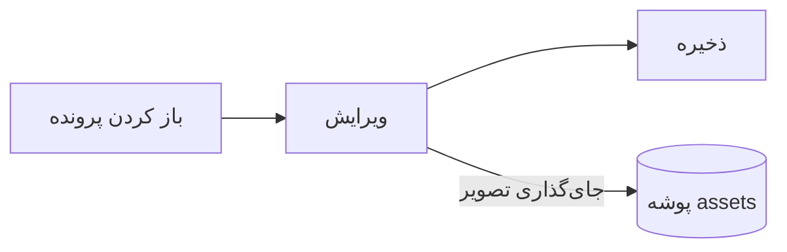

# راهنمای Pupitre


Pupitre یک ویرایشگر دسکتاپ برای Markdown است. سندها پرونده‌های ساده با پسوند `.md` هستند: آنچه می‌بینید همان‌جا رندر می‌شود و نحو Markdown فقط وقتی ظاهر می‌شود که نشانگر روی آن باشد. این راهنما نمونه‌ای از خروجی ویرایشگر هم هست؛ هر طور که دوست دارید ویرایشش کنید، تا وقتی **ذخیره به‌عنوان** را نزنید ذخیره نمی‌شود.

## ویرایش

نشانگر را داخل **متن پررنگ**، یک `کد درون‌خطی` یا یک [پیوند](https://github.com/shalemore/pupitre) ببرید تا نحو آن دور متن ظاهر شود. نشانه‌ها مثل متن رفتار می‌کنند:

- با حذف یک نشانه، قالب آن برداشته می‌شود؛ با افزودن یا حذف یک `#` جلوی عنوان، سطح آن تغییر می‌کند.
- با انتخاب متن، نحو آن نمایان می‌شود و کپی کردن، Markdown را کپی می‌کند.
- قالب‌بندی در منوهای **پاراگراف** و **قالب‌بندی**، منوی زمینه و میان‌برهای زیر است.

<details>
<summary>میان‌برهای صفحه‌کلید (Ctrl در macOS همان ⌘ است)</summary>

| کار                           | میان‌بر                                                                                                         |
| :---------------------------- | :------------------------------------------------------------------------------------------------------------- |
| پررنگ / مورب / کد درون‌خطی     | <kbd>Ctrl</kbd>+<kbd>B</kbd> / <kbd>I</kbd> / <kbd>Shift</kbd>+<kbd>`</kbd>                                    |
| زیرخط                         | <kbd>Ctrl</kbd>+<kbd>U</kbd>                                                                                   |
| خط‌خورده                       | <kbd>Alt</kbd>+<kbd>Shift</kbd>+<kbd>5</kbd>                                                                   |
| پاک کردن قالب‌بندی             | <kbd>Ctrl</kbd>+<kbd>\\</kbd>                                                                                  |
| پیوند                         | <kbd>Ctrl</kbd>+<kbd>K</kbd>                                                                                   |
| درج تصویر                     | <kbd>Ctrl</kbd>+<kbd>Shift</kbd>+<kbd>I</kbd>                                                                  |
| عنوان ۱ تا ۶ / پاراگراف       | <kbd>Ctrl</kbd>+<kbd>1</kbd>…<kbd>6</kbd> / <kbd>0</kbd>                                                       |
| نقل قول                       | <kbd>Ctrl</kbd>+<kbd>Shift</kbd>+<kbd>Q</kbd>                                                                  |
| فهرست شماره‌دار / گلوله‌ای      | <kbd>Ctrl</kbd>+<kbd>Shift</kbd>+<kbd>[</kbd> / <kbd>]</kbd>                                                   |
| بلوک کد / بلوک ریاضی          | <kbd>Ctrl</kbd>+<kbd>Shift</kbd>+<kbd>K</kbd> / <kbd>M</kbd>                                                   |
| جدول                          | <kbd>Ctrl</kbd>+<kbd>T</kbd>                                                                                   |
| یافتن / جایگزینی              | <kbd>Ctrl</kbd>+<kbd>F</kbd> / <kbd>Ctrl</kbd>+<kbd>H</kbd> (در macOS: <kbd>⌘</kbd>+<kbd>⌥</kbd>+<kbd>F</kbd>) |
| باز کردن دوبارهٔ زبانهٔ بسته‌شده | <kbd>Ctrl</kbd>+<kbd>Shift</kbd>+<kbd>T</kbd>                                                                  |
| طرح کلی                       | <kbd>Ctrl</kbd>+<kbd>Shift</kbd>+<kbd>L</kbd>                                                                  |
| حالت کد منبع                  | <kbd>Ctrl</kbd>+<kbd>/</kbd>                                                                                   |
| حالت تمرکز / حالت ماشین تحریر | <kbd>F8</kbd> / <kbd>F9</kbd>                                                                                  |
| بازنشانی بزرگ‌نمایی            | <kbd>Ctrl</kbd>+<kbd>Shift</kbd>+<kbd>0</kbd>                                                                  |
| تنظیمات                       | <kbd>Ctrl</kbd>+<kbd>,</kbd>                                                                                   |

</details>

## حالت‌های نوشتن

- **حالت تمرکز** همه‌چیز را کم‌رنگ می‌کند جز پاراگرافی که در حال نوشتنش هستید.
- **حالت ماشین تحریر** سطری را که می‌نویسید وسط پنجره نگه می‌دارد.

هر دو در منوی **نما** و در تنظیمات › ویرایشگر هستند و می‌توان آن‌ها را با هم به کار برد.

## سبک پنجره

تنظیمات › ظاهر › سبک پنجره بین **کلاسیک** و **فراگیر** جابه‌جا می‌شود. در سبک فراگیر، سند داخل کارتی درون پنجره قرار می‌گیرد؛ نوار عنوان و طرح کلی وقتی تایپ یا پیمایش می‌کنید کنار می‌روند و وقتی نشانگر به بالا یا لبه‌ی آغازین پنجره برسد، برمی‌گردند.

## پرونده‌ها و تصاویر

- Pupitre پایان خط‌های پرونده‌ای را که باز کرده نگه می‌دارد، مگر اینکه تنظیمات › Markdown خلافش را بگوید. نحوی که فرمان‌های قالب‌بندی درج می‌کنند هم همان‌جا تعیین می‌شود.
- تصاویر جای‌گذاری‌شده در پوشه‌ای کنار سند ذخیره می‌شوند (پیش‌فرض `assets`، در تنظیمات › Markdown). سندی که هنوز ذخیره نشده، تصاویر را در حافظه نگه می‌دارد و در اولین ذخیره روی دیسک می‌نویسد.
- تنظیمات › عمومی › برنامه پیش‌فرض Markdown باعث می‌شود Pupitre پرونده‌های `.md` را از مدیر پرونده باز کند.
- تنظیمات در `settings.json` ذخیره می‌شوند؛ تنظیمات › درباره پوشه‌ی آن را نشان می‌دهد. فقط مقادیری که با پیش‌فرض‌ها فرق دارند نوشته می‌شوند و فیلدی که خوانده نشود به پیش‌فرض خودش برمی‌گردد، بدون اینکه بر بقیه اثر بگذارد.

## قالب‌ها

قالب کل پنجره و سند را شکل می‌دهد. تنظیمات › ظاهر آن‌ها را همراه طرح‌های رنگی‌ای که پشتیبانی می‌کنند فهرست می‌کند و می‌توان برای حالت تیره قالب جداگانه‌ای انتخاب کرد.

قالب‌ها همراه برنامه عرضه می‌شوند: هر کدام پوشه‌ای در `src/renderer/themes/<name>/` با فایل `index.css` است و نام پوشه، نام قالب است. قلم‌ها یا تصاویری که قالب استفاده می‌کند در همان پوشه قرار می‌گیرند و با `url()` نسبی به آن‌ها ارجاع داده می‌شود.

```css
:root {
  /* طرح‌های رنگی که این قالب پشتیبانی می‌کند: روشن، تیره یا هر دو */
  color-scheme: light dark;

  /* قلم پیش‌فرض متن؛ کاربر می‌تواند در تنظیمات تغییرش دهد */
  --font-document: Georgia, serif;

  /* توکن‌های طراحی که کل پنجره استفاده می‌کند */
  --ui-surface-1: oklch(0.99 0.01 90);
  --ui-brand: oklch(0.55 0.12 250);
}

@media (prefers-color-scheme: dark) {
  :root {
    --ui-surface-1: oklch(0.2 0.01 90);
  }
}

.md-document .md-h1 {
  font-size: 2em;
}
```

- رنگ‌ها با توکن‌های `--ui-*` (سطوح، متن، تأکیدی) و برای کد با `--syntax-*` تنظیم می‌شوند. مقادیر پیش‌فرض و فهرست کامل در `src/renderer/app.css` و قالب `pupitre` است.
- نوار کنار نقل قول باید از `var(--alert-color, …)` استفاده کند تا هشدارها رنگ خودشان را حفظ کنند.
- اندازه‌ی قلم متن، ارتفاع خط و عرض محتوا با کاربر است و همیشه در اولویت‌اند؛ برای اندازه‌ها در سند از `em` و برای جهت‌ها از ویژگی‌های منطقی مانند `padding-inline-start` استفاده کنید تا متن راست‌به‌چپ درست آینه شود.

## مرجع Markdown

### متن

**پررنگ**، _مورب_، ~~خط‌خورده~~، `کد درون‌خطی`، [پیوندها](https://commonmark.org)، H~2~O، x^2^، <kbd>Esc</kbd> و <mark>برجسته‌سازی</mark>. HTML درون‌خطی وقتی یک عنصر کامل باشد رندر می‌شود و در غیر این صورت به‌عنوان متن نمایش داده می‌شود.

> یک نقل قول.
>
> > یک نقل قول تودرتو.

> [!NOTE]
> هشدارهای GitHub: `[!NOTE]`، `[!TIP]`، `[!IMPORTANT]`، `[!WARNING]` و `[!CAUTION]`.

> [!WARNING]
> نشانه باید اولین خط نقل قول باشد.

### فهرست‌ها

1. مرتب‌شده
   - تودرتو، گلوله‌ای
   - [x] کارها را می‌توان علامت زد
   - [ ] و علامت نزد
2. فهرست‌ها می‌توانند کد داشته باشند:

   ```sh
   npm run dev
   ```

### جدول

| چپ      | وسط  |  راست |
| :------ | :--: | ----: |
| سلول    | سلول |  1.00 |
| طولانی‌تر | متن  | 10.50 |

### کد

```typescript
function countWords(text: string): number {
  const segmenter = new Intl.Segmenter(undefined, { granularity: "word" });
  return [...segmenter.segment(text)].filter((part) => part.isWordLike).length;
}
```

### ریاضی

$e^{i\pi} + 1 = 0$ به‌صورت درون‌خطی و این به‌صورت نمایشی:

$$
\int_{-\infty}^{\infty} e^{-x^2} \, dx = \sqrt{\pi}
$$

### نمودارها



### پانویس‌ها

جمله‌ای با پانویس[^1].

[^1]: پانویس‌ها در انتهای سند فهرست می‌شوند.

<!-- نظرات در پرونده نگه داشته می‌شوند و به‌صورت منبع نمایش داده می‌شوند. -->
