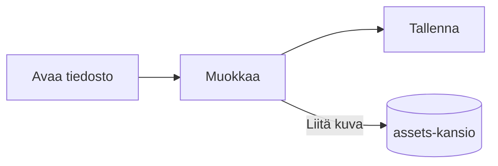

# Pupitren opas


Pupitre on työpöydän Markdown-editori. Asiakirjat ovat tavallisia `.md`-tiedostoja: näkemäsi sisältö renderöidään paikallaan ja Markdown-syntaksi näkyy, kun kursori on sen kohdalla. Tämä opas on myös esimerkki siitä, mitä editori renderöi; muokkaa sitä vapaasti, se tallennetaan vain valitsemalla **Tallenna nimellä**.

## Muokkaaminen

Sijoita kursori **lihavoituun tekstiin**, `rivinsisäiseen koodiin` tai [linkkiin](https://github.com/shalemore/pupitre), niin syntaksi näkyy sen ympärillä. Merkit käyttäytyvät kuin teksti:

- Poista merkki poistaaksesi muotoilun; lisää tai poista `#` otsikon edestä muuttaaksesi sen tasoa.
- Valittu teksti näyttää syntaksinsa, ja kopiointi kopioi Markdownia.
- <kbd>Ctrl</kbd>+napsautus seuraa linkkiä: verkko-osoitteet avautuvat selaimessa, `#otsikko`-linkit vierittävät otsikkoon ja viereisen Markdown-tiedoston linkit avaavat tiedoston.
- Muotoilu on **Kappale**- ja **Muoto**-valikoissa, pikavalikossa ja alla olevissa pikanäppäimissä.

<details>
<summary>Pikanäppäimet (macOS:ssa Ctrl on ⌘)</summary>

| Toiminto                             | Pikanäppäin                                                                                                 |
| :----------------------------------- | :---------------------------------------------------------------------------------------------------------- |
| Lihavointi / Kursiivi / Koodi        | <kbd>Ctrl</kbd>+<kbd>B</kbd> / <kbd>I</kbd> / <kbd>Shift</kbd>+<kbd>`</kbd>                                 |
| Yliviivaus                           | <kbd>Alt</kbd>+<kbd>Shift</kbd>+<kbd>5</kbd>                                                                |
| Alleviivaus                          | <kbd>Ctrl</kbd>+<kbd>U</kbd>                                                                                |
| Tyhjennä muotoilut                   | <kbd>Ctrl</kbd>+<kbd>\\</kbd>                                                                               |
| Linkki                               | <kbd>Ctrl</kbd>+<kbd>K</kbd>                                                                                |
| Lisää kuva…                          | <kbd>Ctrl</kbd>+<kbd>Shift</kbd>+<kbd>I</kbd>                                                               |
| Otsikko 1–6 / Kappale                | <kbd>Ctrl</kbd>+<kbd>1</kbd>…<kbd>6</kbd> / <kbd>0</kbd>                                                    |
| Lainaus                              | <kbd>Ctrl</kbd>+<kbd>Shift</kbd>+<kbd>Q</kbd>                                                               |
| Numeroitu / luettelomerkitetty lista | <kbd>Ctrl</kbd>+<kbd>Shift</kbd>+<kbd>[</kbd> / <kbd>]</kbd>                                                |
| Koodilohko / Matematiikkalohko       | <kbd>Ctrl</kbd>+<kbd>Shift</kbd>+<kbd>K</kbd> / <kbd>M</kbd>                                                |
| Taulukko                             | <kbd>Ctrl</kbd>+<kbd>T</kbd>                                                                                |
| Etsi / Korvaa                        | <kbd>Ctrl</kbd>+<kbd>F</kbd> / <kbd>Ctrl</kbd>+<kbd>H</kbd> (macOS: <kbd>⌘</kbd>+<kbd>⌥</kbd>+<kbd>F</kbd>) |
| Avaa suljettu välilehti uudelleen    | <kbd>Ctrl</kbd>+<kbd>Shift</kbd>+<kbd>T</kbd>                                                               |
| Sivupalkit                           | <kbd>Ctrl</kbd>+<kbd>Shift</kbd>+<kbd>L</kbd>                                                               |
| Lähdekooditila                       | <kbd>Ctrl</kbd>+<kbd>/</kbd>                                                                                |
| Keskittymistila / Kirjoituskonetila  | <kbd>F8</kbd> / <kbd>F9</kbd>                                                                               |
| Palauta zoomaus                      | <kbd>Ctrl</kbd>+<kbd>Shift</kbd>+<kbd>0</kbd>                                                               |
| Asetukset                            | <kbd>Ctrl</kbd>+<kbd>,</kbd>                                                                                |

</details>

## Kirjoitustilat

- **Keskittymistila** himmentää kaiken paitsi kappaleen, jota kirjoitat.
- **Kirjoituskonetila** pitää kirjoitettavan rivin ikkunan keskellä tai lähellä sen ylä- tai alareunaa, kuten kohdassa Asetukset › Editori on määritetty.

Molemmat ovat **Näytä**-valikossa ja kohdassa Asetukset › Editori, ja ne voi yhdistää.

## Ikkunatyyli

Asetukset › Ulkoasu › Ikkunatyyli vaihtaa **Klassisen** ja **Immersiivisen** välillä. Immersiivisessä tyylissä asiakirja näkyy kortilla ikkunan sisällä; otsikkorivi ja sivupalkit piiloutuvat heti, kun kirjoitat tai vierität, ja palaavat, kun osoitin saavuttaa ikkunan ylä- tai sivureunan. Kiinnitetyt sivupalkit pysyvät auki, ja palkin reunasta vetämällä muutat sen leveyttä.

## Tiedostot ja kuvat

- Pupitre säilyttää avatun tiedoston rivinvaihdot, ellei Asetukset › Markdown sano toisin. Myös muotoilukomentojen lisäämä syntaksi asetetaan siellä.
- Liitetyt kuvat tallennetaan asiakirjan viereen kansioon (oletuksena `assets`, Asetukset › Markdown). Tallentamaton asiakirja pitää ne muistissa ja kirjoittaa ne ensimmäisellä tallennuksella.
- Asetukset › Yleiset › Oletus-Markdown-sovellus saa Pupitren avaamaan `.md`-tiedostot tiedostonhallinnasta.
- Asetukset tallennetaan tiedostoon `settings.json`; Asetukset › Tietoja näyttää sen kansion. Vain oletuksista poikkeavat arvot kirjoitetaan, ja lukukelvoton kenttä palaa oletukseen vaikuttamatta muihin.
- Kansiolla voi olla omat asetukset: kun kansio on auki, asetuksissa näkyy **Yleinen** / **Tämä kansio** -valitsin. Kohdassa **Tämä kansio** tehdyt muutokset kirjoitetaan sen sisällä olevaan `.pupitre/settings.json`-tiedostoon; tiedosto luodaan ensimmäisellä muutoksella, ja se asetetaan yleisten asetusten päälle, kun kansio on auki. Asetuksen palauttaminen siellä palauttaa sille yleisen arvon.

## Teemat

Teema määrittää koko ikkunan ja asiakirjan tyylin. Asetukset › Ulkoasu luettelee ne ja niiden tukemat väriteemat, ja tummalle tilalle voi valita erillisen teeman.

Teemat tulevat sovelluksen mukana: kukin teema on kansio polussa `src/renderer/themes/<nimi>/`, jossa on `index.css`, ja kansion nimi on teeman nimi. Teeman käyttämät kirjasimet tai kuvat ovat samassa kansiossa, ja niihin viitataan suhteellisilla `url()`-osoitteilla.

```css
:root {
  /* Teeman tukemat väriteemat: vaalea, tumma tai molemmat */
  color-scheme: light dark;

  /* Leipätekstin oletusfontti; voi vaihtaa asetuksissa */
  --font-document: Georgia, serif;

  /* Koko ikkunassa käytettävät design-tokenit */
  --ui-surface-1: oklch(0.99 0.01 90);
  --ui-brand: oklch(0.55 0.12 250);
}

@media (prefers-color-scheme: dark) {
  :root {
    --ui-surface-1: oklch(0.2 0.01 90);
  }
}

.md-document .md-h1 {
  font-size: 2em;
}
```

- Värit asetetaan `--ui-*`-tokeneilla (pinnat, teksti, korostus) ja koodille `--syntax-*`-tokeneilla. Niiden oletusarvot ja koko luettelo ovat tiedostossa `src/renderer/app.css` ja teemassa `pupitre`.
- Lainauspalkkien tulee käyttää `var(--alert-color, …)`, jotta ilmoitukset säilyttävät värinsä.
- Leipätekstin koko, riviväli ja sisällön leveys kuuluvat käyttäjälle ja voittavat aina; käytä asiakirjan kokoihin `em`-yksikköä ja loogisia ominaisuuksia kuten `padding-inline-start`, jotta oikealta vasemmalle kirjoitettu teksti peilautuu.

## Markdown-viite

### Teksti

**Lihavointi**, _kursiivi_, ~~yliviivaus~~, `rivinsisäinen koodi`, [linkit](https://commonmark.org), H~2~O, x^2^, ==korostus==, :tada: ja <kbd>Esc</kbd>. Rivinsisäinen HTML renderöidään, kun se on täydellinen elementti, ja näytetään muuten lähdekoodina. Kappale, joka sisältää vain `[TOC]`, muuttuu luetteloksi asiakirjan otsikoista.

> Lainaus.
>
> > Sisäkkäinen lainaus.

> [!NOTE]
> GitHub-ilmoitukset: `[!NOTE]`, `[!TIP]`, `[!IMPORTANT]`, `[!WARNING]` ja `[!CAUTION]`.

> [!WARNING]
> Merkin on oltava lainauksen ensimmäisellä rivillä.

### Luettelot

1. Numeroitu
   - Sisäkkäinen, luettelomerkitetty
   - [x] Tehtäviin voi laittaa rastin
   - [ ] Ja poistaa sen
2. Luetteloissa voi olla koodia:

   ```sh
   npm run dev
   ```

### Taulukko

| Vasen   | Keski  | Oikea |
| :------ | :----: | ----: |
| Solu    |  Solu  |  1.00 |
| Pidempi | Teksti | 10.50 |

### Koodi

```typescript
function countWords(text: string): number {
  const segmenter = new Intl.Segmenter(undefined, { granularity: "word" });
  return [...segmenter.segment(text)].filter((part) => part.isWordLike).length;
}
```

### Matematiikka

Rivinsisäisesti $e^{i\pi} + 1 = 0$ ja lohkona:

$$
\int_{-\infty}^{\infty} e^{-x^2} \, dx = \sqrt{\pi}
$$

Kemialliset yhtälöt kirjoitetaan `\ce`-merkinnällä: $\ce{2H2 + O2 -> 2H2O}$.

### Kaaviot



### Alaviitteet

Lause, jossa on alaviite[^1].

[^1]: Alaviitteet luetellaan asiakirjan lopussa.

<!-- Kommentit säilyvät tiedostossa ja näytetään lähdekoodina. -->
