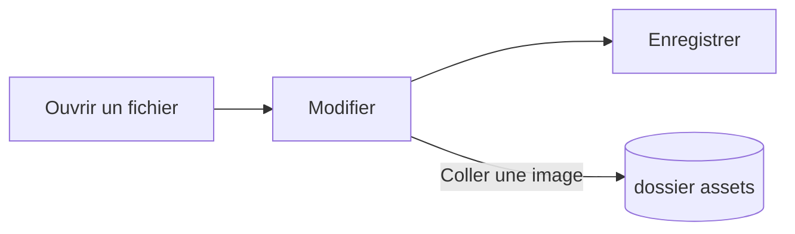

# Guide de Pupitre


Pupitre est un éditeur Markdown de bureau. Les documents sont de simples fichiers `.md` : ce que vous voyez est rendu sur place, et la syntaxe Markdown apparaît tant que le curseur s’y trouve. Ce guide illustre aussi ce que l’éditeur affiche ; modifiez-le librement, il n’est enregistré que si vous choisissez **Enregistrer sous**.

## Édition

Placez le curseur dans du **texte en gras**, un `extrait de code` ou un [lien](https://github.com/shalemore/pupitre) et sa syntaxe apparaît autour. Les marqueurs se comportent comme du texte :

- Supprimez un marqueur pour retirer sa mise en forme ; ajoutez ou supprimez un `#` devant un titre pour changer son niveau.
- Sélectionner du texte montre sa syntaxe, et copier copie du Markdown.
- <kbd>Ctrl</kbd>+clic suit un lien : les adresses web s’ouvrent dans le navigateur, les liens `#titre` font défiler jusqu’au titre et les liens vers un fichier Markdown voisin ouvrent ce fichier.
- La mise en forme se trouve dans les menus **Paragraphe** et **Format**, dans le menu contextuel et dans les raccourcis ci-dessous.

<details>
<summary>Raccourcis clavier (Ctrl correspond à ⌘ sous macOS)</summary>

| Action | Raccourci |
| :----------------------------------------- | :---------------------------------------------------------------------------------------------------------- |
| Gras / Italique / Code en ligne | <kbd>Ctrl</kbd>+<kbd>B</kbd> / <kbd>I</kbd> / <kbd>Shift</kbd>+<kbd>`</kbd> |
| Barré | <kbd>Alt</kbd>+<kbd>Shift</kbd>+<kbd>5</kbd> |
| Souligné | <kbd>Ctrl</kbd>+<kbd>U</kbd> |
| Effacer la mise en forme | <kbd>Ctrl</kbd>+<kbd>\\</kbd> |
| Lien | <kbd>Ctrl</kbd>+<kbd>K</kbd> |
| Insérer une image… | <kbd>Ctrl</kbd>+<kbd>Shift</kbd>+<kbd>I</kbd> |
| Titre 1–6 / Paragraphe | <kbd>Ctrl</kbd>+<kbd>1</kbd>…<kbd>6</kbd> / <kbd>0</kbd> |
| Citation | <kbd>Ctrl</kbd>+<kbd>Shift</kbd>+<kbd>Q</kbd> |
| Liste numérotée / à puces | <kbd>Ctrl</kbd>+<kbd>Shift</kbd>+<kbd>[</kbd> / <kbd>]</kbd> |
| Bloc de code / Bloc mathématique | <kbd>Ctrl</kbd>+<kbd>Shift</kbd>+<kbd>K</kbd> / <kbd>M</kbd> |
| Tableau | <kbd>Ctrl</kbd>+<kbd>T</kbd> |
| Rechercher / Remplacer | <kbd>Ctrl</kbd>+<kbd>F</kbd> / <kbd>Ctrl</kbd>+<kbd>H</kbd> (macOS: <kbd>⌘</kbd>+<kbd>⌥</kbd>+<kbd>F</kbd>) |
| Rouvrir l’onglet fermé | <kbd>Ctrl</kbd>+<kbd>Shift</kbd>+<kbd>T</kbd> |
| Barres latérales | <kbd>Ctrl</kbd>+<kbd>Shift</kbd>+<kbd>L</kbd> |
| Mode code source | <kbd>Ctrl</kbd>+<kbd>/</kbd> |
| Mode concentration / Mode machine à écrire | <kbd>F8</kbd> / <kbd>F9</kbd> |
| Réinitialiser le zoom | <kbd>Ctrl</kbd>+<kbd>Shift</kbd>+<kbd>0</kbd> |
| Préférences | <kbd>Ctrl</kbd>+<kbd>,</kbd> |

</details>

## Modes d’écriture

- Le **Mode concentration** estompe tout sauf le paragraphe que vous écrivez.
- Le **Mode machine à écrire** garde la ligne en cours d’écriture au milieu de la fenêtre, ou près du haut ou du bas selon Préférences › Éditeur.

Les deux sont dans le menu **Affichage** et dans Préférences › Éditeur, et peuvent être combinés.

## Style de fenêtre

Préférences › Apparence › Style de fenêtre permet de passer de **Classique** à **Immersif**. Dans le style immersif, le document est placé dans une carte à l’intérieur de la fenêtre ; la barre de titre et les barres latérales se replient dès que vous tapez ou faites défiler, et reviennent quand le pointeur atteint le haut ou un bord latéral de la fenêtre. L’épingle d’une barre latérale garde les barres latérales ouvertes, et faire glisser le bord d’une barre latérale la redimensionne.

## Fichiers et images

- Pupitre conserve les fins de ligne du fichier ouvert, sauf indication contraire dans Préférences › Markdown. C’est aussi là que se règle la syntaxe insérée par les commandes de mise en forme.
- Les images collées sont enregistrées dans un dossier à côté du document (`assets` par défaut, Préférences › Markdown). Un document pas encore enregistré les garde en mémoire et les écrit au premier enregistrement.
- Préférences › Général › Application Markdown par défaut fait ouvrir les fichiers `.md` avec Pupitre depuis le gestionnaire de fichiers.
- Les préférences sont stockées dans `settings.json` ; Préférences › À propos affiche son dossier. Seules les valeurs différentes des valeurs par défaut sont écrites, et un champ illisible revient à sa valeur par défaut sans toucher aux autres.
- Un dossier peut avoir ses propres préférences : avec un dossier ouvert, les Préférences affichent un sélecteur entre **Global** et **Ce dossier**. Les changements sous **Ce dossier** vont dans `.pupitre/settings.json`, créé au premier changement et superposé aux préférences globales ; une réinitialisation **rétablit** la valeur globale.

## Thèmes

Un thème met en forme toute la fenêtre et le document. Préférences › Apparence les répertorie avec les modes de couleur qu’ils gèrent, et un thème distinct peut être choisi pour le mode sombre.

Les thèmes sont livrés avec l’application : chacun est un dossier `src/renderer/themes/<name>/` contenant un `index.css`, et le nom du dossier est le nom du thème. Les polices ou images d’un thème se placent dans le même dossier et s’appellent avec des `url()` relatives.

```css
:root {
  /* Les schémas de couleurs pris en charge : clair, sombre ou les deux */
  color-scheme: light dark;

  /* Police du corps de texte par défaut ; modifiable dans les préférences */
  --font-document: Georgia, serif;

  /* Jetons de design utilisés par toute la fenêtre */
  --ui-surface-1: oklch(0.99 0.01 90);
  --ui-brand: oklch(0.55 0.12 250);
}

@media (prefers-color-scheme: dark) {
   :root {
    --ui-surface-1: oklch(0.2 0.01 90);
  }
}

.md-document .md-h1 {
  font-size: 2em;
}
```

- Les couleurs se définissent avec les jetons `--ui-*` (surfaces, texte, accent) et `--syntax-*` pour le code. Leurs valeurs par défaut et la liste complète se trouvent dans `src/renderer/app.css` et le thème `pupitre`.
- Les barres de citation doivent utiliser `var(--alert-color, …)` pour que les alertes gardent leurs couleurs.
- La taille de police, l’interligne et la largeur du contenu appartiennent à l’utilisateur et priment toujours ; utilisez `em` pour les tailles dans le document et des propriétés logiques comme `padding-inline-start` pour que le texte de droite à gauche soit inversé.

## Référence Markdown

### Texte

**Gras**, _italique_, ~~barré~~, `code en ligne`, [liens](https://commonmark.org), H~2~O, x^2^, ==surlignages==, :tada: et <kbd>Échap</kbd>. Le HTML en ligne est rendu lorsqu’il forme un élément complet et affiché comme source sinon. Un paragraphe qui ne contient que `[TOC]` devient une liste des titres du document.

> Une citation.
>
> > Une citation imbriquée.

> [!NOTE]
> Alertes GitHub : `[!NOTE]`, `[!TIP]`, `[!IMPORTANT]`, `[!WARNING]` et `[!CAUTION]`.

> [!WARNING]
> Le marqueur doit être la première ligne de la citation.

### Listes

1. Numérotée
   - Imbriquée, à puces
   - [x] Les tâches peuvent être cochées
   - [ ] et décochées
2. Les listes peuvent contenir du code :

   ```sh
   npm run dev
   ```

### Tableau

| Gauche | Centre | Droite |
| :-------- | :-----: | -----: |
| Cellule | Cellule | 1.00 |
| Plus long | Texte | 10.50 |

### Code

```typescript
function countWords(text: string): number {
  const segmenter = new Intl.Segmenter(undefined, { granularity: "word" });
  return [...segmenter.segment(text)].filter((part) => part.isWordLike).length;
}
```

### Mathématiques

En ligne $e^{i\pi} + 1 = 0$ et en bloc :

$$
\int_{-\infty}^{\infty} e^{-x^2} \, dx = \sqrt{\pi}
$$

Les équations chimiques utilisent `\ce` : $\ce{2H2 + O2 -> 2H2O}$.

### Diagrammes



### Notes de bas de page

Une phrase avec une note[^1].

[^1]: Les notes sont listées à la fin du document.

<!-- Les commentaires sont conservés dans le fichier et affichés comme source. -->
