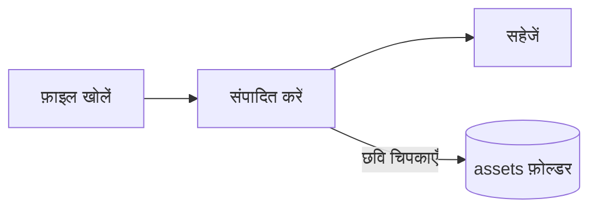

# Pupitre की मार्गदर्शिका


Pupitre एक डेस्कटॉप Markdown संपादक है। दस्तावेज़ सादी `.md` फ़ाइलें होती हैं: जो आप देखते हैं वह वहीं रेंडर होता है और जब कर्सर उस पर होता है तभी Markdown सिंटैक्स दिखता है। यह मार्गदर्शिका इस बात का भी नमूना है कि संपादक क्या रेंडर करता है; इसे मनचाहे ढंग से बदलें, जब तक आप **इस नाम से सहेजें** न चुनें इसे सहेजा नहीं जाएगा।

## संपादन

कर्सर को **बोल्ड टेक्स्ट**, किसी `कोड स्पैन` या किसी [लिंक](https://github.com/shalemore/pupitre) पर ले जाएँ और उसके चारों ओर उसका सिंटैक्स दिखने लगेगा। ये चिह्न टेक्स्ट की तरह व्यवहार करते हैं:

- किसी चिह्न को मिटाने से उसका स्वरूप हट जाता है; शीर्षक के आगे `#` जोड़ने या मिटाने से उसका स्तर बदलता है।
- टेक्स्ट चुनने पर उसका सिंटैक्स दिखता है, और कॉपी करने पर Markdown कॉपी होता है।
- स्वरूपण **अनुच्छेद** और **स्वरूप** मेन्यू, कॉन्टेक्स्ट मेन्यू और नीचे दिए शॉर्टकट में उपलब्ध है।

<details>
<summary>कीबोर्ड शॉर्टकट (macOS पर Ctrl के बजाय ⌘)</summary>

| क्रिया                       | शॉर्टकट                                                                                                      |
| :-------------------------- | :---------------------------------------------------------------------------------------------------------- |
| बोल्ड / इटैलिक / इनलाइन कोड   | <kbd>Ctrl</kbd>+<kbd>B</kbd> / <kbd>I</kbd> / <kbd>Shift</kbd>+<kbd>`</kbd>                                 |
| स्ट्राइकथ्रू                    | <kbd>Alt</kbd>+<kbd>Shift</kbd>+<kbd>5</kbd>                                                                |
| लिंक                         | <kbd>Ctrl</kbd>+<kbd>K</kbd>                                                                                |
| शीर्षक 1–6 / अनुच्छेद           | <kbd>Ctrl</kbd>+<kbd>1</kbd>…<kbd>6</kbd> / <kbd>0</kbd>                                                    |
| उद्धरण                       | <kbd>Ctrl</kbd>+<kbd>Shift</kbd>+<kbd>Q</kbd>                                                               |
| क्रमांकित / बुलेट सूची           | <kbd>Ctrl</kbd>+<kbd>Shift</kbd>+<kbd>[</kbd> / <kbd>]</kbd>                                                |
| कोड ब्लॉक / गणित ब्लॉक        | <kbd>Ctrl</kbd>+<kbd>Shift</kbd>+<kbd>K</kbd> / <kbd>M</kbd>                                                |
| तालिका                      | <kbd>Ctrl</kbd>+<kbd>T</kbd>                                                                                |
| खोजें / बदलें                   | <kbd>Ctrl</kbd>+<kbd>F</kbd> / <kbd>Ctrl</kbd>+<kbd>H</kbd> (macOS: <kbd>⌘</kbd>+<kbd>⌥</kbd>+<kbd>F</kbd>) |
| रूपरेखा                       | <kbd>Ctrl</kbd>+<kbd>Shift</kbd>+<kbd>L</kbd>                                                               |
| एकाग्रता मोड / टाइपराइटर मोड | <kbd>F8</kbd> / <kbd>F9</kbd>                                                                               |
| ज़ूम रीसेट करें                  | <kbd>Ctrl</kbd>+<kbd>Shift</kbd>+<kbd>0</kbd>                                                               |
| प्राथमिकताएँ                  | <kbd>Ctrl</kbd>+<kbd>,</kbd>                                                                                |

</details>

## लिखने के मोड

- **एकाग्रता मोड** उस अनुच्छेद के अलावा सब कुछ धुँधला कर देता है जिसे आप लिख रहे हैं।
- **टाइपराइटर मोड** जिस पंक्ति को आप लिख रहे हैं उसे विंडो के बीच में बनाए रखता है।

दोनों **देखें** मेन्यू और प्राथमिकताएँ › संपादक में हैं और इन्हें साथ भी चलाया जा सकता है।

## विंडो शैली

प्राथमिकताएँ › दिखावट › विंडो शैली **क्लासिक** और **इमर्सिव** के बीच बदलती है। इमर्सिव शैली में दस्तावेज़ विंडो के भीतर एक कार्ड में बैठता है; लिखने या स्क्रॉल करने पर शीर्षक पट्टी और रूपरेखा हट जाती हैं और जब सूचक विंडो के ऊपर या किनारे तक पहुँचता है तो लौट आती हैं।

## फ़ाइलें और छवियाँ

- जब तक प्राथमिकताएँ › Markdown कुछ और न कहें, Pupitre खोली गई फ़ाइल के पंक्ति अंत को वैसा ही रखता है। फ़ॉर्मेटिंग कमांड कौन-सा सिंटैक्स डालें, यह भी वहीं तय होता है।
- चिपकाई गई छवियाँ दस्तावेज़ के बगल के फ़ोल्डर में सहेजी जाती हैं (`assets` डिफ़ॉल्ट है, प्राथमिकताएँ › Markdown)। जो दस्तावेज़ अभी सहेजा नहीं गया, वह उन्हें मेमोरी में रखता है और पहली बार सहेजते समय लिखता है।
- प्राथमिकताएँ › सामान्य › डिफ़ॉल्ट Markdown ऐप Pupitre को फ़ाइल प्रबंधक से `.md` फ़ाइलें खोलने देता है।
- प्राथमिकताएँ `settings.json` में रखी जाती हैं; प्राथमिकताएँ › परिचय उसका फ़ोल्डर दिखाता है। केवल डिफ़ॉल्ट से भिन्न मान लिखे जाते हैं, और जो फ़ील्ड पढ़ी न जा सके वह बाकी को प्रभावित किए बिना अपने डिफ़ॉल्ट पर लौट आती है।

## थीम

एक थीम पूरी विंडो और दस्तावेज़ की शैली तय करती है। प्राथमिकताएँ › दिखावट उन्हें उनके रंग योजनाओं के साथ सूचीबद्ध करता है, और गहरी मोड के लिए अलग थीम चुनी जा सकती है।

थीम ऐप के साथ आती हैं: हर एक `src/renderer/themes/<name>/` में एक फ़ोल्डर है जिसमें `index.css` होती है, और फ़ोल्डर का नाम ही थीम का नाम है। किसी थीम की फ़ॉन्ट या छवियाँ उसी फ़ोल्डर में रखी जाती हैं और सापेक्ष `url()` से जोड़ी जाती हैं।

```css
:root {
  /* वे रंग योजनाएँ जिन्हें यह थीम सपोर्ट करती है: हल्की, गहरी या दोनों */
  color-scheme: light dark;

  /* मुख्य टेक्स्ट का डिफ़ॉल्ट फ़ॉन्ट; इसे प्राथमिकताओं में बदला जा सकता है */
  --font-document: Georgia, serif;

  /* पूरी विंडो में इस्तेमाल होने वाले डिज़ाइन टोकन */
  --ui-surface-1: oklch(0.99 0.01 90);
  --ui-brand: oklch(0.55 0.12 250);
}

@media (prefers-color-scheme: dark) {
  :root {
    --ui-surface-1: oklch(0.2 0.01 90);
  }
}

.md-document .md-h1 {
  font-size: 2em;
}
```

- रंग `--ui-*` टोकन (सतहें, टेक्स्ट, एक्सेंट) से और कोड के लिए `--syntax-*` से तय होते हैं। उनके डिफ़ॉल्ट और पूरी सूची `src/renderer/app.css` और `pupitre` थीम में है।
- उद्धरण की पट्टियाँ `var(--alert-color, …)` इस्तेमाल करें ताकि अलर्ट अपने रंग बनाए रखें।
- दस्तावेज़ के फ़ॉन्ट आकार, पंक्ति की ऊँचाई और सामग्री की चौड़ाई उपयोगकर्ता की होती हैं और हमेशा जीतती हैं; दस्तावेज़ में आकार के लिए `em` और `padding-inline-start` जैसे तार्किक गुण इस्तेमाल करें ताकि दाएँ-से-बाएँ टेक्स्ट सही ढंग से पलटे।

## Markdown संदर्भ

### टेक्स्ट

**बोल्ड**, _इटैलिक_, ~~स्ट्राइकथ्रू~~, `इनलाइन कोड`, [लिंक](https://commonmark.org), H~2~O, x^2^, <kbd>Esc</kbd> और <mark>हाइलाइट</mark>। इनलाइन HTML तब रेंडर होता है जब वह पूरा एलिमेंट हो, वरना सोर्स के रूप में दिखता है।

> एक उद्धरण।
>
> > एक अंदरूनी उद्धरण।

> [!NOTE]
> GitHub अलर्ट: `[!NOTE]`, `[!TIP]`, `[!IMPORTANT]`, `[!WARNING]` और `[!CAUTION]`।

> [!WARNING]
> यह चिह्न उद्धरण की पहली पंक्ति में होना चाहिए।

### सूचियाँ

1. क्रमांकित
   - अंदरूनी, बुलेट वाली
   - [x] कार्य पूरे किए जा सकते हैं
   - [ ] और बाकी भी
2. सूचियों में कोड रखा जा सकता है:

   ```sh
   npm run dev
   ```

### तालिका

| बाएँ | बीच  |   दाएँ |
| :-- | :--: | ----: |
| कक्ष | पाठ  |  1.00 |
| लंबा | टेक्स्ट | 10.50 |

### कोड

```typescript
function countWords(text: string): number {
  const segmenter = new Intl.Segmenter(undefined, { granularity: "word" });
  return [...segmenter.segment(text)].filter((part) => part.isWordLike).length;
}
```

### गणित

इनलाइन $e^{i\pi} + 1 = 0$ और प्रदर्शित:

$$
\int_{-\infty}^{\infty} e^{-x^2} \, dx = \sqrt{\pi}
$$

### आरेख



### फ़ुटनोट

फ़ुटनोट वाला एक वाक्य[^1]।

[^1]: फ़ुटनोट दस्तावेज़ के अंत में सूचीबद्ध होते हैं।

<!-- टिप्पणियाँ फ़ाइल में रहती हैं और सोर्स के रूप में दिखती हैं। -->
