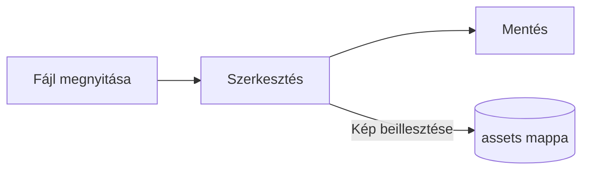

# Pupitre útmutató


A Pupitre egy asztali Markdown-szerkesztő. A dokumentumok egyszerű `.md` fájlok: amit lát, a helyén jelenik meg, a Markdown-szintaxis pedig a kurzor helyén látszik. Ez az útmutató egyszersmind bemutatja, mit jelenít meg a szerkesztő; nyugodtan módosíthatja, csak a **Mentés másként** választásakor kerül mentésre.

## Szerkesztés

Helyezze a kurzort **félkövér szövegbe**, egy `soron belüli kódba` vagy egy [hivatkozásba](https://github.com/shalemore/pupitre), és a szintaxis megjelenik körülötte. A jelölők szövegként viselkednek:

- Egy jelölő törlése megszünteti a formázást; egy `#` hozzáadása vagy törlése a címsor előtt megváltoztatja a szintjét.
- A kijelölt szöveg megmutatja a szintaxisát, a másolás pedig Markdownt másol.
- A <kbd>Ctrl</kbd>+kattintás követ egy hivatkozást: a webcímek a böngészőben nyílnak meg, a `#címsor` hivatkozások a címsorhoz görgetnek, a dokumentum melletti Markdown-fájlra mutató hivatkozások pedig megnyitják azt.
- A formázás a **Bekezdés** és **Formátum** menüben, a helyi menüben és az alábbi gyorsbillentyűkben található.

<details>
<summary>Gyorsbillentyűk (macOS-en a Ctrl helyett ⌘)</summary>

| Művelet                            | Gyorsbillentyű                                                                                              |
| :--------------------------------- | :---------------------------------------------------------------------------------------------------------- |
| Félkövér / Dőlt / Soron belüli kód | <kbd>Ctrl</kbd>+<kbd>B</kbd> / <kbd>I</kbd> / <kbd>Shift</kbd>+<kbd>`</kbd>                                 |
| Aláhúzás                           | <kbd>Ctrl</kbd>+<kbd>U</kbd>                                                                                |
| Áthúzás                            | <kbd>Alt</kbd>+<kbd>Shift</kbd>+<kbd>5</kbd>                                                                |
| Formázás törlése                   | <kbd>Ctrl</kbd>+<kbd>\\</kbd>                                                                               |
| Hivatkozás                         | <kbd>Ctrl</kbd>+<kbd>K</kbd>                                                                                |
| Kép beszúrása                      | <kbd>Ctrl</kbd>+<kbd>Shift</kbd>+<kbd>I</kbd>                                                               |
| Címsor 1–6 / Bekezdés              | <kbd>Ctrl</kbd>+<kbd>1</kbd>…<kbd>6</kbd> / <kbd>0</kbd>                                                    |
| Idézet                             | <kbd>Ctrl</kbd>+<kbd>Shift</kbd>+<kbd>Q</kbd>                                                               |
| Számozott / felsorolásos lista     | <kbd>Ctrl</kbd>+<kbd>Shift</kbd>+<kbd>[</kbd> / <kbd>]</kbd>                                                |
| Kódblokk / Matematikai blokk       | <kbd>Ctrl</kbd>+<kbd>Shift</kbd>+<kbd>K</kbd> / <kbd>M</kbd>                                                |
| Táblázat                           | <kbd>Ctrl</kbd>+<kbd>T</kbd>                                                                                |
| Keresés / Csere                    | <kbd>Ctrl</kbd>+<kbd>F</kbd> / <kbd>Ctrl</kbd>+<kbd>H</kbd> (macOS: <kbd>⌘</kbd>+<kbd>⌥</kbd>+<kbd>F</kbd>) |
| Bezárt lap újramegnyitása          | <kbd>Ctrl</kbd>+<kbd>Shift</kbd>+<kbd>T</kbd>                                                               |
| Oldalsávok                         | <kbd>Ctrl</kbd>+<kbd>Shift</kbd>+<kbd>L</kbd>                                                               |
| Forráskód mód                      | <kbd>Ctrl</kbd>+<kbd>/</kbd>                                                                                |
| Fókuszmód / Írógép mód             | <kbd>F8</kbd> / <kbd>F9</kbd>                                                                               |
| Nagyítás visszaállítása            | <kbd>Ctrl</kbd>+<kbd>Shift</kbd>+<kbd>R</kbd>                                                               |
| Beállítások                        | <kbd>Ctrl</kbd>+<kbd>,</kbd>                                                                                |

</details>

## Írási módok

- A **fókuszmód** elhalványít mindent, kivéve azt a bekezdést, amelyet éppen ír.
- Az **írógép mód** a gépelt sort az ablak közepén, illetve a Beállítások › Szerkesztő beállításától függően a tetejéhez vagy az aljához közel tartja.

Mindkettő a **Nézet** menüben és a Beállítások › Szerkesztő alatt található, és kombinálhatók egymással.

## Ablakstílus

A Beállítások › Megjelenés › Ablakstílus a **Klasszikus** és az **Immerszív** között vált. Immerszív stílusban a dokumentum az ablakon belüli kártyán jelenik meg; a címsor és az oldalsávok elrejtőznek, amint gépelni vagy görgetni kezd, és visszatérnek, amikor a mutató eléri az ablak felső vagy oldalsó szélét. Az oldalsávban lévő rögzítés nyitva tartja az oldalsávokat, az oldalsáv szélének húzásával pedig átméretezheti azt.

## Fájlok és képek

- A Pupitre megtartja a megnyitott fájl sorvégződéseit, hacsak a Beállítások › Markdown nem rendelkezik másként. Ott állítható be az is, milyen szintaxist szúrnak be a formázási parancsok.
- A beillesztett képek a dokumentum melletti mappába kerülnek (alapértelmezés szerint `assets`, Beállítások › Markdown). A még nem mentett dokumentum a memóriában tartja őket, és az első mentéskor írja ki.
- A Beállítások › Általános › Alapértelmezett Markdown-alkalmazás hatására a Pupitre a fájlkezelőből nyitja meg a `.md` fájlokat.
- A beállítások a `settings.json` fájlban vannak; a Beállítások › Névjegy mutatja a mappáját. Csak az alapértéktől eltérő értékek íródnak ki, és egy olvashatatlan mező visszaáll az alapértékre anélkül, hogy érintené a többit.
- Egy mappának saját beállításai lehetnek: nyitott mappa esetén a Beállítások **Globális** és **Ez a mappa** közötti kapcsolót mutat. Amit az **Ez a mappa** alatt módosít, az a mappában lévő `.pupitre/settings.json` fájlba kerül, amely az első módosításkor jön létre, és amikor a mappa nyitva van, a globális beállítások fölé kerül. Egy beállítás visszaállítása ott visszaadja a globális értéket.

## Témák

Egy téma az egész ablak és a dokumentum megjelenését határozza meg. A Beállítások › Megjelenés az általuk támogatott színsémákkal együtt sorolja fel őket, a sötét módhoz pedig külön téma választható.

A témák az alkalmazással együtt érkeznek: mindegyik egy mappa a `src/renderer/themes/<név>/` alatt `index.css` fájllal, és a mappa neve a téma neve. A téma által használt betűtípusok vagy képek ugyanebben a mappában vannak, és relatív `url()` hivatkozásokkal érhetők el.

```css
:root {
  /* A téma által támogatott színsémák: világos, sötét vagy mindkettő */
  color-scheme: light dark;

  /* A törzsszöveg alapértelmezett betűtípusa; a beállításokban módosítható */
  --font-document: Georgia, serif;

  /* Az egész ablakban használt design-tokenek */
  --ui-surface-1: oklch(0.99 0.01 90);
  --ui-brand: oklch(0.55 0.12 250);
}

@media (prefers-color-scheme: dark) {
  :root {
    --ui-surface-1: oklch(0.2 0.01 90);
  }
}

.md-document .md-h1 {
  font-size: 2em;
}
```

- A színek a `--ui-*` tokenekkel (felületek, szöveg, kiemelés) és a kódhoz a `--syntax-*` tokenekkel állíthatók be. Alapértékeik és a teljes lista a `src/renderer/app.css` fájlban és a `pupitre` témában található.
- Az idézetcsíkoknak `var(--alert-color, …)`-t kell használniuk, hogy a figyelmeztetések megtartsák színüket.
- A szöveg mérete, a sormagasság és a tartalom szélessége a felhasználóé, és mindig érvényesül; használjon `em` egységet a dokumentumban és logikai tulajdonságokat, például `padding-inline-start` értéket, hogy a jobbról balra írt szöveg tükröződjön.

## Markdown-referencia

### Szöveg

**Félkövér**, _dőlt_, ~~áthúzott~~, `soron belüli kód`, [hivatkozások](https://commonmark.org), H~2~O, x^2^, ==kiemelések==, :tada: és <kbd>Esc</kbd>. A soron belüli HTML akkor jelenik meg, ha teljes elemet alkot, máskülönben forráskódként látszik. Az a bekezdés, amely csak `[TOC]` szöveget tartalmaz, a dokumentum címsorainak listájává válik.

> Egy idézet.
>
> > Beágyazott idézet.

> [!NOTE]
> GitHub-értesítések: `[!NOTE]`, `[!TIP]`, `[!IMPORTANT]`, `[!WARNING]` és `[!CAUTION]`.

> [!WARNING]
> A jelölőnek az idézet első sorában kell lennie.

### Listák

1. Számozott
   - Beágyazott, felsorolásos
   - [x] A feladatok kipipálhatók
   - [ ] És kipipálatlanok
2. A listák tartalmazhatnak kódot:

   ```sh
   npm run dev
   ```

### Táblázat

| Bal      | Közép  |  Jobb |
| :------- | :----: | ----: |
| Cella    | Cella  |  1.00 |
| Hosszabb | Szöveg | 10.50 |

### Kód

```typescript
function countWords(text: string): number {
  const segmenter = new Intl.Segmenter(undefined, { granularity: "word" });
  return [...segmenter.segment(text)].filter((part) => part.isWordLike).length;
}
```

### Matematika

Soron belül $e^{i\pi} + 1 = 0$ és blokként:

$$
\int_{-\infty}^{\infty} e^{-x^2} \, dx = \sqrt{\pi}
$$

A kémiai egyenletek `\ce` jelölést használnak: $\ce{2H2 + O2 -> 2H2O}$.

### Diagramok



### Lábjegyzetek

Egy mondat lábjegyzettel[^1].

[^1]: A lábjegyzetek a dokumentum végén jelennek meg.

<!-- A megjegyzések a fájlban maradnak, és forráskódként jelennek meg. -->
