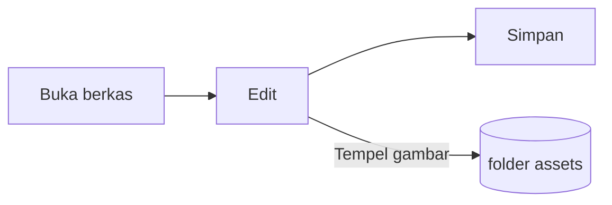

# Panduan Pupitre


Pupitre adalah editor Markdown untuk desktop. Dokumen berupa berkas `.md` biasa: yang Anda lihat dirender di tempat, dan sintaks Markdown muncul saat kursor berada di atasnya. Panduan ini juga menjadi contoh apa yang dirender oleh editor; sunting sesuka Anda, berkas ini tidak disimpan kecuali Anda memilih **Simpan sebagai**.

## Menyunting

Letakkan kursor di dalam **teks tebal**, sebuah `rentang kode`, atau sebuah [tautan](https://github.com/shalemore/pupitre) dan sintaksnya muncul di sekelilingnya. Penandanya berperilaku seperti teks:

- Backspace tepat setelah penanda pembuka akan menghapus formatnya.
- Di awal sebuah judul, ketik `#` untuk menaikkan tingkatnya dan tekan Backspace untuk menurunkannya.
- Pemformatan tersedia di menu **Paragraf** dan **Format**, menu klik kanan, serta pintasan di bawah.

<details>
<summary>Pintasan papan ketik (Ctrl adalah ⌘ di macOS)</summary>

| Tindakan                      | Pintasan                                                                                                    |
| :---------------------------- | :---------------------------------------------------------------------------------------------------------- |
| Tebal / Miring / Kode sebaris | <kbd>Ctrl</kbd>+<kbd>B</kbd> / <kbd>I</kbd> / <kbd>Shift</kbd>+<kbd>`</kbd>                                 |
| Coret                         | <kbd>Alt</kbd>+<kbd>Shift</kbd>+<kbd>5</kbd>                                                                |
| Tautan                        | <kbd>Ctrl</kbd>+<kbd>K</kbd>                                                                                |
| Judul 1–6 / Paragraf          | <kbd>Ctrl</kbd>+<kbd>1</kbd>…<kbd>6</kbd> / <kbd>0</kbd>                                                    |
| Kutipan                       | <kbd>Ctrl</kbd>+<kbd>Shift</kbd>+<kbd>Q</kbd>                                                               |
| Daftar bernomor / butir       | <kbd>Ctrl</kbd>+<kbd>Shift</kbd>+<kbd>[</kbd> / <kbd>]</kbd>                                                |
| Blok kode / blok matematika   | <kbd>Ctrl</kbd>+<kbd>Shift</kbd>+<kbd>K</kbd> / <kbd>M</kbd>                                                |
| Tabel                         | <kbd>Ctrl</kbd>+<kbd>T</kbd>                                                                                |
| Cari / Ganti                  | <kbd>Ctrl</kbd>+<kbd>F</kbd> / <kbd>Ctrl</kbd>+<kbd>H</kbd> (macOS: <kbd>⌘</kbd>+<kbd>⌥</kbd>+<kbd>F</kbd>) |
| Kerangka                      | <kbd>Ctrl</kbd>+<kbd>Shift</kbd>+<kbd>L</kbd>                                                               |
| Mode fokus / mesin tik        | <kbd>F8</kbd> / <kbd>F9</kbd>                                                                               |
| Atur ulang perbesaran         | <kbd>Ctrl</kbd>+<kbd>Shift</kbd>+<kbd>0</kbd>                                                               |
| Preferensi                    | <kbd>Ctrl</kbd>+<kbd>,</kbd>                                                                                |

</details>

## Mode menulis

- **Mode fokus** meredupkan semua kecuali paragraf yang sedang Anda tulis.
- **Mode mesin tik** menjaga baris yang sedang Anda tulis tetap di tengah jendela.

Keduanya ada di menu **Tampilan** dan di Preferensi › Editor, serta dapat digabungkan.

## Gaya jendela

Preferensi › Tampilan › Gaya jendela berganti antara **Klasik** dan **Imersif**. Pada gaya imersif dokumen berada dalam kartu di dalam jendela; bilah judul dan kerangka menyingkir begitu Anda mengetik atau menggulir, lalu kembali saat penunjuk mencapai bagian atas atau tepi awal jendela.

## Berkas dan gambar

- Pupitre mempertahankan akhir baris berkas yang dibuka kecuali Preferensi › Markdown menentukan lain. Cara daftar, penekanan, pagar kode, dan garis ditulis saat disimpan juga diatur di sana.
- Gambar yang ditempel disimpan di folder di samping dokumen (`assets` secara bawaan, Preferensi › Markdown). Dokumen yang belum disimpan menyimpannya di memori dan menuliskannya saat pertama kali disimpan.
- Preferensi › Umum › Aplikasi Markdown bawaan membuat Pupitre membuka berkas `.md` dari pengelola berkas.
- Preferensi disimpan di `settings.json`; Preferensi › Tentang menampilkan foldernya. Hanya nilai yang berbeda dari bawaannya yang ditulis, dan bidang yang tidak dapat dibaca kembali ke bawaannya tanpa memengaruhi yang lain.

## Tema

Sebuah tema menata seluruh jendela dan dokumen. Preferensi › Tampilan mencantumkannya bersama skema warna yang didukung, dan tema tersendiri dapat dipilih untuk mode gelap.

Tema disertakan bersama aplikasi: masing-masing berupa folder di `src/renderer/themes/<name>/` dengan sebuah `index.css`, dan nama folder itulah nama temanya. Font atau gambar yang dipakai tema diletakkan di folder yang sama dan dirujuk dengan `url()` relatif.

```css
:root {
  /* Skema warna yang didukung tema ini: terang, gelap, atau keduanya */
  color-scheme: light dark;

  /* Font isi teks bawaan; bisa diganti di preferensi */
  --font-document: Georgia, serif;

  /* Token desain yang berlaku untuk seluruh jendela */
  --ui-surface-1: oklch(0.99 0.01 90);
  --ui-brand: oklch(0.55 0.12 250);
}

@media (prefers-color-scheme: dark) {
  :root {
    --ui-surface-1: oklch(0.2 0.01 90);
  }
}

.milkdown .ProseMirror h1 {
  font-size: 2em;
}
```

- Warna diatur melalui token `--ui-*` (permukaan, teks, aksen) dan `--syntax-*` untuk kode. Bawaan dan daftar lengkapnya ada di `src/renderer/app.css` dan tema `pupitre`.
- Bilah kutipan sebaiknya memakai `var(--alert-color, …)` agar peringatan tetap mempertahankan warnanya.
- Ukuran font isi, tinggi baris, dan lebar konten milik pengguna dan selalu menang; gunakan `em` untuk ukuran di dalam dokumen dan properti logis seperti `padding-inline-start` agar teks kanan-ke-kiri tercermin dengan benar.

## Rujukan Markdown

### Teks

**Tebal**, _miring_, ~~coret~~, `kode sebaris`, [tautan](https://commonmark.org), H<sub>2</sub>O, x<sup>2</sup>, <kbd>Esc</kbd>, dan <mark>sorotan</mark>. HTML sebaris dirender bila merupakan elemen yang utuh dan ditampilkan sebagai sumber bila tidak.

> Sebuah kutipan.
>
> > Kutipan bersarang.

> [!NOTE]
> Peringatan GitHub: `[!NOTE]`, `[!TIP]`, `[!IMPORTANT]`, `[!WARNING]`, dan `[!CAUTION]`.

> [!WARNING]
> Penandanya harus berada di baris pertama kutipan.

### Daftar

1. Bernomor
   - Bersarang, berbutir
   - [x] Tugas dapat ditandai selesai
   - [ ] Dan dibatalkan
2. Daftar dapat memuat kode:

   ```sh
   npm run dev
   ```

### Tabel

| Kiri  | Tengah  | Kanan |
| :---- | :-----: | ----: |
| Sel   |  Teks   |  1.00 |
| Lebih | Panjang | 10.50 |

### Kode

```typescript
function countWords(text: string): number {
  const segmenter = new Intl.Segmenter(undefined, { granularity: "word" });
  return [...segmenter.segment(text)].filter((part) => part.isWordLike).length;
}
```

### Matematika

Sebaris $e^{i\pi} + 1 = 0$ dan tampilan:

$$
\int_{-\infty}^{\infty} e^{-x^2} \, dx = \sqrt{\pi}
$$

### Diagram



### Catatan kaki

Sebuah kalimat dengan catatan kaki[^1].

[^1]: Catatan kaki dicantumkan di akhir dokumen.

<!-- Komentar tetap tersimpan di berkas dan ditampilkan sebagai sumber. -->
