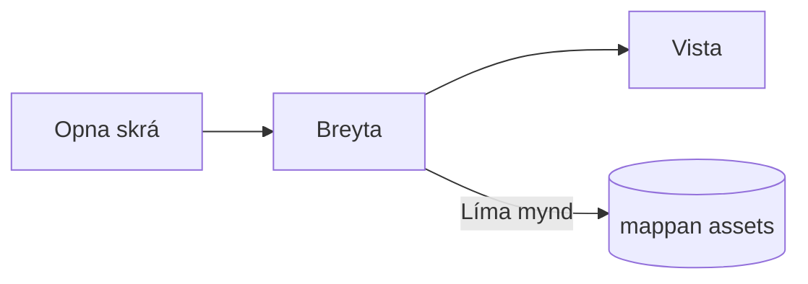

# Leiðarvísir Pupitre


Pupitre er Markdown-ritill fyrir skjáborð. Skjölin eru venjulegar `.md`-skrár: það sem þú sér er birt á staðnum og Markdown-málfræðin birtist þar sem bendillinn stendur. Þessi leiðarvísir er líka dæmi um það sem ritillinn birtir; breyttu honum að vild, hann er aðeins vistaður ef þú velur **Vista sem**.

## Breytingar

Settu bendilinn inn í **feitletraðan texta**, `kóða í texta` eða [hlekk](https://github.com/shalemore/pupitre) og málfræðin birtist í kringum hann. Merkin hegða sér eins og texti:

- Eyddu merki til að fjarlægja sniðið; bættu við eða eyddu `#` framan við fyrirsögn til að breyta stigi hennar.
- Valinn texti sýnir táknmál sitt og afritun afritar Markdown.
- Snið er í valmyndunum **Málsgrein** og **Snið**, í hægrismellsvalmynd og í flýtileiðunum hér fyrir neðan.

<details>
<summary>Flýtileiðir á lyklaborði (Ctrl er ⌘ á macOS)</summary>

| Aðgerð                              | Flýtileið                                                                                                   |
| :---------------------------------- | :---------------------------------------------------------------------------------------------------------- |
| Feitletra / Skáletra / Kóði í texta | <kbd>Ctrl</kbd>+<kbd>B</kbd> / <kbd>I</kbd> / <kbd>Shift</kbd>+<kbd>`</kbd>                                 |
| Yfirstrika                          | <kbd>Alt</kbd>+<kbd>Shift</kbd>+<kbd>5</kbd>                                                                |
| Hlekkur                             | <kbd>Ctrl</kbd>+<kbd>K</kbd>                                                                                |
| Fyrirsögn 1–6 / Málsgrein           | <kbd>Ctrl</kbd>+<kbd>1</kbd>…<kbd>6</kbd> / <kbd>0</kbd>                                                    |
| Tilvitnun                           | <kbd>Ctrl</kbd>+<kbd>Shift</kbd>+<kbd>Q</kbd>                                                               |
| Númeraður / punktalisti             | <kbd>Ctrl</kbd>+<kbd>Shift</kbd>+<kbd>[</kbd> / <kbd>]</kbd>                                                |
| Kóðablokk / Stærðfræðiblokk         | <kbd>Ctrl</kbd>+<kbd>Shift</kbd>+<kbd>K</kbd> / <kbd>M</kbd>                                                |
| Tafla                               | <kbd>Ctrl</kbd>+<kbd>T</kbd>                                                                                |
| Finna / Skipta út                   | <kbd>Ctrl</kbd>+<kbd>F</kbd> / <kbd>Ctrl</kbd>+<kbd>H</kbd> (macOS: <kbd>⌘</kbd>+<kbd>⌥</kbd>+<kbd>F</kbd>) |
| Efnisyfirlit                        | <kbd>Ctrl</kbd>+<kbd>Shift</kbd>+<kbd>L</kbd>                                                               |
| Einbeitingarhamur / Skrifvélarhamur | <kbd>F8</kbd> / <kbd>F9</kbd>                                                                               |
| Endurstilla aðdrátt                 | <kbd>Ctrl</kbd>+<kbd>Shift</kbd>+<kbd>0</kbd>                                                               |
| Forstillingar                       | <kbd>Ctrl</kbd>+<kbd>,</kbd>                                                                                |

</details>

## Rithemur

- **Einbeitingarhamur** dempar allt nema málsgreinina sem þú ert að skrifa.
- **Skrifvélarhamur** heldur línunni sem þú ert að skrifa í miðju gluggans.

Báðir eru í valmyndinni **Sýna** og í Forstillingar › Ritill, og þá má nota saman.

## Stíll glugga

Forstillingar › Útlit › Stíll glugga skiptir milli **Klassísks** og **Yfirgripsmikils**. Í yfirgripsmikla stílnum stendur skjalið á spjaldi inni í glugganum; titilstikan og efnisyfirlitið víkja um leið og þú skrifar eða skrunar og koma aftur þegar bendillinn nær efri eða upphafskanti gluggans.

## Skrár og myndir

- Pupitre heldur línulokum skrárinnar sem var opnuð, nema Forstillingar › Markdown segi annað. Táknmálið sem sniðskipanir setja inn er einnig stillt þar.
- Límdar myndir eru vistaðar í möppu við skjalið (`assets` sjálfgefið, Forstillingar › Markdown). Skjal sem ekki hefur verið vistað heldur þeim í minni og skrifar þær við fyrstu vistun.
- Forstillingar › Almennt › Sjálfgefna Markdown-forritið lætur Pupitre opna `.md`-skrár úr skráastjóranum.
- Forstillingarnar eru geymdar í `settings.json`; Forstillingar › Um sýnir möppuna. Aðeins gildi sem víkja frá sjálfgefnum eru skrifuð, og reitur sem ekki er læsilegur fer aftur í sjálfgefið án þess að hafa áhrif á aðra.

## Þemu

Þema skilgreinir stíl alls gluggans og skjalsins. Forstillingar › Útlit listar þau með litakerfunum sem þau styðja, og hægt er að velja sérstakt þema fyrir dökkan ham.

Þemun fylgja forritinu: hvert þema er mappa í `src/renderer/themes/<nafn>/` með `index.css`, og nafn möppunnar er nafn þemans. Leturgerðir eða myndir sem þema notar eru í sömu möppu og vísað er til þeirra með afstæðum `url()`.

```css
:root {
  /* Litakerfin sem þemað styður: bjart, dökkt eða hvort tveggja */
  color-scheme: light dark;

  /* Sjálfgefið letur meginmáls; hægt að breyta í stillingum */
  --font-document: Georgia, serif;

  /* Hönnunarbreytur sem gilda í öllum glugganum */
  --ui-surface-1: oklch(0.99 0.01 90);
  --ui-brand: oklch(0.55 0.12 250);
}

@media (prefers-color-scheme: dark) {
  :root {
    --ui-surface-1: oklch(0.2 0.01 90);
  }
}

.md-document .md-h1 {
  font-size: 2em;
}
```

- Litir eru stilltir með `--ui-*`-tókunum (flöt, texti, áhersla) og `--syntax-*` fyrir kóða. Sjálfgefin gildi þeirra og allur listinn eru í `src/renderer/app.css` og þemanu `pupitre`.
- Tilvitnanastikur eiga að nota `var(--alert-color, …)` svo tilkynningar haldi litum sínum.
- Stærð megintexta, línubil og breidd innihalds tilheyra notandanum og vinna alltaf; notaðu `em` fyrir mál í skjalinu og rökleg eigindi eins og `padding-inline-start` svo texti frá hægri til vinstri speglist.

## Markdown-handbók

### Texti

**Feitletrað**, _skáletrað_, ~~yfirstrikað~~, `kóði í texta`, [hlekkir](https://commonmark.org), H~2~O, x^2^, <kbd>Esc</kbd> og <mark>markanir</mark>. HTML í texta er birt þegar það er heil eining og birt sem frumkóði annars.

> Tilvitnun.
>
> > Innfelld tilvitnun.

> [!NOTE]
> GitHub-tilkynningar: `[!NOTE]`, `[!TIP]`, `[!IMPORTANT]`, `[!WARNING]` og `[!CAUTION]`.

> [!WARNING]
> Merkið verður að vera fyrsta lína tilvitnunarinnar.

### Listar

1. Númeraður
   - Innfelldur, punktalisti
   - [x] Hægt er að merkja verk
   - [ ] Og afmerkja þau
2. Listar geta innihaldið kóða:

   ```sh
   npm run dev
   ```

### Tafla

| Vinstri | Miðja  | Hægri |
| :------ | :----: | ----: |
| Reitur  | Reitur |  1.00 |
| Lengri  | Texti  | 10.50 |

### Kóði

```typescript
function countWords(text: string): number {
  const segmenter = new Intl.Segmenter(undefined, { granularity: "word" });
  return [...segmenter.segment(text)].filter((part) => part.isWordLike).length;
}
```

### Stærðfræði

Í texta $e^{i\pi} + 1 = 0$ og sem blokk:

$$
\int_{-\infty}^{\infty} e^{-x^2} \, dx = \sqrt{\pi}
$$

### Skýringarmyndir



### Neðanmálsgreinar

Setning með neðanmálsgrein[^1].

[^1]: Neðanmálsgreinar eru listar í lok skjalsins.

<!-- Athugasemdir haldast í skránni og eru birtar sem frumkóði. -->
