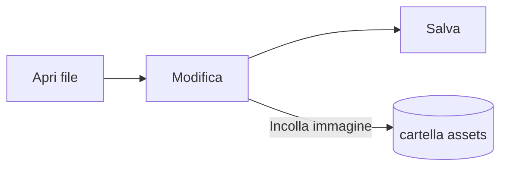

# Guida a Pupitre


Pupitre è un editor Markdown per desktop. I documenti sono semplici file `.md`: ciò che vedi viene mostrato già formattato sul posto, e la sintassi Markdown compare finché il cursore si trova su di essa. Questa guida è anche un esempio di ciò che l’editor mostra; modificala liberamente, non viene salvata a meno che tu scelga **Salva con nome**.

## Modifica

Sposta il cursore dentro un **testo in grassetto**, un `frammento di codice` o un [link](https://github.com/shalemore/pupitre) e la sua sintassi compare intorno. I marcatori si comportano come testo:

- Backspace subito dopo un marcatore di apertura rimuove la formattazione.
- All’inizio di un titolo, digita `#` per alzarne il livello e premi Backspace per abbassarlo.
- La formattazione è nei menu **Paragrafo** e **Formato**, nel menu contestuale e nelle scorciatoie qui sotto.

<details>
<summary>Scorciatoie da tastiera (Ctrl è ⌘ su macOS)</summary>

| Azione                                                  | Scorciatoia                                                                                                 |
| :------------------------------------------------------ | :---------------------------------------------------------------------------------------------------------- |
| Grassetto / Corsivo / Codice in linea                   | <kbd>Ctrl</kbd>+<kbd>B</kbd> / <kbd>I</kbd> / <kbd>Shift</kbd>+<kbd>`</kbd>                                 |
| Barrato                                                 | <kbd>Alt</kbd>+<kbd>Shift</kbd>+<kbd>5</kbd>                                                                |
| Link                                                    | <kbd>Ctrl</kbd>+<kbd>K</kbd>                                                                                |
| Titolo 1–6 / Paragrafo                                  | <kbd>Ctrl</kbd>+<kbd>1</kbd>…<kbd>6</kbd> / <kbd>0</kbd>                                                    |
| Citazione                                               | <kbd>Ctrl</kbd>+<kbd>Shift</kbd>+<kbd>Q</kbd>                                                               |
| Elenco numerato / puntato                               | <kbd>Ctrl</kbd>+<kbd>Shift</kbd>+<kbd>[</kbd> / <kbd>]</kbd>                                                |
| Blocco di codice / Blocco matematico                    | <kbd>Ctrl</kbd>+<kbd>Shift</kbd>+<kbd>K</kbd> / <kbd>M</kbd>                                                |
| Tabella                                                 | <kbd>Ctrl</kbd>+<kbd>T</kbd>                                                                                |
| Trova / Sostituisci                                     | <kbd>Ctrl</kbd>+<kbd>F</kbd> / <kbd>Ctrl</kbd>+<kbd>H</kbd> (macOS: <kbd>⌘</kbd>+<kbd>⌥</kbd>+<kbd>F</kbd>) |
| Struttura                                               | <kbd>Ctrl</kbd>+<kbd>Shift</kbd>+<kbd>L</kbd>                                                               |
| Modalità concentrazione / Modalità macchina da scrivere | <kbd>F8</kbd> / <kbd>F9</kbd>                                                                               |
| Reimposta zoom                                          | <kbd>Ctrl</kbd>+<kbd>Shift</kbd>+<kbd>0</kbd>                                                               |
| Preferenze                                              | <kbd>Ctrl</kbd>+<kbd>,</kbd>                                                                                |

</details>

## Modalità di scrittura

- La **Modalità concentrazione** attenua tutto tranne il paragrafo che stai scrivendo.
- La **Modalità macchina da scrivere** tiene la riga che stai scrivendo al centro della finestra.

Entrambe sono nel menu **Visualizza** e in Preferenze › Editor, e si possono combinare.

## Stile finestra

Preferenze › Aspetto › Stile finestra passa da **Classico** a **Immersivo**. Nello stile immersivo il documento sta in una scheda dentro la finestra; la barra del titolo e la struttura si spostano quando scrivi o scorri e tornano quando il puntatore raggiunge il bordo superiore o iniziale della finestra. Lo stile si applica alle finestre aperte dopo la modifica.

## File e immagini

- Pupitre mantiene i fine riga del file aperto, salvo diversa indicazione in Preferenze › Markdown. Lì si imposta anche come vengono scritti al salvataggio elenchi, enfasi, recinti di codice e linee.
- Le immagini incollate vengono salvate in una cartella accanto al documento (`assets` per impostazione predefinita, Preferenze › Markdown). Un documento non ancora salvato le tiene in memoria e le scrive al primo salvataggio.
- Preferenze › Generale › App predefinita per Markdown fa aprire i file `.md` con Pupitre dal gestore file.
- Le preferenze sono memorizzate in `settings.json`; Preferenze › Informazioni ne mostra la cartella. Vengono scritti solo i valori diversi da quelli predefiniti, e un campo illeggibile torna al valore predefinito senza toccare gli altri.

## Temi

Un tema dà stile a tutta la finestra e al documento. Preferenze › Aspetto li elenca con gli schemi di colore supportati, e per la modalità scura si può scegliere un tema separato.

I temi sono inclusi nell’app: ognuno è una cartella in `src/renderer/themes/<name>/` con un `index.css`, e il nome della cartella è il nome del tema. Font o immagini del tema stanno nella stessa cartella e si richiamano con `url()` relativi.

```css
:root {
  /* Gli schemi di colore supportati dal tema: chiaro, scuro o entrambi */
  color-scheme: light dark;

  /* Font del corpo del testo predefinito; si cambia nelle preferenze */
  --font-document: Georgia, serif;

  /* Token di design usati da tutta la finestra */
  --ui-surface-1: oklch(0.99 0.01 90);
  --ui-brand: oklch(0.55 0.12 250);
}

@media (prefers-color-scheme: dark) {
  :root {
    --ui-surface-1: oklch(0.2 0.01 90);
  }
}

.milkdown .ProseMirror h1 {
  font-size: 2em;
}
```

- I colori si impostano con i token `--ui-*` (superfici, testo, accento) e `--syntax-*` per il codice. I valori predefiniti e l’elenco completo sono in `src/renderer/app.css` e nel tema `pupitre`.
- Le barre delle citazioni dovrebbero usare `var(--alert-color, …)` perché gli avvisi mantengano i loro colori.
- Dimensione del testo, altezza di riga e larghezza del contenuto appartengono all’utente e prevalgono sempre; usa `em` per le dimensioni nel documento e proprietà logiche come `padding-inline-start` perché il testo da destra a sinistra venga specchiato.

## Riferimento Markdown

### Testo

**Grassetto**, _corsivo_, ~~barrato~~, `codice in linea`, [link](https://commonmark.org), H<sub>2</sub>O, x<sup>2</sup>, <kbd>Esc</kbd> ed <mark>evidenziazioni</mark>. L’HTML in linea viene reso quando è un elemento completo, altrimenti è mostrato come sorgente.

> Una citazione.
>
> > Una citazione annidata.

> [!NOTE]
> Avvisi GitHub: `[!NOTE]`, `[!TIP]`, `[!IMPORTANT]`, `[!WARNING]` e `[!CAUTION]`.

> [!WARNING]
> Il marcatore deve essere la prima riga della citazione.

### Elenchi

1. Numerato
   - Annidato, puntato
   - [x] Le attività si possono spuntare
   - [ ] e deselezionare
2. Gli elenchi possono contenere codice:

   ```sh
   npm run dev
   ```

### Tabella

| Sinistra  | Centro | Destra |
| :-------- | :----: | -----: |
| Cella     | Cella  |   1.00 |
| Più lungo | Testo  |  10.50 |

### Codice

```typescript
function countWords(text: string): number {
  const segmenter = new Intl.Segmenter(undefined, { granularity: "word" });
  return [...segmenter.segment(text)].filter((part) => part.isWordLike).length;
}
```

### Matematica

In linea $e^{i\pi} + 1 = 0$ e in blocco:

$$
\int_{-\infty}^{\infty} e^{-x^2} \, dx = \sqrt{\pi}
$$

### Diagrammi



### Note a piè di pagina

Una frase con una nota[^1].

[^1]: Le note sono elencate alla fine del documento.

<!-- I commenti restano nel file e sono mostrati come sorgente. -->
