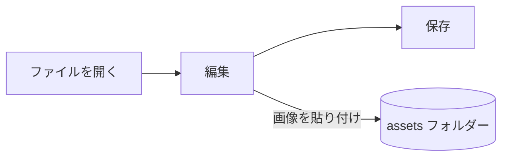

# Pupitre ガイド


Pupitre はデスクトップ向けの Markdown エディタです。ドキュメントは普通の `.md` ファイルで、見えているものはその場でレンダリングされ、カーソルがある間は Markdown の記法が表示されます。このガイドはエディタの表示例でもあります。自由に編集してください。**名前を付けて保存** を選ばない限り保存されません。

## 編集

**太字**、`インラインコード`、[リンク](https://github.com/shalemore/pupitre) の中にカーソルを置くと、周囲に記法が表示されます。記号はテキストと同じように扱えます。

- 記号を消すとその書式が外れ、見出しの前の `#` を増減するとレベルが変わります。
- テキストを選択すると中の記法が表示され、コピーすると Markdown がコピーされます。
- 書式は **段落** メニューと **書式** メニュー、コンテキストメニュー、下記のショートカットから使えます。

<details>
<summary>キーボードショートカット（macOS では Ctrl が ⌘）</summary>

| 操作                                    | ショートカット                                                                                              |
| :-------------------------------------- | :---------------------------------------------------------------------------------------------------------- |
| 太字 / 斜体 / インラインコード          | <kbd>Ctrl</kbd>+<kbd>B</kbd> / <kbd>I</kbd> / <kbd>Shift</kbd>+<kbd>`</kbd>                                 |
| 下線                                    | <kbd>Ctrl</kbd>+<kbd>U</kbd>                                                                                |
| 取り消し線                              | <kbd>Alt</kbd>+<kbd>Shift</kbd>+<kbd>5</kbd>                                                                |
| 書式をクリア                            | <kbd>Ctrl</kbd>+<kbd>\\</kbd>                                                                               |
| リンク                                  | <kbd>Ctrl</kbd>+<kbd>K</kbd>                                                                                |
| 画像を挿入                              | <kbd>Ctrl</kbd>+<kbd>Shift</kbd>+<kbd>I</kbd>                                                               |
| 見出し 1–6 / 段落                       | <kbd>Ctrl</kbd>+<kbd>1</kbd>…<kbd>6</kbd> / <kbd>0</kbd>                                                    |
| 引用                                    | <kbd>Ctrl</kbd>+<kbd>Shift</kbd>+<kbd>Q</kbd>                                                               |
| 番号付きリスト / 箇条書き               | <kbd>Ctrl</kbd>+<kbd>Shift</kbd>+<kbd>[</kbd> / <kbd>]</kbd>                                                |
| コードブロック / 数式ブロック           | <kbd>Ctrl</kbd>+<kbd>Shift</kbd>+<kbd>K</kbd> / <kbd>M</kbd>                                                |
| 表                                      | <kbd>Ctrl</kbd>+<kbd>T</kbd>                                                                                |
| 検索 / 置換                             | <kbd>Ctrl</kbd>+<kbd>F</kbd> / <kbd>Ctrl</kbd>+<kbd>H</kbd> (macOS: <kbd>⌘</kbd>+<kbd>⌥</kbd>+<kbd>F</kbd>) |
| 閉じたタブを再度開く                    | <kbd>Ctrl</kbd>+<kbd>Shift</kbd>+<kbd>T</kbd>                                                               |
| アウトライン                            | <kbd>Ctrl</kbd>+<kbd>Shift</kbd>+<kbd>L</kbd>                                                               |
| ソースコードモード                      | <kbd>Ctrl</kbd>+<kbd>/</kbd>                                                                                |
| フォーカスモード / タイプライターモード | <kbd>F8</kbd> / <kbd>F9</kbd>                                                                               |
| ズームをリセット                        | <kbd>Ctrl</kbd>+<kbd>Shift</kbd>+<kbd>0</kbd>                                                               |
| 環境設定                                | <kbd>Ctrl</kbd>+<kbd>,</kbd>                                                                                |

</details>

## 執筆モード

- **フォーカスモード** は書いている段落以外を薄く表示します。
- **タイプライターモード** は書いている行をウィンドウの中央に保ちます。

どちらも **表示** メニューと 環境設定 › エディタ にあり、組み合わせて使えます。

## ウィンドウスタイル

環境設定 › 外観 › ウィンドウスタイル で **クラシック** と **没入型** を切り替えます。没入型ではドキュメントがウィンドウ内のカードに表示され、入力やスクロールを始めるとタイトルバーとアウトラインが退き、ポインターがウィンドウの上端または開始側の端に来ると戻ります。

## ファイルと画像

- 環境設定 › Markdown で変更しない限り、Pupitre は開いたファイルの改行コードを保ちます。書式コマンドが挿入する記法もそこで設定します。
- 貼り付けた画像はドキュメントの隣のフォルダー（既定は `assets`、環境設定 › Markdown）に保存されます。まだ保存していないドキュメントでは画像をメモリーに保持し、最初の保存時に書き出します。
- 環境設定 › 一般 › Markdown の既定のアプリ で、ファイルマネージャーから `.md` ファイルを Pupitre で開けるようになります。
- 設定は `settings.json` に保存され、環境設定 › 情報 でそのフォルダーを表示できます。既定値と異なる値だけが書き込まれ、読み取れない項目は他の項目に影響せず既定値に戻ります。

## テーマ

テーマはウィンドウ全体とドキュメントの見た目を決めます。環境設定 › 外観 に対応する配色とともに一覧され、ダークモードには別のテーマを選べます。

テーマはアプリに同梱されています。各テーマは `src/renderer/themes/<name>/` フォルダーにある `index.css` で、フォルダー名がテーマ名です。テーマが使うフォントや画像は同じフォルダーに置き、相対 `url()` で参照します。

```css
:root {
  /* このテーマが対応する配色：ライト、ダーク、またはその両方 */
  color-scheme: light dark;

  /* 既定の本文フォント。ユーザーは環境設定で上書きできます */
  --font-document: Georgia, serif;

  /* ウィンドウ全体で使うデザイントークン */
  --ui-surface-1: oklch(0.99 0.01 90);
  --ui-brand: oklch(0.55 0.12 250);
}

@media (prefers-color-scheme: dark) {
  :root {
    --ui-surface-1: oklch(0.2 0.01 90);
  }
}

.md-document .md-h1 {
  font-size: 2em;
}
```

- 色は `--ui-*` トークン（面、テキスト、アクセント）とコード用の `--syntax-*` で設定します。既定値と全一覧は `src/renderer/app.css` と `pupitre` テーマにあります。
- 引用の縦線は `var(--alert-color, …)` を使い、アラートが色を保てるようにしてください。
- 本文のフォントサイズ、行間、コンテンツ幅はユーザーのもので常に優先されます。ドキュメント内のサイズには `em`、右から左のテキストが反転するよう `padding-inline-start` などの論理プロパティを使ってください。

## Markdown リファレンス

### テキスト

**太字**、_斜体_、~~取り消し線~~、`インラインコード`、[リンク](https://commonmark.org)、H~2~O、x^2^、<kbd>Esc</kbd>、<mark>ハイライト</mark>。インライン HTML は完全な要素のときにレンダリングされ、それ以外はソースとして表示されます。

> 引用。
>
> > 入れ子の引用。

> [!NOTE]
> GitHub アラート：`[!NOTE]`、`[!TIP]`、`[!IMPORTANT]`、`[!WARNING]`、`[!CAUTION]`。

> [!WARNING]
> マーカーは引用の最初の行に置く必要があります。

### リスト

1. 番号付き
   - 入れ子の箇条書き
   - [x] タスクはチェックでき
   - [ ] 外すこともできます
2. リストにはコードも入れられます：

   ```sh
   npm run dev
   ```

### 表

| 左     |   中央   |    右 |
| :----- | :------: | ----: |
| セル   |   セル   |  1.00 |
| 長めの | テキスト | 10.50 |

### コード

```typescript
function countWords(text: string): number {
  const segmenter = new Intl.Segmenter(undefined, { granularity: "word" });
  return [...segmenter.segment(text)].filter((part) => part.isWordLike).length;
}
```

### 数式

インライン $e^{i\pi} + 1 = 0$ と数式ブロック：

$$
\int_{-\infty}^{\infty} e^{-x^2} \, dx = \sqrt{\pi}
$$

### 図



### 脚注

脚注のある文[^1]。

[^1]: 脚注はドキュメントの末尾に並びます。

<!-- コメントはファイルに残り、ソースとして表示されます。 -->
