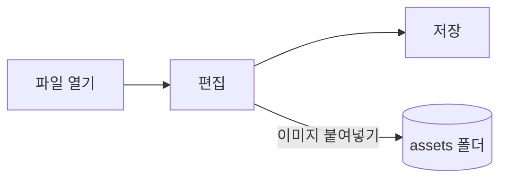

# Pupitre 가이드


Pupitre는 데스크톱용 Markdown 편집기입니다. 문서는 일반 `.md` 파일이며, 보이는 내용은 그 자리에서 렌더링되고 커서가 있는 동안에는 Markdown 문법이 나타납니다. 이 가이드는 편집기가 보여 주는 예시이기도 합니다. 자유롭게 편집하세요. **다른 이름으로 저장**을 선택하지 않으면 저장되지 않습니다.

## 편집

**굵은 글씨**, `코드 조각`, [링크](https://github.com/shalemore/pupitre) 안에 커서를 두면 주변에 문법이 나타납니다. 표시는 텍스트처럼 동작합니다.

- 표시를 지우면 서식이 사라지고, 제목 앞의 `#`을 더하거나 지우면 수준이 바뀝니다.
- 텍스트를 선택하면 그 안의 문법이 보이고, 복사하면 Markdown이 복사됩니다.
- 서식은 **단락** 및 **서식** 메뉴, 컨텍스트 메뉴, 아래 단축키에서 사용할 수 있습니다.

<details>
<summary>키보드 단축키(macOS에서는 Ctrl이 ⌘)</summary>

| 동작                           | 단축키                                                                                                      |
| :----------------------------- | :---------------------------------------------------------------------------------------------------------- |
| 굵게 / 기울임꼴 / 인라인 코드  | <kbd>Ctrl</kbd>+<kbd>B</kbd> / <kbd>I</kbd> / <kbd>Shift</kbd>+<kbd>`</kbd>                                 |
| 취소선                         | <kbd>Alt</kbd>+<kbd>Shift</kbd>+<kbd>5</kbd>                                                                |
| 링크                           | <kbd>Ctrl</kbd>+<kbd>K</kbd>                                                                                |
| 제목 1–6 / 단락                | <kbd>Ctrl</kbd>+<kbd>1</kbd>…<kbd>6</kbd> / <kbd>0</kbd>                                                    |
| 인용                           | <kbd>Ctrl</kbd>+<kbd>Shift</kbd>+<kbd>Q</kbd>                                                               |
| 번호 매기기 / 글머리 기호 목록 | <kbd>Ctrl</kbd>+<kbd>Shift</kbd>+<kbd>[</kbd> / <kbd>]</kbd>                                                |
| 코드 블록 / 수식 블록          | <kbd>Ctrl</kbd>+<kbd>Shift</kbd>+<kbd>K</kbd> / <kbd>M</kbd>                                                |
| 표                             | <kbd>Ctrl</kbd>+<kbd>T</kbd>                                                                                |
| 찾기 / 바꾸기                  | <kbd>Ctrl</kbd>+<kbd>F</kbd> / <kbd>Ctrl</kbd>+<kbd>H</kbd> (macOS: <kbd>⌘</kbd>+<kbd>⌥</kbd>+<kbd>F</kbd>) |
| 아웃라인                       | <kbd>Ctrl</kbd>+<kbd>Shift</kbd>+<kbd>L</kbd>                                                               |
| 집중 모드 / 타자기 모드        | <kbd>F8</kbd> / <kbd>F9</kbd>                                                                               |
| 확대/축소 초기화               | <kbd>Ctrl</kbd>+<kbd>Shift</kbd>+<kbd>0</kbd>                                                               |
| 환경설정                       | <kbd>Ctrl</kbd>+<kbd>,</kbd>                                                                                |

</details>

## 작성 모드

- **집중 모드**는 작성 중인 단락 외에는 흐리게 표시합니다.
- **타자기 모드**는 작성 중인 줄을 창 가운데에 유지합니다.

둘 다 **보기** 메뉴와 환경설정 › 편집기에 있으며 함께 사용할 수 있습니다.

## 창 스타일

환경설정 › 모양 › 창 스타일에서 **클래식**과 **몰입형**을 전환합니다. 몰입형에서는 문서가 창 안의 카드에 놓이고, 입력하거나 스크롤하면 제목 표시줄과 개요가 물러났다가 포인터가 창 위쪽이나 시작 쪽 가장자리에 닿으면 돌아옵니다.

## 파일과 이미지

- 환경설정 › Markdown에서 바꾸지 않으면 Pupitre는 연 파일의 줄 바꿈 문자를 유지합니다. 서식 명령이 넣는 문법도 그곳에서 정합니다.
- 붙여넣은 이미지는 문서 옆 폴더(기본값 `assets`, 환경설정 › Markdown)에 저장됩니다. 아직 저장하지 않은 문서는 이미지를 메모리에 두었다가 처음 저장할 때 기록합니다.
- 환경설정 › 일반 › 기본 Markdown 앱으로 파일 관리자에서 `.md` 파일을 Pupitre로 열 수 있습니다.
- 환경설정은 `settings.json`에 저장되며 환경설정 › 정보에서 그 폴더를 볼 수 있습니다. 기본값과 다른 값만 기록되고, 읽을 수 없는 항목은 다른 항목에 영향 없이 기본값으로 돌아갑니다.

## 테마

테마는 창 전체와 문서의 모양을 정합니다. 환경설정 › 모양에 지원하는 색 구성표와 함께 나열되며, 다크 모드에는 별도의 테마를 고를 수 있습니다.

테마는 앱에 포함되어 있습니다. 각 테마는 `src/renderer/themes/<name>/` 폴더의 `index.css`이고 폴더 이름이 테마 이름입니다. 테마가 쓰는 글꼴이나 이미지는 같은 폴더에 두고 상대 `url()`로 참조합니다.

```css
:root {
  /* 이 테마가 지원하는 색상 구성표: 라이트, 다크 또는 둘 다 */
  color-scheme: light dark;

  /* 기본 본문 글꼴. 사용자는 환경설정에서 변경할 수 있습니다 */
  --font-document: Georgia, serif;

  /* 창 전체에서 사용하는 디자인 토큰 */
  --ui-surface-1: oklch(0.99 0.01 90);
  --ui-brand: oklch(0.55 0.12 250);
}

@media (prefers-color-scheme: dark) {
  :root {
    --ui-surface-1: oklch(0.2 0.01 90);
  }
}

.md-document .md-h1 {
  font-size: 2em;
}
```

- 색은 `--ui-*` 토큰(표면, 텍스트, 강조)과 코드용 `--syntax-*`로 설정합니다. 기본값과 전체 목록은 `src/renderer/app.css`와 `pupitre` 테마에 있습니다.
- 인용 막대는 `var(--alert-color, …)`를 사용해 알림이 색을 유지하게 하세요.
- 본문 글꼴 크기, 줄 높이, 콘텐츠 너비는 사용자의 것이므로 항상 우선합니다. 문서 안의 크기에는 `em`을, 오른쪽에서 왼쪽 텍스트가 반전되도록 `padding-inline-start` 같은 논리 속성을 사용하세요.

## Markdown 참조

### 텍스트

**굵게**, _기울임_, ~~취소선~~, `인라인 코드`, [링크](https://commonmark.org), H~2~O, x^2^, <kbd>Esc</kbd>, <mark>강조 표시</mark>. 인라인 HTML은 완전한 요소일 때 렌더링되고, 그렇지 않으면 소스로 표시됩니다.

> 인용.
>
> > 중첩된 인용.

> [!NOTE]
> GitHub 알림: `[!NOTE]`, `[!TIP]`, `[!IMPORTANT]`, `[!WARNING]`, `[!CAUTION]`.

> [!WARNING]
> 표시는 인용의 첫 줄에 있어야 합니다.

### 목록

1. 번호 매기기
   - 중첩된 글머리 기호
   - [x] 작업은 체크할 수 있고
   - [ ] 해제할 수도 있습니다
2. 목록에는 코드를 넣을 수 있습니다:

   ```sh
   npm run dev
   ```

### 표

| 왼쪽  | 가운데 | 오른쪽 |
| :---- | :----: | -----: |
| 셀    |   셀   |   1.00 |
| 더 긴 | 텍스트 |  10.50 |

### 코드

```typescript
function countWords(text: string): number {
  const segmenter = new Intl.Segmenter(undefined, { granularity: "word" });
  return [...segmenter.segment(text)].filter((part) => part.isWordLike).length;
}
```

### 수식

인라인 $e^{i\pi} + 1 = 0$ 과 별행 수식:

$$
\int_{-\infty}^{\infty} e^{-x^2} \, dx = \sqrt{\pi}
$$

### 다이어그램



### 각주

각주가 있는 문장[^1].

[^1]: 각주는 문서 끝에 나열됩니다.

<!-- 주석은 파일에 남고 소스로 표시됩니다. -->
