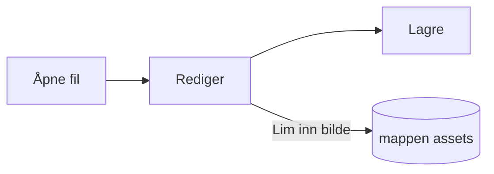

# Pupitres veiledning


Pupitre er en skrivebordsredigerer for Markdown. Dokumentene er vanlige `.md`-filer: det du ser gjengis på stedet, og Markdown-syntaksen vises der markøren står. Denne veiledningen er også et eksempel på hva redigereren gjengir; rediger den fritt, den lagres bare hvis du velger **Lagre som**.

## Redigere

Sett markøren inne i **fet tekst**, et `kodeavsnitt` eller en [lenke](https://github.com/shalemore/pupitre), så vises syntaksen rundt. Markørene oppfører seg som tekst:

- Slett en markør for å fjerne formateringen; legg til eller slett en `#` foran en overskrift for å endre nivået.
- Når du merker tekst, vises syntaksen i den, og kopiering kopierer Markdown.
- <kbd>Ctrl</kbd>+klikk følger en lenke: nettadresser åpnes i nettleseren, `#overskrift`-lenker ruller til overskriften, og lenker til en Markdown-fil ved siden av dokumentet åpner den.
- Formatering finnes i menyene **Avsnitt** og **Format**, i hurtigmenyen og i hurtigtastene nedenfor.

<details>
<summary>Hurtigtaster (Ctrl er ⌘ på macOS)</summary>

| Handling                       | Hurtigtast                                                                                                  |
| :----------------------------- | :---------------------------------------------------------------------------------------------------------- |
| Fet / Kursiv / Innebygd kode   | <kbd>Ctrl</kbd>+<kbd>B</kbd> / <kbd>I</kbd> / <kbd>Shift</kbd>+<kbd>`</kbd>                                 |
| Gjennomstreket                 | <kbd>Alt</kbd>+<kbd>Shift</kbd>+<kbd>5</kbd>                                                                |
| Understreking                  | <kbd>Ctrl</kbd>+<kbd>U</kbd>                                                                                |
| Fjern formatering              | <kbd>Ctrl</kbd>+<kbd>\\</kbd>                                                                               |
| Lenke                          | <kbd>Ctrl</kbd>+<kbd>K</kbd>                                                                                |
| Sett inn bilde…                | <kbd>Ctrl</kbd>+<kbd>Shift</kbd>+<kbd>I</kbd>                                                               |
| Overskrift 1–6 / Avsnitt       | <kbd>Ctrl</kbd>+<kbd>1</kbd>…<kbd>6</kbd> / <kbd>0</kbd>                                                    |
| Sitat                          | <kbd>Ctrl</kbd>+<kbd>Shift</kbd>+<kbd>Q</kbd>                                                               |
| Nummerert / punktliste         | <kbd>Ctrl</kbd>+<kbd>Shift</kbd>+<kbd>[</kbd> / <kbd>]</kbd>                                                |
| Kodeblokk / Matematikkblokk    | <kbd>Ctrl</kbd>+<kbd>Shift</kbd>+<kbd>K</kbd> / <kbd>M</kbd>                                                |
| Tabell                         | <kbd>Ctrl</kbd>+<kbd>T</kbd>                                                                                |
| Finn / Erstatt                 | <kbd>Ctrl</kbd>+<kbd>F</kbd> / <kbd>Ctrl</kbd>+<kbd>H</kbd> (macOS: <kbd>⌘</kbd>+<kbd>⌥</kbd>+<kbd>F</kbd>) |
| Åpne lukket fane på nytt       | <kbd>Ctrl</kbd>+<kbd>Shift</kbd>+<kbd>T</kbd>                                                               |
| Sidefelt                       | <kbd>Ctrl</kbd>+<kbd>Shift</kbd>+<kbd>L</kbd>                                                               |
| Kildekodemodus                 | <kbd>Ctrl</kbd>+<kbd>/</kbd>                                                                                |
| Fokusmodus / Skrivemaskinmodus | <kbd>F8</kbd> / <kbd>F9</kbd>                                                                               |
| Tilbakestill zoom              | <kbd>Ctrl</kbd>+<kbd>Shift</kbd>+<kbd>R</kbd>                                                               |
| Innstillinger                  | <kbd>Ctrl</kbd>+<kbd>,</kbd>                                                                                |

</details>

## Skrivemoduser

- **Fokusmodus** demper alt unntatt avsnittet du skriver i.
- **Skrivemaskinmodus** holder linjen du skriver på midten av vinduet eller nær over- eller underkanten, slik Innstillinger › Redigerer angir.

Begge finnes i menyen **Vis** og under Innstillinger › Redigerer, og kan brukes sammen.

## Vindustil

Innstillinger › Utseende › Vindustil bytter mellom **Klassisk** og **Immersiv**. I immersiv stil vises dokumentet på et kort i vinduet; tittellinjen og sidefeltene skjules når du skriver eller ruller, og kommer tilbake når pekeren når toppen eller sidekanten av vinduet. Festede sidefelt holdes åpne, og du endrer bredden ved å dra i kanten av et sidefelt.

## Filer og bilder

- Pupitre beholder linjesluttene i filen den åpnet, med mindre Innstillinger › Markdown sier noe annet. Syntaksen som formateringskommandoer setter inn, stilles også inn der.
- Innlimte bilder lagres i en mappe ved siden av dokumentet (`assets` som standard, Innstillinger › Markdown). Et dokument som ikke er lagret ennå holder dem i minnet og skriver dem ved første lagring.
- Innstillinger › Generelt › Standard Markdown-app gjør at Pupitre åpner `.md`-filer fra filbehandleren.
- Innstillingene lagres i `settings.json`; Innstillinger › Om viser mappen. Bare verdier som avviker fra standard skrives, og et felt som ikke kan leses faller tilbake på standard uten å påvirke de andre.
- En mappe kan ha egne innstillinger: når en mappe er åpen, viser innstillingene en veksler mellom **Globalt** og **Denne mappen**. Endringer under **Denne mappen** lagres i `.pupitre/settings.json` i den; filen opprettes ved den første endringen og legges over de globale innstillingene så lenge mappen er åpen. Tilbakestilling av en innstilling der gjenoppretter den globale verdien.

## Temaer

Et tema bestemmer stilen for hele vinduet og dokumentet. Innstillinger › Utseende lister dem med fargeskjemaene de støtter, og et eget tema kan velges for mørk modus.

Temaer følger med appen: hvert tema er en mappe i `src/renderer/themes/<navn>/` med en `index.css`, og mappenavnet er temaets navn. Skrifttyper eller bilder et tema bruker ligger i samme mappe og refereres med relative `url()`.

```css
:root {
  /* Fargeskjemaene temaet støtter: lyst, mørkt eller begge */
  color-scheme: light dark;

  /* Standard skrift for brødteksten; kan endres i innstillingene */
  --font-document: Georgia, serif;

  /* Designtokens som gjelder for hele vinduet */
  --ui-surface-1: oklch(0.99 0.01 90);
  --ui-brand: oklch(0.55 0.12 250);
}

@media (prefers-color-scheme: dark) {
  :root {
    --ui-surface-1: oklch(0.2 0.01 90);
  }
}

.md-document .md-h1 {
  font-size: 2em;
}
```

- Farger stilles inn med `--ui-*`-tokenene (flater, tekst, aksent) og `--syntax-*` for kode. Standardverdiene og hele listen finnes i `src/renderer/app.css` og temaet `pupitre`.
- Sitatstreker bør bruke `var(--alert-color, …)` slik at varsler beholder fargene sine.
- Brødtekstens størrelse, linjeavstand og innholdsbredde tilhører brukeren og vinner alltid; bruk `em` for mål i dokumentet og logiske egenskaper som `padding-inline-start` slik at tekst fra høyre til venstre speiles.

## Markdown-referanse

### Tekst

**Fet**, _kursiv_, ~~gjennomstreket~~, `innebygd kode`, [lenker](https://commonmark.org), H~2~O, x^2^, ==utheving==, :tada: og <kbd>Esc</kbd>. Innebygd HTML gjengis når det er et komplett element, og vises som kildekode ellers. Et avsnitt som bare inneholder `[TOC]`, blir en liste over dokumentets overskrifter.

> Et sitat.
>
> > Et sitat i et sitat.

> [!NOTE]
> GitHub-varsler: `[!NOTE]`, `[!TIP]`, `[!IMPORTANT]`, `[!WARNING]` og `[!CAUTION]`.

> [!WARNING]
> Markøren må være sitatets første linje.

### Lister

1. Nummerert
   - Punktliste i en liste
   - [x] Oppgaver kan krysses av
   - [ ] Og fjernes
2. Lister kan inneholde kode:

   ```sh
   npm run dev
   ```

### Tabell

| Venstre | Midten | Høyre |
| :------ | :----: | ----: |
| Celle   | Celle  |  1.00 |
| Lengre  | Tekst  | 10.50 |

### Kode

```typescript
function countWords(text: string): number {
  const segmenter = new Intl.Segmenter(undefined, { granularity: "word" });
  return [...segmenter.segment(text)].filter((part) => part.isWordLike).length;
}
```

### Matematikk

Innebygd $e^{i\pi} + 1 = 0$ og som blokk:

$$
\int_{-\infty}^{\infty} e^{-x^2} \, dx = \sqrt{\pi}
$$

Kjemiske ligninger skrives med `\ce`: $\ce{2H2 + O2 -> 2H2O}$.

### Diagrammer



### Fotnoter

En setning med en fotnote[^1].

[^1]: Fotnoter listes på slutten av dokumentet.

<!-- Kommentarer beholdes i filen og vises som kildekode. -->
