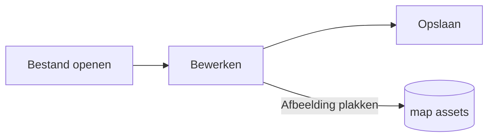

# Pupitre-gids


Pupitre is een Markdown-editor voor de desktop. Documenten zijn gewone `.md`-bestanden: wat u ziet wordt ter plaatse weergegeven en de Markdown-syntaxis verschijnt terwijl de cursor erop staat. Deze gids is ook een voorbeeld van wat de editor weergeeft; bewerk hem gerust, hij wordt alleen opgeslagen als u **Opslaan als** kiest.

## Bewerken

Zet de cursor in **vette tekst**, in een `inline code` of in een [link](https://github.com/shalemore/pupitre) en de syntaxis verschijnt eromheen. De markeringen gedragen zich als tekst:

- Verwijder een markering om de opmaak weg te halen; voeg een `#` toe voor een kop of verwijder er een om het niveau te wijzigen.
- Geselecteerde tekst toont zijn syntaxis, en kopiëren kopieert Markdown.
- Opmaak staat in de menu's **Alinea** en **Opmaak**, in het contextmenu en in de sneltoetsen hieronder.

<details>
<summary>Sneltoetsen (Ctrl is ⌘ op macOS)</summary>

| Actie                           | Sneltoets                                                                                                   |
| :------------------------------ | :---------------------------------------------------------------------------------------------------------- |
| Vet / Cursief / Inline code     | <kbd>Ctrl</kbd>+<kbd>B</kbd> / <kbd>I</kbd> / <kbd>Shift</kbd>+<kbd>`</kbd>                                 |
| Doorhalen                       | <kbd>Alt</kbd>+<kbd>Shift</kbd>+<kbd>5</kbd>                                                                |
| Onderstreept                    | <kbd>Ctrl</kbd>+<kbd>U</kbd>                                                                                |
| Opmaak wissen                   | <kbd>Ctrl</kbd>+<kbd>\\</kbd>                                                                               |
| Link                            | <kbd>Ctrl</kbd>+<kbd>K</kbd>                                                                                |
| Afbeelding invoegen…            | <kbd>Ctrl</kbd>+<kbd>Shift</kbd>+<kbd>I</kbd>                                                               |
| Kop 1–6 / Alinea                | <kbd>Ctrl</kbd>+<kbd>1</kbd>…<kbd>6</kbd> / <kbd>0</kbd>                                                    |
| Citaat                          | <kbd>Ctrl</kbd>+<kbd>Shift</kbd>+<kbd>Q</kbd>                                                               |
| Genummerde / ongenummerde lijst | <kbd>Ctrl</kbd>+<kbd>Shift</kbd>+<kbd>[</kbd> / <kbd>]</kbd>                                                |
| Codeblok / Wiskundeblok         | <kbd>Ctrl</kbd>+<kbd>Shift</kbd>+<kbd>K</kbd> / <kbd>M</kbd>                                                |
| Tabel                           | <kbd>Ctrl</kbd>+<kbd>T</kbd>                                                                                |
| Zoeken / Vervangen              | <kbd>Ctrl</kbd>+<kbd>F</kbd> / <kbd>Ctrl</kbd>+<kbd>H</kbd> (macOS: <kbd>⌘</kbd>+<kbd>⌥</kbd>+<kbd>F</kbd>) |
| Gesloten tab opnieuw openen     | <kbd>Ctrl</kbd>+<kbd>Shift</kbd>+<kbd>T</kbd>                                                               |
| Overzicht                       | <kbd>Ctrl</kbd>+<kbd>Shift</kbd>+<kbd>L</kbd>                                                               |
| Broncodemodus                   | <kbd>Ctrl</kbd>+<kbd>/</kbd>                                                                                |
| Focusmodus / Typemachinemodus   | <kbd>F8</kbd> / <kbd>F9</kbd>                                                                               |
| Zoom herstellen                 | <kbd>Ctrl</kbd>+<kbd>Shift</kbd>+<kbd>0</kbd>                                                               |
| Voorkeuren                      | <kbd>Ctrl</kbd>+<kbd>,</kbd>                                                                                |

</details>

## Schrijfmodi

- De **focusmodus** vervaagt alles behalve de alinea waarin u schrijft.
- De **typemachinemodus** houdt de regel waarin u typt in het midden van het venster.

Beide staan in het menu **Beeld** en in Voorkeuren › Editor, en kunnen worden gecombineerd.

## Vensterstijl

Voorkeuren › Weergave › Vensterstijl schakelt tussen **Klassiek** en **Immersief**. In de immersieve stijl staat het document in een kaart in het venster; de titelbalk en het overzicht wijken zodra u typt of scrolt en komen terug wanneer de aanwijzer de bovenkant of de beginrand van het venster bereikt.

## Bestanden en afbeeldingen

- Pupitre houdt de regeleinden van het geopende bestand aan, tenzij Voorkeuren › Markdown anders zegt. De syntaxis die opmaakopdrachten invoegen, stelt u daar ook in.
- Geplakte afbeeldingen worden opgeslagen in een map naast het document (standaard `assets`, Voorkeuren › Markdown). Een document dat nog niet is opgeslagen houdt ze in het geheugen en schrijft ze bij de eerste keer opslaan.
- Voorkeuren › Algemeen › Standaard Markdown-app zorgt ervoor dat Pupitre `.md`-bestanden opent vanuit de bestandsbeheerder.
- Voorkeuren staan in `settings.json`; Voorkeuren › Over toont de map. Alleen waarden die van de standaard afwijken worden opgeslagen, en een veld dat niet kan worden gelezen valt terug op de standaard zonder de andere te beïnvloeden.

## Thema's

Een thema bepaalt de stijl van het hele venster en van het document. Voorkeuren › Weergave toont ze met de kleurschema's die ze ondersteunen, en voor de donkere modus kan een apart thema worden gekozen.

Thema's worden met de app meegeleverd: elk is een map in `src/renderer/themes/<naam>/` met een `index.css`, en de mapnaam is de naam van het thema. Lettertypen of afbeeldingen die een thema gebruikt, staan in dezelfde map en worden met relatieve `url()`'s aangewezen.

```css
:root {
  /* De kleurschema's die dit thema ondersteunt: licht, donker of beide */
  color-scheme: light dark;

  /* Standaardlettertype voor de bodytekst; aan te passen in de instellingen */
  --font-document: Georgia, serif;

  /* Designtokens die in het hele venster gelden */
  --ui-surface-1: oklch(0.99 0.01 90);
  --ui-brand: oklch(0.55 0.12 250);
}

@media (prefers-color-scheme: dark) {
  :root {
    --ui-surface-1: oklch(0.2 0.01 90);
  }
}

.md-document .md-h1 {
  font-size: 2em;
}
```

- Kleuren stelt u in met de `--ui-*`-tokens (oppervlakken, tekst, accent) en `--syntax-*` voor code. Hun standaardwaarden en de volledige lijst staan in `src/renderer/app.css` en het thema `pupitre`.
- Citaatbalken horen `var(--alert-color, …)` te gebruiken, zodat meldingen hun eigen kleuren behouden.
- De grootte van de tekst, de regelafstand en de breedte van de inhoud zijn van de gebruiker en winnen altijd; gebruik `em` voor maten in het document en logische eigenschappen zoals `padding-inline-start` zodat tekst van rechts naar links wordt gespiegeld.

## Markdown-referentie

### Tekst

**Vet**, _cursief_, ~~doorhalen~~, `inline code`, [links](https://commonmark.org), H~2~O, x^2^, <kbd>Esc</kbd> en <mark>markeringen</mark>. Inline HTML wordt weergegeven als het een compleet element is en anders als broncode getoond.

> Een citaat.
>
> > Een genest citaat.

> [!NOTE]
> GitHub-meldingen: `[!NOTE]`, `[!TIP]`, `[!IMPORTANT]`, `[!WARNING]` en `[!CAUTION]`.

> [!WARNING]
> De markering moet de eerste regel van het citaat zijn.

### Lijsten

1. Genummerd
   - Genest, ongenummerd
   - [x] Taken kunnen worden aangevinkt
   - [ ] En uitgevinkt
2. Lijsten kunnen code bevatten:

   ```sh
   npm run dev
   ```

### Tabel

| Links  | Midden | Rechts |
| :----- | :----: | -----: |
| Cel    |  Cel   |   1.00 |
| Langer | Tekst  |  10.50 |

### Code

```typescript
function countWords(text: string): number {
  const segmenter = new Intl.Segmenter(undefined, { granularity: "word" });
  return [...segmenter.segment(text)].filter((part) => part.isWordLike).length;
}
```

### Wiskunde

Inline $e^{i\pi} + 1 = 0$ en als blok:

$$
\int_{-\infty}^{\infty} e^{-x^2} \, dx = \sqrt{\pi}
$$

### Diagrammen



### Voetnoten

Een zin met een voetnoot[^1].

[^1]: Voetnoten staan aan het einde van het document.

<!-- Opmerkingen blijven in het bestand en worden als broncode getoond. -->
