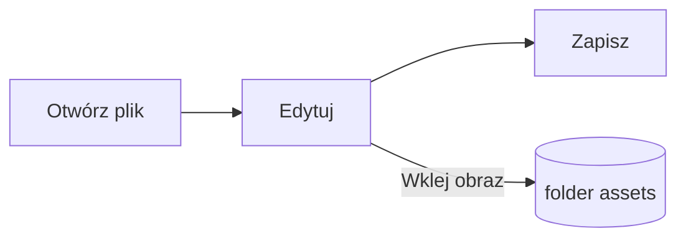

# Przewodnik po Pupitre


Pupitre to komputerowy edytor Markdown. Dokumenty to zwykłe pliki `.md`: to, co widzisz, jest renderowane na miejscu, a składnia Markdown pojawia się tam, gdzie jest kursor. Ten przewodnik jest też przykładem tego, co renderuje edytor; edytuj go swobodnie, zostanie zapisany tylko po wybraniu **Zapisz jako**.

## Edycja

Przenieś kursor do **pogrubionego tekstu**, `kodu w tekście` lub [łącza](https://github.com/shalemore/pupitre), a wokół niego pojawi się składnia. Znaczniki zachowują się jak tekst:

- Usuń znacznik, aby usunąć formatowanie; dodaj lub usuń `#` przed nagłówkiem, aby zmienić jego poziom.
- Zaznaczony tekst pokazuje swoją składnię, a kopiowanie kopiuje Markdown.
- Formatowanie jest w menu **Akapit** i **Format**, w menu kontekstowym oraz w skrótach poniżej.

<details>
<summary>Skróty klawiaturowe (Ctrl to ⌘ w systemie macOS)</summary>

| Czynność                              | Skrót                                                                                                       |
| :------------------------------------ | :---------------------------------------------------------------------------------------------------------- |
| Pogrubienie / Kursywa / Kod w tekście | <kbd>Ctrl</kbd>+<kbd>B</kbd> / <kbd>I</kbd> / <kbd>Shift</kbd>+<kbd>`</kbd>                                 |
| Przekreślenie                         | <kbd>Alt</kbd>+<kbd>Shift</kbd>+<kbd>5</kbd>                                                                |
| Łącze                                 | <kbd>Ctrl</kbd>+<kbd>K</kbd>                                                                                |
| Nagłówek 1–6 / Akapit                 | <kbd>Ctrl</kbd>+<kbd>1</kbd>…<kbd>6</kbd> / <kbd>0</kbd>                                                    |
| Cytat                                 | <kbd>Ctrl</kbd>+<kbd>Shift</kbd>+<kbd>Q</kbd>                                                               |
| Lista numerowana / punktowana         | <kbd>Ctrl</kbd>+<kbd>Shift</kbd>+<kbd>[</kbd> / <kbd>]</kbd>                                                |
| Blok kodu / Blok matematyczny         | <kbd>Ctrl</kbd>+<kbd>Shift</kbd>+<kbd>K</kbd> / <kbd>M</kbd>                                                |
| Tabela                                | <kbd>Ctrl</kbd>+<kbd>T</kbd>                                                                                |
| Znajdź / Zamień                       | <kbd>Ctrl</kbd>+<kbd>F</kbd> / <kbd>Ctrl</kbd>+<kbd>H</kbd> (macOS: <kbd>⌘</kbd>+<kbd>⌥</kbd>+<kbd>F</kbd>) |
| Spis treści                           | <kbd>Ctrl</kbd>+<kbd>Shift</kbd>+<kbd>L</kbd>                                                               |
| Tryb skupienia / maszyny do pisania   | <kbd>F8</kbd> / <kbd>F9</kbd>                                                                               |
| Przywróć powiększenie                 | <kbd>Ctrl</kbd>+<kbd>Shift</kbd>+<kbd>0</kbd>                                                               |
| Ustawienia                            | <kbd>Ctrl</kbd>+<kbd>,</kbd>                                                                                |

</details>

## Tryby pisania

- **Tryb skupienia** przyciemnia wszystko poza akapitem, w którym piszesz.
- **Tryb maszyny do pisania** utrzymuje pisaną linię na środku okna.

Oba są w menu **Widok** i w Ustawieniach › Edytor i można je łączyć.

## Styl okna

Ustawienia › Wygląd › Styl okna przełącza między **Klasycznym** a **Immersyjnym**. W stylu immersyjnym dokument leży na karcie wewnątrz okna; pasek tytułu i spis treści odsuwają się, gdy tylko zaczniesz pisać lub przewijać, i wracają, gdy wskaźnik dotrze do górnej lub początkowej krawędzi okna.

## Pliki i obrazy

- Pupitre zachowuje końce wierszy otwartego pliku, chyba że Ustawienia › Markdown mówią inaczej. Składnię wstawianą przez polecenia formatowania też ustawia się tam.
- Wklejone obrazy są zapisywane w folderze obok dokumentu (domyślnie `assets`, Ustawienia › Markdown). Dokument, który nie został jeszcze zapisany, trzyma je w pamięci i zapisze przy pierwszym zapisie.
- Ustawienia › Ogólne › Domyślna aplikacja Markdown sprawia, że Pupitre otwiera pliki `.md` z menedżera plików.
- Ustawienia są przechowywane w `settings.json`; Ustawienia › O programie pokazuje jego folder. Zapisywane są tylko wartości różne od domyślnych, a pole, którego nie da się odczytać, wraca do wartości domyślnej bez wpływu na pozostałe.

## Motywy

Motyw określa wygląd całego okna i dokumentu. Ustawienia › Wygląd listują je wraz z obsługiwanymi schematami kolorów, a dla trybu ciemnego można wybrać osobny motyw.

Motywy są dostarczane z aplikacją: każdy to folder w `src/renderer/themes/<nazwa>/` z plikiem `index.css`, a nazwa folderu jest nazwą motywu. Czcionki lub obrazy używane przez motyw leżą w tym samym folderze i są wskazywane względnymi `url()`.

```css
:root {
  /* Motywy kolorystyczne obsługiwane przez ten motyw: jasny, ciemny lub oba */
  color-scheme: light dark;

  /* Domyślna czcionka tekstu głównego; można ją zmienić w preferencjach */
  --font-document: Georgia, serif;

  /* Tokeny projektu używane w całym oknie */
  --ui-surface-1: oklch(0.99 0.01 90);
  --ui-brand: oklch(0.55 0.12 250);
}

@media (prefers-color-scheme: dark) {
  :root {
    --ui-surface-1: oklch(0.2 0.01 90);
  }
}

.md-document .md-h1 {
  font-size: 2em;
}
```

- Kolory ustawia się przez tokeny `--ui-*` (powierzchnie, tekst, akcent) oraz `--syntax-*` dla kodu. Ich wartości domyślne i pełna lista są w `src/renderer/app.css` i motywie `pupitre`.
- Paski cytatów powinny używać `var(--alert-color, …)`, aby alerty zachowały własne kolory.
- Rozmiar tekstu, odstęp między wierszami i szerokość treści należą do użytkownika i zawsze wygrywają; w dokumencie używaj `em` oraz właściwości logicznych, takich jak `padding-inline-start`, aby tekst od prawej do lewej był odbity lustrzanie.

## Dokumentacja Markdown

### Tekst

**Pogrubienie**, _kursywa_, ~~przekreślenie~~, `kod w tekście`, [łącza](https://commonmark.org), H<sub>2</sub>O, x<sup>2</sup>, <kbd>Esc</kbd> i <mark>podświetlenia</mark>. Wbudowany HTML jest renderowany, gdy tworzy kompletny element, a w przeciwnym razie pokazywany jako źródło.

> Cytat.
>
> > Zagnieżdżony cytat.

> [!NOTE]
> Alerty GitHuba: `[!NOTE]`, `[!TIP]`, `[!IMPORTANT]`, `[!WARNING]` i `[!CAUTION]`.

> [!WARNING]
> Znacznik musi być pierwszą linią cytatu.

### Listy

1. Numerowana
   - Zagnieżdżona, punktowana
   - [x] Zadania można odhaczać
   - [ ] I odznaczać
2. Listy mogą zawierać kod:

   ```sh
   npm run dev
   ```

### Tabela

| Lewo    | Środek  | Prawo |
| :------ | :-----: | ----: |
| Komórka | Komórka |  1.00 |
| Dłuższa |  Tekst  | 10.50 |

### Kod

```typescript
function countWords(text: string): number {
  const segmenter = new Intl.Segmenter(undefined, { granularity: "word" });
  return [...segmenter.segment(text)].filter((part) => part.isWordLike).length;
}
```

### Matematyka

W tekście $e^{i\pi} + 1 = 0$ i w bloku:

$$
\int_{-\infty}^{\infty} e^{-x^2} \, dx = \sqrt{\pi}
$$

### Diagramy



### Przypisy

Zdanie z przypisem[^1].

[^1]: Przypisy są wymienione na końcu dokumentu.

<!-- Komentarze pozostają w pliku i są pokazywane jako źródło. -->
