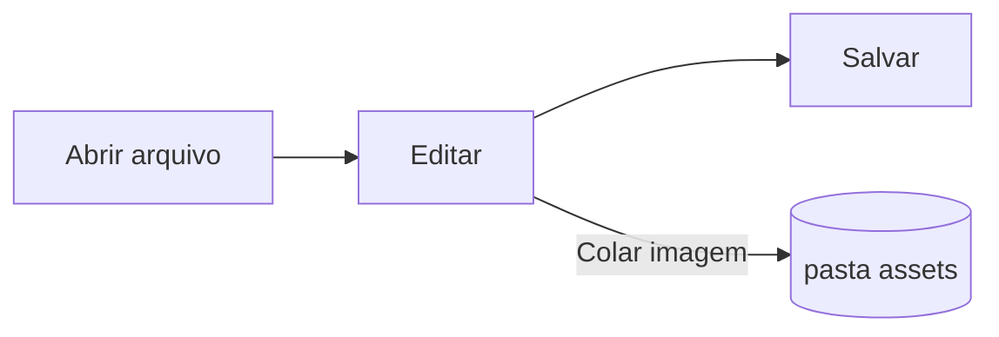

# Guia do Pupitre


O Pupitre é um editor de Markdown para desktop. Os documentos são arquivos `.md` comuns: o que você vê é renderizado no próprio lugar, e a sintaxe do Markdown aparece enquanto o cursor está sobre ela. Este guia também é um exemplo do que o editor exibe; edite à vontade, ele não é salvo a menos que você escolha **Salvar Como**.

## Edição

Mova o cursor para dentro de um **texto em negrito**, um `trecho de código` ou um [link](https://github.com/shalemore/pupitre) e a sintaxe aparece ao redor. Os marcadores se comportam como texto:

- Apague um marcador para remover a formatação; acrescente ou apague um `#` antes de um título para mudar o nível.
- Ao selecionar texto, a sintaxe dele aparece, e copiar copia Markdown.
- A formatação está nos menus **Parágrafo** e **Formatar**, no menu de contexto e nos atalhos abaixo.

<details>
<summary>Atalhos de teclado (Ctrl é ⌘ no macOS)</summary>

| Ação                                 | Atalho                                                                                                      |
| :----------------------------------- | :---------------------------------------------------------------------------------------------------------- |
| Negrito / Itálico / Código embutido  | <kbd>Ctrl</kbd>+<kbd>B</kbd> / <kbd>I</kbd> / <kbd>Shift</kbd>+<kbd>`</kbd>                                 |
| Tachado                              | <kbd>Alt</kbd>+<kbd>Shift</kbd>+<kbd>5</kbd>                                                                |
| Link                                 | <kbd>Ctrl</kbd>+<kbd>K</kbd>                                                                                |
| Título 1–6 / Parágrafo               | <kbd>Ctrl</kbd>+<kbd>1</kbd>…<kbd>6</kbd> / <kbd>0</kbd>                                                    |
| Citação                              | <kbd>Ctrl</kbd>+<kbd>Shift</kbd>+<kbd>Q</kbd>                                                               |
| Lista numerada / com marcadores      | <kbd>Ctrl</kbd>+<kbd>Shift</kbd>+<kbd>[</kbd> / <kbd>]</kbd>                                                |
| Bloco de código / Bloco matemático   | <kbd>Ctrl</kbd>+<kbd>Shift</kbd>+<kbd>K</kbd> / <kbd>M</kbd>                                                |
| Tabela                               | <kbd>Ctrl</kbd>+<kbd>T</kbd>                                                                                |
| Localizar / Substituir               | <kbd>Ctrl</kbd>+<kbd>F</kbd> / <kbd>Ctrl</kbd>+<kbd>H</kbd> (macOS: <kbd>⌘</kbd>+<kbd>⌥</kbd>+<kbd>F</kbd>) |
| Estrutura                            | <kbd>Ctrl</kbd>+<kbd>Shift</kbd>+<kbd>L</kbd>                                                               |
| Modo foco / Modo máquina de escrever | <kbd>F8</kbd> / <kbd>F9</kbd>                                                                               |
| Redefinir zoom                       | <kbd>Ctrl</kbd>+<kbd>Shift</kbd>+<kbd>0</kbd>                                                               |
| Preferências                         | <kbd>Ctrl</kbd>+<kbd>,</kbd>                                                                                |

</details>

## Modos de escrita

- O **Modo foco** esmaece tudo, exceto o parágrafo que você está escrevendo.
- O **Modo máquina de escrever** mantém a linha que você escreve no meio da janela.

Ambos estão no menu **Exibir** e em Preferências › Editor, e podem ser combinados.

## Estilo da janela

Preferências › Aparência › Estilo da janela alterna entre **Clássico** e **Imersivo**. No estilo imersivo o documento fica em um cartão dentro da janela; a barra de título e a estrutura sai do caminho quando você digita ou rola e voltam quando o ponteiro chega ao topo ou à borda inicial da janela.

## Arquivos e imagens

- O Pupitre mantém as quebras de linha do arquivo aberto, a menos que Preferências › Markdown diga o contrário. Ali também se define a sintaxe que os comandos de formatação inserem.
- As imagens coladas são salvas em uma pasta ao lado do documento (`assets` por padrão, Preferências › Markdown). Um documento ainda não salvo as mantém na memória e as grava no primeiro salvamento.
- Preferências › Geral › App padrão para Markdown faz o Pupitre abrir arquivos `.md` a partir do gerenciador de arquivos.
- As preferências ficam em `settings.json`; Preferências › Sobre mostra a pasta. Só são gravados os valores diferentes dos padrões, e um campo ilegível volta ao padrão sem afetar os outros.

## Temas

Um tema estiliza toda a janela e o documento. Preferências › Aparência os lista com os esquemas de cores que suportam, e um tema separado pode ser escolhido para o modo escuro.

Os temas acompanham o app: cada um é uma pasta em `src/renderer/themes/<name>/` com um `index.css`, e o nome da pasta é o nome do tema. Fontes ou imagens do tema ficam na mesma pasta e são referenciadas com `url()` relativos.

```css
:root {
  /* Os esquemas de cores aceitos por este tema: claro, escuro ou ambos */
  color-scheme: light dark;

  /* Fonte padrão do corpo do texto; dá para trocar nas preferências */
  --font-document: Georgia, serif;

  /* Tokens de design usados na janela inteira */
  --ui-surface-1: oklch(0.99 0.01 90);
  --ui-brand: oklch(0.55 0.12 250);
}

@media (prefers-color-scheme: dark) {
  :root {
    --ui-surface-1: oklch(0.2 0.01 90);
  }
}

.md-document .md-h1 {
  font-size: 2em;
}
```

- As cores são definidas pelos tokens `--ui-*` (superfícies, texto, destaque) e `--syntax-*` para código. Os padrões e a lista completa estão em `src/renderer/app.css` e no tema `pupitre`.
- As barras de citação devem usar `var(--alert-color, …)` para que os alertas mantenham suas cores.
- Tamanho da fonte, altura da linha e largura do conteúdo pertencem ao usuário e sempre prevalecem; use `em` para tamanhos no documento e propriedades lógicas como `padding-inline-start` para que o texto da direita para a esquerda seja espelhado.

## Referência de Markdown

### Texto

**Negrito**, _itálico_, ~~tachado~~, `código embutido`, [links](https://commonmark.org), H~2~O, x^2^, <kbd>Esc</kbd> e <mark>destaques</mark>. O HTML embutido é renderizado quando é um elemento completo e exibido como código-fonte caso contrário.

> Uma citação.
>
> > Uma citação aninhada.

> [!NOTE]
> Alertas do GitHub: `[!NOTE]`, `[!TIP]`, `[!IMPORTANT]`, `[!WARNING]` e `[!CAUTION]`.

> [!WARNING]
> O marcador deve ser a primeira linha da citação.

### Listas

1. Numerada
   - Aninhada, com marcadores
   - [x] Tarefas podem ser marcadas
   - [ ] e desmarcadas
2. Listas podem conter código:

   ```sh
   npm run dev
   ```

### Tabela

| Esquerda   | Centro | Direita |
| :--------- | :----: | ------: |
| Célula     | Célula |    1.00 |
| Mais longo | Texto  |   10.50 |

### Código

```typescript
function countWords(text: string): number {
  const segmenter = new Intl.Segmenter(undefined, { granularity: "word" });
  return [...segmenter.segment(text)].filter((part) => part.isWordLike).length;
}
```

### Matemática

Em linha $e^{i\pi} + 1 = 0$ e em bloco:

$$
\int_{-\infty}^{\infty} e^{-x^2} \, dx = \sqrt{\pi}
$$

### Diagramas



### Notas de rodapé

Uma frase com nota de rodapé[^1].

[^1]: As notas de rodapé são listadas no fim do documento.

<!-- Comentários são mantidos no arquivo e exibidos como código-fonte. -->
