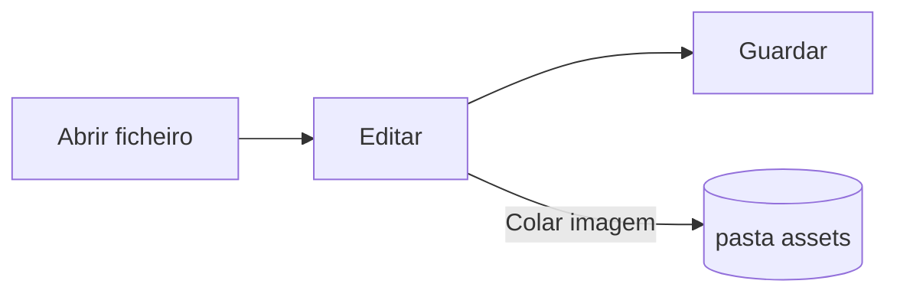

# Guia do Pupitre


O Pupitre é um editor de Markdown para ambiente de trabalho. Os documentos são ficheiros `.md` comuns: o que vê é renderizado no próprio sítio e a sintaxe Markdown aparece quando o cursor está sobre ela. Este guia é também um exemplo do que o editor renderiza; edite-o à vontade, só é guardado se escolher **Guardar como**.

## Edição

Coloque o cursor dentro de **texto a negrito**, de um `trecho de código` ou de uma [ligação](https://github.com/shalemore/pupitre) e a sintaxe aparece à volta. Os marcadores comportam-se como texto:

- Apague um marcador para remover a formatação; acrescente ou apague um `#` antes de um título para mudar o nível.
- Ao selecionar texto, a sua sintaxe fica visível, e copiar copia Markdown.
- A formatação está nos menus **Parágrafo** e **Formato**, no menu de contexto e nos atalhos abaixo.

<details>
<summary>Atalhos de teclado (Ctrl é ⌘ no macOS)</summary>

| Ação                                | Atalho                                                                                                      |
| :---------------------------------- | :---------------------------------------------------------------------------------------------------------- |
| Negrito / Itálico / Código em linha | <kbd>Ctrl</kbd>+<kbd>B</kbd> / <kbd>I</kbd> / <kbd>Shift</kbd>+<kbd>`</kbd>                                 |
| Rasurado                            | <kbd>Alt</kbd>+<kbd>Shift</kbd>+<kbd>5</kbd>                                                                |
| Ligação                             | <kbd>Ctrl</kbd>+<kbd>K</kbd>                                                                                |
| Título 1–6 / Parágrafo              | <kbd>Ctrl</kbd>+<kbd>1</kbd>…<kbd>6</kbd> / <kbd>0</kbd>                                                    |
| Citação                             | <kbd>Ctrl</kbd>+<kbd>Shift</kbd>+<kbd>Q</kbd>                                                               |
| Lista numerada / com marcadores     | <kbd>Ctrl</kbd>+<kbd>Shift</kbd>+<kbd>[</kbd> / <kbd>]</kbd>                                                |
| Bloco de código / Bloco matemático  | <kbd>Ctrl</kbd>+<kbd>Shift</kbd>+<kbd>K</kbd> / <kbd>M</kbd>                                                |
| Tabela                              | <kbd>Ctrl</kbd>+<kbd>T</kbd>                                                                                |
| Localizar / Substituir              | <kbd>Ctrl</kbd>+<kbd>F</kbd> / <kbd>Ctrl</kbd>+<kbd>H</kbd> (macOS: <kbd>⌘</kbd>+<kbd>⌥</kbd>+<kbd>F</kbd>) |
| Índice                              | <kbd>Ctrl</kbd>+<kbd>Shift</kbd>+<kbd>L</kbd>                                                               |
| Modo de concentração / de escrever  | <kbd>F8</kbd> / <kbd>F9</kbd>                                                                               |
| Repor zoom                          | <kbd>Ctrl</kbd>+<kbd>Shift</kbd>+<kbd>0</kbd>                                                               |
| Preferências                        | <kbd>Ctrl</kbd>+<kbd>,</kbd>                                                                                |

</details>

## Modos de escrita

- O **modo de concentração** atenua tudo exceto o parágrafo em que está a escrever.
- O **modo máquina de escrever** mantém a linha em escrita no centro da janela.

Ambos estão no menu **Ver** e em Preferências › Editor, e podem ser combinados.

## Estilo da janela

Preferências › Aparência › Estilo da janela alterna entre **Clássico** e **Imersivo**. No estilo imersivo o documento fica num cartão dentro da janela; a barra de título e o índice afastam-se assim que escreve ou desloca, e voltam quando o ponteiro chega ao topo ou à margem inicial da janela.

## Ficheiros e imagens

- O Pupitre mantém os fins de linha do ficheiro que abriu, salvo indicação em contrário em Preferências › Markdown. A sintaxe que os comandos de formatação inserem também se define aí.
- As imagens coladas são guardadas numa pasta ao lado do documento (`assets` por predefinição, Preferências › Markdown). Um documento ainda não guardado mantém-nas em memória e escreve-as no primeiro guardar.
- Preferências › Geral › Aplicação Markdown predefinida faz com que o Pupitre abra ficheiros `.md` a partir do gestor de ficheiros.
- As preferências ficam em `settings.json`; Preferências › Acerca mostra a sua pasta. Só são escritos os valores diferentes dos predefinidos, e um campo ilegível volta à predefinição sem afetar os outros.

## Temas

Um tema define o estilo de toda a janela e do documento. Preferências › Aparência lista-os com os esquemas de cores que suportam, e um tema separado pode ser escolhido para o modo escuro.

Os temas vêm com a aplicação: cada um é uma pasta em `src/renderer/themes/<nome>/` com um `index.css`, e o nome da pasta é o nome do tema. Os tipos de letra ou imagens de um tema ficam na mesma pasta e são referidos com `url()`s relativos.

```css
:root {
  /* Os esquemas de cores suportados por este tema: claro, escuro ou ambos */
  color-scheme: light dark;

  /* Tipo de letra predefinido do corpo de texto; pode ser alterado nas preferências */
  --font-document: Georgia, serif;

  /* Tokens de design usados em toda a janela */
  --ui-surface-1: oklch(0.99 0.01 90);
  --ui-brand: oklch(0.55 0.12 250);
}

@media (prefers-color-scheme: dark) {
  :root {
    --ui-surface-1: oklch(0.2 0.01 90);
  }
}

.md-document .md-h1 {
  font-size: 2em;
}
```

- As cores definem-se com os tokens `--ui-*` (superfícies, texto, destaque) e `--syntax-*` para código. Os seus valores predefinidos e a lista completa estão em `src/renderer/app.css` e no tema `pupitre`.
- As barras de citação devem usar `var(--alert-color, …)` para que os avisos mantenham as suas cores.
- O tamanho do texto, a entrelinha e a largura do conteúdo pertencem ao utilizador e ganham sempre; use `em` para os tamanhos no documento e propriedades lógicas como `padding-inline-start` para que o texto da direita para a esquerda fique espelhado.

## Referência de Markdown

### Texto

**Negrito**, _itálico_, ~~rasurado~~, `código em linha`, [ligações](https://commonmark.org), H<sub>2</sub>O, x<sup>2</sup>, <kbd>Esc</kbd> e <mark>destaques</mark>. O HTML em linha é renderizado quando é um elemento completo e mostrado como código caso contrário.

> Uma citação.
>
> > Uma citação aninhada.

> [!NOTE]
> Avisos do GitHub: `[!NOTE]`, `[!TIP]`, `[!IMPORTANT]`, `[!WARNING]` e `[!CAUTION]`.

> [!WARNING]
> O marcador tem de ser a primeira linha da citação.

### Listas

1. Numerada
   - Aninhada, com marcas
   - [x] As tarefas podem ser marcadas
   - [ ] E desmarcadas
2. As listas podem conter código:

   ```sh
   npm run dev
   ```

### Tabela

| Esquerda | Centro | Direita |
| :------- | :----: | ------: |
| Célula   | Célula |    1.00 |
| Mais     | Texto  |   10.50 |

### Código

```typescript
function countWords(text: string): number {
  const segmenter = new Intl.Segmenter(undefined, { granularity: "word" });
  return [...segmenter.segment(text)].filter((part) => part.isWordLike).length;
}
```

### Matemática

Em linha $e^{i\pi} + 1 = 0$ e em bloco:

$$
\int_{-\infty}^{\infty} e^{-x^2} \, dx = \sqrt{\pi}
$$

### Diagramas



### Notas de rodapé

Uma frase com uma nota de rodapé[^1].

[^1]: As notas de rodapé são listadas no fim do documento.

<!-- Os comentários ficam no ficheiro e são mostrados como código. -->
