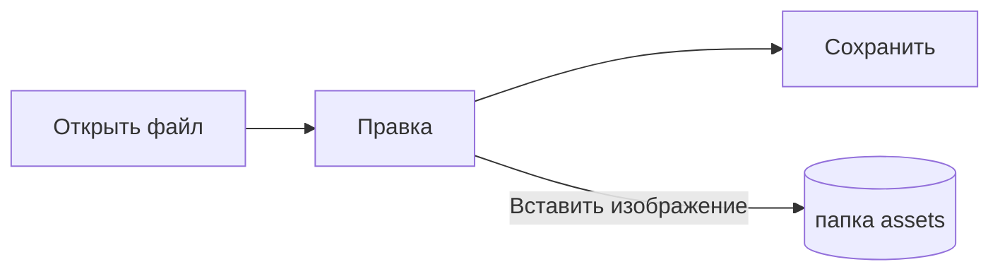

# Руководство по Pupitre


Pupitre — настольный редактор Markdown. Документы — обычные файлы `.md`: то, что вы видите, отображается на месте, а разметка Markdown появляется там, где стоит курсор. Это руководство одновременно служит примером того, что показывает редактор; редактируйте его свободно, оно не сохранится, пока вы не выберете **Сохранить как**.

## Редактирование

Поставьте курсор в **жирный текст**, `фрагмент кода` или [ссылку](https://github.com/shalemore/pupitre), и вокруг появится разметка. Маркеры ведут себя как текст:

- Удалите маркер, чтобы снять форматирование; добавьте или удалите `#` перед заголовком, чтобы изменить его уровень.
- В выделенном тексте видна его разметка, а копирование копирует Markdown.
- <kbd>Ctrl</kbd>+щелчок открывает ссылку: веб-адреса открываются в браузере, ссылки `#заголовок` прокручивают к заголовку, а ссылки на файл Markdown рядом с документом открывают его.
- Форматирование находится в меню **Абзац** и **Формат**, в контекстном меню и в сочетаниях клавиш ниже.

<details>
<summary>Сочетания клавиш (Ctrl — это ⌘ в macOS)</summary>

| Действие                             | Сочетание                                                                                                   |
| :----------------------------------- | :---------------------------------------------------------------------------------------------------------- |
| Полужирный / Курсив / Встроенный код | <kbd>Ctrl</kbd>+<kbd>B</kbd> / <kbd>I</kbd> / <kbd>Shift</kbd>+<kbd>`</kbd>                                 |
| Зачёркнутый                          | <kbd>Alt</kbd>+<kbd>Shift</kbd>+<kbd>5</kbd>                                                                |
| Подчёркнутый                         | <kbd>Ctrl</kbd>+<kbd>U</kbd>                                                                                |
| Очистить форматирование              | <kbd>Ctrl</kbd>+<kbd>\\</kbd>                                                                               |
| Ссылка                               | <kbd>Ctrl</kbd>+<kbd>K</kbd>                                                                                |
| Вставить изображение…                | <kbd>Ctrl</kbd>+<kbd>Shift</kbd>+<kbd>I</kbd>                                                               |
| Заголовок 1–6 / Абзац                | <kbd>Ctrl</kbd>+<kbd>1</kbd>…<kbd>6</kbd> / <kbd>0</kbd>                                                    |
| Цитата                               | <kbd>Ctrl</kbd>+<kbd>Shift</kbd>+<kbd>Q</kbd>                                                               |
| Нумерованный / маркированный список  | <kbd>Ctrl</kbd>+<kbd>Shift</kbd>+<kbd>[</kbd> / <kbd>]</kbd>                                                |
| Блок кода / Блок формулы             | <kbd>Ctrl</kbd>+<kbd>Shift</kbd>+<kbd>K</kbd> / <kbd>M</kbd>                                                |
| Таблица                              | <kbd>Ctrl</kbd>+<kbd>T</kbd>                                                                                |
| Найти / Заменить                     | <kbd>Ctrl</kbd>+<kbd>F</kbd> / <kbd>Ctrl</kbd>+<kbd>H</kbd> (macOS: <kbd>⌘</kbd>+<kbd>⌥</kbd>+<kbd>F</kbd>) |
| Открыть закрытую вкладку             | <kbd>Ctrl</kbd>+<kbd>Shift</kbd>+<kbd>T</kbd>                                                               |
| Боковые панели                       | <kbd>Ctrl</kbd>+<kbd>Shift</kbd>+<kbd>L</kbd>                                                               |
| Режим исходного кода                 | <kbd>Ctrl</kbd>+<kbd>/</kbd>                                                                                |
| Режим фокуса / Режим пишущей машинки | <kbd>F8</kbd> / <kbd>F9</kbd>                                                                               |
| Сбросить масштаб                     | <kbd>Ctrl</kbd>+<kbd>Shift</kbd>+<kbd>R</kbd>                                                               |
| Настройки                            | <kbd>Ctrl</kbd>+<kbd>,</kbd>                                                                                |

</details>

## Режимы письма

- **Режим фокуса** приглушает всё, кроме абзаца, над которым вы работаете.
- **Режим пишущей машинки** держит печатаемую строку в середине окна или ближе к его верху или низу, как задано в Настройках › Редактор.

Оба режима есть в меню **Вид** и в разделе Настройки › Редактор и могут работать вместе.

## Стиль окна

В Настройках › Внешний вид › Стиль окна можно переключаться между стилями **Классический** и **Иммерсивный**. В иммерсивном стиле документ находится в карточке внутри окна; строка заголовка и боковые панели скрываются, когда вы печатаете или прокручиваете, и возвращаются, когда указатель подходит к верхнему или боковому краю окна. Закреплённые боковые панели остаются открытыми, а перетаскивание края панели меняет её ширину.

## Файлы и изображения

- Pupitre сохраняет окончания строк открытого файла, если в Настройках › Markdown не указано иное. Там же настраивается разметка, которую вставляют команды форматирования.
- Вставленные изображения сохраняются в папку рядом с документом (по умолчанию `assets`, Настройки › Markdown). Ещё не сохранённый документ хранит их в памяти и записывает при первом сохранении.
- Настройки › Общие › Приложение по умолчанию для Markdown позволяет открывать файлы `.md` в Pupitre из файлового менеджера.
- Настройки хранятся в `settings.json`; Настройки › О программе показывает его папку. Записываются только значения, отличающиеся от значений по умолчанию, а нечитаемое поле возвращается к значению по умолчанию, не затрагивая остальные.
- У папки могут быть собственные настройки: когда папка открыта, в настройках появляется переключатель между **Глобальными** и **Этой папкой**. Изменения в разделе **Эта папка** записываются в `.pupitre/settings.json` в ней; файл создаётся при первом изменении и накладывается на глобальные настройки, пока эта папка открыта. Сброс настройки там возвращает её глобальное значение.

## Темы

Тема оформляет всё окно и документ. Настройки › Внешний вид перечисляет их вместе с поддерживаемыми цветовыми схемами, а для тёмного режима можно выбрать отдельную тему.

Темы поставляются вместе с приложением: каждая — папка `src/renderer/themes/<name>/` с файлом `index.css`, и имя папки — это имя темы. Шрифты и изображения темы лежат в той же папке и подключаются относительными `url()`.

```css
:root {
  /* Цветовые схемы, которые поддерживает тема: светлая, тёмная или обе */
  color-scheme: light dark;

  /* Шрифт основного текста по умолчанию; его можно изменить в настройках */
  --font-document: Georgia, serif;

  /* Дизайн-токены, действующие для всего окна */
  --ui-surface-1: oklch(0.99 0.01 90);
  --ui-brand: oklch(0.55 0.12 250);
}

@media (prefers-color-scheme: dark) {
  :root {
    --ui-surface-1: oklch(0.2 0.01 90);
  }
}

.md-document .md-h1 {
  font-size: 2em;
}
```

- Цвета задаются токенами `--ui-*` (поверхности, текст, акцент) и `--syntax-*` для кода. Значения по умолчанию и полный список — в `src/renderer/app.css` и теме `pupitre`.
- Полосы цитат должны использовать `var(--alert-color, …)`, чтобы оповещения сохраняли свои цвета.
- Размер шрифта, межстрочный интервал и ширина содержимого принадлежат пользователю и всегда приоритетны; используйте `em` для размеров в документе и логические свойства вроде `padding-inline-start`, чтобы текст справа налево отражался.

## Справочник по Markdown

### Текст

**Полужирный**, _курсив_, ~~зачёркнутый~~, `встроенный код`, [ссылки](https://commonmark.org), H~2~O, x^2^, ==выделение==, :tada: и <kbd>Esc</kbd>. Встроенный HTML отображается, если это законченный элемент, иначе показывается как исходный текст. Абзац, состоящий только из `[TOC]`, превращается в список заголовков документа.

> Цитата.
>
> > Вложенная цитата.

> [!NOTE]
> Оповещения GitHub: `[!NOTE]`, `[!TIP]`, `[!IMPORTANT]`, `[!WARNING]` и `[!CAUTION]`.

> [!WARNING]
> Маркер должен находиться в первой строке цитаты.

### Списки

1. Нумерованный
   - Вложенный маркированный
   - [x] Задачи можно отмечать
   - [ ] и снимать отметку
2. Списки могут содержать код:

   ```sh
   npm run dev
   ```

### Таблица

| Слева     | По центру | Справа |
| :-------- | :-------: | -----: |
| Ячейка    |  Ячейка   |   1.00 |
| Подлиннее |   Текст   |  10.50 |

### Код

```typescript
function countWords(text: string): number {
  const segmenter = new Intl.Segmenter(undefined, { granularity: "word" });
  return [...segmenter.segment(text)].filter((part) => part.isWordLike).length;
}
```

### Формулы

Строчная $e^{i\pi} + 1 = 0$ и выносная:

$$
\int_{-\infty}^{\infty} e^{-x^2} \, dx = \sqrt{\pi}
$$

Химические уравнения записываются через `\ce`: $\ce{2H2 + O2 -> 2H2O}$.

### Диаграммы



### Сноски

Предложение со сноской[^1].

[^1]: Сноски выводятся в конце документа.

<!-- Комментарии остаются в файле и показываются как исходный текст. -->
