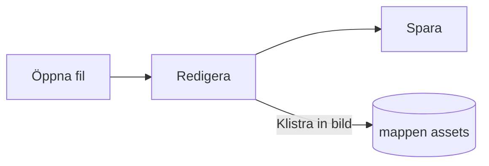

# Pupitres guide


Pupitre är en skrivbordsredigerare för Markdown. Dokumenten är vanliga `.md`-filer: det du ser renderas på plats och Markdown-syntaxen visas där markören står. Den här guiden är också ett exempel på vad redigeraren renderar; redigera den fritt, den sparas bara om du väljer **Spara som**.

## Redigera

Sätt markören i **fet text**, ett `kodstycke` eller en [länk](https://github.com/shalemore/pupitre) och syntaxen visas runt omkring. Markeringarna beter sig som text:

- Backsteg direkt efter en öppnande markering tar bort formateringen.
- Skriv `#` i början av en rubrik för att höja nivån och tryck på Backsteg för att sänka den.
- Formatering finns i menyerna **Stycke** och **Format**, i snabbmenyn och i kortkommandona nedan.

<details>
<summary>Kortkommandon (Ctrl är ⌘ på macOS)</summary>

| Åtgärd                       | Kortkommando                                                                                                |
| :--------------------------- | :---------------------------------------------------------------------------------------------------------- |
| Fet / Kursiv / Infogad kod   | <kbd>Ctrl</kbd>+<kbd>B</kbd> / <kbd>I</kbd> / <kbd>Shift</kbd>+<kbd>`</kbd>                                 |
| Genomstruken                 | <kbd>Alt</kbd>+<kbd>Shift</kbd>+<kbd>5</kbd>                                                                |
| Länk                         | <kbd>Ctrl</kbd>+<kbd>K</kbd>                                                                                |
| Rubrik 1–6 / Stycke          | <kbd>Ctrl</kbd>+<kbd>1</kbd>…<kbd>6</kbd> / <kbd>0</kbd>                                                    |
| Citat                        | <kbd>Ctrl</kbd>+<kbd>Shift</kbd>+<kbd>Q</kbd>                                                               |
| Numrerad / punktad lista     | <kbd>Ctrl</kbd>+<kbd>Shift</kbd>+<kbd>[</kbd> / <kbd>]</kbd>                                                |
| Kodblock / Matematikblock    | <kbd>Ctrl</kbd>+<kbd>Shift</kbd>+<kbd>K</kbd> / <kbd>M</kbd>                                                |
| Tabell                       | <kbd>Ctrl</kbd>+<kbd>T</kbd>                                                                                |
| Sök / Ersätt                 | <kbd>Ctrl</kbd>+<kbd>F</kbd> / <kbd>Ctrl</kbd>+<kbd>H</kbd> (macOS: <kbd>⌘</kbd>+<kbd>⌥</kbd>+<kbd>F</kbd>) |
| Disposition                  | <kbd>Ctrl</kbd>+<kbd>Shift</kbd>+<kbd>L</kbd>                                                               |
| Fokusläge / Skrivmaskinsläge | <kbd>F8</kbd> / <kbd>F9</kbd>                                                                               |
| Återställ zoom               | <kbd>Ctrl</kbd>+<kbd>Shift</kbd>+<kbd>0</kbd>                                                               |
| Inställningar                | <kbd>Ctrl</kbd>+<kbd>,</kbd>                                                                                |

</details>

## Skrivlägen

- **Fokusläge** dämpar allt utom stycket du skriver i.
- **Skrivmaskinsläge** håller raden du skriver på i mitten av fönstret.

Båda finns i menyn **Visa** och under Inställningar › Redigerare och kan kombineras.

## Fönsterstil

Inställningar › Utseende › Fönsterstil växlar mellan **Klassisk** och **Immersiv**. I den immersiva stilen ligger dokumentet på ett kort i fönstret; namnlisten och dispositionen flyttar undan så snart du skriver eller rullar och kommer tillbaka när pekaren når fönstrets överkant eller startkant.

## Filer och bilder

- Pupitre behåller radsluten från filen den öppnade, om inte Inställningar › Markdown säger något annat. Hur listor, betoning, kodstaket och linjer skrivs vid sparande ställs in där.
- Inklistrade bilder sparas i en mapp bredvid dokumentet (`assets` som standard, Inställningar › Markdown). Ett dokument som ännu inte sparats behåller dem i minnet och skriver dem vid första sparningen.
- Inställningar › Allmänt › Standardapp för Markdown gör att Pupitre öppnar `.md`-filer från filhanteraren.
- Inställningarna sparas i `settings.json`; Inställningar › Om visar mappen. Bara värden som skiljer sig från standard skrivs, och ett fält som inte kan läsas faller tillbaka på standard utan att påverka de andra.

## Teman

Ett tema bestämmer stilen för hela fönstret och dokumentet. Inställningar › Utseende listar dem med de färgscheman de stöder, och ett eget tema kan väljas för mörkt läge.

Teman följer med appen: varje tema är en mapp i `src/renderer/themes/<namn>/` med en `index.css`, och mappens namn är temats namn. Teckensnitt eller bilder som ett tema använder ligger i samma mapp och hänvisas till med relativa `url()`.

```css
:root {
  /* De färgscheman temat stöder: ljust, mörkt eller båda */
  color-scheme: light dark;

  /* Standardtypsnitt för brödtexten; går att ändra i inställningarna */
  --font-document: Georgia, serif;

  /* Designtokens som gäller i hela fönstret */
  --ui-surface-1: oklch(0.99 0.01 90);
  --ui-brand: oklch(0.55 0.12 250);
}

@media (prefers-color-scheme: dark) {
  :root {
    --ui-surface-1: oklch(0.2 0.01 90);
  }
}

.milkdown .ProseMirror h1 {
  font-size: 2em;
}
```

- Färger ställs in med `--ui-*`-token (ytor, text, accent) och `--syntax-*` för kod. Deras standardvärden och hela listan finns i `src/renderer/app.css` och temat `pupitre`.
- Citatstaplar bör använda `var(--alert-color, …)` så att varningar behåller sina färger.
- Brödtextens storlek, radavstånd och innehållsbredd tillhör användaren och vinner alltid; använd `em` för mått i dokumentet och logiska egenskaper som `padding-inline-start` så att text från höger till vänster speglas.

## Markdown-referens

### Text

**Fet**, _kursiv_, ~~genomstruken~~, `infogad kod`, [länkar](https://commonmark.org), H<sub>2</sub>O, x<sup>2</sup>, <kbd>Esc</kbd> och <mark>markeringar</mark>. Infogad HTML renderas när det är ett komplett element och visas som källkod annars.

> Ett citat.
>
> > Ett inbäddat citat.

> [!NOTE]
> GitHub-notiser: `[!NOTE]`, `[!TIP]`, `[!IMPORTANT]`, `[!WARNING]` och `[!CAUTION]`.

> [!WARNING]
> Markeringen måste vara citatets första rad.

### Listor

1. Numrerad
   - Inbäddad, punktad
   - [x] Uppgifter kan bockas av
   - [ ] Och avbockas
2. Listor kan innehålla kod:

   ```sh
   npm run dev
   ```

### Tabell

| Vänster | Mitten | Höger |
| :------ | :----: | ----: |
| Cell    |  Cell  |  1.00 |
| Längre  |  Text  | 10.50 |

### Kod

```typescript
function countWords(text: string): number {
  const segmenter = new Intl.Segmenter(undefined, { granularity: "word" });
  return [...segmenter.segment(text)].filter((part) => part.isWordLike).length;
}
```

### Matematik

Infogad $e^{i\pi} + 1 = 0$ och som block:

$$
\int_{-\infty}^{\infty} e^{-x^2} \, dx = \sqrt{\pi}
$$

### Diagram



### Fotnoter

En mening med en fotnot[^1].

[^1]: Fotnoter listas i slutet av dokumentet.

<!-- Kommentarer behålls i filen och visas som källkod. -->
