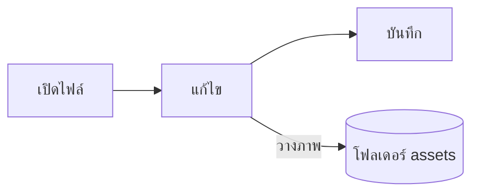

# คู่มือ Pupitre


Pupitre เป็นโปรแกรมแก้ไข Markdown สำหรับเดสก์ท็อป เอกสารเป็นไฟล์ `.md` ธรรมดา สิ่งที่คุณเห็นจะถูกแสดงผลในตำแหน่งเดิม และไวยากรณ์ Markdown จะปรากฏเมื่อเคอร์เซอร์อยู่บนส่วนนั้น คู่มือนี้ยังเป็นตัวอย่างของสิ่งที่ตัวแก้ไขแสดงผลด้วย แก้ไขได้ตามต้องการ เพราะไฟล์นี้จะไม่ถูกบันทึกเว้นแต่คุณเลือก **บันทึกเป็น**

## การแก้ไข

เลื่อนเคอร์เซอร์ไปใน**ข้อความตัวหนา** `โค้ดในบรรทัด` หรือ[ลิงก์](https://github.com/shalemore/pupitre) แล้วไวยากรณ์จะปรากฏขึ้นรอบ ๆ เครื่องหมายเหล่านี้ทำงานเหมือนข้อความ:

- ลบเครื่องหมายเพื่อเอารูปแบบออก และเพิ่มหรือลบ `#` หน้าหัวข้อเพื่อเปลี่ยนระดับ
- เมื่อเลือกข้อความ จะเห็นไวยากรณ์ภายใน และการคัดลอกจะคัดลอกเป็น Markdown
- การจัดรูปแบบอยู่ในเมนู**ย่อหน้า**และ**รูปแบบ** เมนูคลิกขวา และคีย์ลัดด้านล่าง

<details>
<summary>คีย์ลัด (บน macOS ใช้ ⌘ แทน Ctrl)</summary>

| การกระทำ                    | คีย์ลัด                                                                                                        |
| :-------------------------- | :---------------------------------------------------------------------------------------------------------- |
| ตัวหนา / ตัวเอียง / โค้ดในบรรทัด | <kbd>Ctrl</kbd>+<kbd>B</kbd> / <kbd>I</kbd> / <kbd>Shift</kbd>+<kbd>`</kbd>                                 |
| ขีดฆ่า                        | <kbd>Alt</kbd>+<kbd>Shift</kbd>+<kbd>5</kbd>                                                                |
| ลิงก์                         | <kbd>Ctrl</kbd>+<kbd>K</kbd>                                                                                |
| หัวข้อ 1–6 / ย่อหน้า            | <kbd>Ctrl</kbd>+<kbd>1</kbd>…<kbd>6</kbd> / <kbd>0</kbd>                                                    |
| อ้างอิง                       | <kbd>Ctrl</kbd>+<kbd>Shift</kbd>+<kbd>Q</kbd>                                                               |
| รายการลำดับเลข / หัวข้อย่อย     | <kbd>Ctrl</kbd>+<kbd>Shift</kbd>+<kbd>[</kbd> / <kbd>]</kbd>                                                |
| บล็อกโค้ด / บล็อกคณิตศาสตร์      | <kbd>Ctrl</kbd>+<kbd>Shift</kbd>+<kbd>K</kbd> / <kbd>M</kbd>                                                |
| ตาราง                       | <kbd>Ctrl</kbd>+<kbd>T</kbd>                                                                                |
| ค้นหา / แทนที่                 | <kbd>Ctrl</kbd>+<kbd>F</kbd> / <kbd>Ctrl</kbd>+<kbd>H</kbd> (macOS: <kbd>⌘</kbd>+<kbd>⌥</kbd>+<kbd>F</kbd>) |
| โครงร่าง                     | <kbd>Ctrl</kbd>+<kbd>Shift</kbd>+<kbd>L</kbd>                                                               |
| โหมดโฟกัส / โหมดพิมพ์ดีด        | <kbd>F8</kbd> / <kbd>F9</kbd>                                                                               |
| รีเซ็ตการซูม                   | <kbd>Ctrl</kbd>+<kbd>Shift</kbd>+<kbd>0</kbd>                                                               |
| การตั้งค่า                     | <kbd>Ctrl</kbd>+<kbd>,</kbd>                                                                                |

</details>

## โหมดการเขียน

- **โหมดโฟกัส** จะหรี่ทุกอย่างยกเว้นย่อหน้าที่คุณกำลังเขียน
- **โหมดพิมพ์ดีด** จะตรึงบรรทัดที่คุณกำลังเขียนไว้กลางหน้าต่าง

ทั้งสองอยู่ในเมนู**มุมมอง**และในการตั้งค่า › ตัวแก้ไข และใช้ร่วมกันได้

## รูปแบบหน้าต่าง

การตั้งค่า › รูปลักษณ์ › รูปแบบหน้าต่าง สลับระหว่าง**คลาสสิก**และ**เต็มจอ** ในแบบเต็มจอ เอกสารจะอยู่ในกรอบการ์ดภายในหน้าต่าง แถบชื่อเรื่องและโครงร่างจะหลบออกเมื่อคุณเริ่มพิมพ์หรือเลื่อน และกลับมาเมื่อตัวชี้ไปถึงขอบบนหรือขอบต้นของหน้าต่าง

## ไฟล์และรูปภาพ

- Pupitre จะคงการขึ้นบรรทัดของไฟล์ที่เปิดไว้ เว้นแต่การตั้งค่า › Markdown จะกำหนดไว้เป็นอย่างอื่น ไวยากรณ์ที่คำสั่งจัดรูปแบบแทรกก็กำหนดไว้ที่นั่นเช่นกัน
- รูปภาพที่วางจะถูกบันทึกไว้ในโฟลเดอร์ข้าง ๆ เอกสาร (`assets` เป็นค่าเริ่มต้น ดูที่การตั้งค่า › Markdown) เอกสารที่ยังไม่ถูกบันทึกจะเก็บรูปไว้ในหน่วยความจำและเขียนลงไฟล์เมื่อบันทึกครั้งแรก
- การตั้งค่า › ทั่วไป › แอป Markdown ค่าเริ่มต้น ทำให้ Pupitre เปิดไฟล์ `.md` จากตัวจัดการไฟล์ได้
- การตั้งค่าถูกเก็บไว้ใน `settings.json` และการตั้งค่า › เกี่ยวกับ จะแสดงโฟลเดอร์ของไฟล์นั้น มีการเขียนเฉพาะค่าที่ต่างจากค่าเริ่มต้น และฟิลด์ที่อ่านไม่ได้จะกลับไปใช้ค่าเริ่มต้นโดยไม่กระทบฟิลด์อื่น

## ธีม

ธีมหนึ่งกำหนดรูปแบบของทั้งหน้าต่างและเอกสาร การตั้งค่า › รูปลักษณ์ แสดงรายการธีมพร้อมชุดสีที่รองรับ และเลือกธีมแยกต่างหากสำหรับโหมดมืดได้

ธีมมาพร้อมกับแอป แต่ละธีมเป็นโฟลเดอร์ใน `src/renderer/themes/<name>/` ที่มีไฟล์ `index.css` และชื่อโฟลเดอร์คือชื่อของธีม แบบอักษรหรือรูปภาพที่ธีมใช้จะอยู่ในโฟลเดอร์เดียวกันและอ้างอิงด้วย `url()` แบบสัมพัทธ์

```css
:root {
  /* รูปแบบสีที่ธีมนี้รองรับ: สว่าง มืด หรือทั้งสองแบบ */
  color-scheme: light dark;

  /* ฟอนต์เนื้อหาหลักตามค่าเริ่มต้น เปลี่ยนได้ในการตั้งค่า */
  --font-document: Georgia, serif;

  /* โทเคนการออกแบบที่ใช้ทั่วทั้งหน้าต่าง */
  --ui-surface-1: oklch(0.99 0.01 90);
  --ui-brand: oklch(0.55 0.12 250);
}

@media (prefers-color-scheme: dark) {
  :root {
    --ui-surface-1: oklch(0.2 0.01 90);
  }
}

.md-document .md-h1 {
  font-size: 2em;
}
```

- สีกำหนดผ่านโทเค็น `--ui-*` (พื้นผิว ข้อความ สีเน้น) และ `--syntax-*` สำหรับโค้ด ค่าเริ่มต้นและรายการทั้งหมดอยู่ใน `src/renderer/app.css` และธีม `pupitre`
- แถบอ้างอิงควรใช้ `var(--alert-color, …)` เพื่อให้การแจ้งเตือนคงสีของตัวเองไว้
- ขนาดตัวอักษรของเนื้อหา ระยะห่างบรรทัด และความกว้างเนื้อหาเป็นของผู้ใช้และมีผลเหนือกว่าเสมอ ใช้ `em` สำหรับขนาดในเอกสาร และใช้พร็อพเพอร์ตี้เชิงตรรกะ เช่น `padding-inline-start` เพื่อให้ข้อความขวาไปซ้ายสะท้อนอย่างถูกต้อง

## อ้างอิง Markdown

### ข้อความ

**ตัวหนา**, _ตัวเอียง_, ~~ขีดฆ่า~~, `โค้ดในบรรทัด`, [ลิงก์](https://commonmark.org), H<sub>2</sub>O, x<sup>2</sup>, <kbd>Esc</kbd> และ <mark>ไฮไลต์</mark> HTML ในบรรทัดจะถูกแสดงผลเมื่อเป็นองค์ประกอบที่สมบูรณ์ มิฉะนั้นจะแสดงเป็นต้นฉบับ

> ข้อความอ้างอิง
>
> > ข้อความอ้างอิงซ้อนกัน

> [!NOTE]
> การแจ้งเตือนของ GitHub: `[!NOTE]`, `[!TIP]`, `[!IMPORTANT]`, `[!WARNING]` และ `[!CAUTION]`

> [!WARNING]
> เครื่องหมายต้องอยู่บรรทัดแรกของข้อความอ้างอิง

### รายการ

1. ลำดับเลข
   - ซ้อนกัน แบบหัวข้อย่อย
   - [x] งานที่ทำเสร็จแล้วได้
   - [ ] และที่ยังไม่เสร็จ
2. รายการมีโค้ดได้:

   ```sh
   npm run dev
   ```

### ตาราง

| ซ้าย    |  กลาง  |   ขวา |
| :----- | :----: | ----: |
| เซลล์   | ข้อความ |  1.00 |
| ยาวกว่า | ข้อความ | 10.50 |

### โค้ด

```typescript
function countWords(text: string): number {
  const segmenter = new Intl.Segmenter(undefined, { granularity: "word" });
  return [...segmenter.segment(text)].filter((part) => part.isWordLike).length;
}
```

### คณิตศาสตร์

แบบในบรรทัด $e^{i\pi} + 1 = 0$ และแบบแสดงผล:

$$
\int_{-\infty}^{\infty} e^{-x^2} \, dx = \sqrt{\pi}
$$

### ไดอะแกรม



### เชิงอรรถ

ประโยคหนึ่งที่มีเชิงอรรถ[^1]

[^1]: เชิงอรรถจะแสดงไว้ท้ายเอกสาร

<!-- ความคิดเห็นจะถูกเก็บไว้ในไฟล์และแสดงเป็นต้นฉบับ -->
