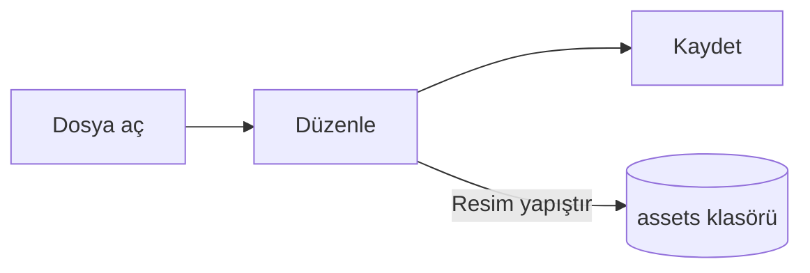

# Pupitre Kılavuzu


Pupitre bir masaüstü Markdown düzenleyicisidir. Belgeler sıradan `.md` dosyalarıdır: gördüğünüz içerik yerinde işlenir ve imleç üzerindeyken Markdown sözdizimi görünür. Bu kılavuz aynı zamanda düzenleyicinin nasıl işlediğine dair bir örnektir; dilediğiniz gibi düzenleyin, **Farklı Kaydet** seçmediğiniz sürece kaydedilmez.

## Düzenleme

İmleci **kalın metnin**, bir `satır içi kodun` ya da bir [bağlantının](https://github.com/shalemore/pupitre) içine getirin, sözdizimi çevresinde görünür. İşaretçiler metin gibi davranır:

- Bir açılış işaretinden hemen sonra Geri tuşuna basmak biçimi kaldırır.
- Bir başlığın başında `#` yazmak düzeyini yükseltir, Geri tuşuna basmak düşürür.
- Biçimlendirme **Paragraf** ve **Biçim** menülerinde, sağ tık menüsünde ve aşağıdaki kısayollarda bulunur.

<details>
<summary>Klavye kısayolları (macOS'ta Ctrl yerine ⌘)</summary>

| İşlem                           | Kısayol                                                                                                     |
| :------------------------------ | :---------------------------------------------------------------------------------------------------------- |
| Kalın / İtalik / Satır içi kod  | <kbd>Ctrl</kbd>+<kbd>B</kbd> / <kbd>I</kbd> / <kbd>Shift</kbd>+<kbd>`</kbd>                                 |
| Üstü çizili                     | <kbd>Alt</kbd>+<kbd>Shift</kbd>+<kbd>5</kbd>                                                                |
| Bağlantı                        | <kbd>Ctrl</kbd>+<kbd>K</kbd>                                                                                |
| Başlık 1–6 / Paragraf           | <kbd>Ctrl</kbd>+<kbd>1</kbd>…<kbd>6</kbd> / <kbd>0</kbd>                                                    |
| Alıntı                          | <kbd>Ctrl</kbd>+<kbd>Shift</kbd>+<kbd>Q</kbd>                                                               |
| Numaralı / madde işaretli liste | <kbd>Ctrl</kbd>+<kbd>Shift</kbd>+<kbd>[</kbd> / <kbd>]</kbd>                                                |
| Kod bloğu / Matematik bloğu     | <kbd>Ctrl</kbd>+<kbd>Shift</kbd>+<kbd>K</kbd> / <kbd>M</kbd>                                                |
| Tablo                           | <kbd>Ctrl</kbd>+<kbd>T</kbd>                                                                                |
| Bul / Değiştir                  | <kbd>Ctrl</kbd>+<kbd>F</kbd> / <kbd>Ctrl</kbd>+<kbd>H</kbd> (macOS: <kbd>⌘</kbd>+<kbd>⌥</kbd>+<kbd>F</kbd>) |
| Anahat                          | <kbd>Ctrl</kbd>+<kbd>Shift</kbd>+<kbd>L</kbd>                                                               |
| Odak modu / Daktilo modu        | <kbd>F8</kbd> / <kbd>F9</kbd>                                                                               |
| Yakınlaştırmayı sıfırla         | <kbd>Ctrl</kbd>+<kbd>Shift</kbd>+<kbd>0</kbd>                                                               |
| Tercihler                       | <kbd>Ctrl</kbd>+<kbd>,</kbd>                                                                                |

</details>

## Yazma modları

- **Odak modu**, yazdığınız paragraf dışındaki her şeyi soluklaştırır.
- **Daktilo modu**, yazılan satırı pencerenin ortasında tutar.

İkisi de **Görünüm** menüsünde ve Tercihler › Düzenleyici altında bulunur ve birlikte kullanılabilir.

## Pencere stili

Tercihler › Görünüm › Pencere Stili, **Klasik** ile **Sürükleyici** arasında geçiş yapar. Sürükleyici stilde belge pencerenin içindeki bir kartta durur; yazmaya veya kaydırmaya başladığınızda başlık çubuğu ve anahat çekilir, işaretçi pencerenin üstüne ya da başlangıç kenarına geldiğinde geri döner.

## Dosyalar ve resimler

- Pupitre, Tercihler › Markdown aksini söylemedikçe açtığı dosyanın satır sonlarını korur. Listelerin, vurguların, kod çitlerinin ve yatay çizgilerin kaydederken nasıl yazılacağı da orada ayarlanır.
- Yapıştırılan resimler belgenin yanındaki bir klasöre kaydedilir (varsayılan olarak `assets`, bkz. Tercihler › Markdown). Henüz kaydedilmemiş bir belge onları bellekte tutar ve ilk kaydetmede yazar.
- Tercihler › Genel › Varsayılan Markdown Uygulaması, Pupitre'nin `.md` dosyalarını dosya yöneticisinden açmasını sağlar.
- Tercihler `settings.json` içinde saklanır; Tercihler › Hakkında klasörünü gösterir. Yalnızca varsayılandan farklı değerler yazılır ve okunamayan bir alan diğerlerini etkilemeden varsayılana döner.

## Temalar

Bir tema tüm pencereyi ve belgeyi biçimlendirir. Tercihler › Görünüm, temaları destekledikleri renk şemalarıyla listeler ve koyu mod için ayrı bir tema seçilebilir.

Temalar uygulamayla birlikte gelir: her biri `src/renderer/themes/<ad>/` altında bir `index.css` içeren bir klasördür ve klasör adı temanın adıdır. Bir temanın kullandığı yazı tipleri veya resimler aynı klasörde durur ve göreli `url()` ile başvurulur.

```css
:root {
  /* Temanın desteklediği renk şemaları: açık, koyu veya ikisi */
  color-scheme: light dark;

  /* Gövde metninin varsayılan yazı tipi; tercihlerden değiştirilebilir */
  --font-document: Georgia, serif;

  /* Tüm pencerede kullanılan tasarım belirteçleri */
  --ui-surface-1: oklch(0.99 0.01 90);
  --ui-brand: oklch(0.55 0.12 250);
}

@media (prefers-color-scheme: dark) {
  :root {
    --ui-surface-1: oklch(0.2 0.01 90);
  }
}

.milkdown .ProseMirror h1 {
  font-size: 2em;
}
```

- Renkler `--ui-*` belirteçleriyle (yüzeyler, metin, vurgu) ve kod için `--syntax-*` ile ayarlanır. Varsayılan değerleri ve tam liste `src/renderer/app.css` ile `pupitre` temasında bulunur.
- Alıntı çubukları `var(--alert-color, …)` kullanmalıdır, böylece uyarılar kendi renklerini korur.
- Gövde yazı boyutu, satır aralığı ve içerik genişliği kullanıcıya aittir ve her zaman önceliklidir; belgedeki boyutlar için `em`, sağdan sola metnin ters görüntülenmesi için `padding-inline-start` gibi mantıksal özellikler kullanın.

## Markdown başvurusu

### Metin

**Kalın**, _italik_, ~~üstü çizili~~, `satır içi kod`, [bağlantılar](https://commonmark.org), H<sub>2</sub>O, x<sup>2</sup>, <kbd>Esc</kbd> ve <mark>vurgular</mark>. Satır içi HTML tam bir öğe olduğunda işlenir, aksi halde kaynak olarak gösterilir.

> Bir alıntı.
>
> > İç içe bir alıntı.

> [!NOTE]
> GitHub uyarıları: `[!NOTE]`, `[!TIP]`, `[!IMPORTANT]`, `[!WARNING]` ve `[!CAUTION]`.

> [!WARNING]
> İşaretçi, alıntının ilk satırı olmalıdır.

### Listeler

1. Numaralı
   - İç içe, madde işaretli
   - [x] Görevler işaretlenebilir
   - [ ] Ve işareti kaldırılabilir
2. Listeler kod içerebilir:

   ```sh
   npm run dev
   ```

### Tablo

| Sol   | Orta  |   Sağ |
| :---- | :---: | ----: |
| Hücre | Hücre |  1.00 |
| Uzun  | Metin | 10.50 |

### Kod

```typescript
function countWords(text: string): number {
  const segmenter = new Intl.Segmenter(undefined, { granularity: "word" });
  return [...segmenter.segment(text)].filter((part) => part.isWordLike).length;
}
```

### Matematik

Satır içi $e^{i\pi} + 1 = 0$ ve blok olarak:

$$
\int_{-\infty}^{\infty} e^{-x^2} \, dx = \sqrt{\pi}
$$

### Diyagramlar



### Dipnotlar

Dipnotlu bir cümle[^1].

[^1]: Dipnotlar belgenin sonunda listelenir.

<!-- Yorumlar dosyada saklanır ve kaynak olarak gösterilir. -->
