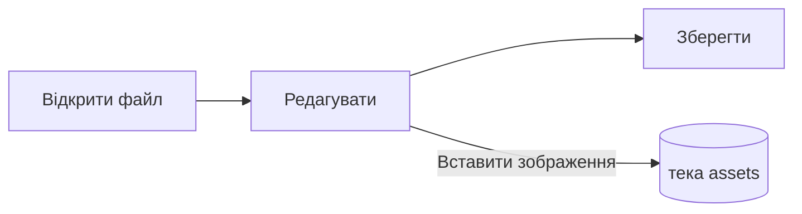

# Посібник із Pupitre


Pupitre — це настільний редактор Markdown. Документи — звичайні файли `.md`: те, що ви бачите, відображається на місці, а синтаксис Markdown з'являється там, де стоїть курсор. Цей посібник також є зразком того, що відображає редактор; редагуйте його вільно, він зберігається лише за вибору **Зберегти як**.

## Редагування

Поставте курсор у **жирний текст**, `вбудований код` або [посилання](https://github.com/shalemore/pupitre), і навколо нього з'явиться синтаксис. Маркери поводяться як текст:

- Backspace одразу після відкривального маркера знімає форматування.
- На початку заголовка введіть `#`, щоб підвищити рівень, і натисніть Backspace, щоб знизити його.
- Форматування є в меню **Абзац** і **Формат**, у контекстному меню та в наведених нижче комбінаціях.

<details>
<summary>Комбінації клавіш (у macOS Ctrl — це ⌘)</summary>

| Дія                                      | Комбінація                                                                                                  |
| :--------------------------------------- | :---------------------------------------------------------------------------------------------------------- |
| Жирний / Курсив / Вбудований код         | <kbd>Ctrl</kbd>+<kbd>B</kbd> / <kbd>I</kbd> / <kbd>Shift</kbd>+<kbd>`</kbd>                                 |
| Закреслення                              | <kbd>Alt</kbd>+<kbd>Shift</kbd>+<kbd>5</kbd>                                                                |
| Посилання                                | <kbd>Ctrl</kbd>+<kbd>K</kbd>                                                                                |
| Заголовок 1–6 / Абзац                    | <kbd>Ctrl</kbd>+<kbd>1</kbd>…<kbd>6</kbd> / <kbd>0</kbd>                                                    |
| Цитата                                   | <kbd>Ctrl</kbd>+<kbd>Shift</kbd>+<kbd>Q</kbd>                                                               |
| Нумерований / маркований список          | <kbd>Ctrl</kbd>+<kbd>Shift</kbd>+<kbd>[</kbd> / <kbd>]</kbd>                                                |
| Блок коду / Математичний блок            | <kbd>Ctrl</kbd>+<kbd>Shift</kbd>+<kbd>K</kbd> / <kbd>M</kbd>                                                |
| Таблиця                                  | <kbd>Ctrl</kbd>+<kbd>T</kbd>                                                                                |
| Знайти / Замінити                        | <kbd>Ctrl</kbd>+<kbd>F</kbd> / <kbd>Ctrl</kbd>+<kbd>H</kbd> (macOS: <kbd>⌘</kbd>+<kbd>⌥</kbd>+<kbd>F</kbd>) |
| Структура                                | <kbd>Ctrl</kbd>+<kbd>Shift</kbd>+<kbd>L</kbd>                                                               |
| Режим зосередження / друкарської машинки | <kbd>F8</kbd> / <kbd>F9</kbd>                                                                               |
| Скинути масштаб                          | <kbd>Ctrl</kbd>+<kbd>Shift</kbd>+<kbd>0</kbd>                                                               |
| Параметри                                | <kbd>Ctrl</kbd>+<kbd>,</kbd>                                                                                |

</details>

## Режими письма

- **Режим зосередження** затемнює все, крім абзацу, у якому ви пишете.
- **Режим друкарської машинки** тримає рядок, який ви пишете, посередині вікна.

Обидва є в меню **Вигляд** і в Параметри › Редактор, і їх можна поєднувати.

## Стиль вікна

Параметри › Вигляд › Стиль вікна перемикає між **Класичним** і **Занурювальним**. У занурювальному стилі документ лежить на картці всередині вікна; рядок заголовка та структура відступають, щойно ви починаєте писати чи прокручувати, і повертаються, коли вказівник досягає верхнього або початкового краю вікна. Стиль застосовується до вікон, відкритих після зміни.

## Файли та зображення

- Pupitre зберігає закінчення рядків відкритого файлу, якщо Параметри › Markdown не вказують інше. Там само задається, як під час збереження записуються списки, наголошення, огорожі коду та лінії.
- Вставлені зображення зберігаються в теці поруч із документом (типово `assets`, Параметри › Markdown). Незбережений документ тримає їх у пам'яті й записує під час першого збереження.
- Параметри › Загальні › Стандартна програма Markdown змушує Pupitre відкривати файли `.md` з файлового менеджера.
- Параметри зберігаються в `settings.json`; Параметри › Про програму показує його теку. Записуються лише значення, що відрізняються від стандартних, а поле, яке не вдається прочитати, повертається до стандартного без впливу на інші.

## Теми

Тема визначає стиль усього вікна й документа. Параметри › Вигляд перелічують їх із кольоровими схемами, які вони підтримують, і для темного режиму можна вибрати окрему тему.

Теми постачаються разом із програмою: кожна тема — це тека в `src/renderer/themes/<назва>/` з `index.css`, і назва теки є назвою теми. Шрифти або зображення, які використовує тема, лежать у тій самій теці й на них посилаються відносними `url()`.

```css
:root {
  /* Кольорові схеми, які підтримує тема: світла, темна або обидві */
  color-scheme: light dark;

  /* Типовий шрифт основного тексту; його можна змінити в налаштуваннях */
  --font-document: Georgia, serif;

  /* Дизайн-токени, що діють для всього вікна */
  --ui-surface-1: oklch(0.99 0.01 90);
  --ui-brand: oklch(0.55 0.12 250);
}

@media (prefers-color-scheme: dark) {
  :root {
    --ui-surface-1: oklch(0.2 0.01 90);
  }
}

.milkdown .ProseMirror h1 {
  font-size: 2em;
}
```

- Кольори задаються токенами `--ui-*` (поверхні, текст, акцент) і `--syntax-*` для коду. Їхні стандартні значення та повний список є в `src/renderer/app.css` і темі `pupitre`.
- Смуги цитат мають використовувати `var(--alert-color, …)`, щоб попередження зберігали свої кольори.
- Розмір основного тексту, міжрядковий інтервал і ширина вмісту належать користувачеві й завжди перемагають; використовуйте `em` для розмірів у документі та логічні властивості, як-от `padding-inline-start`, щоб текст справа наліво дзеркалився.

## Довідник із Markdown

### Текст

**Жирний**, _курсив_, ~~закреслений~~, `вбудований код`, [посилання](https://commonmark.org), H<sub>2</sub>O, x<sup>2</sup>, <kbd>Esc</kbd> і <mark>виділення</mark>. Вбудований HTML відображається, коли є повним елементом, інакше показується як вихідний код.

> Цитата.
>
> > Вкладена цитата.

> [!NOTE]
> Сповіщення GitHub: `[!NOTE]`, `[!TIP]`, `[!IMPORTANT]`, `[!WARNING]` і `[!CAUTION]`.

> [!WARNING]
> Маркер має бути першим рядком цитати.

### Списки

1. Нумерований
   - Вкладений, маркований
   - [x] Завдання можна позначати
   - [ ] І знімати позначку
2. Списки можуть містити код:

   ```sh
   npm run dev
   ```

### Таблиця

| Ліворуч | По центру | Праворуч |
| :------ | :-------: | -------: |
| Комірка |  Комірка  |     1.00 |
| Довший  |   Текст   |    10.50 |

### Код

```typescript
function countWords(text: string): number {
  const segmenter = new Intl.Segmenter(undefined, { granularity: "word" });
  return [...segmenter.segment(text)].filter((part) => part.isWordLike).length;
}
```

### Математика

У рядку $e^{i\pi} + 1 = 0$ і як блок:

$$
\int_{-\infty}^{\infty} e^{-x^2} \, dx = \sqrt{\pi}
$$

### Діаграми



### Виноски

Речення з виноскою[^1].

[^1]: Виноски перелічуються в кінці документа.

<!-- Коментарі залишаються у файлі й показуються як вихідний код. -->
