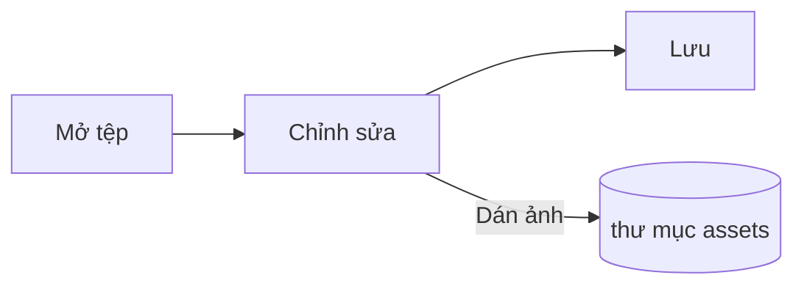

# Hướng dẫn Pupitre


Pupitre là trình soạn thảo Markdown trên máy tính. Tài liệu là các tệp `.md` thông thường: nội dung bạn thấy được hiển thị ngay tại chỗ, và cú pháp Markdown xuất hiện khi con trỏ ở trên đó. Hướng dẫn này cũng là một mẫu về những gì trình soạn thảo hiển thị; bạn có thể sửa thoải mái, tệp này chỉ được lưu khi bạn chọn **Lưu thành**.

## Chỉnh sửa

Đặt con trỏ vào **chữ in đậm**, một `đoạn mã` hoặc một [liên kết](https://github.com/shalemore/pupitre) và cú pháp của nó sẽ hiện ra xung quanh. Các dấu này hoạt động như văn bản:

- Nhấn Backspace ngay sau dấu mở để bỏ định dạng đó.
- Ở đầu một tiêu đề, gõ `#` để tăng cấp và nhấn Backspace để giảm cấp.
- Định dạng có trong menu **Đoạn văn** và **Định dạng**, menu chuột phải và các phím tắt bên dưới.

<details>
<summary>Phím tắt (trên macOS dùng ⌘ thay cho Ctrl)</summary>

| Thao tác                          | Phím tắt                                                                                                    |
| :-------------------------------- | :---------------------------------------------------------------------------------------------------------- |
| In đậm / nghiêng / mã trong dòng  | <kbd>Ctrl</kbd>+<kbd>B</kbd> / <kbd>I</kbd> / <kbd>Shift</kbd>+<kbd>`</kbd>                                 |
| Gạch ngang                        | <kbd>Alt</kbd>+<kbd>Shift</kbd>+<kbd>5</kbd>                                                                |
| Liên kết                          | <kbd>Ctrl</kbd>+<kbd>K</kbd>                                                                                |
| Tiêu đề 1–6 / Đoạn văn            | <kbd>Ctrl</kbd>+<kbd>1</kbd>…<kbd>6</kbd> / <kbd>0</kbd>                                                    |
| Trích dẫn                         | <kbd>Ctrl</kbd>+<kbd>Shift</kbd>+<kbd>Q</kbd>                                                               |
| Danh sách đánh số / gạch đầu dòng | <kbd>Ctrl</kbd>+<kbd>Shift</kbd>+<kbd>[</kbd> / <kbd>]</kbd>                                                |
| Khối mã / khối công thức          | <kbd>Ctrl</kbd>+<kbd>Shift</kbd>+<kbd>K</kbd> / <kbd>M</kbd>                                                |
| Bảng                              | <kbd>Ctrl</kbd>+<kbd>T</kbd>                                                                                |
| Tìm / Thay thế                    | <kbd>Ctrl</kbd>+<kbd>F</kbd> / <kbd>Ctrl</kbd>+<kbd>H</kbd> (macOS: <kbd>⌘</kbd>+<kbd>⌥</kbd>+<kbd>F</kbd>) |
| Dàn ý                             | <kbd>Ctrl</kbd>+<kbd>Shift</kbd>+<kbd>L</kbd>                                                               |
| Chế độ tập trung / máy đánh chữ   | <kbd>F8</kbd> / <kbd>F9</kbd>                                                                               |
| Đặt lại thu phóng                 | <kbd>Ctrl</kbd>+<kbd>Shift</kbd>+<kbd>0</kbd>                                                               |
| Tùy chọn                          | <kbd>Ctrl</kbd>+<kbd>,</kbd>                                                                                |

</details>

## Chế độ viết

- **Chế độ tập trung** làm mờ mọi thứ trừ đoạn văn bạn đang viết.
- **Chế độ máy đánh chữ** giữ dòng bạn đang viết ở giữa cửa sổ.

Cả hai đều có trong menu **Xem** và trong Tùy chọn › Trình soạn thảo, và có thể dùng cùng nhau.

## Kiểu cửa sổ

Tùy chọn › Hiển thị › Kiểu cửa sổ chuyển giữa **Cổ điển** và **Toàn màn hình**. Ở kiểu toàn màn hình, tài liệu nằm trong một thẻ giữa cửa sổ; thanh tiêu đề và dàn ý sẽ lùi đi khi bạn gõ hoặc cuộn, rồi trở lại khi con trỏ chạm mép trên hoặc mép đầu của cửa sổ. Kiểu này áp dụng cho cửa sổ được mở sau khi thay đổi.

## Tệp và hình ảnh

- Pupitre giữ nguyên kiểu kết thúc dòng của tệp đã mở, trừ khi Tùy chọn › Markdown quy định khác. Cách viết danh sách, nhấn mạnh, hàng rào mã và đường kẻ khi lưu cũng được đặt ở đó.
- Ảnh được dán sẽ được lưu vào thư mục bên cạnh tài liệu (`assets` theo mặc định, xem Tùy chọn › Markdown). Tài liệu chưa được lưu sẽ giữ ảnh trong bộ nhớ và ghi chúng khi lưu lần đầu.
- Tùy chọn › Chung › Ứng dụng Markdown mặc định cho phép Pupitre mở tệp `.md` từ trình quản lý tệp.
- Tùy chọn được lưu trong `settings.json`; Tùy chọn › Giới thiệu hiển thị thư mục của tệp này. Chỉ những giá trị khác mặc định mới được ghi, và trường không đọc được sẽ trở về mặc định mà không ảnh hưởng đến các trường khác.

## Giao diện

Một giao diện định dạng toàn bộ cửa sổ và tài liệu. Tùy chọn › Hiển thị liệt kê các giao diện cùng bảng màu mà chúng hỗ trợ, và có thể chọn giao diện riêng cho chế độ tối.

Giao diện đi kèm ứng dụng: mỗi giao diện là một thư mục trong `src/renderer/themes/<name>/` có một tệp `index.css`, và tên thư mục chính là tên giao diện. Phông chữ hoặc hình ảnh mà giao diện dùng sẽ nằm trong cùng thư mục và được tham chiếu bằng `url()` tương đối.

```css
:root {
  /* Các bảng màu mà giao diện này hỗ trợ: sáng, tối hoặc cả hai */
  color-scheme: light dark;

  /* Phông chữ mặc định cho phần nội dung; có thể đổi trong Tùy chọn */
  --font-document: Georgia, serif;

  /* Các token thiết kế dùng cho toàn bộ cửa sổ */
  --ui-surface-1: oklch(0.99 0.01 90);
  --ui-brand: oklch(0.55 0.12 250);
}

@media (prefers-color-scheme: dark) {
  :root {
    --ui-surface-1: oklch(0.2 0.01 90);
  }
}

.milkdown .ProseMirror h1 {
  font-size: 2em;
}
```

- Màu sắc được đặt qua các token `--ui-*` (bề mặt, văn bản, màu nhấn) và `--syntax-*` cho mã. Giá trị mặc định và danh sách đầy đủ nằm trong `src/renderer/app.css` và giao diện `pupitre`.
- Thanh trích dẫn nên dùng `var(--alert-color, …)` để phần cảnh báo giữ được màu của mình.
- Cỡ chữ nội dung, giãn dòng và chiều rộng nội dung thuộc về người dùng và luôn thắng; hãy dùng `em` cho kích thước trong tài liệu và các thuộc tính logic như `padding-inline-start` để văn bản phải-sang-trái được lật đúng.

## Tham khảo Markdown

### Văn bản

**In đậm**, _in nghiêng_, ~~gạch ngang~~, `mã trong dòng`, [liên kết](https://commonmark.org), H<sub>2</sub>O, x<sup>2</sup>, <kbd>Esc</kbd> và <mark>đánh dấu</mark>. HTML trong dòng được hiển thị khi là một phần tử hoàn chỉnh, nếu không sẽ hiện dưới dạng mã nguồn.

> Một đoạn trích dẫn.
>
> > Một trích dẫn lồng nhau.

> [!NOTE]
> Cảnh báo của GitHub: `[!NOTE]`, `[!TIP]`, `[!IMPORTANT]`, `[!WARNING]` và `[!CAUTION]`.

> [!WARNING]
> Dấu này phải nằm ở dòng đầu tiên của trích dẫn.

### Danh sách

1. Đánh số
   - Lồng nhau, gạch đầu dòng
   - [x] Việc có thể đánh dấu xong
   - [ ] Và bỏ đánh dấu
2. Danh sách có thể chứa mã:

   ```sh
   npm run dev
   ```

### Bảng

| Trái    |  Giữa   |  Phải |
| :------ | :-----: | ----: |
| Ô       | Văn bản |  1.00 |
| Dài hơn | Văn bản | 10.50 |

### Mã

```typescript
function countWords(text: string): number {
  const segmenter = new Intl.Segmenter(undefined, { granularity: "word" });
  return [...segmenter.segment(text)].filter((part) => part.isWordLike).length;
}
```

### Công thức

Trong dòng $e^{i\pi} + 1 = 0$ và dạng hiển thị:

$$
\int_{-\infty}^{\infty} e^{-x^2} \, dx = \sqrt{\pi}
$$

### Sơ đồ



### Chú thích

Một câu có chú thích[^1].

[^1]: Chú thích được liệt kê ở cuối tài liệu.

<!-- Chú thích trong mã được giữ lại trong tệp và hiển thị dưới dạng mã nguồn. -->
