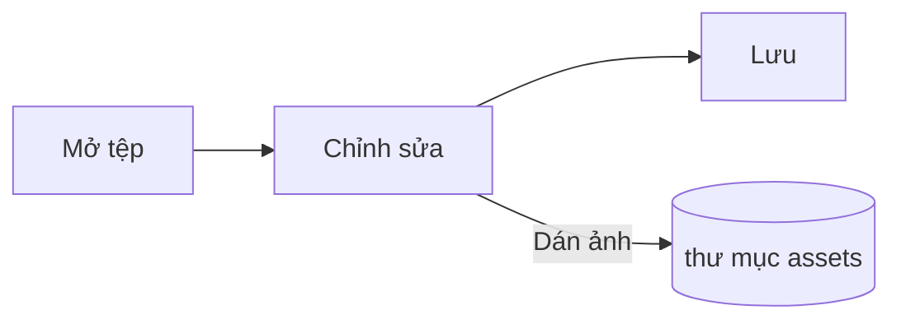

# Hướng dẫn Pupitre


Pupitre là trình soạn thảo Markdown trên máy tính. Tài liệu là các tệp `.md` thông thường: nội dung bạn thấy được hiển thị ngay tại chỗ, và cú pháp Markdown xuất hiện khi con trỏ ở trên đó. Hướng dẫn này cũng là một mẫu về những gì trình soạn thảo hiển thị; bạn có thể sửa thoải mái, tệp này chỉ được lưu khi bạn chọn **Lưu thành**.

## Chỉnh sửa

Đặt con trỏ vào **chữ in đậm**, một `đoạn mã` hoặc một [liên kết](https://github.com/shalemore/pupitre) và cú pháp của nó sẽ hiện ra xung quanh. Các dấu này hoạt động như văn bản:

- Xóa một dấu để bỏ định dạng của nó; thêm hoặc xóa một `#` trước tiêu đề để đổi cấp.
- Khi chọn văn bản, cú pháp bên trong sẽ hiện ra, và sao chép sẽ sao chép Markdown.
- <kbd>Ctrl</kbd>+nhấp để mở một liên kết: địa chỉ web mở trong trình duyệt, liên kết `#tiêu đề` cuộn đến tiêu đề đó và liên kết đến tệp Markdown bên cạnh tài liệu sẽ mở tệp đó.
- Định dạng có trong menu **Đoạn văn** và **Định dạng**, menu ngữ cảnh và các phím tắt bên dưới.

<details>
<summary>Phím tắt (trên macOS dùng ⌘ thay cho Ctrl)</summary>

| Thao tác                          | Phím tắt                                                                                                    |
| :-------------------------------- | :---------------------------------------------------------------------------------------------------------- |
| In đậm / nghiêng / mã trong dòng  | <kbd>Ctrl</kbd>+<kbd>B</kbd> / <kbd>I</kbd> / <kbd>Shift</kbd>+<kbd>`</kbd>                                 |
| Gạch chân                         | <kbd>Ctrl</kbd>+<kbd>U</kbd>                                                                                |
| Gạch ngang                        | <kbd>Alt</kbd>+<kbd>Shift</kbd>+<kbd>5</kbd>                                                                |
| Xóa định dạng                     | <kbd>Ctrl</kbd>+<kbd>\\</kbd>                                                                               |
| Liên kết                          | <kbd>Ctrl</kbd>+<kbd>K</kbd>                                                                                |
| Chèn ảnh                          | <kbd>Ctrl</kbd>+<kbd>Shift</kbd>+<kbd>I</kbd>                                                               |
| Tiêu đề 1–6 / Đoạn văn            | <kbd>Ctrl</kbd>+<kbd>1</kbd>…<kbd>6</kbd> / <kbd>0</kbd>                                                    |
| Trích dẫn                         | <kbd>Ctrl</kbd>+<kbd>Shift</kbd>+<kbd>Q</kbd>                                                               |
| Danh sách đánh số / gạch đầu dòng | <kbd>Ctrl</kbd>+<kbd>Shift</kbd>+<kbd>[</kbd> / <kbd>]</kbd>                                                |
| Khối mã / khối công thức          | <kbd>Ctrl</kbd>+<kbd>Shift</kbd>+<kbd>K</kbd> / <kbd>M</kbd>                                                |
| Bảng                              | <kbd>Ctrl</kbd>+<kbd>T</kbd>                                                                                |
| Tìm / Thay thế                    | <kbd>Ctrl</kbd>+<kbd>F</kbd> / <kbd>Ctrl</kbd>+<kbd>H</kbd> (macOS: <kbd>⌘</kbd>+<kbd>⌥</kbd>+<kbd>F</kbd>) |
| Mở lại tab đã đóng                | <kbd>Ctrl</kbd>+<kbd>Shift</kbd>+<kbd>T</kbd>                                                               |
| Thanh bên                         | <kbd>Ctrl</kbd>+<kbd>Shift</kbd>+<kbd>L</kbd>                                                               |
| Chế độ mã nguồn                   | <kbd>Ctrl</kbd>+<kbd>/</kbd>                                                                                |
| Chế độ tập trung / máy đánh chữ   | <kbd>F8</kbd> / <kbd>F9</kbd>                                                                               |
| Đặt lại thu phóng                 | <kbd>Ctrl</kbd>+<kbd>Shift</kbd>+<kbd>0</kbd>                                                               |
| Tùy chọn                          | <kbd>Ctrl</kbd>+<kbd>,</kbd>                                                                                |

</details>

## Chế độ viết

- **Chế độ tập trung** làm mờ mọi thứ trừ đoạn văn bạn đang viết.
- **Chế độ máy đánh chữ** giữ dòng bạn đang viết ở giữa cửa sổ, hoặc gần phía trên hay phía dưới, theo Tùy chọn › Trình soạn thảo.

Cả hai đều có trong menu **Xem** và trong Tùy chọn › Trình soạn thảo, và có thể dùng cùng nhau.

## Kiểu cửa sổ

Tùy chọn › Hiển thị › Kiểu cửa sổ chuyển giữa **Cổ điển** và **Đắm chìm**. Ở kiểu đắm chìm, tài liệu nằm trong một thẻ giữa cửa sổ; thanh tiêu đề và các thanh bên ẩn đi khi bạn gõ hoặc cuộn, rồi trở lại khi con trỏ chạm mép trên hoặc mép bên của cửa sổ. Ghim thanh bên giữ thanh bên mở, và kéo mép của một thanh bên sẽ thay đổi kích thước của nó.

## Tệp và hình ảnh

- Pupitre giữ nguyên kiểu kết thúc dòng của tệp đã mở, trừ khi Tùy chọn › Markdown quy định khác. Cú pháp mà các lệnh định dạng chèn vào cũng được đặt ở đó.
- Ảnh được dán sẽ được lưu vào thư mục bên cạnh tài liệu (`assets` theo mặc định, xem Tùy chọn › Markdown). Tài liệu chưa được lưu sẽ giữ ảnh trong bộ nhớ và ghi chúng khi lưu lần đầu.
- Tùy chọn › Chung › Ứng dụng Markdown mặc định cho phép Pupitre mở tệp `.md` từ trình quản lý tệp.
- Tùy chọn được lưu trong `settings.json`; Tùy chọn › Giới thiệu hiển thị thư mục của tệp này. Chỉ những giá trị khác mặc định mới được ghi, và trường không đọc được sẽ trở về mặc định mà không ảnh hưởng đến các trường khác.
- Mỗi thư mục có thể có cài đặt riêng: khi mở một thư mục, Tùy chọn hiển thị nút chuyển giữa **Toàn cục** và **Thư mục này**. Những gì bạn thay đổi trong **Thư mục này** được ghi vào `.pupitre/settings.json` trong thư mục đó, tệp này được tạo khi có thay đổi đầu tiên và được phủ lên cài đặt toàn cục mỗi khi thư mục đó được mở. Đặt lại một cài đặt ở đó sẽ trả nó về giá trị toàn cục.

## Chủ đề

Một chủ đề định dạng toàn bộ cửa sổ và tài liệu. Tùy chọn › Hiển thị liệt kê các chủ đề cùng lược đồ màu mà chúng hỗ trợ, và có thể chọn chủ đề riêng cho chế độ tối.

Chủ đề đi kèm ứng dụng: mỗi chủ đề là một thư mục trong `src/renderer/themes/<name>/` có một tệp `index.css`, và tên thư mục chính là tên chủ đề. Phông chữ hoặc hình ảnh mà chủ đề dùng sẽ nằm trong cùng thư mục và được tham chiếu bằng `url()` tương đối.

```css
:root {
  /* Các lược đồ màu mà chủ đề này hỗ trợ: sáng, tối hoặc cả hai */
  color-scheme: light dark;

  /* Phông chữ mặc định cho phần nội dung; có thể đổi trong Tùy chọn */
  --font-document: Georgia, serif;

  /* Các token thiết kế dùng cho toàn bộ cửa sổ */
  --ui-surface-1: oklch(0.99 0.01 90);
  --ui-brand: oklch(0.55 0.12 250);
}

@media (prefers-color-scheme: dark) {
  :root {
    --ui-surface-1: oklch(0.2 0.01 90);
  }
}

.md-document .md-h1 {
  font-size: 2em;
}
```

- Màu sắc được đặt qua các token `--ui-*` (bề mặt, văn bản, màu nhấn) và `--syntax-*` cho mã. Giá trị mặc định và danh sách đầy đủ nằm trong `src/renderer/app.css` và chủ đề `pupitre`.
- Thanh trích dẫn nên dùng `var(--alert-color, …)` để phần cảnh báo giữ được màu của mình.
- Cỡ chữ nội dung, giãn dòng và chiều rộng nội dung thuộc về người dùng và luôn thắng; hãy dùng `em` cho kích thước trong tài liệu và các thuộc tính logic như `padding-inline-start` để văn bản phải-sang-trái được lật đúng.

## Tham khảo Markdown

### Văn bản

**In đậm**, _in nghiêng_, ~~gạch ngang~~, `mã trong dòng`, [liên kết](https://commonmark.org), H~2~O, x^2^, ==tô sáng==, :tada: và <kbd>Esc</kbd>. HTML trong dòng được hiển thị khi là một phần tử hoàn chỉnh, nếu không sẽ hiện dưới dạng mã nguồn. Đoạn văn chỉ chứa `[TOC]` sẽ trở thành danh sách các tiêu đề của tài liệu.

> Một đoạn trích dẫn.
>
> > Một trích dẫn lồng nhau.

> [!NOTE]
> Thông báo GitHub: `[!NOTE]`, `[!TIP]`, `[!IMPORTANT]`, `[!WARNING]` và `[!CAUTION]`.

> [!WARNING]
> Dấu này phải nằm ở dòng đầu tiên của trích dẫn.

### Danh sách

1. Đánh số
   - Lồng nhau, gạch đầu dòng
   - [x] Công việc có thể được đánh dấu hoàn thành
   - [ ] Và bỏ đánh dấu
2. Danh sách có thể chứa mã:

   ```sh
   npm run dev
   ```

### Bảng

| Trái    |  Giữa   |  Phải |
| :------ | :-----: | ----: |
| Ô       | Văn bản |  1.00 |
| Dài hơn | Văn bản | 10.50 |

### Mã

```typescript
function countWords(text: string): number {
  const segmenter = new Intl.Segmenter(undefined, { granularity: "word" });
  return [...segmenter.segment(text)].filter((part) => part.isWordLike).length;
}
```

### Công thức

Trong dòng $e^{i\pi} + 1 = 0$ và dạng hiển thị:

$$
\int_{-\infty}^{\infty} e^{-x^2} \, dx = \sqrt{\pi}
$$

Phương trình hóa học dùng `\ce`: $\ce{2H2 + O2 -> 2H2O}$.

### Sơ đồ



### Chú thích cuối trang

Một câu có chú thích[^1].

[^1]: Chú thích được liệt kê ở cuối tài liệu.

<!-- Ghi chú được giữ lại trong tệp và hiển thị dưới dạng mã nguồn. -->
