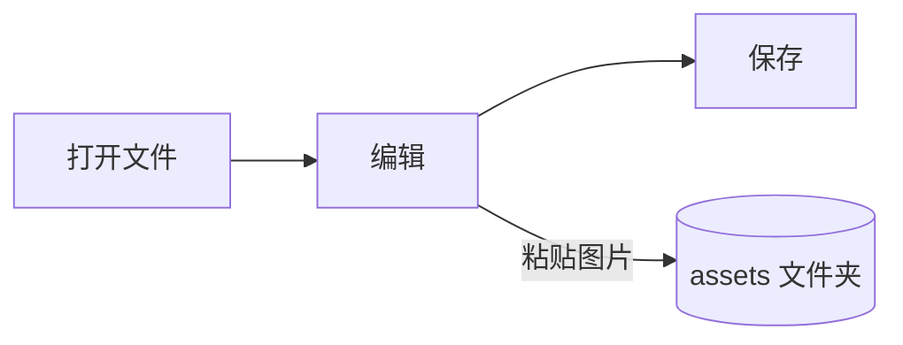

# Pupitre 指南


Pupitre 是一款桌面 Markdown 编辑器。文档就是普通的 `.md` 文件：所见内容就地渲染，光标所在处会显示 Markdown 语法。本指南同时也是编辑器渲染效果的示例，可以随意编辑，除非选择**另存为**，否则不会保存。

## 编辑

把光标移到**粗体文字**、`行内代码`或[链接](https://github.com/shalemore/pupitre)中，周围就会显示它的语法。这些标记的行为和文字一样：

- 删掉标记就能取消对应格式；在标题前增减 `#` 就能改变级别。
- 选中文字时会显示其中的语法，复制得到的就是 Markdown。
- <kbd>Ctrl</kbd>+点击可打开链接：网址在浏览器中打开，`#标题` 链接滚动到该标题，指向文档旁 Markdown 文件的链接会打开那个文件。
- 格式命令在**段落**菜单和**格式**菜单、右键菜单以及下面的快捷键中。

<details>
<summary>键盘快捷键（macOS 上 Ctrl 对应 ⌘）</summary>

| 操作                   | 快捷键                                                                                                       |
| :--------------------- | :----------------------------------------------------------------------------------------------------------- |
| 粗体 / 斜体 / 行内代码 | <kbd>Ctrl</kbd>+<kbd>B</kbd> / <kbd>I</kbd> / <kbd>Shift</kbd>+<kbd>`</kbd>                                  |
| 删除线                 | <kbd>Alt</kbd>+<kbd>Shift</kbd>+<kbd>5</kbd>                                                                 |
| 下划线                 | <kbd>Ctrl</kbd>+<kbd>U</kbd>                                                                                 |
| 清除格式               | <kbd>Ctrl</kbd>+<kbd>\\</kbd>                                                                                |
| 链接                   | <kbd>Ctrl</kbd>+<kbd>K</kbd>                                                                                 |
| 插入图片…              | <kbd>Ctrl</kbd>+<kbd>Shift</kbd>+<kbd>I</kbd>                                                                |
| 标题 1–6 / 正文        | <kbd>Ctrl</kbd>+<kbd>1</kbd>…<kbd>6</kbd> / <kbd>0</kbd>                                                     |
| 引用                   | <kbd>Ctrl</kbd>+<kbd>Shift</kbd>+<kbd>Q</kbd>                                                                |
| 有序 / 无序列表        | <kbd>Ctrl</kbd>+<kbd>Shift</kbd>+<kbd>[</kbd> / <kbd>]</kbd>                                                 |
| 代码块 / 公式块        | <kbd>Ctrl</kbd>+<kbd>Shift</kbd>+<kbd>K</kbd> / <kbd>M</kbd>                                                 |
| 表格                   | <kbd>Ctrl</kbd>+<kbd>T</kbd>                                                                                 |
| 查找 / 替换            | <kbd>Ctrl</kbd>+<kbd>F</kbd> / <kbd>Ctrl</kbd>+<kbd>H</kbd>（macOS：<kbd>⌘</kbd>+<kbd>⌥</kbd>+<kbd>F</kbd>） |
| 重新打开关闭的标签页   | <kbd>Ctrl</kbd>+<kbd>Shift</kbd>+<kbd>T</kbd>                                                                |
| 侧边栏                 | <kbd>Ctrl</kbd>+<kbd>Shift</kbd>+<kbd>L</kbd>                                                                |
| 源代码模式             | <kbd>Ctrl</kbd>+<kbd>/</kbd>                                                                                 |
| 专注模式 / 打字机模式  | <kbd>F8</kbd> / <kbd>F9</kbd>                                                                                |
| 重置缩放               | <kbd>Ctrl</kbd>+<kbd>Shift</kbd>+<kbd>R</kbd>                                                                |
| 偏好设置               | <kbd>Ctrl</kbd>+<kbd>,</kbd>                                                                                 |

</details>

## 写作模式

- **专注模式**会淡化正在编辑的段落以外的内容。
- **打字机模式**让正在输入的行始终保持在窗口中央，也可以在偏好设置 › 编辑器中将位置改为靠上或靠下。

两者都在**视图**菜单和偏好设置 › 编辑器中，可以同时开启。

## 窗口样式

偏好设置 › 外观 › 窗口样式可在**经典**和**沉浸式**之间切换。沉浸式下，文档位于窗口内的卡片中；开始输入或滚动后，标题栏和侧边栏会自动收起，指针移到窗口顶部或任一侧时再出现。固定侧边栏后，侧边栏会保持打开；拖动侧边栏的边缘可调整宽度。

## 文件和图片

- 除非在偏好设置 › Markdown 中另行设置，Pupitre 会保留所打开文件的换行符。格式命令插入什么写法，也在那里设置。
- 粘贴的图片保存在文档旁的文件夹中（默认 `assets`，见偏好设置 › Markdown）。尚未保存的文档会把图片放在内存里，第一次保存时再写入。
- 偏好设置 › 常规 › 默认 Markdown 应用可以让 Pupitre 从文件管理器打开 `.md` 文件。
- 偏好设置保存在 `settings.json` 中，偏好设置 › 关于可以显示它所在的文件夹。只写入与默认值不同的值，无法读取的字段会恢复默认值，不影响其他字段。
- 文件夹可以有自己的设置：打开文件夹后，偏好设置里会出现**全局**和**此文件夹**的切换。在**此文件夹**下做的修改保存在其中的 `.pupitre/settings.json`，在首次修改时才会创建，之后只要打开这个文件夹，它就会叠加在全局设置之上。在那里重置某项会回到全局的值。

## 主题

主题决定整个窗口和文档的样式。偏好设置 › 外观会列出各主题及其支持的配色方案，深色模式可单独选择另一个主题。

主题随应用一起发布：每个主题是 `src/renderer/themes/<name>/` 下带有 `index.css` 的文件夹，文件夹名就是主题名。主题用到的字体或图片放在同一文件夹里，用相对 `url()` 引用。

```css
:root {
  /* 这个主题支持的配色方案：浅色、深色或两者 */
  color-scheme: light dark;

  /* 默认正文字体；用户可以在偏好设置里覆盖 */
  --font-document: Georgia, serif;

  /* 整个窗口使用的设计令牌 */
  --ui-surface-1: oklch(0.99 0.01 90);
  --ui-brand: oklch(0.55 0.12 250);
}

@media (prefers-color-scheme: dark) {
  :root {
    --ui-surface-1: oklch(0.2 0.01 90);
  }
}

.md-document .md-h1 {
  font-size: 2em;
}
```

- 颜色通过 `--ui-*` 令牌（表面、文字、强调色）和代码用的 `--syntax-*` 设置。它们的默认值和完整列表见 `src/renderer/app.css` 和 `pupitre` 主题。
- 引用条应使用 `var(--alert-color, …)`，这样提示块才能保持各自的颜色。
- 正文字号、行高和内容宽度属于用户，始终优先；文档里的尺寸用 `em`，并使用 `padding-inline-start` 这样的逻辑属性，让从右到左的文字能够镜像。

## Markdown 参考

### 文本

**粗体**、_斜体_、~~删除线~~、`行内代码`、[链接](https://commonmark.org)、H~2~O、x^2^、==高亮==、:tada: 和 <kbd>Esc</kbd>。行内 HTML 是完整元素时会被渲染，否则显示为源码。只包含 `[TOC]` 的段落会变成文档的目录，列出文档中的标题。

> 一段引用。
>
> > 嵌套的引用。

> [!NOTE]
> GitHub 提示块：`[!NOTE]`、`[!TIP]`、`[!IMPORTANT]`、`[!WARNING]` 和 `[!CAUTION]`。

> [!WARNING]
> 标记必须位于引用的第一行。

### 列表

1. 有序
   - 嵌套的无序
   - [x] 任务可以勾选
   - [ ] 也可以取消勾选
2. 列表里可以放代码：

   ```sh
   npm run dev
   ```

### 表格

| 左对齐 |  居中  | 右对齐 |
| :----- | :----: | -----: |
| 单元格 | 单元格 |   1.00 |
| 更长的 |  文字  |  10.50 |

### 代码

```typescript
function countWords(text: string): number {
  const segmenter = new Intl.Segmenter(undefined, { granularity: "word" });
  return [...segmenter.segment(text)].filter((part) => part.isWordLike).length;
}
```

### 公式

行内 $e^{i\pi} + 1 = 0$ 与独立公式：

$$
\int_{-\infty}^{\infty} e^{-x^2} \, dx = \sqrt{\pi}
$$

化学方程式用 `\ce`：$\ce{2H2 + O2 -> 2H2O}$。

### 图表



### 脚注

带脚注的句子[^1]。

[^1]: 脚注会列在文档末尾。

<!-- 注释会保留在文件中，并显示为源码。 -->
