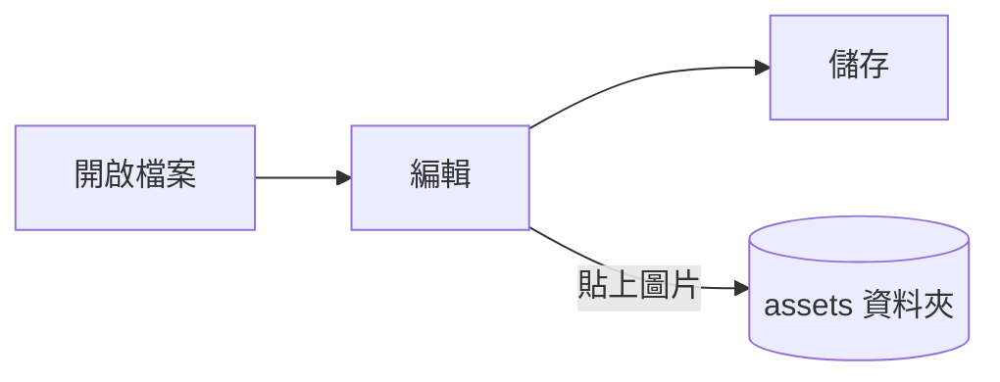

# Pupitre 指南


Pupitre 是一款桌面 Markdown 編輯器。文件就是一般的 `.md` 檔案：所見內容就地呈現，游標所在處會顯示 Markdown 語法。本指南同時也是編輯器呈現效果的範例，可以隨意編輯，除非選擇**另存新檔**，否則不會儲存。

## 編輯

將游標移到**粗體文字**、`行內程式碼`或[連結](https://github.com/shalemore/pupitre)中，周圍就會顯示它的語法。這些標記的行為和文字一樣：

- 刪掉標記就能取消對應格式；在標題前增減 `#` 就能改變層級。
- 選取文字時會顯示其中的語法，複製得到的就是 Markdown。
- <kbd>Ctrl</kbd>+按一下可開啟連結：網址會在瀏覽器中開啟，`#標題` 連結會捲動至該標題，指向文件旁 Markdown 檔案的連結則會開啟該檔案。
- 格式指令在**段落**選單和**格式**選單、右鍵選單以及下面的快速鍵中。

<details>
<summary>鍵盤快速鍵（macOS 上 Ctrl 對應 ⌘）</summary>

| 操作                     | 快速鍵                                                                                                       |
| :----------------------- | :----------------------------------------------------------------------------------------------------------- |
| 粗體 / 斜體 / 行內程式碼 | <kbd>Ctrl</kbd>+<kbd>B</kbd> / <kbd>I</kbd> / <kbd>Shift</kbd>+<kbd>`</kbd>                                  |
| 刪除線                   | <kbd>Alt</kbd>+<kbd>Shift</kbd>+<kbd>5</kbd>                                                                 |
| 底線                     | <kbd>Ctrl</kbd>+<kbd>U</kbd>                                                                                 |
| 清除格式                 | <kbd>Ctrl</kbd>+<kbd>\\</kbd>                                                                                |
| 連結                     | <kbd>Ctrl</kbd>+<kbd>K</kbd>                                                                                 |
| 插入圖片…                | <kbd>Ctrl</kbd>+<kbd>Shift</kbd>+<kbd>I</kbd>                                                                |
| 標題 1–6 / 內文          | <kbd>Ctrl</kbd>+<kbd>1</kbd>…<kbd>6</kbd> / <kbd>0</kbd>                                                     |
| 引用                     | <kbd>Ctrl</kbd>+<kbd>Shift</kbd>+<kbd>Q</kbd>                                                                |
| 編號 / 項目符號清單      | <kbd>Ctrl</kbd>+<kbd>Shift</kbd>+<kbd>[</kbd> / <kbd>]</kbd>                                                 |
| 程式碼區塊 / 公式區塊    | <kbd>Ctrl</kbd>+<kbd>Shift</kbd>+<kbd>K</kbd> / <kbd>M</kbd>                                                 |
| 表格                     | <kbd>Ctrl</kbd>+<kbd>T</kbd>                                                                                 |
| 尋找 / 取代              | <kbd>Ctrl</kbd>+<kbd>F</kbd> / <kbd>Ctrl</kbd>+<kbd>H</kbd>（macOS：<kbd>⌘</kbd>+<kbd>⌥</kbd>+<kbd>F</kbd>） |
| 重新開啟關閉的分頁       | <kbd>Ctrl</kbd>+<kbd>Shift</kbd>+<kbd>T</kbd>                                                                |
| 側邊欄                   | <kbd>Ctrl</kbd>+<kbd>Shift</kbd>+<kbd>L</kbd>                                                                |
| 原始碼模式               | <kbd>Ctrl</kbd>+<kbd>/</kbd>                                                                                 |
| 專注模式 / 打字機模式    | <kbd>F8</kbd> / <kbd>F9</kbd>                                                                                |
| 重設縮放                 | <kbd>Ctrl</kbd>+<kbd>Shift</kbd>+<kbd>0</kbd>                                                                |
| 偏好設定                 | <kbd>Ctrl</kbd>+<kbd>,</kbd>                                                                                 |

</details>

## 寫作模式

- **專注模式**會淡化正在編輯的段落以外的內容。
- **打字機模式**讓正在輸入的行始終保持在視窗中央，也可以在偏好設定 › 編輯器中改為靠上或靠下。

兩者都在**檢視**選單和偏好設定 › 編輯器中，可以同時開啟。

## 視窗樣式

偏好設定 › 外觀 › 視窗樣式可在**經典**和**沉浸式**之間切換。沉浸式下，文件位於視窗內的卡片中；開始輸入或捲動後，標題列和側邊欄會自動收起，指標移到視窗頂部或任一側時再出現。釘選側邊欄後，側邊欄會保持開啟；拖曳側邊欄的邊緣則可調整寬度。

## 檔案和圖片

- 除非在偏好設定 › Markdown 中另行設定，Pupitre 會保留所開啟檔案的換行字元。格式指令插入甚麼寫法，也在那裡設定。
- 貼上的圖片儲存在文件旁的資料夾中（預設 `assets`，見偏好設定 › Markdown）。尚未儲存的文件會把圖片放在記憶體裡，第一次儲存時再寫入。
- 偏好設定 › 一般 › 預設 Markdown 應用程式可以讓 Pupitre 從檔案管理員開啟 `.md` 檔案。
- 偏好設定儲存在 `settings.json` 中，偏好設定 › 關於可以顯示它所在的資料夾。只寫入與預設值不同的值，讀不出來的欄位會回到預設值，不影響其他欄位。
- 資料夾可以有自己的設定：開啟資料夾後，偏好設定會出現**全域**和**此資料夾**的切換。在**此資料夾**下所做的變更會存到其中的 `.pupitre/settings.json`，第一次變更時才會建立，之後只要開啟這個資料夾，就會疊加在全域設定之上。在那裡重設某項設定會還原為全域的值。

## 主題

主題決定整個視窗和文件的樣式。偏好設定 › 外觀會列出各主題及其支援的配色方案，深色模式可另外選擇一個主題。

主題隨應用程式一起發佈：每個主題是 `src/renderer/themes/<name>/` 下帶有 `index.css` 的資料夾，資料夾名稱就是主題名稱。主題用到的字體或圖片放在同一資料夾裡，以相對 `url()` 引用。

```css
:root {
  /* 這個主題支援的配色方案：淺色、深色或兩者 */
  color-scheme: light dark;

  /* 預設正文字體；使用者可以在偏好設定裡覆寫 */
  --font-document: Georgia, serif;

  /* 整個視窗使用的設計權杖 */
  --ui-surface-1: oklch(0.99 0.01 90);
  --ui-brand: oklch(0.55 0.12 250);
}

@media (prefers-color-scheme: dark) {
  :root {
    --ui-surface-1: oklch(0.2 0.01 90);
  }
}

.md-document .md-h1 {
  font-size: 2em;
}
```

- 顏色透過 `--ui-*` 權杖（表面、文字、強調色）和程式碼用的 `--syntax-*` 設定。它們的預設值和完整清單見 `src/renderer/app.css` 和 `pupitre` 主題。
- 引用條應使用 `var(--alert-color, …)`，這樣提示區塊才能保持各自的顏色。
- 內文字級、行高和內容寬度屬於使用者，始終優先；文件裡的尺寸用 `em`，並使用 `padding-inline-start` 這類邏輯屬性，讓由右至左的文字能夠鏡像。

## Markdown 參考

### 文字

**粗體**、_斜體_、~~刪除線~~、`行內程式碼`、[連結](https://commonmark.org)、H~2~O、x^2^、==醒目提示==、:tada: 和 <kbd>Esc</kbd>。行內 HTML 是完整元素時會被呈現，否則顯示為原始碼。只包含 `[TOC]` 的段落會變成文件的目錄，列出文件中的標題。

> 一段引用。
>
> > 巢狀的引用。

> [!NOTE]
> GitHub 提示區塊：`[!NOTE]`、`[!TIP]`、`[!IMPORTANT]`、`[!WARNING]` 和 `[!CAUTION]`。

> [!WARNING]
> 標記必須位於引用的第一行。

### 清單

1. 編號
   - 巢狀的項目符號
   - [x] 工作項目可以勾選
   - [ ] 也可以取消勾選
2. 清單裡可以放程式碼：

   ```sh
   npm run dev
   ```

### 表格

| 靠左   |  置中  |  靠右 |
| :----- | :----: | ----: |
| 儲存格 | 儲存格 |  1.00 |
| 較長的 |  文字  | 10.50 |

### 程式碼

```typescript
function countWords(text: string): number {
  const segmenter = new Intl.Segmenter(undefined, { granularity: "word" });
  return [...segmenter.segment(text)].filter((part) => part.isWordLike).length;
}
```

### 公式

行內 $e^{i\pi} + 1 = 0$ 與獨立公式：

$$
\int_{-\infty}^{\infty} e^{-x^2} \, dx = \sqrt{\pi}
$$

化學方程式使用 `\ce`：$\ce{2H2 + O2 -> 2H2O}$。

### 圖表



### 註腳

帶註腳的句子[^1]。

[^1]: 註腳會列在文件末尾。

<!-- 註解會保留在檔案中，並顯示為原始碼。 -->
