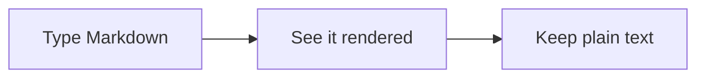

# Welcome to Pupitre

Pupitre is a desktop Markdown editor that **renders while you type**: the syntax under the cursor stays visible and editable, everything else reads like the finished page. This page is the real editor running in your browser. Try it right here; nothing you type leaves your computer.

> [!TIP]
> Start typing, then watch the title bar and the sidebars step aside. Scroll back to the top and push up a little more to bring them back, or move the pointer to the top or to a side edge of the window. Pin them with the pin button, or drag a sidebar's edge to resize it.

## What to try

- [x] **Immersive window.** Preferences › Appearance › Window Style switches to the classic one.
- [x] **Two sidebars.** The folder on one side, the outline of this document on the other.
- [ ] **Themes.** Pick another in Preferences › Appearance; each has a light and a dark side.
- [ ] **Focus and typewriter modes.** <kbd>F8</kbd> and <kbd>F9</kbd>, or the View menu.
- [ ] **Everything renders.** Open _Pupitre Guide_ in the folder for a tour of the syntax.

## A few things it renders

Inline math like $e^{i\pi} + 1 = 0$, chemistry like $\ce{2H2 + O2 -> 2H2O}$, ==highlights==, H~2~O, x^2^ and :tada: emoji. Tables are edited in place:

| Feature  | Where                  |
| :------- | :--------------------- |
| Diagrams | Mermaid, in your theme |
| Math     | MathJax                |
| Code     | 100+ languages         |

## About this demo

Files here live in memory and are gone when you close the tab; the real app works on your own files and folders, with a folder-level settings file. The demo leaves out font choice and automatic updates.

**Get Pupitre:** [download the app](https://github.com/shalemore/pupitre/releases), or on Windows run `scoop bucket add shalemore https://github.com/shalemore/scoop-bucket` and `scoop install pupitre`. The source is on [GitHub](https://github.com/shalemore/pupitre), and the licenses of the packages it is built from are [listed here](https://shalemore.github.io/pupitre/THIRD-PARTY-NOTICES.txt).
